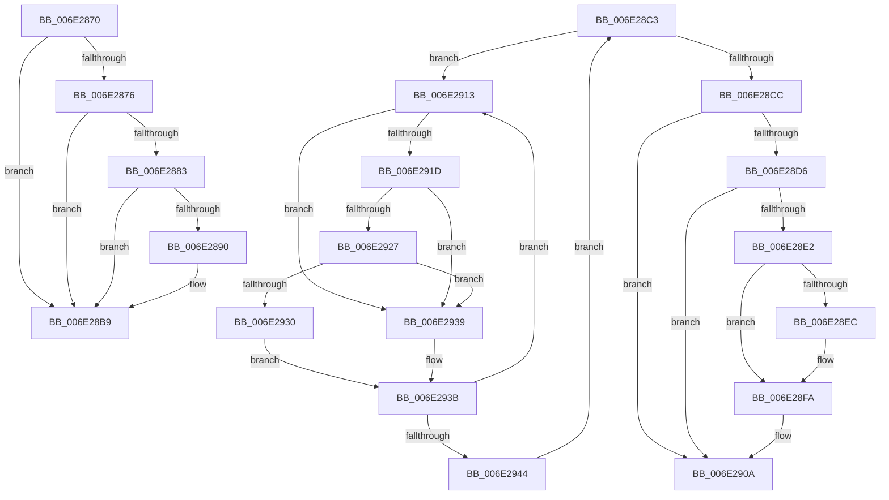

# sub_006E2870

- RVA: `0x006E2870`–`0x006E2949` (길이 `217` bytes)
- VA: `0x00000001406E2870`
- 실행 섹션: `.text`
- PDB 이름 있음: `아니요`; PDB Function 태그: `아니요`
- unwind 정보 RVA: `0x0007930C`
- 디코드: `55`개 명령, `217/217` bytes 표시
- 미해석 바이트: `0` (있으면 어셈블리에 `.byte`로 보존)

> 이 문서는 커널 이미지의 기계어와 PDB 기호를 분석해 생성했습니다. 4번과 5번은 함수 원형과 자료형을 바이너리 사용 방식에서 추정한 C 해석이며 원본 소스 복구 결과는 아닙니다.

## 1. Dependencies

- 직접 호출 지점: **6**; 고유 호출 대상: **6**
- 직접 호출자로 확인된 함수: **0**
- RIP 상대 이미지 참조: **4**

### Outgoing calls
- `0x006E2895` → [KiReleasePrcbLocksForIsolationUnit](../39/KiReleasePrcbLocksForIsolationUnit_function_00399C50.md) (function, `0x00399C50`)
- `0x006E289D` → [KiSendHeteroRescheduleIntRequest](../35/KiSendHeteroRescheduleIntRequest_function_00354120.md) (function, `0x00354120`)
- `0x006E28AC` → [KiAcquirePrcbLocksForIsolationUnit](../30/KiAcquirePrcbLocksForIsolationUnit_function_0030ED60.md) (function, `0x0030ED60`)
- `0x006E2902` → [KiUpdateVPBackingThreadPriority](../30/KiUpdateVPBackingThreadPriority_function_00306040.md) (function, `0x00306040`)
- `0x006E2927` → [KiCheckVpBackingLongSpinWaitHypercall](../30/KiCheckVpBackingLongSpinWaitHypercall_function_0030F490.md) (function, `0x0030F490`)
- `0x006E2932` → [HvlNotifyLongSpinWait](../30/HvlNotifyLongSpinWait_function_0030F460.md) (function, `0x0030F460`)

### Direct callers
- 이 함수 시작 RVA로 연결되는 직접 call은 확인되지 않았습니다. 간접 호출은 완전히 역산할 수 없습니다.

### Static image references
- `0x006E2876` → RVA `0x00FC6B78` (`ALMOSTRO`; read)
- `0x006E2883` → RVA `0x00FC6D04` (`ALMOSTRO`; read)
- `0x006E2915` → RVA `0x00FC52AC` (`ALMOSTRO`; reference)
- `0x006E291D` → RVA `0x00FC6AB8` (`ALMOSTRO`; read)

## 2. Other-region calls and transfers

- 다른 실행 섹션으로 향하는 call: **0**
- call이 아닌 외부 분기/꼬리 이동: **2**
  - `0x006E28BE` → [KiSwapThread + 0x174](../35/KiSwapThread_function_00355640.md) (`tail-transfer`)
  - `0x006E290E` → [KiSwapThread + 0x239](../35/KiSwapThread_function_00355640.md) (`tail-transfer`)

## 3. Assembly (complete function range)

```asm
006E2870  49 3B 6E 18                     cmp rbp, qword ptr [r14 + 0x18]
006E2874  75 43                           jne 0x1406e28b9
006E2876  44 39 3D FB 42 8E 00            cmp dword ptr [rip + 0x8e42fb], r15d
006E287D  49 8D 5E 18                     lea rbx, [r14 + 0x18]
006E2881  74 36                           je 0x1406e28b9
006E2883  44 39 3D 7A 44 8E 00            cmp dword ptr [rip + 0x8e447a], r15d
006E288A  49 8D 5E 18                     lea rbx, [r14 + 0x18]
006E288E  75 29                           jne 0x1406e28b9
006E2890  48 8D 4C 24 70                  lea rcx, [rsp + 0x70]
006E2895  E8 B6 73 CB FF                  call 0x140399c50
006E289A  49 8B CE                        mov rcx, r14
006E289D  E8 7E 18 C7 FF                  call 0x140354120
006E28A2  4C 8D 44 24 70                  lea r8, [rsp + 0x70]
006E28A7  33 D2                           xor edx, edx
006E28A9  49 8B CE                        mov rcx, r14
006E28AC  E8 AF C4 C2 FF                  call 0x14030ed60
006E28B1  49 8B 6E 10                     mov rbp, qword ptr [r14 + 0x10]
006E28B5  49 8D 5E 18                     lea rbx, [r14 + 0x18]
006E28B9  BF 01 00 00 00                  mov edi, 1
006E28BE  E9 F1 2E C7 FF                  jmp 0x1403557b4
006E28C3  F0 49 0F BA 6D 40 00            lock bts qword ptr [r13 + 0x40], 0
006E28CA  72 47                           jb 0x1406e2913
006E28CC  41 F7 45 78 00 00 40 00         test dword ptr [r13 + 0x78], 0x400000
006E28D4  74 34                           je 0x1406e290a
006E28D6  41 0F B6 85 84 01 00 00         movzx eax, byte ptr [r13 + 0x184]
006E28DE  3C 05                           cmp al, 5
006E28E0  75 28                           jne 0x1406e290a
006E28E2  41 F7 45 78 00 00 40 00         test dword ptr [r13 + 0x78], 0x400000
006E28EA  74 0E                           je 0x1406e28fa
006E28EC  49 8B 85 C8 03 00 00            mov rax, qword ptr [r13 + 0x3c8]
006E28F3  F0 81 08 00 00 04 00            lock or dword ptr [rax], 0x40000
006E28FA  45 33 C9                        xor r9d, r9d
006E28FD  33 D2                           xor edx, edx
006E28FF  49 8B CD                        mov rcx, r13
006E2902  E8 39 37 C2 FF                  call 0x140306040
006E2907  40 B7 01                        mov dil, 1
006E290A  4D 89 7D 40                     mov qword ptr [r13 + 0x40], r15
006E290E  E9 66 2F C7 FF                  jmp 0x140355879
006E2913  FF C6                           inc esi
006E2915  85 35 91 29 8E 00               test dword ptr [rip + 0x8e2991], esi
006E291B  75 1C                           jne 0x1406e2939
006E291D  8B 05 95 41 8E 00               mov eax, dword ptr [rip + 0x8e4195]
006E2923  A8 40                           test al, 0x40
006E2925  74 12                           je 0x1406e2939
006E2927  E8 64 CB C2 FF                  call 0x14030f490
006E292C  84 C0                           test al, al
006E292E  74 09                           je 0x1406e2939
006E2930  8B CE                           mov ecx, esi
006E2932  E8 29 CB C2 FF                  call 0x14030f460
006E2937  EB 02                           jmp 0x1406e293b
006E2939  F3 90                           pause
006E293B  49 8B 45 40                     mov rax, qword ptr [r13 + 0x40]
006E293F  48 85 C0                        test rax, rax
006E2942  75 CF                           jne 0x1406e2913
006E2944  E9 7A FF FF FF                  jmp 0x1406e28c3
```

## 4. C-style interpretation (structured pseudocode)

```c
__int64 __fastcall sub_006E2870(__int64 a1, int a2, __int64 a3, int a4, __int64 a5, __int64 a6, __int64 a7, __int64 a8, __int64 a9, __int64 a10, __int64 a11, __int64 a12, __int64 a13, __int64 a14)
{
    __int64 result;
    __int64 v_rbp;
    __int64 v_rbx;

    if (v_rbp != (*(unsigned __int64 *)(v_r14 + 24))) goto loc_006E28B9;
    if ((*(unsigned int *)(v_rip + 9323259)) == ((unsigned int)(v_r15))) goto loc_006E28B9;
    v_rbx = v_r14 + 24;
    if ((*(unsigned int *)(v_rip + 9323642)) == ((unsigned int)(v_r15))) {
        a1 = a14;
        result = KiReleasePrcbLocksForIsolationUnit(a1, a2, a3, a4);
        a1 = v_r14;
        result = KiSendHeteroRescheduleIntRequest(a1, a2, a3, a4);
        a3 = a14;
        a2 = 0;
        a1 = v_r14;
        result = KiAcquirePrcbLocksForIsolationUnit(a1, a2, a3, a4);
        v_rbp = *(unsigned __int64 *)(v_r14 + 16);
        v_rbx = v_r14 + 24;
    }
}
```

## 5. (Beta) C Style

```c
int64_t sub_006E2870(int64_t Arg1, int32_t Arg2, int64_t Arg3, int32_t Arg4, uint64_t Arg5, uint64_t Arg6, uint64_t Arg7, uint64_t Arg8, uint64_t Arg9, uint64_t Arg10, uint64_t Arg11, uint64_t Arg12, uint64_t Arg13, int64_t Arg14)
{
    int64_t result;
    int64_t local_rbp;
    int64_t local_rbx;

    if (local_rbp != (*(uint64_t *)(local_r14 + 0x18))) goto loc_006E28B9;
    if ((*(uint32_t *)(v_rip + 0x8E42FB)) == ((uint32_t)(local_r15))) goto loc_006E28B9;
    local_rbx = local_r14 + 24;
    if ((*(uint32_t *)(v_rip + 0x8E447A)) == ((uint32_t)(local_r15))) {
        Arg1 = Arg14;
        result = KiReleasePrcbLocksForIsolationUnit(Arg1, Arg2, Arg3, Arg4);
        Arg1 = local_r14;
        result = KiSendHeteroRescheduleIntRequest(Arg1, Arg2, Arg3, Arg4);
        Arg3 = Arg14;
        Arg2 = 0;
        Arg1 = local_r14;
        result = KiAcquirePrcbLocksForIsolationUnit(Arg1, Arg2, Arg3, Arg4);
        local_rbp = *(uint64_t *)(local_r14 + 0x10);
        local_rbx = local_r14 + 24;
    }
}
```

## 6. Execution-region graph

[열기: 2D/3D 그래프와 함수 탐색 컨트롤 패널](../../../control-panel.html?section=text&rva=0x006E2870&view=graph)

- 2D 그래프는 위에서 아래로 흐르고, 3D 그래프는 빈 공간을 드래그해 회전합니다. Shift+드래그는 이동, 휠은 확대·축소, 함수 노드 선택은 대상 보고서 이동입니다.

### Static fallback


