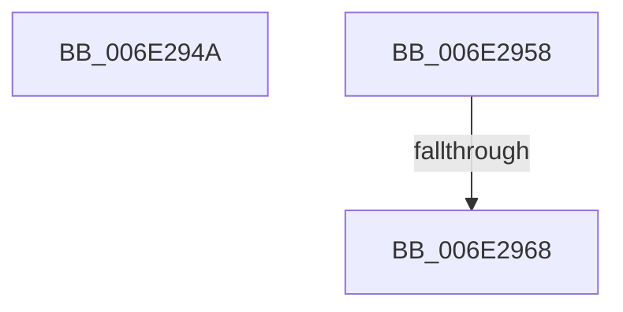

# sub_006E294A

- RVA: `0x006E294A`–`0x006E2974` (길이 `42` bytes)
- VA: `0x00000001406E294A`
- 실행 섹션: `.text`
- PDB 이름 있음: `아니요`; PDB Function 태그: `아니요`
- unwind 정보 RVA: `0x00079514`
- 디코드: `10`개 명령, `42/42` bytes 표시
- 미해석 바이트: `0` (있으면 어셈블리에 `.byte`로 보존)

> 이 문서는 커널 이미지의 기계어와 PDB 기호를 분석해 생성했습니다. 4번과 5번은 함수 원형과 자료형을 바이너리 사용 방식에서 추정한 C 해석이며 원본 소스 복구 결과는 아닙니다.

## 1. Dependencies

- 직접 호출 지점: **2**; 고유 호출 대상: **2**
- 직접 호출자로 확인된 함수: **0**
- RIP 상대 이미지 참조: **0**

### Outgoing calls
- `0x006E294D` → [CcPerfLogWorkItemEnqueue](../35/CcPerfLogWorkItemEnqueue_function_00357340.md) (function, `0x00357340`)
- `0x006E295B` → [CcIsWriteBehindThreadpoolAtLowPriority](../35/CcIsWriteBehindThreadpoolAtLowPriority_function_003570DC.md) (function, `0x003570DC`)

### Direct callers
- 이 함수 시작 RVA로 연결되는 직접 call은 확인되지 않았습니다. 간접 호출은 완전히 역산할 수 없습니다.

### Static image references
- 디코드된 RIP-relative 메모리 참조가 없습니다.

## 2. Other-region calls and transfers

- 다른 실행 섹션으로 향하는 call: **0**
- call이 아닌 외부 분기/꼬리 이동: **3**
  - `0x006E2953` → [CcPostWorkQueueRegular + 0x57](../35/CcPostWorkQueueRegular_function_00356834.md) (`tail-transfer`)
  - `0x006E2962` → [CcPostWorkQueueRegular + 0x78](../35/CcPostWorkQueueRegular_function_00356834.md) (`tail-transfer`)
  - `0x006E296F` → [CcPostWorkQueueRegular + 0x78](../35/CcPostWorkQueueRegular_function_00356834.md) (`tail-transfer`)

## 3. Assembly (complete function range)

```asm
006E294A  41 B1 01                        mov r9b, 1
006E294D  E8 EE 49 C7 FF                  call 0x140357340
006E2952  90                              nop
006E2953  E9 33 3F C7 FF                  jmp 0x14035688b
006E2958  48 8B CD                        mov rcx, rbp
006E295B  E8 7C 47 C7 FF                  call 0x1403570dc
006E2960  84 C0                           test al, al
006E2962  0F 85 44 3F C7 FF               jne 0x1403568ac
006E2968  C6 86 E0 00 00 00 01            mov byte ptr [rsi + 0xe0], 1
006E296F  E9 38 3F C7 FF                  jmp 0x1403568ac
```

## 4. C-style interpretation (structured pseudocode)

```c
__int64 __fastcall sub_006E294A(void)
{
    __int64 result;

    result = CcPerfLogWorkItemEnqueue(a1, a2, a3, 1);
}
```

## 5. (Beta) C Style

```c
void sub_006E294A(void)
{
    int64_t result;

    result = CcPerfLogWorkItemEnqueue(a1, a2, a3, 1);
}
```

## 6. Execution-region graph

[열기: 2D/3D 그래프와 함수 탐색 컨트롤 패널](../../../control-panel.html?section=text&rva=0x006E294A&view=graph)

- 2D 그래프는 위에서 아래로 흐르고, 3D 그래프는 빈 공간을 드래그해 회전합니다. Shift+드래그는 이동, 휠은 확대·축소, 함수 노드 선택은 대상 보고서 이동입니다.

### Static fallback


