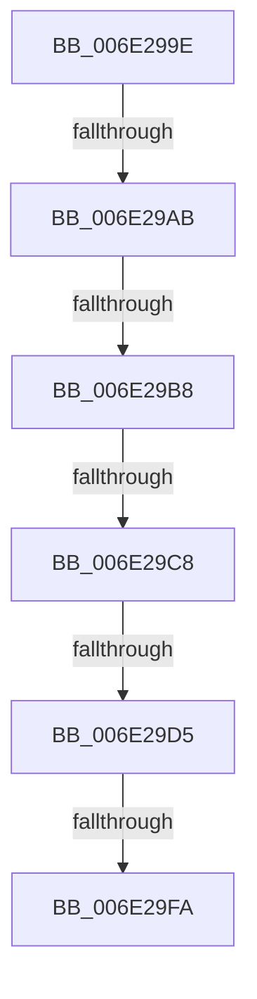

# sub_006E299E

- RVA: `0x006E299E`–`0x006E2A71` (길이 `211` bytes)
- VA: `0x00000001406E299E`
- 실행 섹션: `.text`
- PDB 이름 있음: `아니요`; PDB Function 태그: `아니요`
- unwind 정보 RVA: `0x000795A0`
- 디코드: `45`개 명령, `211/211` bytes 표시
- 미해석 바이트: `0` (있으면 어셈블리에 `.byte`로 보존)

> 이 문서는 커널 이미지의 기계어와 PDB 기호를 분석해 생성했습니다. 4번과 5번은 함수 원형과 자료형을 바이너리 사용 방식에서 추정한 C 해석이며 원본 소스 복구 결과는 아닙니다.

## 1. Dependencies

- 직접 호출 지점: **3**; 고유 호출 대상: **3**
- 직접 호출자로 확인된 함수: **0**
- RIP 상대 이미지 참조: **1**

### Outgoing calls
- `0x006E29E9` → [ExAllocatePoolWithTagFromNode](../35/ExAllocatePoolWithTagFromNode_function_0035A944.md) (function, `0x0035A944`)
- `0x006E2A50` → [ExQueueWorkItemToPartition](../35/ExQueueWorkItemToPartition_function_00356E2C.md) (function, `0x00356E2C`)
- `0x006E2A66` → [KeWaitForSingleObject](../20/KeWaitForSingleObject_function_0020E6B0.md) (function, `0x0020E6B0`)

### Direct callers
- 이 함수 시작 RVA로 연결되는 직접 call은 확인되지 않았습니다. 간접 호출은 완전히 역산할 수 없습니다.

### Static image references
- `0x006E2A32` → RVA `0x00357540` (`CcWriteBehindInternal`; read)

## 2. Other-region calls and transfers

- 다른 실행 섹션으로 향하는 call: **0**
- call이 아닌 외부 분기/꼬리 이동: **6**
  - `0x006E29A5` → [CcWriteBehind + 0x14D](../35/CcWriteBehind_function_00356EAC.md) (`tail-transfer`)
  - `0x006E29B2` → [CcWriteBehind + 0x14D](../35/CcWriteBehind_function_00356EAC.md) (`tail-transfer`)
  - `0x006E29C2` → [CcWriteBehind + 0x14D](../35/CcWriteBehind_function_00356EAC.md) (`tail-transfer`)
  - `0x006E29CF` → [CcWriteBehind + 0x14D](../35/CcWriteBehind_function_00356EAC.md) (`tail-transfer`)
  - `0x006E29F4` → [CcWriteBehind + 0x14D](../35/CcWriteBehind_function_00356EAC.md) (`tail-transfer`)
  - `0x006E2A6C` → [CcWriteBehind + 0x182](../35/CcWriteBehind_function_00356EAC.md) (`tail-transfer`)

## 3. Assembly (complete function range)

```asm
006E299E  4C 39 AB E8 04 00 00            cmp qword ptr [rbx + 0x4e8], r13
006E29A5  0F 85 4E 46 C7 FF               jne 0x140356ff9
006E29AB  44 39 AD 0C 02 00 00            cmp dword ptr [rbp + 0x20c], r13d
006E29B2  0F 85 41 46 C7 FF               jne 0x140356ff9
006E29B8  F7 85 98 00 00 00 00 00 01 00   test dword ptr [rbp + 0x98], 0x10000
006E29C2  0F 85 31 46 C7 FF               jne 0x140356ff9
006E29C8  44 38 AB 0E 05 00 00            cmp byte ptr [rbx + 0x50e], r13b
006E29CF  0F 85 24 46 C7 FF               jne 0x140356ff9
006E29D5  45 8B 4F 18                     mov r9d, dword ptr [r15 + 0x18]
006E29D9  BA 50 00 00 00                  mov edx, 0x50
006E29DE  41 0F BA E9 1F                  bts r9d, 0x1f
006E29E3  41 B8 43 63 57 71               mov r8d, 0x71576343
006E29E9  E8 56 7F C7 FF                  call 0x14035a944
006E29EE  48 8B F0                        mov rsi, rax
006E29F1  48 85 C0                        test rax, rax
006E29F4  0F 84 FF 45 C7 FF               je 0x140356ff9
006E29FA  48 89 58 38                     mov qword ptr [rax + 0x38], rbx
006E29FE  BA 26 00 00 00                  mov edx, 0x26
006E2A03  C7 40 20 01 00 00 00            mov dword ptr [rax + 0x20], 1
006E2A0A  48 8B CE                        mov rcx, rsi
006E2A0D  4C 89 60 40                     mov qword ptr [rax + 0x40], r12
006E2A11  4C 89 78 48                     mov qword ptr [rax + 0x48], r15
006E2A15  48 8D 47 28                     lea rax, [rdi + 0x28]
006E2A19  C6 47 38 01                     mov byte ptr [rdi + 0x38], 1
006E2A1D  66 C7 47 20 01 00               mov word ptr [rdi + 0x20], 1
006E2A23  C6 47 22 06                     mov byte ptr [rdi + 0x22], 6
006E2A27  44 89 6F 24                     mov dword ptr [rdi + 0x24], r13d
006E2A2B  48 89 40 08                     mov qword ptr [rax + 8], rax
006E2A2F  48 89 00                        mov qword ptr [rax], rax
006E2A32  48 8D 05 07 4B C7 FF            lea rax, [rip - 0x38b4f9]
006E2A39  48 89 46 10                     mov qword ptr [rsi + 0x10], rax
006E2A3D  48 89 7E 18                     mov qword ptr [rsi + 0x18], rdi
006E2A41  4C 89 2E                        mov qword ptr [rsi], r13
006E2A44  4C 8B 4E 38                     mov r9, qword ptr [rsi + 0x38]
006E2A48  45 8B 47 18                     mov r8d, dword ptr [r15 + 0x18]
006E2A4C  4D 8B 49 08                     mov r9, qword ptr [r9 + 8]
006E2A50  E8 D7 43 C7 FF                  call 0x140356e2c
006E2A55  45 33 C9                        xor r9d, r9d
006E2A58  4C 89 6C 24 20                  mov qword ptr [rsp + 0x20], r13
006E2A5D  45 33 C0                        xor r8d, r8d
006E2A60  48 8D 4F 20                     lea rcx, [rdi + 0x20]
006E2A64  33 D2                           xor edx, edx
006E2A66  E8 45 BC B2 FF                  call 0x14020e6b0
006E2A6B  90                              nop
006E2A6C  E9 BD 45 C7 FF                  jmp 0x14035702e
```

## 4. C-style interpretation (structured pseudocode)

```c
__int64 __fastcall sub_006E299E(void)
{
    __int64 result;
    unsigned __int64 v_stack_p20;

    result = ExAllocatePoolWithTagFromNode(a1, 80, (unsigned int)(0x71576343ULL), (unsigned int)(*(unsigned int *)(v_r15 + 24)));
    *(unsigned __int64 *)(result + 56) = v_rbx;
    *(unsigned int *)(result + 32) = 1;
    *(unsigned __int64 *)(result + 64) = v_r12;
    *(unsigned __int64 *)(result + 72) = v_r15;
    *(unsigned __int8 *)(v_rdi + 56) = 1;
    *(unsigned __int16 *)(v_rdi + 32) = 1;
    *(unsigned __int8 *)(v_rdi + 34) = 6;
    *(unsigned int *)(v_rdi + 36) = (unsigned int)(v_r13);
    *(unsigned __int64 *)(v_rdi + 40 + 8) = v_rdi + 40;
    *(unsigned __int64 *)(v_rdi + 40) = v_rdi + 40;
    *(unsigned __int64 *)(result + 16) = v_rip - 3716345;
    *(unsigned __int64 *)(result + 24) = v_rdi;
    *(unsigned __int64 *)(result) = v_r13;
    result = ExQueueWorkItemToPartition(result, 38, (unsigned int)(*(unsigned int *)(v_r15 + 24)), *(unsigned __int64 *)(*(unsigned __int64 *)(result + 56) + 8));
    a4 = 0;
    v_stack_p20 = v_r13;
    a3 = 0;
    a2 = 0;
    result = KeWaitForSingleObject(v_rdi + 32, a2, a3, a4);
}
```

## 5. (Beta) C Style

```c
void sub_006E299E(void)
{
    int64_t result;
    uint64_t v_stack_p20;

    result = ExAllocatePoolWithTagFromNode(a1, 80, (uint32_t)(0x71576343ULL), (uint32_t)(*(uint32_t *)(local_r15 + 0x18)));
    *(uint64_t *)(result + 0x38) = local_rbx;
    *(uint32_t *)(result + 0x20) = 1;
    *(uint64_t *)(result + 0x40) = local_r12;
    *(uint64_t *)(result + 0x48) = local_r15;
    *(uint8_t *)(local_rdi + 0x38) = 1;
    *(uint16_t *)(local_rdi + 0x20) = 1;
    *(uint8_t *)(local_rdi + 0x22) = 6;
    *(uint32_t *)(local_rdi + 0x24) = (uint32_t)(local_r13);
    *(uint64_t *)(local_rdi + 0x28 + 0x8) = local_rdi + 40;
    *(uint64_t *)(local_rdi + 0x28) = local_rdi + 40;
    *(uint64_t *)(result + 0x10) = v_rip - 3716345;
    *(uint64_t *)(result + 0x18) = local_rdi;
    *(uint64_t *)(result) = local_r13;
    result = ExQueueWorkItemToPartition(result, 38, (uint32_t)(*(uint32_t *)(local_r15 + 0x18)), *(uint64_t *)(*(uint64_t *)(result + 0x38) + 0x8));
    a4 = 0;
    v_stack_p20 = local_r13;
    a3 = 0;
    a2 = 0;
    result = KeWaitForSingleObject(local_rdi + 32, a2, a3, a4);
}
```

## 6. Execution-region graph

[열기: 2D/3D 그래프와 함수 탐색 컨트롤 패널](../../../control-panel.html?section=text&rva=0x006E299E&view=graph)

- 2D 그래프는 위에서 아래로 흐르고, 3D 그래프는 빈 공간을 드래그해 회전합니다. Shift+드래그는 이동, 휠은 확대·축소, 함수 노드 선택은 대상 보고서 이동입니다.

### Static fallback


