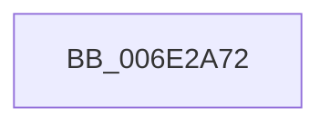

# sub_006E2A72

- RVA: `0x006E2A72`–`0x006E2A9E` (길이 `44` bytes)
- VA: `0x00000001406E2A72`
- 실행 섹션: `.text`
- PDB 이름 있음: `아니요`; PDB Function 태그: `아니요`
- unwind 정보 RVA: `0x00079608`
- 디코드: `11`개 명령, `44/44` bytes 표시
- 미해석 바이트: `0` (있으면 어셈블리에 `.byte`로 보존)

> 이 문서는 커널 이미지의 기계어와 PDB 기호를 분석해 생성했습니다. 4번과 5번은 함수 원형과 자료형을 바이너리 사용 방식에서 추정한 C 해석이며 원본 소스 복구 결과는 아닙니다.

## 1. Dependencies

- 직접 호출 지점: **2**; 고유 호출 대상: **2**
- 직접 호출자로 확인된 함수: **0**
- RIP 상대 이미지 참조: **0**

### Outgoing calls
- `0x006E2A79` → [CcReferenceSharedCacheMapFileObject](../23/CcReferenceSharedCacheMapFileObject_function_002379BC.md) (function, `0x002379BC`)
- `0x006E2A93` → [ObFastDereferenceObjectDeferDelete](../23/ObFastDereferenceObjectDeferDelete_function_002378C0.md) (function, `0x002378C0`)

### Direct callers
- 이 함수 시작 RVA로 연결되는 직접 call은 확인되지 않았습니다. 간접 호출은 완전히 역산할 수 없습니다.

### Static image references
- 디코드된 RIP-relative 메모리 참조가 없습니다.

## 2. Other-region calls and transfers

- 다른 실행 섹션으로 향하는 call: **0**
- call이 아닌 외부 분기/꼬리 이동: **1**
  - `0x006E2A99` → [CcPerfLogWorkItemEnqueue + 0x96](../35/CcPerfLogWorkItemEnqueue_function_00357340.md) (`tail-transfer`)

## 3. Assembly (complete function range)

```asm
006E2A72  48 8B 77 18                     mov rsi, qword ptr [rdi + 0x18]
006E2A76  48 8B CE                        mov rcx, rsi
006E2A79  E8 3E 4F B5 FF                  call 0x1402379bc
006E2A7E  41 B8 43 63 53 63               mov r8d, 0x63536343
006E2A84  48 8B D0                        mov rdx, rax
006E2A87  48 8B 48 18                     mov rcx, qword ptr [rax + 0x18]
006E2A8B  48 89 4D D8                     mov qword ptr [rbp - 0x28], rcx
006E2A8F  48 8D 4E 60                     lea rcx, [rsi + 0x60]
006E2A93  E8 28 4E B5 FF                  call 0x1402378c0
006E2A98  90                              nop
006E2A99  E9 38 49 C7 FF                  jmp 0x1403573d6
```

## 4. C-style interpretation (structured pseudocode)

```c
__int64 __fastcall sub_006E2A72(void)
{
    __int64 result;

    result = CcReferenceSharedCacheMapFileObject(*(unsigned __int64 *)(v_rdi + 24), a2, a3, a4);
    *(unsigned __int64 *)(v_rbp - 40) = *(unsigned __int64 *)(result + 24);
    result = ObFastDereferenceObjectDeferDelete(*(unsigned __int64 *)(v_rdi + 24) + 96, result, (unsigned int)(0x63536343ULL), a4);
}
```

## 5. (Beta) C Style

```c
void sub_006E2A72(void)
{
    int64_t result;

    result = CcReferenceSharedCacheMapFileObject(*(uint64_t *)(local_rdi + 0x18), a2, a3, a4);
    *(uint64_t *)(local_rbp - 0x28) = *(uint64_t *)(result + 0x18);
    result = ObFastDereferenceObjectDeferDelete(*(uint64_t *)(local_rdi + 0x18) + 96, result, (uint32_t)(0x63536343ULL), a4);
}
```

## 6. Execution-region graph

[열기: 2D/3D 그래프와 함수 탐색 컨트롤 패널](../../../control-panel.html?section=text&rva=0x006E2A72&view=graph)

- 2D 그래프는 위에서 아래로 흐르고, 3D 그래프는 빈 공간을 드래그해 회전합니다. Shift+드래그는 이동, 휠은 확대·축소, 함수 노드 선택은 대상 보고서 이동입니다.

### Static fallback


