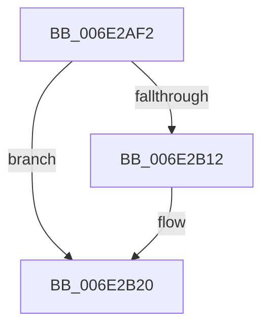

# sub_006E2AF2

- RVA: `0x006E2AF2`–`0x006E2B2A` (길이 `56` bytes)
- VA: `0x00000001406E2AF2`
- 실행 섹션: `.text`
- PDB 이름 있음: `아니요`; PDB Function 태그: `아니요`
- unwind 정보 RVA: `0x00079668`
- 디코드: `14`개 명령, `56/56` bytes 표시
- 미해석 바이트: `0` (있으면 어셈블리에 `.byte`로 보존)

> 이 문서는 커널 이미지의 기계어와 PDB 기호를 분석해 생성했습니다. 4번과 5번은 함수 원형과 자료형을 바이너리 사용 방식에서 추정한 C 해석이며 원본 소스 복구 결과는 아닙니다.

## 1. Dependencies

- 직접 호출 지점: **3**; 고유 호출 대상: **3**
- 직접 호출자로 확인된 함수: **0**
- RIP 상대 이미지 참조: **0**

### Outgoing calls
- `0x006E2AF5` → [CcDecrementOpenCount](../38/CcDecrementOpenCount_function_0038B75C.md) (function, `0x0038B75C`)
- `0x006E2AFE` → [KeReleaseInStackQueuedSpinLock](../34/KeReleaseInStackQueuedSpinLock_function_00342CE0.md) (function, `0x00342CE0`)
- `0x006E2B1B` → [KeSetEvent](../33/KeSetEvent_function_0033F310.md) (function, `0x0033F310`)

### Direct callers
- 이 함수 시작 RVA로 연결되는 직접 call은 확인되지 않았습니다. 간접 호출은 완전히 역산할 수 없습니다.

### Static image references
- 디코드된 RIP-relative 메모리 참조가 없습니다.

## 2. Other-region calls and transfers

- 다른 실행 섹션으로 향하는 call: **0**
- call이 아닌 외부 분기/꼬리 이동: **1**
  - `0x006E2B25` → [CcWriteBehindPreProcess + 0x31D](../35/CcWriteBehindPreProcess_function_00357784.md) (`tail-transfer`)

## 3. Assembly (complete function range)

```asm
006E2AF2  48 8B CF                        mov rcx, rdi
006E2AF5  E8 62 8C CA FF                  call 0x14038b75c
006E2AFA  48 8D 4D D0                     lea rcx, [rbp - 0x30]
006E2AFE  E8 DD 01 C6 FF                  call 0x140342ce0
006E2B03  48 8B 45 30                     mov rax, qword ptr [rbp + 0x30]
006E2B07  C7 00 54 00 00 C0               mov dword ptr [rax], 0xc0000054
006E2B0D  45 84 ED                        test r13b, r13b
006E2B10  74 0E                           je 0x1406e2b20
006E2B12  49 8D 4E 20                     lea rcx, [r14 + 0x20]
006E2B16  45 33 C0                        xor r8d, r8d
006E2B19  33 D2                           xor edx, edx
006E2B1B  E8 F0 C7 C5 FF                  call 0x14033f310
006E2B20  B8 01 00 00 00                  mov eax, 1
006E2B25  E9 77 4F C7 FF                  jmp 0x140357aa1
```

## 4. C-style interpretation (structured pseudocode)

```c
__int64 __fastcall sub_006E2AF2(__int64 a1, int a2, int a3)
{
    __int64 result;

    result = CcDecrementOpenCount(v_rdi, a2, a3, a4);
    result = KeReleaseInStackQueuedSpinLock(v_rbp - 48, a2, a3, a4);
    *(unsigned int *)(*(unsigned __int64 *)(v_rbp + 48)) = 0xC0000054ULL;
    result = *(unsigned __int64 *)(v_rbp + 48);
    if ((unsigned __int8)(v_r13) != 0) {
        a1 = v_r14 + 32;
        a3 = 0;
        a2 = 0;
        result = KeSetEvent(a1, a2, a3, a4);
    }
}
```

## 5. (Beta) C Style

```c
int64_t sub_006E2AF2(int64_t Arg1, int32_t Arg2, int32_t Arg3)
{
    int64_t result;

    result = CcDecrementOpenCount(local_rdi, Arg2, Arg3, a4);
    result = KeReleaseInStackQueuedSpinLock(local_rbp - 48, Arg2, Arg3, a4);
    *(uint32_t *)(*(uint64_t *)(local_rbp + 0x30)) = 0xC0000054ULL;
    result = *(uint64_t *)(local_rbp + 0x30);
    if ((uint8_t)(local_r13) != 0) {
        Arg1 = local_r14 + 32;
        Arg3 = 0;
        Arg2 = 0;
        result = KeSetEvent(Arg1, Arg2, Arg3, a4);
    }
}
```

## 6. Execution-region graph

[열기: 2D/3D 그래프와 함수 탐색 컨트롤 패널](../../../control-panel.html?section=text&rva=0x006E2AF2&view=graph)

- 2D 그래프는 위에서 아래로 흐르고, 3D 그래프는 빈 공간을 드래그해 회전합니다. Shift+드래그는 이동, 휠은 확대·축소, 함수 노드 선택은 대상 보고서 이동입니다.

### Static fallback


