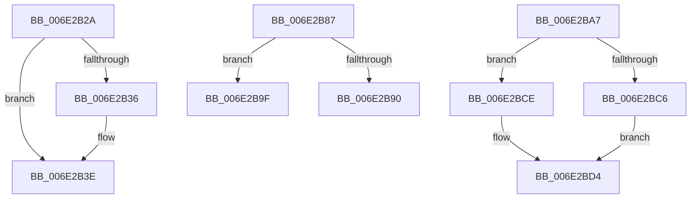

# sub_006E2B2A

- RVA: `0x006E2B2A`–`0x006E2BDF` (길이 `181` bytes)
- VA: `0x00000001406E2B2A`
- 실행 섹션: `.text`
- PDB 이름 있음: `아니요`; PDB Function 태그: `아니요`
- unwind 정보 RVA: `0x00079694`
- 디코드: `44`개 명령, `181/181` bytes 표시
- 미해석 바이트: `0` (있으면 어셈블리에 `.byte`로 보존)

> 이 문서는 커널 이미지의 기계어와 PDB 기호를 분석해 생성했습니다. 4번과 5번은 함수 원형과 자료형을 바이너리 사용 방식에서 추정한 C 해석이며 원본 소스 복구 결과는 아닙니다.

## 1. Dependencies

- 직접 호출 지점: **8**; 고유 호출 대상: **7**
- 직접 호출자로 확인된 함수: **0**
- RIP 상대 이미지 참조: **0**

### Outgoing calls
- `0x006E2B39` → [CcCancelMmWaitForUninitializeCacheMap](../4F/CcCancelMmWaitForUninitializeCacheMap_function_004F998C.md) (function, `0x004F998C`)
- `0x006E2B42` → [KeReleaseInStackQueuedSpinLock](../34/KeReleaseInStackQueuedSpinLock_function_00342CE0.md) (function, `0x00342CE0`)
- `0x006E2B4B` → [KeReleaseInStackQueuedSpinLock](../34/KeReleaseInStackQueuedSpinLock_function_00342CE0.md) (function, `0x00342CE0`)
- `0x006E2B53` → [FsRtlReleaseFile](../../page/98/FsRtlReleaseFile_function_00985B70.md) (function, `0x00985B70`)
- `0x006E2B65` → [ObFastDereferenceObjectDeferDelete](../23/ObFastDereferenceObjectDeferDelete_function_002378C0.md) (function, `0x002378C0`)
- `0x006E2B75` → [KeAcquireInStackQueuedSpinLock](../27/KeAcquireInStackQueuedSpinLock_function_002757A0.md) (function, `0x002757A0`)
- `0x006E2B93` → [CcInsertIntoDirtySharedCacheMapList](../3C/CcInsertIntoDirtySharedCacheMapList_function_003CD9D8.md) (function, `0x003CD9D8`)
- `0x006E2BD4` → [CcScheduleLazyWriteScan](../3C/CcScheduleLazyWriteScan_function_003CBD20.md) (function, `0x003CBD20`)

### Direct callers
- 이 함수 시작 RVA로 연결되는 직접 call은 확인되지 않았습니다. 간접 호출은 완전히 역산할 수 없습니다.

### Static image references
- 디코드된 RIP-relative 메모리 참조가 없습니다.

## 2. Other-region calls and transfers

- 다른 실행 섹션으로 향하는 call: **1**
  - `0x006E2B53` → [FsRtlReleaseFile](../../page/98/FsRtlReleaseFile_function_00985B70.md) (`.text` → `PAGE`)
- call이 아닌 외부 분기/꼬리 이동: **4**
  - `0x006E2B82` → [CcWriteBehindPostProcess + 0x1BC](../35/CcWriteBehindPostProcess_function_00357BB4.md) (`tail-transfer`)
  - `0x006E2B9A` → [CcWriteBehindPostProcess + 0x1BC](../35/CcWriteBehindPostProcess_function_00357BB4.md) (`tail-transfer`)
  - `0x006E2BA2` → [CcWriteBehindPostProcess + 0x1BC](../35/CcWriteBehindPostProcess_function_00357BB4.md) (`tail-transfer`)
  - `0x006E2BDA` → [CcWriteBehindPostProcess + 0x1E1](../35/CcWriteBehindPostProcess_function_00357BB4.md) (`tail-transfer`)

## 3. Assembly (complete function range)

```asm
006E2B2A  F7 87 98 00 00 00 00 00 01 00   test dword ptr [rdi + 0x98], 0x10000
006E2B34  74 08                           je 0x1406e2b3e
006E2B36  48 8B CF                        mov rcx, rdi
006E2B39  E8 4E 6E E1 FF                  call 0x1404f998c
006E2B3E  48 8D 4D C8                     lea rcx, [rbp - 0x38]
006E2B42  E8 99 01 C6 FF                  call 0x140342ce0
006E2B47  48 8D 4D E0                     lea rcx, [rbp - 0x20]
006E2B4B  E8 90 01 C6 FF                  call 0x140342ce0
006E2B50  48 8B CB                        mov rcx, rbx
006E2B53  E8 18 30 2A 00                  call 0x140985b70
006E2B58  48 8D 4F 60                     lea rcx, [rdi + 0x60]
006E2B5C  41 B8 43 63 53 63               mov r8d, 0x63536343
006E2B62  48 8B D3                        mov rdx, rbx
006E2B65  E8 56 4D B5 FF                  call 0x1402378c0
006E2B6A  49 8D 8D 00 03 00 00            lea rcx, [r13 + 0x300]
006E2B71  48 8D 55 C8                     lea rdx, [rbp - 0x38]
006E2B75  E8 26 2C B9 FF                  call 0x1402757a0
006E2B7A  8A 4D 50                        mov cl, byte ptr [rbp + 0x50]
006E2B7D  BB 00 00 01 00                  mov ebx, 0x10000
006E2B82  E9 E9 51 C7 FF                  jmp 0x140357d70
006E2B87  45 33 F6                        xor r14d, r14d
006E2B8A  44 39 77 70                     cmp dword ptr [rdi + 0x70], r14d
006E2B8E  75 0F                           jne 0x1406e2b9f
006E2B90  48 8B CF                        mov rcx, rdi
006E2B93  E8 40 AE CE FF                  call 0x1403cd9d8
006E2B98  B1 01                           mov cl, 1
006E2B9A  E9 D1 51 C7 FF                  jmp 0x140357d70
006E2B9F  41 8A CE                        mov cl, r14b
006E2BA2  E9 C9 51 C7 FF                  jmp 0x140357d70
006E2BA7  48 8B 87 18 02 00 00            mov rax, qword ptr [rdi + 0x218]
006E2BAE  48 05 1A 04 00 00               add rax, 0x41a
006E2BB4  48 8B 55 60                     mov rdx, qword ptr [rbp + 0x60]
006E2BB8  49 8B CD                        mov rcx, r13
006E2BBB  C6 00 01                        mov byte ptr [rax], 1
006E2BBE  85 9F 98 00 00 00               test dword ptr [rdi + 0x98], ebx
006E2BC4  74 08                           je 0x1406e2bce
006E2BC6  41 B1 01                        mov r9b, 1
006E2BC9  45 8A C1                        mov r8b, r9b
006E2BCC  EB 06                           jmp 0x1406e2bd4
006E2BCE  45 33 C9                        xor r9d, r9d
006E2BD1  45 33 C0                        xor r8d, r8d
006E2BD4  E8 47 91 CE FF                  call 0x1403cbd20
006E2BD9  90                              nop
006E2BDA  E9 B6 51 C7 FF                  jmp 0x140357d95
```

## 4. C-style interpretation (structured pseudocode)

```c
__int64 __fastcall sub_006E2B2A(void)
{
    __int64 result;

    if (((*(unsigned int *)(v_rdi + 152)) & (0x10000ULL)) != 0) {
        a1 = v_rdi;
        result = CcCancelMmWaitForUninitializeCacheMap(a1, a2, a3, a4);
    }
    result = KeReleaseInStackQueuedSpinLock(v_rbp - 56, a2, a3, a4);
    result = KeReleaseInStackQueuedSpinLock(v_rbp - 32, a2, a3, a4);
    result = FsRtlReleaseFile(v_rbx, a2, a3, a4);
    result = ObFastDereferenceObjectDeferDelete(v_rdi + 96, v_rbx, (unsigned int)(0x63536343ULL), a4);
    result = KeAcquireInStackQueuedSpinLock(v_r13 + 768, v_rbp - 56, (unsigned int)(0x63536343ULL), a4);
}
```

## 5. (Beta) C Style

```c
void sub_006E2B2A(void)
{
    int64_t result;

    if (((*(uint32_t *)(local_rdi + 0x98)) & (0x10000ULL)) != 0) {
        a1 = local_rdi;
        result = CcCancelMmWaitForUninitializeCacheMap(a1, a2, a3, a4);
    }
    result = KeReleaseInStackQueuedSpinLock(local_rbp - 56, a2, a3, a4);
    result = KeReleaseInStackQueuedSpinLock(local_rbp - 32, a2, a3, a4);
    result = FsRtlReleaseFile(local_rbx, a2, a3, a4);
    result = ObFastDereferenceObjectDeferDelete(local_rdi + 96, local_rbx, (uint32_t)(0x63536343ULL), a4);
    result = KeAcquireInStackQueuedSpinLock(local_r13 + 768, local_rbp - 56, (uint32_t)(0x63536343ULL), a4);
}
```

## 6. Execution-region graph

[열기: 2D/3D 그래프와 함수 탐색 컨트롤 패널](../../../control-panel.html?section=text&rva=0x006E2B2A&view=graph)

- 2D 그래프는 위에서 아래로 흐르고, 3D 그래프는 빈 공간을 드래그해 회전합니다. Shift+드래그는 이동, 휠은 확대·축소, 함수 노드 선택은 대상 보고서 이동입니다.

### Static fallback


