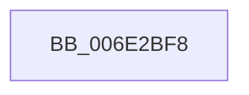

# sub_006E2BF8

- RVA: `0x006E2BF8`–`0x006E2C20` (길이 `40` bytes)
- VA: `0x00000001406E2BF8`
- 실행 섹션: `.text`
- PDB 이름 있음: `아니요`; PDB Function 태그: `아니요`
- unwind 정보 RVA: `0x000798B8`
- 디코드: `10`개 명령, `40/40` bytes 표시
- 미해석 바이트: `0` (있으면 어셈블리에 `.byte`로 보존)

> 이 문서는 커널 이미지의 기계어와 PDB 기호를 분석해 생성했습니다. 4번과 5번은 함수 원형과 자료형을 바이너리 사용 방식에서 추정한 C 해석이며 원본 소스 복구 결과는 아닙니다.

## 1. Dependencies

- 직접 호출 지점: **2**; 고유 호출 대상: **2**
- 직접 호출자로 확인된 함수: **0**
- RIP 상대 이미지 참조: **1**

### Outgoing calls
- `0x006E2C09` → [guard_dispatch_icall](../6B/guard_dispatch_icall_function_006BAAD0.md) (function, `0x006BAAD0`)
- `0x006E2C15` → [ExAcquireSpinLockSharedAtDpcLevel](../24/ExAcquireSpinLockSharedAtDpcLevel_function_00248E30.md) (function, `0x00248E30`)

### Direct callers
- 이 함수 시작 RVA로 연결되는 직접 call은 확인되지 않았습니다. 간접 호출은 완전히 역산할 수 없습니다.

### Static image references
- `0x006E2C0E` → RVA `0x00E67B48` (`.data`; read)

## 2. Other-region calls and transfers

- 다른 실행 섹션으로 향하는 call: **0**
- call이 아닌 외부 분기/꼬리 이동: **1**
  - `0x006E2C1B` → [vDbgPrintExWithPrefixInternalHelper + 0x2E4](../35/vDbgPrintExWithPrefixInternalHelper_function_003593C0.md) (`tail-transfer`)

## 3. Assembly (complete function range)

```asm
006E2BF8  48 8D 7E E8                     lea rdi, [rsi - 0x18]
006E2BFC  45 8B C5                        mov r8d, r13d
006E2BFF  41 8B D4                        mov edx, r12d
006E2C02  48 8D 4D 10                     lea rcx, [rbp + 0x10]
006E2C06  49 8B C7                        mov rax, r15
006E2C09  E8 C2 7E FD FF                  call 0x1406baad0
006E2C0E  48 8D 0D 33 4F 78 00            lea rcx, [rip + 0x784f33]
006E2C15  E8 16 62 B6 FF                  call 0x140248e30
006E2C1A  90                              nop
006E2C1B  E9 84 6A C7 FF                  jmp 0x1403596a4
```

## 4. C-style interpretation (structured pseudocode)

```c
__int64 __fastcall sub_006E2BF8(void)
{
    __int64 result;

    result = guard_dispatch_icall(v_rbp + 16, (unsigned int)((unsigned int)(v_r12)), (unsigned int)((unsigned int)(v_r13)), a4);
    result = ExAcquireSpinLockSharedAtDpcLevel(v_rip + 7884595, (unsigned int)((unsigned int)(v_r12)), (unsigned int)((unsigned int)(v_r13)), a4);
}
```

## 5. (Beta) C Style

```c
void sub_006E2BF8(void)
{
    int64_t result;

    result = guard_dispatch_icall(local_rbp + 16, (uint32_t)((uint32_t)(local_r12)), (uint32_t)((uint32_t)(local_r13)), a4);
    result = ExAcquireSpinLockSharedAtDpcLevel(v_rip + 7884595, (uint32_t)((uint32_t)(local_r12)), (uint32_t)((uint32_t)(local_r13)), a4);
}
```

## 6. Execution-region graph

[열기: 2D/3D 그래프와 함수 탐색 컨트롤 패널](../../../control-panel.html?section=text&rva=0x006E2BF8&view=graph)

- 2D 그래프는 위에서 아래로 흐르고, 3D 그래프는 빈 공간을 드래그해 회전합니다. Shift+드래그는 이동, 휠은 확대·축소, 함수 노드 선택은 대상 보고서 이동입니다.

### Static fallback


