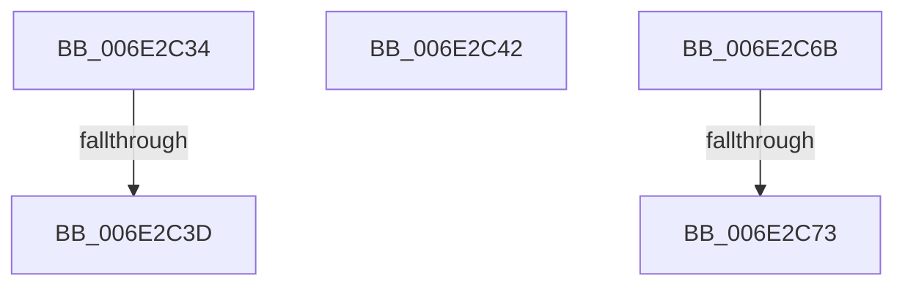

# sub_006E2C34

- RVA: `0x006E2C34`–`0x006E2C7B` (길이 `71` bytes)
- VA: `0x00000001406E2C34`
- 실행 섹션: `.text`
- PDB 이름 있음: `아니요`; PDB Function 태그: `아니요`
- unwind 정보 RVA: `0x00079A9C`
- 디코드: `15`개 명령, `71/71` bytes 표시
- 미해석 바이트: `0` (있으면 어셈블리에 `.byte`로 보존)

> 이 문서는 커널 이미지의 기계어와 PDB 기호를 분석해 생성했습니다. 4번과 5번은 함수 원형과 자료형을 바이너리 사용 방식에서 추정한 C 해석이며 원본 소스 복구 결과는 아닙니다.

## 1. Dependencies

- 직접 호출 지점: **3**; 고유 호출 대상: **3**
- 직접 호출자로 확인된 함수: **0**
- RIP 상대 이미지 참조: **0**

### Outgoing calls
- `0x006E2C4C` → [KeReleaseInStackQueuedSpinLockFromDpcLevel](../21/KeReleaseInStackQueuedSpinLockFromDpcLevel_function_002171B0.md) (function, `0x002171B0`)
- `0x006E2C55` → [KeReleaseInStackQueuedSpinLock](../34/KeReleaseInStackQueuedSpinLock_function_00342CE0.md) (function, `0x00342CE0`)
- `0x006E2C5A` → [KeRcuReadUnlock](../38/KeRcuReadUnlock_function_0038A070.md) (function, `0x0038A070`)

### Direct callers
- 이 함수 시작 RVA로 연결되는 직접 call은 확인되지 않았습니다. 간접 호출은 완전히 역산할 수 없습니다.

### Static image references
- 디코드된 RIP-relative 메모리 참조가 없습니다.

## 2. Other-region calls and transfers

- 다른 실행 섹션으로 향하는 call: **0**
- call이 아닌 외부 분기/꼬리 이동: **5**
  - `0x006E2C37` → [CcFlushCachePreProcess + 0x187](../35/CcFlushCachePreProcess_function_0035A9B0.md) (`tail-transfer`)
  - `0x006E2C3D` → [CcFlushCachePreProcess + 0x17E](../35/CcFlushCachePreProcess_function_0035A9B0.md) (`tail-transfer`)
  - `0x006E2C66` → [CcFlushCachePreProcess + 0x195](../35/CcFlushCachePreProcess_function_0035A9B0.md) (`tail-transfer`)
  - `0x006E2C6D` → [CcFlushCachePreProcess + 0x3C5](../35/CcFlushCachePreProcess_function_0035A9B0.md) (`tail-transfer`)
  - `0x006E2C76` → [CcFlushCachePreProcess + 0x3C5](../35/CcFlushCachePreProcess_function_0035A9B0.md) (`tail-transfer`)

## 3. Assembly (complete function range)

```asm
006E2C34  45 84 FF                        test r15b, r15b
006E2C37  0F 84 FA 7E C7 FF               je 0x14035ab37
006E2C3D  E9 EC 7E C7 FF                  jmp 0x14035ab2e
006E2C42  FF 8F 0C 02 00 00               dec dword ptr [rdi + 0x20c]
006E2C48  48 8D 4D D0                     lea rcx, [rbp - 0x30]
006E2C4C  E8 5F 45 B3 FF                  call 0x1402171b0
006E2C51  48 8D 4D E8                     lea rcx, [rbp - 0x18]
006E2C55  E8 86 00 C6 FF                  call 0x140342ce0
006E2C5A  E8 11 74 CA FF                  call 0x14038a070
006E2C5F  41 C7 06 54 00 00 C0            mov dword ptr [r14], 0xc0000054
006E2C66  E9 DA 7E C7 FF                  jmp 0x14035ab45
006E2C6B  85 C9                           test ecx, ecx
006E2C6D  0F 85 02 81 C7 FF               jne 0x14035ad75
006E2C73  41 89 06                        mov dword ptr [r14], eax
006E2C76  E9 FA 80 C7 FF                  jmp 0x14035ad75
```

## 4. C-style interpretation (structured pseudocode)

```c
__int64 __fastcall sub_006E2C34(void)
{
}
```

## 5. (Beta) C Style

```c
void sub_006E2C34(void)
{
}
```

## 6. Execution-region graph

[열기: 2D/3D 그래프와 함수 탐색 컨트롤 패널](../../../control-panel.html?section=text&rva=0x006E2C34&view=graph)

- 2D 그래프는 위에서 아래로 흐르고, 3D 그래프는 빈 공간을 드래그해 회전합니다. Shift+드래그는 이동, 휠은 확대·축소, 함수 노드 선택은 대상 보고서 이동입니다.

### Static fallback


