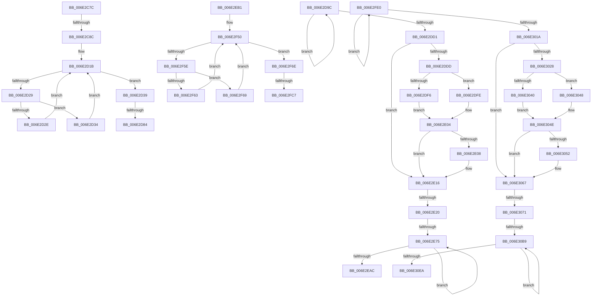

# sub_006E2C7C

- RVA: `0x006E2C7C`–`0x006E30F5` (길이 `1,145` bytes)
- VA: `0x00000001406E2C7C`
- 실행 섹션: `.text`
- PDB 이름 있음: `아니요`; PDB Function 태그: `아니요`
- unwind 정보 RVA: `0x00079B88`
- 디코드: `285`개 명령, `1,145/1,145` bytes 표시
- 미해석 바이트: `0` (있으면 어셈블리에 `.byte`로 보존)

> 이 문서는 커널 이미지의 기계어와 PDB 기호를 분석해 생성했습니다. 4번과 5번은 함수 원형과 자료형을 바이너리 사용 방식에서 추정한 C 해석이며 원본 소스 복구 결과는 아닙니다.

## 1. Dependencies

- 직접 호출 지점: **4**; 고유 호출 대상: **2**
- 직접 호출자로 확인된 함수: **0**
- RIP 상대 이미지 참조: **3**

### Outgoing calls
- `0x006E2D91` → [RtlHeapZero](../6B/RtlHeapZero_function_006BBC10.md) (function, `0x006BBC10`)
- `0x006E2E0C` → [RtlpHpEnvCompactionSchedule](../32/RtlpHpEnvCompactionSchedule_function_003264A0.md) (function, `0x003264A0`)
- `0x006E2FD5` → [RtlHeapZero](../6B/RtlHeapZero_function_006BBC10.md) (function, `0x006BBC10`)
- `0x006E3056` → [RtlpHpEnvCompactionSchedule](../32/RtlpHpEnvCompactionSchedule_function_003264A0.md) (function, `0x003264A0`)

### Direct callers
- 이 함수 시작 RVA로 연결되는 직접 call은 확인되지 않았습니다. 간접 호출은 완전히 역산할 수 없습니다.

### Static image references
- `0x006E2CBA` → RVA `0x00E28308` (`.data`; read)
- `0x006E2DF6` → RVA `0x00EFA7BC` (`.data`; read)
- `0x006E2DFE` → RVA `0x00EFA7C0` (`.data`; read)

## 2. Other-region calls and transfers

- 다른 실행 섹션으로 향하는 call: **0**
- call이 아닌 외부 분기/꼬리 이동: **11**
  - `0x006E2C86` → [ExAllocateHeapPool + 0x2326](../35/ExAllocateHeapPool_function_0035BA30.md) (`tail-transfer`)
  - `0x006E2D7E` → [ExAllocateHeapPool + 0xD77](../35/ExAllocateHeapPool_function_0035BA30.md) (`tail-transfer`)
  - `0x006E2D97` → [ExAllocateHeapPool + 0xD79](../35/ExAllocateHeapPool_function_0035BA30.md) (`tail-transfer`)
  - `0x006E2E1A` → [ExAllocateHeapPool + 0xD6C](../35/ExAllocateHeapPool_function_0035BA30.md) (`tail-transfer`)
  - `0x006E2E6F` → [ExAllocateHeapPool + 0xD6C](../35/ExAllocateHeapPool_function_0035BA30.md) (`tail-transfer`)
  - `0x006E2EAC` → [ExAllocateHeapPool + 0xD6C](../35/ExAllocateHeapPool_function_0035BA30.md) (`tail-transfer`)
  - `0x006E2FC1` → [ExAllocateHeapPool + 0x1EC5](../35/ExAllocateHeapPool_function_0035BA30.md) (`tail-transfer`)
  - `0x006E2FDB` → [ExAllocateHeapPool + 0x1EC5](../35/ExAllocateHeapPool_function_0035BA30.md) (`tail-transfer`)
  - `0x006E306B` → [ExAllocateHeapPool + 0xA54](../35/ExAllocateHeapPool_function_0035BA30.md) (`tail-transfer`)
  - `0x006E30B3` → [ExAllocateHeapPool + 0xA54](../35/ExAllocateHeapPool_function_0035BA30.md) (`tail-transfer`)
  - `0x006E30F0` → [ExAllocateHeapPool + 0xA4D](../35/ExAllocateHeapPool_function_0035BA30.md) (`tail-transfer`)

## 3. Assembly (complete function range)

```asm
006E2C7C  48 8B 42 38                     mov rax, qword ptr [rdx + 0x38]
006E2C80  48 A9 FF 0F 00 00               test rax, 0xfff
006E2C86  0F 84 CA B0 C7 FF               je 0x14035dd56
006E2C8C  4C 8B D8                        mov r11, rax
006E2C8F  49 81 E3 00 F0 FF FF            and r11, 0xfffffffffffff000
006E2C96  48 FF C8                        dec rax
006E2C99  48 89 42 38                     mov qword ptr [rdx + 0x38], rax
006E2C9D  49 8B C3                        mov rax, r11
006E2CA0  65 4C 8B 0C 25 88 01 00 00      mov r9, qword ptr gs:[0x188]
006E2CA9  45 0F B6 53 18                  movzx r10d, byte ptr [r11 + 0x18]
006E2CAE  48 C1 E8 0C                     shr rax, 0xc
006E2CB2  41 83 EA 08                     sub r10d, 8
006E2CB6  41 33 43 28                     xor eax, dword ptr [r11 + 0x28]
006E2CBA  33 05 48 56 74 00               xor eax, dword ptr [rip + 0x745648]
006E2CC0  49 8B 89 60 07 00 00            mov rcx, qword ptr [r9 + 0x760]
006E2CC7  49 8B 91 68 07 00 00            mov rdx, qword ptr [r9 + 0x768]
006E2CCE  89 44 24 68                     mov dword ptr [rsp + 0x68], eax
006E2CD2  0F B7 D8                        movzx ebx, ax
006E2CD5  4C 8D 04 0A                     lea r8, [rdx + rcx]
006E2CD9  48 33 D1                        xor rdx, rcx
006E2CDC  48 8B C2                        mov rax, rdx
006E2CDF  48 C1 C1 18                     rol rcx, 0x18
006E2CE3  48 C1 E0 10                     shl rax, 0x10
006E2CE7  48 33 C8                        xor rcx, rax
006E2CEA  49 C1 E8 20                     shr r8, 0x20
006E2CEE  48 33 CA                        xor rcx, rdx
006E2CF1  41 0F B6 F8                     movzx edi, r8b
006E2CF5  48 C1 C2 25                     rol rdx, 0x25
006E2CF9  49 89 89 60 07 00 00            mov qword ptr [r9 + 0x760], rcx
006E2D00  49 FF CA                        dec r10
006E2D03  49 89 91 68 07 00 00            mov qword ptr [r9 + 0x768], rdx
006E2D0A  4D 8D 4B 40                     lea r9, [r11 + 0x40]
006E2D0E  41 0F B6 43 24                  movzx eax, byte ptr [r11 + 0x24]
006E2D13  4F 8D 14 D1                     lea r10, [r9 + r10*8]
006E2D17  49 8D 14 C1                     lea rdx, [r9 + rax*8]
006E2D1B  4C 8B 02                        mov r8, qword ptr [rdx]
006E2D1E  49 8B C8                        mov rcx, r8
006E2D21  48 F7 D1                        not rcx
006E2D24  48 85 C9                        test rcx, rcx
006E2D27  75 10                           jne 0x1406e2d39
006E2D29  49 3B D2                        cmp rdx, r10
006E2D2C  74 06                           je 0x1406e2d34
006E2D2E  48 83 C2 08                     add rdx, 8
006E2D32  EB E7                           jmp 0x1406e2d1b
006E2D34  49 8B D1                        mov rdx, r9
006E2D37  EB E2                           jmp 0x1406e2d1b
006E2D39  F3 48 0F B8 C1                  popcnt rax, rcx
006E2D3E  0F AF C7                        imul eax, edi
006E2D41  41 BA 01 00 00 00               mov r10d, 1
006E2D47  0F B7 7C 24 6A                  movzx edi, word ptr [rsp + 0x6a]
006E2D4C  C1 E8 08                        shr eax, 8
006E2D4F  C4 C2 F9 F7 C2                  shlx rax, r10, rax
006E2D54  C4 E2 FB F5 C9                  pdep rcx, rax, rcx
006E2D59  F3 48 0F BC C1                  tzcnt rax, rcx
006E2D5E  49 0B C8                        or rcx, r8
006E2D61  48 89 0A                        mov qword ptr [rdx], rcx
006E2D64  41 2B D1                        sub edx, r9d
006E2D67  8D 0C D0                        lea ecx, [rax + rdx*8]
006E2D6A  8B C1                           mov eax, ecx
006E2D6C  0F AF CB                        imul ecx, ebx
006E2D6F  C1 E8 06                        shr eax, 6
006E2D72  41 88 43 24                     mov byte ptr [r11 + 0x24], al
006E2D76  03 F9                           add edi, ecx
006E2D78  49 03 FB                        add rdi, r11
006E2D7B  4D 85 E4                        test r12, r12
006E2D7E  0F 85 23 9A C7 FF               jne 0x14035c7a7
006E2D84  8B DE                           mov ebx, esi
006E2D86  48 8B CF                        mov rcx, rdi
006E2D89  48 8D 53 0F                     lea rdx, [rbx + 0xf]
006E2D8D  48 83 E2 F0                     and rdx, 0xfffffffffffffff0
006E2D91  E8 7A 8E FD FF                  call 0x1406bbc10
006E2D96  90                              nop
006E2D97  E9 0D 9A C7 FF                  jmp 0x14035c7a9
006E2D9C  48 89 45 E0                     mov qword ptr [rbp - 0x20], rax
006E2DA0  48 8B C8                        mov rcx, rax
006E2DA3  0F B6 55 E6                     movzx edx, byte ptr [rbp - 0x1a]
006E2DA7  48 C1 E9 30                     shr rcx, 0x30
006E2DAB  80 F9 01                        cmp cl, 1
006E2DAE  48 89 45 F0                     mov qword ptr [rbp - 0x10], rax
006E2DB2  0F 44 D3                        cmove edx, ebx
006E2DB5  66 FF 45 E2                     inc word ptr [rbp - 0x1e]
006E2DB9  88 55 E6                        mov byte ptr [rbp - 0x1a], dl
006E2DBC  41 0F B7 52 2C                  movzx edx, word ptr [r10 + 0x2c]
006E2DC1  48 8B 4D E0                     mov rcx, qword ptr [rbp - 0x20]
006E2DC5  48 C1 E2 06                     shl rdx, 6
006E2DC9  F0 49 0F B1 4A 10               lock cmpxchg qword ptr [r10 + 0x10], rcx
006E2DCF  75 CB                           jne 0x1406e2d9c
006E2DD1  42 80 7C 22 5C 00               cmp byte ptr [rdx + r12 + 0x5c], 0
006E2DD7  48 8B 5D B8                     mov rbx, qword ptr [rbp - 0x48]
006E2DDB  75 39                           jne 0x1406e2e16
006E2DDD  42 C6 44 22 5C 01               mov byte ptr [rdx + r12 + 0x5c], 1
006E2DE3  49 8B 0C 24                     mov rcx, qword ptr [r12]
006E2DE7  48 8B 41 38                     mov rax, qword ptr [rcx + 0x38]
006E2DEB  48 8B 00                        mov rax, qword ptr [rax]
006E2DEE  48 C1 E8 08                     shr rax, 8
006E2DF2  3C 01                           cmp al, 1
006E2DF4  75 08                           jne 0x1406e2dfe
006E2DF6  8B 05 C0 79 81 00               mov eax, dword ptr [rip + 0x8179c0]
006E2DFC  EB 06                           jmp 0x1406e2e04
006E2DFE  8B 05 BC 79 81 00               mov eax, dword ptr [rip + 0x8179bc]
006E2E04  85 C0                           test eax, eax
006E2E06  75 0E                           jne 0x1406e2e16
006E2E08  48 8B 49 38                     mov rcx, qword ptr [rcx + 0x38]
006E2E0C  E8 8F 36 C4 FF                  call 0x1403264a0
006E2E11  4C 8B 54 24 30                  mov r10, qword ptr [rsp + 0x30]
006E2E16  80 7D F6 01                     cmp byte ptr [rbp - 0xa], 1
006E2E1A  0F 85 7C 99 C7 FF               jne 0x14035c79c
006E2E20  44 0F B7 4D F4                  movzx r9d, word ptr [rbp - 0xc]
006E2E25  41 C1 E1 06                     shl r9d, 6
006E2E29  4D 03 CC                        add r9, r12
006E2E2C  41 0F 0D 49 08                  prefetchw byte ptr [r9 + 8]
006E2E31  49 8B 41 08                     mov rax, qword ptr [r9 + 8]
006E2E35  45 8B 5A 18                     mov r11d, dword ptr [r10 + 0x18]
006E2E39  48 8B C8                        mov rcx, rax
006E2E3C  81 E1 FF 0F 00 00               and ecx, 0xfff
006E2E42  41 81 E3 FF 0F 00 00            and r11d, 0xfff
006E2E49  48 8B D0                        mov rdx, rax
006E2E4C  48 2B D1                        sub rdx, rcx
006E2E4F  41 8B CB                        mov ecx, r11d
006E2E52  48 0B CA                        or rcx, rdx
006E2E55  49 89 4A 18                     mov qword ptr [r10 + 0x18], rcx
006E2E59  48 8B C8                        mov rcx, rax
006E2E5C  48 33 CB                        xor rcx, rbx
006E2E5F  48 81 E1 00 F0 FF FF            and rcx, 0xfffffffffffff000
006E2E66  48 33 C8                        xor rcx, rax
006E2E69  F0 49 0F B1 49 08               lock cmpxchg qword ptr [r9 + 8], rcx
006E2E6F  0F 84 27 99 C7 FF               je 0x14035c79c
006E2E75  48 8B C8                        mov rcx, rax
006E2E78  48 8B D0                        mov rdx, rax
006E2E7B  81 E1 FF 0F 00 00               and ecx, 0xfff
006E2E81  4C 8B C0                        mov r8, rax
006E2E84  48 2B D1                        sub rdx, rcx
006E2E87  49 8B CB                        mov rcx, r11
006E2E8A  48 0B CA                        or rcx, rdx
006E2E8D  49 89 4A 18                     mov qword ptr [r10 + 0x18], rcx
006E2E91  48 8B C8                        mov rcx, rax
006E2E94  48 33 CB                        xor rcx, rbx
006E2E97  48 81 E1 00 F0 FF FF            and rcx, 0xfffffffffffff000
006E2E9E  48 33 C8                        xor rcx, rax
006E2EA1  F0 49 0F B1 49 08               lock cmpxchg qword ptr [r9 + 8], rcx
006E2EA7  49 3B C0                        cmp rax, r8
006E2EAA  75 C9                           jne 0x1406e2e75
006E2EAC  E9 EB 98 C7 FF                  jmp 0x14035c79c
006E2EB1  4C 8B D8                        mov r11, rax
006E2EB4  48 89 74 24 40                  mov qword ptr [rsp + 0x40], rsi
006E2EB9  49 81 E3 00 F0 FF FF            and r11, 0xfffffffffffff000
006E2EC0  48 FF C8                        dec rax
006E2EC3  48 89 42 38                     mov qword ptr [rdx + 0x38], rax
006E2EC7  49 8B C3                        mov rax, r11
006E2ECA  65 4C 8B 0C 25 88 01 00 00      mov r9, qword ptr gs:[0x188]
006E2ED3  45 0F B6 53 18                  movzx r10d, byte ptr [r11 + 0x18]
006E2ED8  48 C1 E8 0C                     shr rax, 0xc
006E2EDC  41 83 EA 08                     sub r10d, 8
006E2EE0  41 33 43 28                     xor eax, dword ptr [r11 + 0x28]
006E2EE4  33 05 1E 54 74 00               xor eax, dword ptr [rip + 0x74541e]
006E2EEA  49 8B 91 68 07 00 00            mov rdx, qword ptr [r9 + 0x768]
006E2EF1  0F B7 C8                        movzx ecx, ax
006E2EF4  89 8D 78 01 00 00               mov dword ptr [rbp + 0x178], ecx
006E2EFA  49 8B 89 60 07 00 00            mov rcx, qword ptr [r9 + 0x760]
006E2F01  89 45 80                        mov dword ptr [rbp - 0x80], eax
006E2F04  4C 8D 04 0A                     lea r8, [rdx + rcx]
006E2F08  48 33 D1                        xor rdx, rcx
006E2F0B  48 8B C2                        mov rax, rdx
006E2F0E  48 C1 C1 18                     rol rcx, 0x18
006E2F12  48 C1 E0 10                     shl rax, 0x10
006E2F16  48 33 C8                        xor rcx, rax
006E2F19  49 C1 E8 20                     shr r8, 0x20
006E2F1D  48 33 CA                        xor rcx, rdx
006E2F20  41 0F B6 C0                     movzx eax, r8b
006E2F24  48 C1 C2 25                     rol rdx, 0x25
006E2F28  49 89 89 60 07 00 00            mov qword ptr [r9 + 0x760], rcx
006E2F2F  49 FF CA                        dec r10
006E2F32  49 89 91 68 07 00 00            mov qword ptr [r9 + 0x768], rdx
006E2F39  4D 8D 4B 40                     lea r9, [r11 + 0x40]
006E2F3D  89 85 70 01 00 00               mov dword ptr [rbp + 0x170], eax
006E2F43  41 0F B6 43 24                  movzx eax, byte ptr [r11 + 0x24]
006E2F48  4F 8D 14 D1                     lea r10, [r9 + r10*8]
006E2F4C  49 8D 14 C1                     lea rdx, [r9 + rax*8]
006E2F50  4C 8B 02                        mov r8, qword ptr [rdx]
006E2F53  49 8B C8                        mov rcx, r8
006E2F56  48 F7 D1                        not rcx
006E2F59  48 85 C9                        test rcx, rcx
006E2F5C  75 10                           jne 0x1406e2f6e
006E2F5E  49 3B D2                        cmp rdx, r10
006E2F61  74 06                           je 0x1406e2f69
006E2F63  48 83 C2 08                     add rdx, 8
006E2F67  EB E7                           jmp 0x1406e2f50
006E2F69  49 8B D1                        mov rdx, r9
006E2F6C  EB E2                           jmp 0x1406e2f50
006E2F6E  8B B5 78 01 00 00               mov esi, dword ptr [rbp + 0x178]
006E2F74  41 BA 01 00 00 00               mov r10d, 1
006E2F7A  F3 48 0F B8 C1                  popcnt rax, rcx
006E2F7F  0F AF 85 70 01 00 00            imul eax, dword ptr [rbp + 0x170]
006E2F86  C1 E8 08                        shr eax, 8
006E2F89  C4 C2 F9 F7 C2                  shlx rax, r10, rax
006E2F8E  C4 E2 FB F5 C9                  pdep rcx, rax, rcx
006E2F93  4C 0B C1                        or r8, rcx
006E2F96  F3 48 0F BC C1                  tzcnt rax, rcx
006E2F9B  4C 89 02                        mov qword ptr [rdx], r8
006E2F9E  41 2B D1                        sub edx, r9d
006E2FA1  8D 0C D0                        lea ecx, [rax + rdx*8]
006E2FA4  0F AF F1                        imul esi, ecx
006E2FA7  8B C1                           mov eax, ecx
006E2FA9  C1 E8 06                        shr eax, 6
006E2FAC  41 88 43 24                     mov byte ptr [r11 + 0x24], al
006E2FB0  0F B7 45 82                     movzx eax, word ptr [rbp - 0x7e]
006E2FB4  03 F0                           add esi, eax
006E2FB6  49 03 F3                        add rsi, r11
006E2FB9  4D 85 E4                        test r12, r12
006E2FBC  4C 8B 64 24 40                  mov r12, qword ptr [rsp + 0x40]
006E2FC1  0F 85 2E A9 C7 FF               jne 0x14035d8f5
006E2FC7  41 8B D4                        mov edx, r12d
006E2FCA  48 8B CE                        mov rcx, rsi
006E2FCD  48 83 C2 0F                     add rdx, 0xf
006E2FD1  48 83 E2 F0                     and rdx, 0xfffffffffffffff0
006E2FD5  E8 36 8C FD FF                  call 0x1406bbc10
006E2FDA  90                              nop
006E2FDB  E9 15 A9 C7 FF                  jmp 0x14035d8f5
006E2FE0  48 89 44 24 60                  mov qword ptr [rsp + 0x60], rax
006E2FE5  48 8B C8                        mov rcx, rax
006E2FE8  0F B6 54 24 66                  movzx edx, byte ptr [rsp + 0x66]
006E2FED  48 C1 E9 30                     shr rcx, 0x30
006E2FF1  80 F9 01                        cmp cl, 1
006E2FF4  48 89 45 00                     mov qword ptr [rbp], rax
006E2FF8  0F 44 D3                        cmove edx, ebx
006E2FFB  66 FF 44 24 62                  inc word ptr [rsp + 0x62]
006E3000  88 54 24 66                     mov byte ptr [rsp + 0x66], dl
006E3004  41 0F B7 53 2C                  movzx edx, word ptr [r11 + 0x2c]
006E3009  48 8B 4C 24 60                  mov rcx, qword ptr [rsp + 0x60]
006E300E  48 C1 E2 06                     shl rdx, 6
006E3012  F0 49 0F B1 4B 10               lock cmpxchg qword ptr [r11 + 0x10], rcx
006E3018  75 C6                           jne 0x1406e2fe0
006E301A  42 80 7C 02 5C 00               cmp byte ptr [rdx + r8 + 0x5c], 0
006E3020  8B 9D 80 01 00 00               mov ebx, dword ptr [rbp + 0x180]
006E3026  75 3F                           jne 0x1406e3067
006E3028  42 C6 44 02 5C 01               mov byte ptr [rdx + r8 + 0x5c], 1
006E302E  49 8B 08                        mov rcx, qword ptr [r8]
006E3031  48 8B 41 38                     mov rax, qword ptr [rcx + 0x38]
006E3035  48 8B 00                        mov rax, qword ptr [rax]
006E3038  48 C1 E8 08                     shr rax, 8
006E303C  3C 01                           cmp al, 1
006E303E  75 08                           jne 0x1406e3048
006E3040  8B 05 76 77 81 00               mov eax, dword ptr [rip + 0x817776]
006E3046  EB 06                           jmp 0x1406e304e
006E3048  8B 05 72 77 81 00               mov eax, dword ptr [rip + 0x817772]
006E304E  85 C0                           test eax, eax
006E3050  75 15                           jne 0x1406e3067
006E3052  48 8B 49 38                     mov rcx, qword ptr [rcx + 0x38]
006E3056  E8 45 34 C4 FF                  call 0x1403264a0
006E305B  4C 8B 5C 24 30                  mov r11, qword ptr [rsp + 0x30]
006E3060  4D 8D 87 40 03 00 00            lea r8, [r15 + 0x340]
006E3067  80 7D 06 01                     cmp byte ptr [rbp + 6], 1
006E306B  0F 85 13 94 C7 FF               jne 0x14035c484
006E3071  44 0F B7 4D 04                  movzx r9d, word ptr [rbp + 4]
006E3076  41 C1 E1 06                     shl r9d, 6
006E307A  4D 03 C8                        add r9, r8
006E307D  41 0F 0D 49 08                  prefetchw byte ptr [r9 + 8]
006E3082  4D 8B 53 18                     mov r10, qword ptr [r11 + 0x18]
006E3086  49 8B 41 08                     mov rax, qword ptr [r9 + 8]
006E308A  49 8B CA                        mov rcx, r10
006E308D  48 33 C8                        xor rcx, rax
006E3090  48 8B D0                        mov rdx, rax
006E3093  48 81 E1 00 F0 FF FF            and rcx, 0xfffffffffffff000
006E309A  81 E2 FF 0F 00 00               and edx, 0xfff
006E30A0  49 33 CA                        xor rcx, r10
006E30A3  49 89 4B 18                     mov qword ptr [r11 + 0x18], rcx
006E30A7  49 8B CB                        mov rcx, r11
006E30AA  48 0B CA                        or rcx, rdx
006E30AD  F0 49 0F B1 49 08               lock cmpxchg qword ptr [r9 + 8], rcx
006E30B3  0F 84 CB 93 C7 FF               je 0x14035c484
006E30B9  48 8B D0                        mov rdx, rax
006E30BC  49 8B CA                        mov rcx, r10
006E30BF  48 33 C8                        xor rcx, rax
006E30C2  81 E2 FF 0F 00 00               and edx, 0xfff
006E30C8  48 81 E1 00 F0 FF FF            and rcx, 0xfffffffffffff000
006E30CF  4C 8B C0                        mov r8, rax
006E30D2  49 33 CA                        xor rcx, r10
006E30D5  49 89 4B 18                     mov qword ptr [r11 + 0x18], rcx
006E30D9  49 8B CB                        mov rcx, r11
006E30DC  48 0B CA                        or rcx, rdx
006E30DF  F0 49 0F B1 49 08               lock cmpxchg qword ptr [r9 + 8], rcx
006E30E5  49 3B C0                        cmp rax, r8
006E30E8  75 CF                           jne 0x1406e30b9
006E30EA  8B 9D 80 01 00 00               mov ebx, dword ptr [rbp + 0x180]
006E30F0  E9 88 93 C7 FF                  jmp 0x14035c47d
```

## 4. C-style interpretation (structured pseudocode)

```c
__int64 __fastcall sub_006E2C7C(__int64 a1, __int64 a2)
{
    __int64 result;
    __int64 v_r10;
    __int64 v_r11;
    __int64 v_rdi;
    unsigned __int64 v_stack_p30;
    unsigned __int64 v_stack_p40;
    unsigned __int64 v_stack_p60;
    unsigned __int16 v_stack_p62;
    unsigned __int8 v_stack_p66;
    unsigned int v_stack_p68;
    unsigned __int16 v_stack_p6A;

    v_r11 = (*(unsigned __int64 *)(a2 + 56)) & (0xFFFFFFFFFFFFF000ULL);
    result = (*(unsigned __int64 *)(a2 + 56)) - 1;
    *(unsigned __int64 *)(a2 + 56) = result;
    result = (v_r11) >> (12);
    v_r10 = (unsigned int)((*(unsigned __int8 *)(v_r11 + 24)) - (8));
    result = (unsigned int)((result) ^ (*(unsigned int *)(v_r11 + 40)));
    result = (unsigned int)((result) ^ (*(unsigned int *)(v_rip + 7624264)));
    v_stack_p68 = (unsigned int)(result);
    a2 = (*(unsigned __int64 *)(*(unsigned __int64 *)(gs_base + (0 + 392)) + 1896)) ^ (*(unsigned __int64 *)(*(unsigned __int64 *)(gs_base + (0 + 392)) + 1888));
    result = (a2) << (16);
    a1 = (*(unsigned __int64 *)(*(unsigned __int64 *)(gs_base + (0 + 392)) + 1888)) ^ (result);
    a3 = (*(unsigned __int64 *)(*(unsigned __int64 *)(gs_base + (0 + 392)) + 1896) + *(unsigned __int64 *)(*(unsigned __int64 *)(gs_base + (0 + 392)) + 1888) * 1) >> (32);
    a1 = (a1) ^ (a2);
    *(unsigned __int64 *)(*(unsigned __int64 *)(gs_base + (0 + 392)) + 1888) = a1;
    v_r10 = (v_r10) - 1;
    *(unsigned __int64 *)(*(unsigned __int64 *)(gs_base + (0 + 392)) + 1896) = a2;
loc_006E2D1B:
    a1 = ~(*(unsigned __int64 *)(v_r11 + 64 + *(unsigned __int8 *)(v_r11 + 36) * 8));
    if (a1 != 0) goto loc_006E2D39;
    if ((v_r11 + 64 + *(unsigned __int8 *)(v_r11 + 36) * 8) == (v_r11 + 64 + v_r10 * 8)) goto loc_006E2D34;
    a2 = (v_r11 + 64 + *(unsigned __int8 *)(v_r11 + 36) * 8) + (8);
    goto loc_006E2D1B;
loc_006E2D34:
    goto loc_006E2D1B;
loc_006E2D39:
    result = (unsigned int)((*(unsigned __int8 *)(v_r11 + 36)) * ((unsigned int)((unsigned __int8)(a3))));
    result = (unsigned int)((result) >> (8));
    a1 = (a1) | (*(unsigned __int64 *)(v_r11 + 64 + *(unsigned __int8 *)(v_r11 + 36) * 8));
    *(unsigned __int64 *)(v_r11 + 64) = a1;
    a2 = (unsigned int)((v_r11 + 64) - ((unsigned int)(v_r11 + 64)));
    a1 = (unsigned int)((result + a2 * 8) * ((unsigned int)((unsigned __int16)(result))));
    result = (unsigned int)(((unsigned int)((unsigned int)(result + a2 * 8))) >> (6));
    *(unsigned __int8 *)(v_r11 + 36) = (unsigned __int8)(result);
    v_rdi = (unsigned int)((v_stack_p6A) + ((unsigned int)(a1)));
    v_rdi = (v_rdi) + (v_r11);
    a2 = ((unsigned int)((unsigned int)(v_rsi)) + 15) & (-16);
    result = RtlHeapZero(v_rdi, a2, *(unsigned __int64 *)(v_r11 + 64 + *(unsigned __int8 *)(v_r11 + 36) * 8), v_r11 + 64);
}
```

## 5. (Beta) C Style

```c
int64_t sub_006E2C7C(int64_t Arg1, void *Arg2)
{
    uint8_t *arg2 = (uint8_t *)Arg2;

    int64_t result;
    int64_t local_r10;
    int64_t local_r11;
    int64_t local_rdi;
    uint64_t v_stack_p30;
    uint64_t v_stack_p40;
    uint64_t v_stack_p60;
    uint16_t v_stack_p62;
    uint8_t v_stack_p66;
    uint32_t v_stack_p68;
    uint16_t v_stack_p6A;

    local_r11 = (*(uint64_t *)(arg2 + 0x38)) & (0xFFFFFFFFFFFFF000ULL);
    result = (*(uint64_t *)(arg2 + 0x38)) - 1;
    *(uint64_t *)(arg2 + 0x38) = result;
    result = (local_r11) >> (12);
    local_r10 = (uint32_t)((*(uint8_t *)(local_r11 + 0x18)) - (8));
    result = (uint32_t)((result) ^ (*(uint32_t *)(local_r11 + 0x28)));
    result = (uint32_t)((result) ^ (*(uint32_t *)(v_rip + 0x745648)));
    v_stack_p68 = (uint32_t)(result);
    Arg2 = (*(uint64_t *)(*(uint64_t *)(gs_base + (0 + 0x188)) + 0x768)) ^ (*(uint64_t *)(*(uint64_t *)(gs_base + (0 + 0x188)) + 0x760));
    result = (Arg2) << (16);
    Arg1 = (*(uint64_t *)(*(uint64_t *)(gs_base + (0 + 0x188)) + 0x760)) ^ (result);
    a3 = (*(uint64_t *)(*(uint64_t *)(gs_base + (0 + 0x188)) + 0x768) + *(uint64_t *)(*(uint64_t *)(gs_base + (0 + 0x188)) + 0x760) * 1) >> (32);
    Arg1 = (Arg1) ^ (Arg2);
    *(uint64_t *)(*(uint64_t *)(gs_base + (0 + 0x188)) + 0x760) = Arg1;
    local_r10 = (local_r10) - 1;
    *(void **)(*(uint64_t *)(gs_base + (0 + 0x188)) + 0x768) = Arg2;
loc_006E2D1B:
    Arg1 = ~(*(uint64_t *)(local_r11 + 0x40 + *(uint8_t *)(local_r11 + 0x24) * 8));
    if (Arg1 != 0) goto loc_006E2D39;
    if ((local_r11 + 64 + *(uint8_t *)(local_r11 + 0x24) * 8) == (local_r11 + 64 + local_r10 * 8)) goto loc_006E2D34;
    Arg2 = (local_r11 + 64 + *(uint8_t *)(local_r11 + 0x24) * 8) + (8);
    goto loc_006E2D1B;
loc_006E2D34:
    goto loc_006E2D1B;
loc_006E2D39:
    result = (uint32_t)((*(uint8_t *)(local_r11 + 0x24)) * ((uint32_t)((uint8_t)(a3))));
    result = (uint32_t)((result) >> (8));
    Arg1 = (Arg1) | (*(uint64_t *)(local_r11 + 0x40 + *(uint8_t *)(local_r11 + 0x24) * 8));
    *(uint64_t *)(local_r11 + 0x40) = Arg1;
    Arg2 = (uint32_t)((local_r11 + 64) - ((uint32_t)(local_r11 + 64)));
    Arg1 = (uint32_t)((result + Arg2 * 8) * ((uint32_t)((uint16_t)(result))));
    result = (uint32_t)(((uint32_t)((uint32_t)(result + Arg2 * 8))) >> (6));
    *(uint8_t *)(local_r11 + 0x24) = (uint8_t)(result);
    local_rdi = (uint32_t)((v_stack_p6A) + ((uint32_t)(Arg1)));
    local_rdi = (local_rdi) + (local_r11);
    Arg2 = ((uint32_t)((uint32_t)(local_rsi)) + 15) & (-16);
    result = RtlHeapZero(local_rdi, Arg2, *(uint64_t *)(local_r11 + 0x40 + *(uint8_t *)(local_r11 + 0x24) * 8), local_r11 + 64);
}
```

### 관측된 메모리 오프셋

구조체 형식이 확인되지 않은 접근은 인자 기준의 오프셋으로만 기록했습니다.

| 기준 인자 | 오프셋 표현 | 폭 (bit) | 접근 |
|---|---:|---:|---|
| `Arg2` | `+ 0x38` | `64` | `R` |
| `Arg2` | `+ 0x38` | `64` | `W` |

## 6. Execution-region graph

[열기: 2D/3D 그래프와 함수 탐색 컨트롤 패널](../../../control-panel.html?section=text&rva=0x006E2C7C&view=graph)

- 2D 그래프는 위에서 아래로 흐르고, 3D 그래프는 빈 공간을 드래그해 회전합니다. Shift+드래그는 이동, 휠은 확대·축소, 함수 노드 선택은 대상 보고서 이동입니다.

### Static fallback


