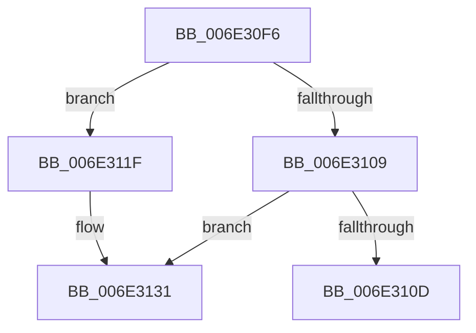

# sub_006E30F6

- RVA: `0x006E30F6`–`0x006E313A` (길이 `68` bytes)
- VA: `0x00000001406E30F6`
- 실행 섹션: `.text`
- PDB 이름 있음: `아니요`; PDB Function 태그: `아니요`
- unwind 정보 RVA: `0x00079E4C`
- 디코드: `19`개 명령, `68/68` bytes 표시
- 미해석 바이트: `0` (있으면 어셈블리에 `.byte`로 보존)

> 이 문서는 커널 이미지의 기계어와 PDB 기호를 분석해 생성했습니다. 4번과 5번은 함수 원형과 자료형을 바이너리 사용 방식에서 추정한 C 해석이며 원본 소스 복구 결과는 아닙니다.

## 1. Dependencies

- 직접 호출 지점: **0**; 고유 호출 대상: **0**
- 직접 호출자로 확인된 함수: **0**
- RIP 상대 이미지 참조: **0**

### Outgoing calls
- 직접 디코드된 call 명령이 없습니다.

### Direct callers
- 이 함수 시작 RVA로 연결되는 직접 call은 확인되지 않았습니다. 간접 호출은 완전히 역산할 수 없습니다.

### Static image references
- 디코드된 RIP-relative 메모리 참조가 없습니다.

## 2. Other-region calls and transfers

- 다른 실행 섹션으로 향하는 call: **0**
- call이 아닌 외부 분기/꼬리 이동: **2**
  - `0x006E311A` → [MiCopyOnWrite + 0x324](../36/MiCopyOnWrite_function_00362A0C.md) (`tail-transfer`)
  - `0x006E3135` → [MiCopyOnWrite + 0x324](../36/MiCopyOnWrite_function_00362A0C.md) (`tail-transfer`)

## 3. Assembly (complete function range)

```asm
006E30F6  8B 43 30                        mov eax, dword ptr [rbx + 0x30]
006E30F9  C1 E8 07                        shr eax, 7
006E30FC  83 E0 1F                        and eax, 0x1f
006E30FF  8B C8                           mov ecx, eax
006E3101  C1 E9 03                        shr ecx, 3
006E3104  83 F9 03                        cmp ecx, 3
006E3107  75 16                           jne 0x1406e311f
006E3109  A8 07                           test al, 7
006E310B  74 24                           je 0x1406e3131
006E310D  C7 44 24 34 19 00 00 00         mov dword ptr [rsp + 0x34], 0x19
006E3115  B9 19 00 00 00                  mov ecx, 0x19
006E311A  E9 11 FC C7 FF                  jmp 0x140362d30
006E311F  8B 44 24 34                     mov eax, dword ptr [rsp + 0x34]
006E3123  3B CA                           cmp ecx, edx
006E3125  B9 09 00 00 00                  mov ecx, 9
006E312A  0F 44 C1                        cmove eax, ecx
006E312D  89 44 24 34                     mov dword ptr [rsp + 0x34], eax
006E3131  8B 4C 24 34                     mov ecx, dword ptr [rsp + 0x34]
006E3135  E9 F6 FB C7 FF                  jmp 0x140362d30
```

## 4. C-style interpretation (structured pseudocode)

```c
__int64 __fastcall sub_006E30F6(__int64 a1, int a2)
{
    __int64 result;
    unsigned int v_stack_p34;

    result = (unsigned int)(((unsigned int)(*(unsigned int *)(v_rbx + 48))) >> (7));
    result = (unsigned int)((result) & (31));
    a1 = (unsigned int)(((unsigned int)((unsigned int)(result))) >> (3));
    if (((unsigned int)(a1)) != 3) goto loc_006E311F;
    if ((((unsigned __int8)(result)) & (7)) == 0) goto loc_006E3131;
    v_stack_p34 = 25;
loc_006E311F:
    result = (unsigned int)(v_stack_p34);
    if (25 == a2) { result = 9; }
    v_stack_p34 = (unsigned int)(result);
loc_006E3131:
}
```

## 5. (Beta) C Style

```c
int64_t sub_006E30F6(int64_t Arg1, int32_t Arg2)
{
    int64_t result;
    uint32_t v_stack_p34;

    result = (uint32_t)(((uint32_t)(*(uint32_t *)(local_rbx + 0x30))) >> (7));
    result = (uint32_t)((result) & (31));
    Arg1 = (uint32_t)(((uint32_t)((uint32_t)(result))) >> (3));
    if (((uint32_t)(Arg1)) != 3) goto loc_006E311F;
    if ((((uint8_t)(result)) & (7)) == 0) goto loc_006E3131;
    v_stack_p34 = 25;
loc_006E311F:
    result = (uint32_t)(v_stack_p34);
    if (25 == Arg2) { result = 9; }
    v_stack_p34 = (uint32_t)(result);
loc_006E3131:
}
```

## 6. Execution-region graph

[열기: 2D/3D 그래프와 함수 탐색 컨트롤 패널](../../../control-panel.html?section=text&rva=0x006E30F6&view=graph)

- 2D 그래프는 위에서 아래로 흐르고, 3D 그래프는 빈 공간을 드래그해 회전합니다. Shift+드래그는 이동, 휠은 확대·축소, 함수 노드 선택은 대상 보고서 이동입니다.

### Static fallback


