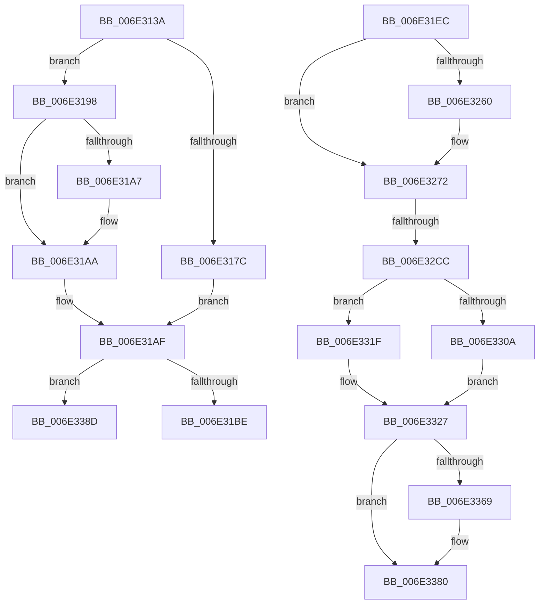

# sub_006E313A

- RVA: `0x006E313A`–`0x006E33AF` (길이 `629` bytes)
- VA: `0x00000001406E313A`
- 실행 섹션: `.text`
- PDB 이름 있음: `아니요`; PDB Function 태그: `아니요`
- unwind 정보 RVA: `0x00079ED8`
- 디코드: `145`개 명령, `629/629` bytes 표시
- 미해석 바이트: `0` (있으면 어셈블리에 `.byte`로 보존)

> 이 문서는 커널 이미지의 기계어와 PDB 기호를 분석해 생성했습니다. 4번과 5번은 함수 원형과 자료형을 바이너리 사용 방식에서 추정한 C 해석이며 원본 소스 복구 결과는 아닙니다.

## 1. Dependencies

- 직접 호출 지점: **12**; 고유 호출 대상: **12**
- 직접 호출자로 확인된 함수: **0**
- RIP 상대 이미지 참조: **1**

### Outgoing calls
- `0x006E3191` → [MiGetSlabPage](../37/MiGetSlabPage_function_00376FBC.md) (function, `0x00376FBC`)
- `0x006E31AA` → [MiGetPage](../28/MiGetPage_function_002884C0.md) (function, `0x002884C0`)
- `0x006E31F7` → [MiReturnCommit](../24/MiReturnCommit_function_00248410.md) (function, `0x00248410`)
- `0x006E3219` → [MiInitializeReadInProgressPfn](../2B/MiInitializeReadInProgressPfn_function_002B6990.md) (function, `0x002B6990`)
- `0x006E3221` → [MiGetPagingFileOffset](../36/MiGetPagingFileOffset_function_0036F530.md) (function, `0x0036F530`)
- `0x006E3235` → [MiIsPteInStore](../36/MiIsPteInStore_function_00362460.md) (function, `0x00362460`)
- `0x006E32AA` → [MiObtainProtoReference](../31/MiObtainProtoReference_function_00318178.md) (function, `0x00318178`)
- `0x006E32EB` → [MiUnlockProtoPoolPage](../24/MiUnlockProtoPoolPage_function_00246090.md) (function, `0x00246090`)
- `0x006E3358` → [MiGetInPageSupportBlock](../36/MiGetInPageSupportBlock_function_00362500.md) (function, `0x00362500`)
- `0x006E337B` → [MiSetInPagePriority](../36/MiSetInPagePriority_function_0036A9A4.md) (function, `0x0036A9A4`)
- `0x006E339A` → [MiReturnFaultCharges](../36/MiReturnFaultCharges_function_0036D928.md) (function, `0x0036D928`)
- `0x006E33A4` → [MiReleasePrefetchGapPages](../36/MiReleasePrefetchGapPages_function_00367C08.md) (function, `0x00367C08`)

### Direct callers
- 이 함수 시작 RVA로 연결되는 직접 call은 확인되지 않았습니다. 간접 호출은 완전히 역산할 수 없습니다.

### Static image references
- `0x006E314F` → RVA `0x00E2DCC0` (`.data`; read)

## 2. Other-region calls and transfers

- 다른 실행 섹션으로 향하는 call: **0**
- call이 아닌 외부 분기/꼬리 이동: **4**
  - `0x006E31E7` → [MiPfPutPagesInTransition + 0x3E6](../36/MiPfPutPagesInTransition_function_003640EC.md) (`tail-transfer`)
  - `0x006E32C6` → [MiPfPutPagesInTransition + 0x9A6](../36/MiPfPutPagesInTransition_function_003640EC.md) (`tail-transfer`)
  - `0x006E3388` → [MiPfPutPagesInTransition + 0x49D](../36/MiPfPutPagesInTransition_function_003640EC.md) (`tail-transfer`)
  - `0x006E33AA` → [MiPfPutPagesInTransition + 0xABB](../36/MiPfPutPagesInTransition_function_003640EC.md) (`tail-transfer`)

## 3. Assembly (complete function range)

```asm
006E313A  48 8B 4D F0                     mov rcx, qword ptr [rbp - 0x10]
006E313E  41 BA 01 00 00 00               mov r10d, 1
006E3144  41 8B C2                        mov eax, r10d
006E3147  F0 0F C1 01                     lock xadd dword ptr [rcx], eax
006E314B  4C 8B 45 F8                     mov r8, qword ptr [rbp - 8]
006E314F  4C 8D 0D 6A AB 74 00            lea r9, [rip + 0x74ab6a]
006E3156  4C 8B 7C 24 48                  mov r15, qword ptr [rsp + 0x48]
006E315B  33 D2                           xor edx, edx
006E315D  49 8B C8                        mov rcx, r8
006E3160  48 C1 E9 10                     shr rcx, 0x10
006E3164  83 E1 03                        and ecx, 3
006E3167  41 F7 34 89                     div dword ptr [r9 + rcx*4]
006E316B  49 8B CF                        mov rcx, r15
006E316E  41 33 D0                        xor edx, r8d
006E3171  0F B6 D2                        movzx edx, dl
006E3174  41 33 D0                        xor edx, r8d
006E3177  4D 3B E5                        cmp r12, r13
006E317A  74 1C                           je 0x1406e3198
006E317C  44 8B C2                        mov r8d, edx
006E317F  44 89 5C 24 28                  mov dword ptr [rsp + 0x28], r11d
006E3184  8B 54 24 38                     mov edx, dword ptr [rsp + 0x38]
006E3188  45 8D 4A 13                     lea r9d, [r10 + 0x13]
006E318C  4C 89 5C 24 20                  mov qword ptr [rsp + 0x20], r11
006E3191  E8 26 3E C9 FF                  call 0x140376fbc
006E3196  EB 17                           jmp 0x1406e31af
006E3198  48 8B 45 A8                     mov rax, qword ptr [rbp - 0x58]
006E319C  41 B8 31 00 00 00               mov r8d, 0x31
006E31A2  44 84 10                        test byte ptr [rax], r10b
006E31A5  75 03                           jne 0x1406e31aa
006E31A7  45 8B C2                        mov r8d, r10d
006E31AA  E8 11 53 BA FF                  call 0x1402884c0
006E31AF  48 89 44 24 68                  mov qword ptr [rsp + 0x68], rax
006E31B4  48 83 F8 FF                     cmp rax, -1
006E31B8  0F 84 CF 01 00 00               je 0x1406e338d
006E31BE  4C 8D 04 40                     lea r8, [rax + rax*2]
006E31C2  48 B9 00 00 00 00 00 DE FF FF   movabs rcx, 0xffffde0000000000
006E31CC  49 C1 E0 04                     shl r8, 4
006E31D0  48 8B C1                        mov rax, rcx
006E31D3  4C 8B 7C 24 50                  mov r15, qword ptr [rsp + 0x50]
006E31D8  4C 03 C0                        add r8, rax
006E31DB  48 8B 44 24 60                  mov rax, qword ptr [rsp + 0x60]
006E31E0  45 33 DB                        xor r11d, r11d
006E31E3  4C 89 45 88                     mov qword ptr [rbp - 0x78], r8
006E31E7  E9 E6 12 C8 FF                  jmp 0x1403644d2
006E31EC  48 8B 4C 24 48                  mov rcx, qword ptr [rsp + 0x48]
006E31F1  45 33 C0                        xor r8d, r8d
006E31F4  49 8B D4                        mov rdx, r12
006E31F7  E8 14 52 B6 FF                  call 0x140248410
006E31FC  4C 8B 6D 90                     mov r13, qword ptr [rbp - 0x70]
006E3200  48 8D 54 24 68                  lea rdx, [rsp + 0x68]
006E3205  4D 8B CF                        mov r9, r15
006E3208  44 89 74 24 28                  mov dword ptr [rsp + 0x28], r14d
006E320D  45 8B C4                        mov r8d, r12d
006E3210  4C 89 6C 24 20                  mov qword ptr [rsp + 0x20], r13
006E3215  48 83 C9 FF                     or rcx, 0xffffffffffffffff
006E3219  E8 72 37 BD FF                  call 0x1402b6990
006E321E  48 8B CF                        mov rcx, rdi
006E3221  E8 0A C3 C8 FF                  call 0x14036f530
006E3226  48 8B 4C 24 48                  mov rcx, qword ptr [rsp + 0x48]
006E322B  48 8B D7                        mov rdx, rdi
006E322E  44 8B F8                        mov r15d, eax
006E3231  44 89 7D C0                     mov dword ptr [rbp - 0x40], r15d
006E3235  E8 26 F2 C7 FF                  call 0x140362460
006E323A  48 C1 EF 0C                     shr rdi, 0xc
006E323E  49 8D 95 10 01 00 00            lea rdx, [r13 + 0x110]
006E3245  83 E7 0F                        and edi, 0xf
006E3248  44 8B E0                        mov r12d, eax
006E324B  83 7D A0 02                     cmp dword ptr [rbp - 0x60], 2
006E324F  48 8B BC F9 60 48 00 00         mov rdi, qword ptr [rcx + rdi*8 + 0x4860]
006E3257  49 89 95 00 01 00 00            mov qword ptr [r13 + 0x100], rdx
006E325E  7D 12                           jge 0x1406e3272
006E3260  41 8B 8D C0 00 00 00            mov ecx, dword ptr [r13 + 0xc0]
006E3267  0F BA E9 09                     bts ecx, 9
006E326B  41 89 8D C0 00 00 00            mov dword ptr [r13 + 0xc0], ecx
006E3272  33 C9                           xor ecx, ecx
006E3274  C7 42 08 38 00 00 00            mov dword ptr [rdx + 8], 0x38
006E327B  48 89 0A                        mov qword ptr [rdx], rcx
006E327E  B8 42 40 00 00                  mov eax, 0x4042
006E3283  48 89 4A 20                     mov qword ptr [rdx + 0x20], rcx
006E3287  48 8B 4C 24 30                  mov rcx, qword ptr [rsp + 0x30]
006E328C  48 C7 42 28 00 10 00 00         mov qword ptr [rdx + 0x28], 0x1000
006E3294  33 D2                           xor edx, edx
006E3296  66 41 09 85 1A 01 00 00         or word ptr [r13 + 0x11a], ax
006E329E  48 8B 44 24 68                  mov rax, qword ptr [rsp + 0x68]
006E32A3  49 89 85 40 01 00 00            mov qword ptr [r13 + 0x140], rax
006E32AA  E8 C9 4E C3 FF                  call 0x140318178
006E32AF  48 8B 55 00                     mov rdx, qword ptr [rbp]
006E32B3  48 8B 4C 24 30                  mov rcx, qword ptr [rsp + 0x30]
006E32B8  49 89 8D A0 00 00 00            mov qword ptr [r13 + 0xa0], rcx
006E32BF  48 8B 02                        mov rax, qword ptr [rdx]
006E32C2  48 39 50 08                     cmp qword ptr [rax + 8], rdx
006E32C6  0F 85 C6 17 C8 FF               jne 0x140364a92
006E32CC  49 89 45 00                     mov qword ptr [r13], rax
006E32D0  49 89 55 08                     mov qword ptr [r13 + 8], rdx
006E32D4  4C 89 68 08                     mov qword ptr [rax + 8], r13
006E32D8  48 8B 45 70                     mov rax, qword ptr [rbp + 0x70]
006E32DC  4C 89 2A                        mov qword ptr [rdx], r13
006E32DF  8A 95 80 00 00 00               mov dl, byte ptr [rbp + 0x80]
006E32E5  FF 80 D4 00 00 00               inc dword ptr [rax + 0xd4]
006E32EB  E8 A0 2D B6 FF                  call 0x140246090
006E32F0  33 C0                           xor eax, eax
006E32F2  49 89 85 E0 00 00 00            mov qword ptr [r13 + 0xe0], rax
006E32F9  41 8B 8D C0 00 00 00            mov ecx, dword ptr [r13 + 0xc0]
006E3300  48 89 44 24 30                  mov qword ptr [rsp + 0x30], rax
006E3305  45 85 E4                        test r12d, r12d
006E3308  75 15                           jne 0x1406e331f
006E330A  89 45 C4                        mov dword ptr [rbp - 0x3c], eax
006E330D  48 8B 45 C0                     mov rax, qword ptr [rbp - 0x40]
006E3311  48 C1 E0 0C                     shl rax, 0xc
006E3315  48 89 45 C0                     mov qword ptr [rbp - 0x40], rax
006E3319  49 89 45 60                     mov qword ptr [r13 + 0x60], rax
006E331D  EB 08                           jmp 0x1406e3327
006E331F  4D 89 7D 60                     mov qword ptr [r13 + 0x60], r15
006E3323  0F BA E9 0A                     bts ecx, 0xa
006E3327  48 8B 45 E8                     mov rax, qword ptr [rbp - 0x18]
006E332B  0F BA E9 16                     bts ecx, 0x16
006E332F  48 8B 95 90 00 00 00            mov rdx, qword ptr [rbp + 0x90]
006E3336  49 89 BD C8 00 00 00            mov qword ptr [r13 + 0xc8], rdi
006E333D  48 8B 7D 88                     mov rdi, qword ptr [rbp - 0x78]
006E3341  41 89 8D C0 00 00 00            mov dword ptr [r13 + 0xc0], ecx
006E3348  33 C9                           xor ecx, ecx
006E334A  49 89 85 F0 00 00 00            mov qword ptr [r13 + 0xf0], rax
006E3351  49 89 BD F8 00 00 00            mov qword ptr [r13 + 0xf8], rdi
006E3358  E8 A3 F1 C7 FF                  call 0x140362500
006E335D  45 33 DB                        xor r11d, r11d
006E3360  48 89 45 90                     mov qword ptr [rbp - 0x70], rax
006E3364  48 85 C0                        test rax, rax
006E3367  74 17                           je 0x1406e3380
006E3369  8B 55 A4                        mov edx, dword ptr [rbp - 0x5c]
006E336C  48 8B C8                        mov rcx, rax
006E336F  44 8B 44 24 7C                  mov r8d, dword ptr [rsp + 0x7c]
006E3374  4C 89 98 F8 00 00 00            mov qword ptr [rax + 0xf8], r11
006E337B  E8 24 76 C8 FF                  call 0x14036a9a4
006E3380  4C 8B 6C 24 70                  mov r13, qword ptr [rsp + 0x70]
006E3385  4D 8B FB                        mov r15, r11
006E3388  E9 FC 11 C8 FF                  jmp 0x140364589
006E338D  B8 01 00 00 00                  mov eax, 1
006E3392  49 8B CF                        mov rcx, r15
006E3395  44 8B C0                        mov r8d, eax
006E3398  8B D0                           mov edx, eax
006E339A  E8 89 A5 C8 FF                  call 0x14036d928
006E339F  48 8D 4C 24 50                  lea rcx, [rsp + 0x50]
006E33A4  E8 5F 48 C8 FF                  call 0x140367c08
006E33A9  90                              nop
006E33AA  E9 F8 17 C8 FF                  jmp 0x140364ba7
```

## 4. C-style interpretation (structured pseudocode)

```c
__int64 __fastcall sub_006E313A(__int64 a1, int a2, __int64 a3, __int64 a4, __int64 a5, __int64 a6, unsigned int a7, __int64 a8, __int64 a9, __int64 a10, __int64 a11, __int64 a12)
{
    __int64 result;
    __int64 v_r11;
    unsigned __int64 v_stack_p20;
    unsigned int v_stack_p28;
    unsigned __int64 v_stack_p30;
    unsigned __int64 v_stack_p48;
    unsigned __int64 v_stack_p68;
    unsigned __int64 v_stack_p70;
    unsigned int v_stack_p7C;

    a2 = 0;
    a1 = (*(unsigned __int64 *)(v_rbp - 8)) >> (16);
    a1 = (unsigned int)((a1) & (3));
    a2 = (unsigned int)((a2) ^ ((unsigned int)(*(unsigned __int64 *)(v_rbp - 8))));
    a2 = (unsigned int)(((unsigned __int8)(a2)) ^ ((unsigned int)(*(unsigned __int64 *)(v_rbp - 8))));
    if (v_r12 == v_r13) goto loc_006E3198;
    v_stack_p28 = (unsigned int)(v_r11);
    v_stack_p20 = v_r11;
    result = MiGetSlabPage(a9, (unsigned int)(a7), (unsigned int)(a2), 1 + 19);
    goto loc_006E31AF;
loc_006E3198:
    if (((*(unsigned __int8 *)(*(unsigned __int64 *)(v_rbp - 88))) & (1)) == 0) {
        a3 = 1;
    }
    result = MiGetPage(a9, (unsigned int)(a7), a3, 1 + 19);
loc_006E31AF:
    v_stack_p68 = result;
    if (result == -1) goto loc_006E338D;
    a3 = (result + result * 2) << (4);
    a3 = (a3) + (a9);
    v_r11 = 0;
    *(unsigned __int64 *)(v_rbp - 120) = a3;
loc_006E338D:
    result = MiReturnFaultCharges(a10, 1, 1, 1 + 19);
    result = MiReleasePrefetchGapPages(a10, 1, 1, 1 + 19);
}
```

## 5. (Beta) C Style

```c
int64_t sub_006E313A(int64_t Arg1, int32_t Arg2, int64_t Arg3, int64_t Arg4, uint64_t Arg5, uint64_t Arg6, uint32_t Arg7, uint64_t Arg8, int64_t Arg9, int64_t Arg10, uint64_t Arg11, int64_t Arg12)
{
    int64_t result;
    int64_t local_r11;
    uint64_t v_stack_p20;
    uint32_t v_stack_p28;
    uint64_t v_stack_p30;
    uint64_t v_stack_p48;
    uint64_t v_stack_p68;
    uint64_t v_stack_p70;
    uint32_t v_stack_p7C;

    Arg2 = 0;
    Arg1 = (*(uint64_t *)(local_rbp - 0x8)) >> (16);
    Arg1 = (uint32_t)((Arg1) & (3));
    Arg2 = (uint32_t)((Arg2) ^ ((uint32_t)(*(uint64_t *)(local_rbp - 0x8))));
    Arg2 = (uint32_t)(((uint8_t)(Arg2)) ^ ((uint32_t)(*(uint64_t *)(local_rbp - 0x8))));
    if (local_r12 == local_r13) goto loc_006E3198;
    v_stack_p28 = (uint32_t)(local_r11);
    v_stack_p20 = local_r11;
    result = MiGetSlabPage(Arg9, (uint32_t)(Arg7), (uint32_t)(Arg2), 1 + 19);
    goto loc_006E31AF;
loc_006E3198:
    if (((*(uint8_t *)(*(uint64_t *)(local_rbp - 0x58))) & (1)) == 0) {
        Arg3 = 1;
    }
    result = MiGetPage(Arg9, (uint32_t)(Arg7), Arg3, 1 + 19);
loc_006E31AF:
    v_stack_p68 = result;
    if (result == -1) goto loc_006E338D;
    Arg3 = (result + result * 2) << (4);
    Arg3 = (Arg3) + (Arg9);
    local_r11 = 0;
    *(uint64_t *)(local_rbp - 0x78) = Arg3;
loc_006E338D:
    result = MiReturnFaultCharges(Arg10, 1, 1, 1 + 19);
    result = MiReleasePrefetchGapPages(Arg10, 1, 1, 1 + 19);
}
```

## 6. Execution-region graph

[열기: 2D/3D 그래프와 함수 탐색 컨트롤 패널](../../../control-panel.html?section=text&rva=0x006E313A&view=graph)

- 2D 그래프는 위에서 아래로 흐르고, 3D 그래프는 빈 공간을 드래그해 회전합니다. Shift+드래그는 이동, 휠은 확대·축소, 함수 노드 선택은 대상 보고서 이동입니다.

### Static fallback


