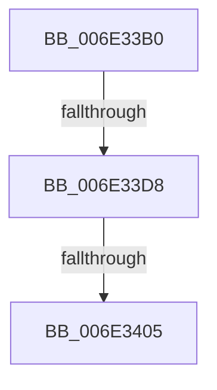

# sub_006E33B0

- RVA: `0x006E33B0`–`0x006E3417` (길이 `103` bytes)
- VA: `0x00000001406E33B0`
- 실행 섹션: `.text`
- PDB 이름 있음: `아니요`; PDB Function 태그: `아니요`
- unwind 정보 RVA: `0x00079F38`
- 디코드: `24`개 명령, `103/103` bytes 표시
- 미해석 바이트: `0` (있으면 어셈블리에 `.byte`로 보존)

> 이 문서는 커널 이미지의 기계어와 PDB 기호를 분석해 생성했습니다. 4번과 5번은 함수 원형과 자료형을 바이너리 사용 방식에서 추정한 C 해석이며 원본 소스 복구 결과는 아닙니다.

## 1. Dependencies

- 직접 호출 지점: **1**; 고유 호출 대상: **1**
- 직접 호출자로 확인된 함수: **0**
- RIP 상대 이미지 참조: **0**

### Outgoing calls
- `0x006E3408` → [MiUnlockPageTable](../21/MiUnlockPageTable_function_00216EC0.md) (function, `0x00216EC0`)

### Direct callers
- 이 함수 시작 RVA로 연결되는 직접 call은 확인되지 않았습니다. 간접 호출은 완전히 역산할 수 없습니다.

### Static image references
- 디코드된 RIP-relative 메모리 참조가 없습니다.

## 2. Other-region calls and transfers

- 다른 실행 섹션으로 향하는 call: **0**
- call이 아닌 외부 분기/꼬리 이동: **3**
  - `0x006E33D2` → [MiSoftFaultMappedView + 0x138](../36/MiSoftFaultMappedView_function_00365364.md) (`tail-transfer`)
  - `0x006E33FF` → [MiSoftFaultMappedView + 0x138](../36/MiSoftFaultMappedView_function_00365364.md) (`tail-transfer`)
  - `0x006E3412` → [MiSoftFaultMappedView + 0x138](../36/MiSoftFaultMappedView_function_00365364.md) (`tail-transfer`)

## 3. Assembly (complete function range)

```asm
006E33B0  48 8B 55 87                     mov rdx, qword ptr [rbp - 0x79]
006E33B4  8B CE                           mov ecx, esi
006E33B6  81 E1 FF 0F 00 00               and ecx, 0xfff
006E33BC  B8 00 10 00 00                  mov eax, 0x1000
006E33C1  2B C1                           sub eax, ecx
006E33C3  8B C8                           mov ecx, eax
006E33C5  48 83 E1 F8                     and rcx, 0xfffffffffffffff8
006E33C9  48 03 F1                        add rsi, rcx
006E33CC  48 03 F9                        add rdi, rcx
006E33CF  48 85 D2                        test rdx, rdx
006E33D2  0F 84 C4 20 C8 FF               je 0x14036549c
006E33D8  48 B8 F8 FF FF FF 7F 00 00 00   movabs rax, 0x7ffffffff8
006E33E2  48 8B CF                        mov rcx, rdi
006E33E5  48 C1 E9 09                     shr rcx, 9
006E33E9  48 23 C8                        and rcx, rax
006E33EC  48 B8 00 00 00 00 80 F6 FF FF   movabs rax, 0xfffff68000000000
006E33F6  48 8B C0                        mov rax, rax
006E33F9  48 03 C8                        add rcx, rax
006E33FC  48 3B D1                        cmp rdx, rcx
006E33FF  0F 84 97 20 C8 FF               je 0x14036549c
006E3405  48 8B CB                        mov rcx, rbx
006E3408  E8 B3 3A B3 FF                  call 0x140216ec0
006E340D  48 83 65 87 00                  and qword ptr [rbp - 0x79], 0
006E3412  E9 85 20 C8 FF                  jmp 0x14036549c
```

## 4. C-style interpretation (structured pseudocode)

```c
__int64 __fastcall sub_006E33B0(void)
{
    __int64 result;
    __int64 v_rdi;
    __int64 v_rsi;

    a1 = (unsigned int)(((unsigned int)((unsigned int)(v_rsi))) & (0xFFFULL));
    result = (unsigned int)(((unsigned int)(0x1000ULL)) - ((unsigned int)(a1)));
    a1 = ((unsigned int)((unsigned int)(result))) & (-8);
    v_rsi = (v_rsi) + (a1);
    v_rdi = (v_rdi) + (a1);
    a1 = (v_rdi) >> (9);
    a1 = (a1) & (result);
    a1 = (a1) + (result);
    result = MiUnlockPageTable(v_rbx, *(unsigned __int64 *)(v_rbp - 121), a3, a4);
}
```

## 5. (Beta) C Style

```c
void sub_006E33B0(void)
{
    int64_t result;
    int64_t local_rdi;
    int64_t local_rsi;

    a1 = (uint32_t)(((uint32_t)((uint32_t)(local_rsi))) & (0xFFFULL));
    result = (uint32_t)(((uint32_t)(0x1000ULL)) - ((uint32_t)(a1)));
    a1 = ((uint32_t)((uint32_t)(result))) & (-8);
    local_rsi = (local_rsi) + (a1);
    local_rdi = (local_rdi) + (a1);
    a1 = (local_rdi) >> (9);
    a1 = (a1) & (result);
    a1 = (a1) + (result);
    result = MiUnlockPageTable(local_rbx, *(uint64_t *)(local_rbp - 0x79), a3, a4);
}
```

## 6. Execution-region graph

[열기: 2D/3D 그래프와 함수 탐색 컨트롤 패널](../../../control-panel.html?section=text&rva=0x006E33B0&view=graph)

- 2D 그래프는 위에서 아래로 흐르고, 3D 그래프는 빈 공간을 드래그해 회전합니다. Shift+드래그는 이동, 휠은 확대·축소, 함수 노드 선택은 대상 보고서 이동입니다.

### Static fallback


