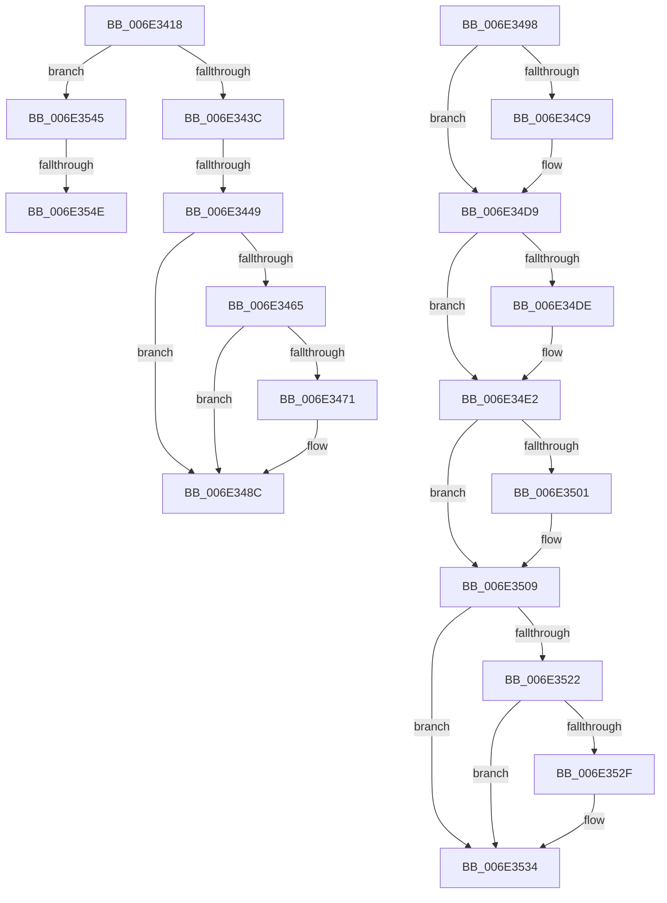

# sub_006E3418

- RVA: `0x006E3418`–`0x006E3560` (길이 `328` bytes)
- VA: `0x00000001406E3418`
- 실행 섹션: `.text`
- PDB 이름 있음: `아니요`; PDB Function 태그: `아니요`
- unwind 정보 RVA: `0x00079FAC`
- 디코드: `88`개 명령, `328/328` bytes 표시
- 미해석 바이트: `0` (있으면 어셈블리에 `.byte`로 보존)

> 이 문서는 커널 이미지의 기계어와 PDB 기호를 분석해 생성했습니다. 4번과 5번은 함수 원형과 자료형을 바이너리 사용 방식에서 추정한 C 해석이며 원본 소스 복구 결과는 아닙니다.

## 1. Dependencies

- 직접 호출 지점: **10**; 고유 호출 대상: **9**
- 직접 호출자로 확인된 함수: **0**
- RIP 상대 이미지 참조: **0**

### Outgoing calls
- `0x006E3427` → [MiGetNextDirectFixupProto](../../page/70/MiGetNextDirectFixupProto_function_007049F0.md) (function, `0x007049F0`)
- `0x006E3478` → [MiUnlockProtoPoolPage](../24/MiUnlockProtoPoolPage_function_00246090.md) (function, `0x00246090`)
- `0x006E34B5` → [KeAbPreAcquire](../21/KeAbPreAcquire_function_00210230.md) (function, `0x00210230`)
- `0x006E34D4` → [ExfAcquirePushLockSharedEx](../21/ExfAcquirePushLockSharedEx_function_0021044C.md) (function, `0x0021044C`)
- `0x006E34EE` → [MiDereferenceSubsectionProtos](../../page/A2/MiDereferenceSubsectionProtos_function_00A2EEE4.md) (function, `0x00A2EEE4`)
- `0x006E3504` → [ExfReleasePushLockShared](../26/ExfReleasePushLockShared_function_00263440.md) (function, `0x00263440`)
- `0x006E350C` → [KeAbPostRelease](../2E/KeAbPostRelease_function_002E1600.md) (function, `0x002E1600`)
- `0x006E352F` → [KiCheckForKernelApcDelivery](../2E/KiCheckForKernelApcDelivery_function_002E2C80.md) (function, `0x002E2C80`)
- `0x006E3538` → [MiFreeSubsectionProtos](../../page/AA/MiFreeSubsectionProtos_function_00AA18F8.md) (function, `0x00AA18F8`)
- `0x006E3555` → [MiUnlockProtoPoolPage](../24/MiUnlockProtoPoolPage_function_00246090.md) (function, `0x00246090`)

### Direct callers
- 이 함수 시작 RVA로 연결되는 직접 call은 확인되지 않았습니다. 간접 호출은 완전히 역산할 수 없습니다.

### Static image references
- 디코드된 RIP-relative 메모리 참조가 없습니다.

## 2. Other-region calls and transfers

- 다른 실행 섹션으로 향하는 call: **3**
  - `0x006E3427` → [MiGetNextDirectFixupProto](../../page/70/MiGetNextDirectFixupProto_function_007049F0.md) (`.text` → `PAGE`)
  - `0x006E34EE` → [MiDereferenceSubsectionProtos](../../page/A2/MiDereferenceSubsectionProtos_function_00A2EEE4.md) (`.text` → `PAGE`)
  - `0x006E3538` → [MiFreeSubsectionProtos](../../page/AA/MiFreeSubsectionProtos_function_00AA18F8.md) (`.text` → `PAGE`)
- call이 아닌 외부 분기/꼬리 이동: **5**
  - `0x006E3443` → [MiWalkEntireImage + 0x20A](../36/MiWalkEntireImage_function_00365D70.md) (`tail-transfer`)
  - `0x006E3493` → [MiWalkEntireImage + 0x2CC](../36/MiWalkEntireImage_function_00365D70.md) (`tail-transfer`)
  - `0x006E3540` → [MiWalkEntireImage + 0x246](../36/MiWalkEntireImage_function_00365D70.md) (`tail-transfer`)
  - `0x006E3548` → [MiWalkEntireImage + 0x80E](../36/MiWalkEntireImage_function_00365D70.md) (`tail-transfer`)
  - `0x006E355B` → [MiWalkEntireImage + 0x80E](../36/MiWalkEntireImage_function_00365D70.md) (`tail-transfer`)

## 3. Assembly (complete function range)

```asm
006E3418  8B 45 E8                        mov eax, dword ptr [rbp - 0x18]
006E341B  48 8B 4D D8                     mov rcx, qword ptr [rbp - 0x28]
006E341F  41 03 C2                        add eax, r10d
006E3422  8B D0                           mov edx, eax
006E3424  89 45 E8                        mov dword ptr [rbp - 0x18], eax
006E3427  E8 C4 15 02 00                  call 0x1407049f0
006E342C  48 89 45 E0                     mov qword ptr [rbp - 0x20], rax
006E3430  4C 8B C0                        mov r8, rax
006E3433  48 85 C0                        test rax, rax
006E3436  0F 84 09 01 00 00               je 0x1406e3545
006E343C  48 8B 5D B0                     mov rbx, qword ptr [rbp - 0x50]
006E3440  48 3B C3                        cmp rax, rbx
006E3443  0F 83 31 2B C8 FF               jae 0x140365f7a
006E3449  49 2B C6                        sub rax, r14
006E344C  48 C1 F8 03                     sar rax, 3
006E3450  44 03 F8                        add r15d, eax
006E3453  48 C1 E0 0C                     shl rax, 0xc
006E3457  48 01 45 98                     add qword ptr [rbp - 0x68], rax
006E345B  4C 89 7C 24 68                  mov qword ptr [rsp + 0x68], r15
006E3460  48 85 F6                        test rsi, rsi
006E3463  74 27                           je 0x1406e348c
006E3465  4D 33 F0                        xor r14, r8
006E3468  49 F7 C6 00 F0 FF FF            test r14, -0x1000
006E346F  74 1B                           je 0x1406e348c
006E3471  8A 54 24 50                     mov dl, byte ptr [rsp + 0x50]
006E3475  48 8B CE                        mov rcx, rsi
006E3478  E8 13 2C B6 FF                  call 0x140246090
006E347D  4C 8B 45 E0                     mov r8, qword ptr [rbp - 0x20]
006E3481  45 33 C9                        xor r9d, r9d
006E3484  41 8B F1                        mov esi, r9d
006E3487  4C 89 4C 24 58                  mov qword ptr [rsp + 0x58], r9
006E348C  4D 8B F0                        mov r14, r8
006E348F  4C 89 45 B8                     mov qword ptr [rbp - 0x48], r8
006E3493  E9 A4 2B C8 FF                  jmp 0x14036603c
006E3498  66 45 29 86 E6 01 00 00         sub word ptr [r14 + 0x1e6], r8w
006E34A0  33 D2                           xor edx, edx
006E34A2  48 8B 5D C0                     mov rbx, qword ptr [rbp - 0x40]
006E34A6  45 33 C0                        xor r8d, r8d
006E34A9  48 83 C3 28                     add rbx, 0x28
006E34AD  4C 89 4D 08                     mov qword ptr [rbp + 8], r9
006E34B1  48 8B CB                        mov rcx, rbx
006E34B4  90                              nop
006E34B5  E8 76 CD B2 FF                  call 0x140210230
006E34BA  48 8B F0                        mov rsi, rax
006E34BD  33 C0                           xor eax, eax
006E34BF  8D 48 11                        lea ecx, [rax + 0x11]
006E34C2  F0 48 0F B1 0B                  lock cmpxchg qword ptr [rbx], rcx
006E34C7  74 10                           je 0x1406e34d9
006E34C9  4C 8B CB                        mov r9, rbx
006E34CC  4C 8B C6                        mov r8, rsi
006E34CF  33 D2                           xor edx, edx
006E34D1  48 8B CB                        mov rcx, rbx
006E34D4  E8 73 CF B2 FF                  call 0x14021044c
006E34D9  48 85 F6                        test rsi, rsi
006E34DC  74 04                           je 0x1406e34e2
006E34DE  C6 46 0A 01                     mov byte ptr [rsi + 0xa], 1
006E34E2  8B 54 24 78                     mov edx, dword ptr [rsp + 0x78]
006E34E6  4C 8D 45 08                     lea r8, [rbp + 8]
006E34EA  48 8B 4D A8                     mov rcx, qword ptr [rbp - 0x58]
006E34EE  E8 F1 B9 34 00                  call 0x140a2eee4
006E34F3  B8 11 00 00 00                  mov eax, 0x11
006E34F8  33 C9                           xor ecx, ecx
006E34FA  F0 48 0F B1 0B                  lock cmpxchg qword ptr [rbx], rcx
006E34FF  74 08                           je 0x1406e3509
006E3501  48 8B CB                        mov rcx, rbx
006E3504  E8 37 FF B7 FF                  call 0x140263440
006E3509  48 8B CB                        mov rcx, rbx
006E350C  E8 EF E0 BF FF                  call 0x1402e1600
006E3511  41 B9 01 00 00 00               mov r9d, 1
006E3517  90                              nop
006E3518  66 45 01 8E E6 01 00 00         add word ptr [r14 + 0x1e6], r9w
006E3520  75 12                           jne 0x1406e3534
006E3522  49 8D 86 98 00 00 00            lea rax, [r14 + 0x98]
006E3529  90                              nop
006E352A  48 39 00                        cmp qword ptr [rax], rax
006E352D  74 05                           je 0x1406e3534
006E352F  E8 4C F7 BF FF                  call 0x1402e2c80
006E3534  48 8D 4D 08                     lea rcx, [rbp + 8]
006E3538  E8 BB E3 3B 00                  call 0x140aa18f8
006E353D  83 E7 F7                        and edi, 0xfffffff7
006E3540  E9 71 2A C8 FF                  jmp 0x140365fb6
006E3545  48 85 F6                        test rsi, rsi
006E3548  0F 84 30 30 C8 FF               je 0x14036657e
006E354E  8A 54 24 50                     mov dl, byte ptr [rsp + 0x50]
006E3552  48 8B CE                        mov rcx, rsi
006E3555  E8 36 2B B6 FF                  call 0x140246090
006E355A  90                              nop
006E355B  E9 1E 30 C8 FF                  jmp 0x14036657e
```

## 4. C-style interpretation (structured pseudocode)

```c
__int64 __fastcall sub_006E3418(__int64 a1, __int64 a2, __int64 a3, int a4, __int64 a5, __int64 a6, __int64 a7, __int64 a8, __int64 a9, unsigned __int8 a10)
{
    __int64 result;
    __int64 v_r14;
    __int64 v_r15;
    __int64 v_rsi;
    unsigned __int64 v_stack_p58;
    unsigned __int64 v_stack_p68;
    unsigned int v_stack_p78;

    result = (unsigned int)(((unsigned int)(*(unsigned int *)(v_rbp - 24))) + ((unsigned int)(v_r10)));
    *(unsigned int *)(v_rbp - 24) = (unsigned int)(result);
    result = MiGetNextDirectFixupProto(*(unsigned __int64 *)(v_rbp - 40), (unsigned int)((unsigned int)(result)), a3, a4);
    *(unsigned __int64 *)(v_rbp - 32) = result;
    if (result == 0) goto loc_006E3545;
    result = (result) - (v_r14);
    result = (result) >> (3);
    v_r15 = (unsigned int)((v_r15) + ((unsigned int)(result)));
    result = (result) << (12);
    v_stack_p68 = v_r15;
    if (v_rsi == 0) goto loc_006E348C;
    v_r14 = (v_r14) ^ (result);
    if (((v_r14) & (0xFFFFFFFFFFFFF000ULL)) != 0) {
        a2 = a10;
        a1 = v_rsi;
        result = MiUnlockProtoPoolPage(a1, a2, result, a4);
        a3 = *(unsigned __int64 *)(v_rbp - 32);
        a4 = 0;
        v_rsi = 0;
        v_stack_p58 = 0;
    }
    *(unsigned __int64 *)(v_rbp - 72) = a3;
loc_006E3545:
    result = MiUnlockProtoPoolPage(v_rsi, a10, a3, a4);
}
```

## 5. (Beta) C Style

```c
int64_t sub_006E3418(int64_t Arg1, int64_t Arg2, int64_t Arg3, int32_t Arg4, uint64_t Arg5, uint64_t Arg6, uint64_t Arg7, uint64_t Arg8, uint64_t Arg9, uint8_t Arg10)
{
    int64_t result;
    int64_t local_r14;
    int64_t local_r15;
    int64_t local_rsi;
    uint64_t v_stack_p58;
    uint64_t v_stack_p68;
    uint32_t v_stack_p78;

    result = (uint32_t)(((uint32_t)(*(uint32_t *)(local_rbp - 0x18))) + ((uint32_t)(local_r10)));
    *(uint32_t *)(local_rbp - 0x18) = (uint32_t)(result);
    result = MiGetNextDirectFixupProto(*(uint64_t *)(local_rbp - 0x28), (uint32_t)((uint32_t)(result)), Arg3, Arg4);
    *(uint64_t *)(local_rbp - 0x20) = result;
    if (result == 0) goto loc_006E3545;
    result = (result) - (local_r14);
    result = (result) >> (3);
    local_r15 = (uint32_t)((local_r15) + ((uint32_t)(result)));
    result = (result) << (12);
    v_stack_p68 = local_r15;
    if (local_rsi == 0) goto loc_006E348C;
    local_r14 = (local_r14) ^ (result);
    if (((local_r14) & (0xFFFFFFFFFFFFF000ULL)) != 0) {
        Arg2 = Arg10;
        Arg1 = local_rsi;
        result = MiUnlockProtoPoolPage(Arg1, Arg2, result, Arg4);
        Arg3 = *(uint64_t *)(local_rbp - 0x20);
        Arg4 = 0;
        local_rsi = 0;
        v_stack_p58 = 0;
    }
    *(uint64_t *)(local_rbp - 0x48) = Arg3;
loc_006E3545:
    result = MiUnlockProtoPoolPage(local_rsi, Arg10, Arg3, Arg4);
}
```

## 6. Execution-region graph

[열기: 2D/3D 그래프와 함수 탐색 컨트롤 패널](../../../control-panel.html?section=text&rva=0x006E3418&view=graph)

- 2D 그래프는 위에서 아래로 흐르고, 3D 그래프는 빈 공간을 드래그해 회전합니다. Shift+드래그는 이동, 휠은 확대·축소, 함수 노드 선택은 대상 보고서 이동입니다.

### Static fallback


