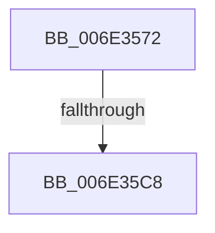

# sub_006E3572

- RVA: `0x006E3572`–`0x006E35D1` (길이 `95` bytes)
- VA: `0x00000001406E3572`
- 실행 섹션: `.text`
- PDB 이름 있음: `아니요`; PDB Function 태그: `아니요`
- unwind 정보 RVA: `0x0007A024`
- 디코드: `18`개 명령, `95/95` bytes 표시
- 미해석 바이트: `0` (있으면 어셈블리에 `.byte`로 보존)

> 이 문서는 커널 이미지의 기계어와 PDB 기호를 분석해 생성했습니다. 4번과 5번은 함수 원형과 자료형을 바이너리 사용 방식에서 추정한 C 해석이며 원본 소스 복구 결과는 아닙니다.

## 1. Dependencies

- 직접 호출 지점: **2**; 고유 호출 대상: **2**
- 직접 호출자로 확인된 함수: **0**
- RIP 상대 이미지 참조: **1**

### Outgoing calls
- `0x006E35B0` → [MiAllocateEnclavePages](../3B/MiAllocateEnclavePages_function_003BC43C.md) (function, `0x003BC43C`)
- `0x006E35BA` → [MiUnlinkPageChainHead](../36/MiUnlinkPageChainHead_function_00365C40.md) (function, `0x00365C40`)

### Direct callers
- 이 함수 시작 RVA로 연결되는 직접 call은 확인되지 않았습니다. 간접 호출은 완전히 역산할 수 없습니다.

### Static image references
- `0x006E357B` → RVA `0x00FC8C40` (`ALMOSTRO`; read)

## 2. Other-region calls and transfers

- 다른 실행 섹션으로 향하는 call: **0**
- call이 아닌 외부 분기/꼬리 이동: **2**
  - `0x006E35C2` → [MiGetPageForEnclave + 0x28](../36/MiGetPageForEnclave_function_00367C38.md) (`tail-transfer`)
  - `0x006E35CC` → [MiGetPageForEnclave + 0x47](../36/MiGetPageForEnclave_function_00367C38.md) (`tail-transfer`)

## 3. Assembly (complete function range)

```asm
006E3572  65 48 8B 04 25 88 01 00 00      mov rax, qword ptr gs:[0x188]
006E357B  48 8D 0D BE 56 8E 00            lea rcx, [rip + 0x8e56be]
006E3582  41 B9 01 00 00 00               mov r9d, 1
006E3588  45 33 C0                        xor r8d, r8d
006E358B  8B 80 4C 02 00 00               mov eax, dword ptr [rax + 0x24c]
006E3591  48 8B 04 C1                     mov rax, qword ptr [rcx + rax*8]
006E3595  48 8B 88 C0 00 00 00            mov rcx, qword ptr [rax + 0xc0]
006E359C  48 8D 44 24 30                  lea rax, [rsp + 0x30]
006E35A1  48 89 44 24 20                  mov qword ptr [rsp + 0x20], rax
006E35A6  0F B7 91 8A 00 00 00            movzx edx, word ptr [rcx + 0x8a]
006E35AD  49 8B CA                        mov rcx, r10
006E35B0  E8 87 8E CD FF                  call 0x1403bc43c
006E35B5  48 8D 4C 24 30                  lea rcx, [rsp + 0x30]
006E35BA  E8 81 26 C8 FF                  call 0x140365c40
006E35BF  48 85 C0                        test rax, rax
006E35C2  0F 85 98 46 C8 FF               jne 0x140367c60
006E35C8  48 83 C8 FF                     or rax, 0xffffffffffffffff
006E35CC  E9 AE 46 C8 FF                  jmp 0x140367c7f
```

## 4. C-style interpretation (structured pseudocode)

```c
__int64 __fastcall sub_006E3572(__int64 a1, __int64 a2, int a3, __int64 a4, __int64 a5, __int64 a6)
{
    __int64 result;
    unsigned __int64 v_stack_p20;

    a3 = 0;
    v_stack_p20 = a6;
    result = MiAllocateEnclavePages(v_r10, *(unsigned __int16 *)(*(unsigned __int64 *)(*(unsigned __int64 *)(v_rip + 9328318 + (unsigned int)(*(unsigned int *)(*(unsigned __int64 *)(gs_base + (0 + 392)) + 588)) * 8) + 192) + 138), a3, 1);
    result = MiUnlinkPageChainHead(a6, *(unsigned __int16 *)(*(unsigned __int64 *)(*(unsigned __int64 *)(v_rip + 9328318 + (unsigned int)(*(unsigned int *)(*(unsigned __int64 *)(gs_base + (0 + 392)) + 588)) * 8) + 192) + 138), a3, 1);
    result = (result) | (-1);
}
```

## 5. (Beta) C Style

```c
int64_t sub_006E3572(int64_t Arg1, int64_t Arg2, int32_t Arg3, int64_t Arg4, uint64_t Arg5, int64_t Arg6)
{
    int64_t result;
    uint64_t v_stack_p20;

    Arg3 = 0;
    v_stack_p20 = Arg6;
    result = MiAllocateEnclavePages(local_r10, *(uint16_t *)(*(uint64_t *)(*(uint64_t *)(v_rip + 0x8E56BE + (uint32_t)(*(uint32_t *)(*(uint64_t *)(gs_base + (0 + 0x188)) + 0x24C)) * 8) + 0xC0) + 0x8A), Arg3, 1);
    result = MiUnlinkPageChainHead(Arg6, *(uint16_t *)(*(uint64_t *)(*(uint64_t *)(v_rip + 0x8E56BE + (uint32_t)(*(uint32_t *)(*(uint64_t *)(gs_base + (0 + 0x188)) + 0x24C)) * 8) + 0xC0) + 0x8A), Arg3, 1);
    result = (result) | (-1);
}
```

## 6. Execution-region graph

[열기: 2D/3D 그래프와 함수 탐색 컨트롤 패널](../../../control-panel.html?section=text&rva=0x006E3572&view=graph)

- 2D 그래프는 위에서 아래로 흐르고, 3D 그래프는 빈 공간을 드래그해 회전합니다. Shift+드래그는 이동, 휠은 확대·축소, 함수 노드 선택은 대상 보고서 이동입니다.

### Static fallback


