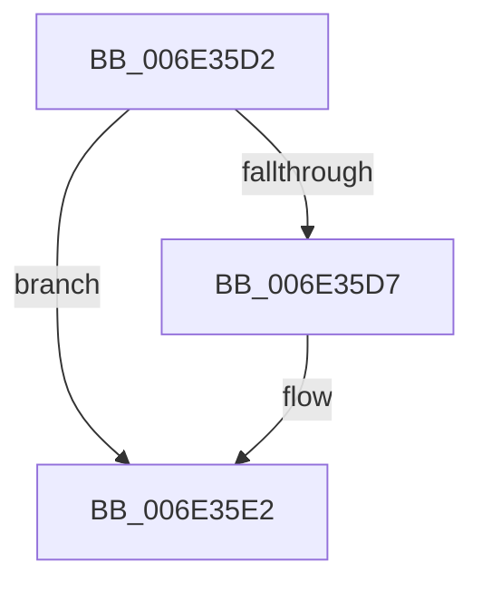

# sub_006E35D2

- RVA: `0x006E35D2`–`0x006E35FB` (길이 `41` bytes)
- VA: `0x00000001406E35D2`
- 실행 섹션: `.text`
- PDB 이름 있음: `아니요`; PDB Function 태그: `아니요`
- unwind 정보 RVA: `0x0007A060`
- 디코드: `12`개 명령, `41/41` bytes 표시
- 미해석 바이트: `0` (있으면 어셈블리에 `.byte`로 보존)

> 이 문서는 커널 이미지의 기계어와 PDB 기호를 분석해 생성했습니다. 4번과 5번은 함수 원형과 자료형을 바이너리 사용 방식에서 추정한 C 해석이며 원본 소스 복구 결과는 아닙니다.

## 1. Dependencies

- 직접 호출 지점: **3**; 고유 호출 대상: **3**
- 직접 호출자로 확인된 함수: **0**
- RIP 상대 이미지 참조: **0**

### Outgoing calls
- `0x006E35DD` → [MiUnlockPageTable](../21/MiUnlockPageTable_function_00216EC0.md) (function, `0x00216EC0`)
- `0x006E35E8` → [MiUnlockWorkingSetShared](../27/MiUnlockWorkingSetShared_function_0027D690.md) (function, `0x0027D690`)
- `0x006E35F0` → [MiLockWorkingSetShared](../27/MiLockWorkingSetShared_function_0027CBF0.md) (function, `0x0027CBF0`)

### Direct callers
- 이 함수 시작 RVA로 연결되는 직접 call은 확인되지 않았습니다. 간접 호출은 완전히 역산할 수 없습니다.

### Static image references
- 디코드된 RIP-relative 메모리 참조가 없습니다.

## 2. Other-region calls and transfers

- 다른 실행 섹션으로 향하는 call: **0**
- call이 아닌 외부 분기/꼬리 이동: **1**
  - `0x006E35F6` → [MiCommitEnclavePages + 0x123](../36/MiCommitEnclavePages_function_00367CCC.md) (`tail-transfer`)

## 3. Assembly (complete function range)

```asm
006E35D2  48 85 DB                        test rbx, rbx
006E35D5  74 0B                           je 0x1406e35e2
006E35D7  48 8B D3                        mov rdx, rbx
006E35DA  48 8B CE                        mov rcx, rsi
006E35DD  E8 DE 38 B3 FF                  call 0x140216ec0
006E35E2  41 8A D7                        mov dl, r15b
006E35E5  48 8B CE                        mov rcx, rsi
006E35E8  E8 A3 A0 B9 FF                  call 0x14027d690
006E35ED  48 8B CE                        mov rcx, rsi
006E35F0  E8 FB 95 B9 FF                  call 0x14027cbf0
006E35F5  90                              nop
006E35F6  E9 F4 47 C8 FF                  jmp 0x140367def
```

## 4. C-style interpretation (structured pseudocode)

```c
__int64 __fastcall sub_006E35D2(void)
{
    __int64 result;

    if (v_rbx != 0) {
        a2 = v_rbx;
        a1 = v_rsi;
        result = MiUnlockPageTable(a1, a2, a3, a4);
    }
    result = MiUnlockWorkingSetShared(v_rsi, (unsigned __int8)(v_r15), a3, a4);
    result = MiLockWorkingSetShared(v_rsi, (unsigned __int8)(v_r15), a3, a4);
}
```

## 5. (Beta) C Style

```c
void sub_006E35D2(void)
{
    int64_t result;

    if (local_rbx != 0) {
        a2 = local_rbx;
        a1 = local_rsi;
        result = MiUnlockPageTable(a1, a2, a3, a4);
    }
    result = MiUnlockWorkingSetShared(local_rsi, (uint8_t)(local_r15), a3, a4);
    result = MiLockWorkingSetShared(local_rsi, (uint8_t)(local_r15), a3, a4);
}
```

## 6. Execution-region graph

[열기: 2D/3D 그래프와 함수 탐색 컨트롤 패널](../../../control-panel.html?section=text&rva=0x006E35D2&view=graph)

- 2D 그래프는 위에서 아래로 흐르고, 3D 그래프는 빈 공간을 드래그해 회전합니다. Shift+드래그는 이동, 휠은 확대·축소, 함수 노드 선택은 대상 보고서 이동입니다.

### Static fallback


