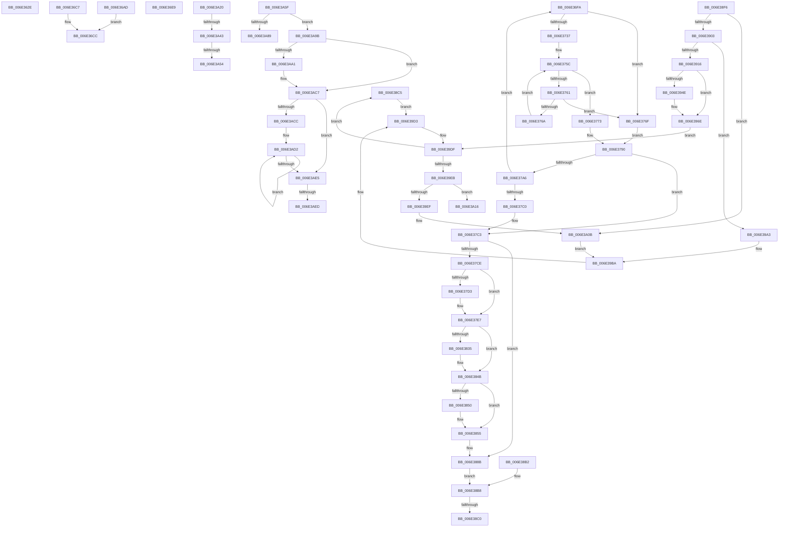

# sub_006E362E

- RVA: `0x006E362E`–`0x006E3AF8` (길이 `1,226` bytes)
- VA: `0x00000001406E362E`
- 실행 섹션: `.text`
- PDB 이름 있음: `아니요`; PDB Function 태그: `아니요`
- unwind 정보 RVA: `0x0007A134`
- 디코드: `300`개 명령, `1,226/1,226` bytes 표시
- 미해석 바이트: `0` (있으면 어셈블리에 `.byte`로 보존)

> 이 문서는 커널 이미지의 기계어와 PDB 기호를 분석해 생성했습니다. 4번과 5번은 함수 원형과 자료형을 바이너리 사용 방식에서 추정한 C 해석이며 원본 소스 복구 결과는 아닙니다.

## 1. Dependencies

- 직접 호출 지점: **32**; 고유 호출 대상: **24**
- 직접 호출자로 확인된 함수: **0**
- RIP 상대 이미지 참조: **5**

### Outgoing calls
- `0x006E364C` → [KeTrackEnclaveTbFlush](../5B/KeTrackEnclaveTbFlush_function_005BBC94.md) (function, `0x005BBC94`)
- `0x006E3651` → [MiGetProcessorFlushList](../24/MiGetProcessorFlushList_function_00242C90.md) (function, `0x00242C90`)
- `0x006E3671` → [MiInitializeTbFlushList](../29/MiInitializeTbFlushList_function_00294F00.md) (function, `0x00294F00`)
- `0x006E368F` → [MiInsertTbFlushEntry](../29/MiInsertTbFlushEntry_function_00293670.md) (function, `0x00293670`)
- `0x006E3697` → [MiFlushTbList](../31/MiFlushTbList_function_00311FC0.md) (function, `0x00311FC0`)
- `0x006E369C` → [MiReleaseProcessorFlushList](../31/MiReleaseProcessorFlushList_function_00313C70.md) (function, `0x00313C70`)
- `0x006E36B8` → [MiUnlockPageTable](../21/MiUnlockPageTable_function_00216EC0.md) (function, `0x00216EC0`)
- `0x006E36D6` → [MiUnlockWorkingSetShared](../27/MiUnlockWorkingSetShared_function_0027D690.md) (function, `0x0027D690`)
- `0x006E36DE` → [MiLockWorkingSetShared](../27/MiLockWorkingSetShared_function_0027CBF0.md) (function, `0x0027CBF0`)
- `0x006E36EF` → [MiUnlockPageTable](../21/MiUnlockPageTable_function_00216EC0.md) (function, `0x00216EC0`)
- `0x006E37B3` → [RtlInterlockedSetClearRun](../37/RtlInterlockedSetClearRun_function_00377F10.md) (function, `0x00377F10`)
- `0x006E37D6` → [MiFlushTbList](../31/MiFlushTbList_function_00311FC0.md) (function, `0x00311FC0`)
- `0x006E37DB` → [MiReleaseProcessorFlushList](../31/MiReleaseProcessorFlushList_function_00313C70.md) (function, `0x00313C70`)
- `0x006E37EF` → [MiUnlockPageTable](../21/MiUnlockPageTable_function_00216EC0.md) (function, `0x00216EC0`)
- `0x006E3800` → [MiUnlockWorkingSetShared](../27/MiUnlockWorkingSetShared_function_0027D690.md) (function, `0x0027D690`)
- `0x006E3821` → [KeAbPreAcquire](../21/KeAbPreAcquire_function_00210230.md) (function, `0x00210230`)
- `0x006E3846` → [ExfAcquirePushLockExclusiveEx](../20/ExfAcquirePushLockExclusiveEx_function_0020FC90.md) (function, `0x0020FC90`)
- `0x006E3862` → [MiLockWorkingSetShared](../27/MiLockWorkingSetShared_function_0027CBF0.md) (function, `0x0027CBF0`)
- `0x006E3886` → [MiMakeSystemAddressValid](../27/MiMakeSystemAddressValid_function_0027FF70.md) (function, `0x0027FF70`)
- `0x006E38A7` → [KeBlockEnclavePage](../5B/KeBlockEnclavePage_function_005BB998.md) (function, `0x005BB998`)
- `0x006E38CC` → [ExAcquireSpinLockSharedAtDpcLevel](../24/ExAcquireSpinLockSharedAtDpcLevel_function_00248E30.md) (function, `0x00248E30`)
- `0x006E38E6` → [KeOutPageEnclavePage](../5B/KeOutPageEnclavePage_function_005BBBDC.md) (function, `0x005BBBDC`)
- `0x006E391D` → [ExReleaseSpinLockSharedFromDpcLevel](../24/ExReleaseSpinLockSharedFromDpcLevel_function_0024A590.md) (function, `0x0024A590`)
- `0x006E3929` → [ExAcquireSpinLockExclusiveAtDpcLevel](../24/ExAcquireSpinLockExclusiveAtDpcLevel_function_00248E80.md) (function, `0x00248E80`)
- `0x006E3935` → [KeRemoveEnclavePage](../36/KeRemoveEnclavePage_function_00368C90.md) (function, `0x00368C90`)
- `0x006E3941` → [KeCreateEnclaveMetadataPage](../5B/KeCreateEnclaveMetadataPage_function_005BBBA0.md) (function, `0x005BBBA0`)
- `0x006E3968` → [KeBugCheckEx](../4F/KeBugCheckEx_function_004FD660.md) (function, `0x004FD660`)
- `0x006E3975` → [ExReleaseSpinLockExclusiveFromDpcLevel](../24/ExReleaseSpinLockExclusiveFromDpcLevel_function_002497E0.md) (function, `0x002497E0`)
- `0x006E39DA` → [ExReleaseSpinLockSharedFromDpcLevel](../24/ExReleaseSpinLockSharedFromDpcLevel_function_0024A590.md) (function, `0x0024A590`)
- `0x006E3A05` → [KeBugCheckEx](../4F/KeBugCheckEx_function_004FD660.md) (function, `0x004FD660`)
- `0x006E3A27` → [KeAbPostRelease](../2E/KeAbPostRelease_function_002E1600.md) (function, `0x002E1600`)
- `0x006E3A54` → [KiCheckForKernelApcDelivery](../2E/KiCheckForKernelApcDelivery_function_002E2C80.md) (function, `0x002E2C80`)

### Direct callers
- 이 함수 시작 RVA로 연결되는 직접 call은 확인되지 않았습니다. 간접 호출은 완전히 역산할 수 없습니다.

### Static image references
- `0x006E36FA` → RVA `0x00E375C8` (`.data`; read)
- `0x006E381A` → RVA `0x00E375D0` (`.data`; read)
- `0x006E3829` → RVA `0x00E375D0` (`.data`; read/write)
- `0x006E3893` → RVA `0x00E375C0` (`.data`; read)
- `0x006E38C5` → RVA `0x00E375D8` (`.data`; read)

## 2. Other-region calls and transfers

- 다른 실행 섹션으로 향하는 call: **0**
- call이 아닌 외부 분기/꼬리 이동: **12**
  - `0x006E36A8` → [MiDecommitHardwareEnclavePages + 0xAF](../36/MiDecommitHardwareEnclavePages_function_003688D4.md) (`tail-transfer`)
  - `0x006E36E4` → [MiDecommitHardwareEnclavePages + 0xD7](../36/MiDecommitHardwareEnclavePages_function_003688D4.md) (`tail-transfer`)
  - `0x006E36F5` → [MiDecommitHardwareEnclavePages + 0x28E](../36/MiDecommitHardwareEnclavePages_function_003688D4.md) (`tail-transfer`)
  - `0x006E38BA` → [MiDecommitHardwareEnclavePages + 0x14E](../36/MiDecommitHardwareEnclavePages_function_003688D4.md) (`tail-transfer`)
  - `0x006E38C0` → [MiDecommitHardwareEnclavePages + 0x143](../36/MiDecommitHardwareEnclavePages_function_003688D4.md) (`tail-transfer`)
  - `0x006E3A1B` → [MiDecommitHardwareEnclavePages + 0x143](../36/MiDecommitHardwareEnclavePages_function_003688D4.md) (`tail-transfer`)
  - `0x006E3A3D` → [MiDecommitHardwareEnclavePages + 0x228](../36/MiDecommitHardwareEnclavePages_function_003688D4.md) (`tail-transfer`)
  - `0x006E3A4E` → [MiDecommitHardwareEnclavePages + 0x228](../36/MiDecommitHardwareEnclavePages_function_003688D4.md) (`tail-transfer`)
  - `0x006E3A5A` → [MiDecommitHardwareEnclavePages + 0x228](../36/MiDecommitHardwareEnclavePages_function_003688D4.md) (`tail-transfer`)
  - `0x006E3A96` → [MiDecommitHardwareEnclavePages + 0x228](../36/MiDecommitHardwareEnclavePages_function_003688D4.md) (`tail-transfer`)
  - `0x006E3AE7` → [MiDecommitHardwareEnclavePages + 0x228](../36/MiDecommitHardwareEnclavePages_function_003688D4.md) (`tail-transfer`)
  - `0x006E3AF3` → [MiDecommitHardwareEnclavePages + 0x228](../36/MiDecommitHardwareEnclavePages_function_003688D4.md) (`tail-transfer`)

## 3. Assembly (complete function range)

```asm
006E362E  48 8B F1                        mov rsi, rcx
006E3631  48 C1 E6 19                     shl rsi, 0x19
006E3635  48 8B 8C 24 E8 00 00 00         mov rcx, qword ptr [rsp + 0xe8]
006E363D  48 8B 49 50                     mov rcx, qword ptr [rcx + 0x50]
006E3641  48 C1 E1 19                     shl rcx, 0x19
006E3645  48 2B CE                        sub rcx, rsi
006E3648  48 C1 F9 10                     sar rcx, 0x10
006E364C  E8 43 86 ED FF                  call 0x1405bbc94
006E3651  E8 3A F6 B5 FF                  call 0x140242c90
006E3656  48 8B F8                        mov rdi, rax
006E3659  C7 44 24 20 80 00 00 00         mov dword ptr [rsp + 0x20], 0x80
006E3661  41 B9 08 00 00 00               mov r9d, 8
006E3667  44 8B 40 0C                     mov r8d, dword ptr [rax + 0xc]
006E366B  49 8B D7                        mov rdx, r15
006E366E  48 8B C8                        mov rcx, rax
006E3671  E8 8A 18 BB FF                  call 0x140294f00
006E3676  48 8B 94 24 F0 00 00 00         mov rdx, qword ptr [rsp + 0xf0]
006E367E  48 C1 E2 19                     shl rdx, 0x19
006E3682  48 2B D6                        sub rdx, rsi
006E3685  48 C1 FA 10                     sar rdx, 0x10
006E3689  45 33 C9                        xor r9d, r9d
006E368C  4D 8B C6                        mov r8, r14
006E368F  E8 DC FF BA FF                  call 0x140293670
006E3694  48 8B CF                        mov rcx, rdi
006E3697  E8 24 E9 C2 FF                  call 0x140311fc0
006E369C  E8 CF 05 C3 FF                  call 0x140313c70
006E36A1  33 F6                           xor esi, esi
006E36A3  48 89 74 24 40                  mov qword ptr [rsp + 0x40], rsi
006E36A8  E9 D6 52 C8 FF                  jmp 0x140368983
006E36AD  49 8B D5                        mov rdx, r13
006E36B0  4C 8B 7C 24 38                  mov r15, qword ptr [rsp + 0x38]
006E36B5  49 8B CF                        mov rcx, r15
006E36B8  E8 03 38 B3 FF                  call 0x140216ec0
006E36BD  45 33 ED                        xor r13d, r13d
006E36C0  4C 89 6C 24 60                  mov qword ptr [rsp + 0x60], r13
006E36C5  EB 05                           jmp 0x1406e36cc
006E36C7  4C 8B 7C 24 38                  mov r15, qword ptr [rsp + 0x38]
006E36CC  8A 94 24 E0 00 00 00            mov dl, byte ptr [rsp + 0xe0]
006E36D3  49 8B CF                        mov rcx, r15
006E36D6  E8 B5 9F B9 FF                  call 0x14027d690
006E36DB  49 8B CF                        mov rcx, r15
006E36DE  E8 0D 95 B9 FF                  call 0x14027cbf0
006E36E3  90                              nop
006E36E4  E9 C2 52 C8 FF                  jmp 0x1403689ab
006E36E9  49 8B D5                        mov rdx, r13
006E36EC  49 8B CF                        mov rcx, r15
006E36EF  E8 CC 37 B3 FF                  call 0x140216ec0
006E36F4  90                              nop
006E36F5  E9 68 54 C8 FF                  jmp 0x140368b62
006E36FA  48 8B 05 C7 3E 75 00            mov rax, qword ptr [rip + 0x753ec7]
006E3701  44 8B 00                        mov r8d, dword ptr [rax]
006E3704  45 8D 58 FF                     lea r11d, [r8 - 1]
006E3708  4C 8B 48 08                     mov r9, qword ptr [rax + 8]
006E370C  49 8B C9                        mov rcx, r9
006E370F  83 E1 04                        and ecx, 4
006E3712  8B C1                           mov eax, ecx
006E3714  48 F7 D8                        neg rax
006E3717  45 1B D2                        sbb r10d, r10d
006E371A  41 83 E2 20                     and r10d, 0x20
006E371E  48 F7 D9                        neg rcx
006E3721  48 1B C0                        sbb rax, rax
006E3724  83 E0 04                        and eax, 4
006E3727  4C 2B C8                        sub r9, rax
006E372A  83 64 24 68 00                  and dword ptr [rsp + 0x68], 0
006E372F  45 03 DA                        add r11d, r10d
006E3732  45 3B C6                        cmp r8d, r14d
006E3735  72 38                           jb 0x1406e376f
006E3737  41 8B C3                        mov eax, r11d
006E373A  48 C1 E8 06                     shr rax, 6
006E373E  4D 8D 04 C1                     lea r8, [r9 + rax*8]
006E3742  41 8B CA                        mov ecx, r10d
006E3745  41 8B C2                        mov eax, r10d
006E3748  48 C1 E8 06                     shr rax, 6
006E374C  49 8D 14 C1                     lea rdx, [r9 + rax*8]
006E3750  49 8B C6                        mov rax, r14
006E3753  48 D3 E0                        shl rax, cl
006E3756  49 2B C6                        sub rax, r14
006E3759  48 0B 02                        or rax, qword ptr [rdx]
006E375C  48 3B C3                        cmp rax, rbx
006E375F  75 12                           jne 0x1406e3773
006E3761  48 83 C2 08                     add rdx, 8
006E3765  49 3B D0                        cmp rdx, r8
006E3768  77 05                           ja 0x1406e376f
006E376A  48 8B 02                        mov rax, qword ptr [rdx]
006E376D  EB ED                           jmp 0x1406e375c
006E376F  8B D7                           mov edx, edi
006E3771  EB 1D                           jmp 0x1406e3790
006E3773  48 F7 D0                        not rax
006E3776  48 0F BC C0                     bsf rax, rax
006E377A  89 44 24 68                     mov dword ptr [rsp + 0x68], eax
006E377E  49 2B D1                        sub rdx, r9
006E3781  48 C1 FA 03                     sar rdx, 3
006E3785  C1 E2 06                        shl edx, 6
006E3788  03 D0                           add edx, eax
006E378A  41 3B D3                        cmp edx, r11d
006E378D  0F 47 D7                        cmova edx, edi
006E3790  44 8B E2                        mov r12d, edx
006E3793  45 2B E2                        sub r12d, r10d
006E3796  3B D7                           cmp edx, edi
006E3798  44 0F 44 E2                     cmove r12d, edx
006E379C  44 89 64 24 34                  mov dword ptr [rsp + 0x34], r12d
006E37A1  44 3B E7                        cmp r12d, edi
006E37A4  74 1D                           je 0x1406e37c3
006E37A6  45 8B C6                        mov r8d, r14d
006E37A9  41 8B D4                        mov edx, r12d
006E37AC  48 8B 0D 15 3E 75 00            mov rcx, qword ptr [rip + 0x753e15]
006E37B3  E8 58 47 C9 FF                  call 0x140377f10
006E37B8  85 C0                           test eax, eax
006E37BA  0F 84 3A FF FF FF               je 0x1406e36fa
006E37C0  44 3B E7                        cmp r12d, edi
006E37C3  48 8B 7C 24 78                  mov rdi, qword ptr [rsp + 0x78]
006E37C8  0F 85 BD 00 00 00               jne 0x1406e388b
006E37CE  48 85 F6                        test rsi, rsi
006E37D1  74 14                           je 0x1406e37e7
006E37D3  48 8B CE                        mov rcx, rsi
006E37D6  E8 E5 E7 C2 FF                  call 0x140311fc0
006E37DB  E8 90 04 C3 FF                  call 0x140313c70
006E37E0  33 F6                           xor esi, esi
006E37E2  48 89 74 24 40                  mov qword ptr [rsp + 0x40], rsi
006E37E7  49 8B D5                        mov rdx, r13
006E37EA  48 8B 4C 24 38                  mov rcx, qword ptr [rsp + 0x38]
006E37EF  E8 CC 36 B3 FF                  call 0x140216ec0
006E37F4  8A 94 24 E0 00 00 00            mov dl, byte ptr [rsp + 0xe0]
006E37FB  48 8B 4C 24 38                  mov rcx, qword ptr [rsp + 0x38]
006E3800  E8 8B 9E B9 FF                  call 0x14027d690
006E3805  48 8B 84 24 90 00 00 00         mov rax, qword ptr [rsp + 0x90]
006E380D  66 01 98 E6 01 00 00            add word ptr [rax + 0x1e6], bx
006E3814  90                              nop
006E3815  45 33 C0                        xor r8d, r8d
006E3818  33 D2                           xor edx, edx
006E381A  48 8D 0D AF 3D 75 00            lea rcx, [rip + 0x753daf]
006E3821  E8 0A CA B2 FF                  call 0x140210230
006E3826  4C 8B E0                        mov r12, rax
006E3829  F0 48 0F BA 2D 9D 3D 75 00 00   lock bts qword ptr [rip + 0x753d9d], 0
006E3833  73 16                           jae 0x1406e384b
006E3835  4C 8D 05 94 3D 75 00            lea r8, [rip + 0x753d94]
006E383C  48 8B D0                        mov rdx, rax
006E383F  48 8D 0D 8A 3D 75 00            lea rcx, [rip + 0x753d8a]
006E3846  E8 45 C4 B2 FF                  call 0x14020fc90
006E384B  4D 85 E4                        test r12, r12
006E384E  74 05                           je 0x1406e3855
006E3850  45 88 74 24 0A                  mov byte ptr [r12 + 0xa], r14b
006E3855  45 33 E4                        xor r12d, r12d
006E3858  44 89 64 24 34                  mov dword ptr [rsp + 0x34], r12d
006E385D  48 8B 4C 24 38                  mov rcx, qword ptr [rsp + 0x38]
006E3862  E8 89 93 B9 FF                  call 0x14027cbf0
006E3867  48 8B 84 24 80 00 00 00         mov rax, qword ptr [rsp + 0x80]
006E386F  8B 50 30                        mov edx, dword ptr [rax + 0x30]
006E3872  C1 EA 0C                        shr edx, 0xc
006E3875  83 E2 7F                        and edx, 0x7f
006E3878  45 33 C9                        xor r9d, r9d
006E387B  44 8A 84 24 E0 00 00 00         mov r8b, byte ptr [rsp + 0xe0]
006E3883  48 8B CF                        mov rcx, rdi
006E3886  E8 E5 C6 B9 FF                  call 0x14027ff70
006E388B  42 8D 04 E5 00 00 00 00         lea eax, [r12*8]
006E3893  48 03 05 26 3D 75 00            add rax, qword ptr [rip + 0x753d26]
006E389A  48 89 44 24 50                  mov qword ptr [rsp + 0x50], rax
006E389F  44 01 74 24 4C                  add dword ptr [rsp + 0x4c], r14d
006E38A4  49 8B CF                        mov rcx, r15
006E38A7  E8 EC 80 ED FF                  call 0x1405bb998
006E38AC  8B 44 24 30                     mov eax, dword ptr [rsp + 0x30]
006E38B0  EB 06                           jmp 0x1406e38b8
006E38B2  33 C0                           xor eax, eax
006E38B4  89 44 24 30                     mov dword ptr [rsp + 0x30], eax
006E38B8  85 C0                           test eax, eax
006E38BA  0F 88 62 51 C8 FF               js 0x140368a22
006E38C0  E9 52 51 C8 FF                  jmp 0x140368a17
006E38C5  48 8D 0D 0C 3D 75 00            lea rcx, [rip + 0x753d0c]
006E38CC  E8 5F 55 B6 FF                  call 0x140248e30
006E38D1  90                              nop
006E38D2  4C 8B 44 24 50                  mov r8, qword ptr [rsp + 0x50]
006E38D7  48 8B 84 24 E8 00 00 00         mov rax, qword ptr [rsp + 0xe8]
006E38DF  48 8B 50 58                     mov rdx, qword ptr [rax + 0x58]
006E38E3  49 8B CF                        mov rcx, r15
006E38E6  E8 F1 82 ED FF                  call 0x1405bbbdc
006E38EB  8B F8                           mov edi, eax
006E38ED  89 44 24 30                     mov dword ptr [rsp + 0x30], eax
006E38F1  E9 DD 00 00 00                  jmp 0x1406e39d3
006E38F6  8B F8                           mov edi, eax
006E38F8  83 7C 24 58 00                  cmp dword ptr [rsp + 0x58], 0
006E38FD  0F 84 08 01 00 00               je 0x1406e3a0b
006E3903  48 8B 84 24 88 00 00 00         mov rax, qword ptr [rsp + 0x88]
006E390B  48 3B 44 24 50                  cmp rax, qword ptr [rsp + 0x50]
006E3910  0F 85 8D 00 00 00               jne 0x1406e39a3
006E3916  48 8D 0D BB 3C 75 00            lea rcx, [rip + 0x753cbb]
006E391D  E8 6E 6C B6 FF                  call 0x14024a590
006E3922  48 8D 0D AF 3C 75 00            lea rcx, [rip + 0x753caf]
006E3929  E8 52 55 B6 FF                  call 0x140248e80
006E392E  48 8B 0D 8B 3C 75 00            mov rcx, qword ptr [rip + 0x753c8b]
006E3935  E8 56 53 C8 FF                  call 0x140368c90
006E393A  48 8B 0D 7F 3C 75 00            mov rcx, qword ptr [rip + 0x753c7f]
006E3941  E8 5A 82 ED FF                  call 0x1405bbba0
006E3946  89 44 24 30                     mov dword ptr [rsp + 0x30], eax
006E394A  85 C0                           test eax, eax
006E394C  79 20                           jns 0x1406e396e
006E394E  4C 63 C8                        movsxd r9, eax
006E3951  48 83 64 24 20 00               and qword ptr [rsp + 0x20], 0
006E3957  4C 8B 05 62 3C 75 00            mov r8, qword ptr [rip + 0x753c62]
006E395E  BA 00 16 05 00                  mov edx, 0x51600
006E3963  B9 1A 00 00 00                  mov ecx, 0x1a
006E3968  E8 F3 9C E1 FF                  call 0x1404fd660
006E396D  CC                              int3
006E396E  48 8D 0D 63 3C 75 00            lea rcx, [rip + 0x753c63]
006E3975  E8 66 5E B6 FF                  call 0x1402497e0
006E397A  BF 16 00 00 C0                  mov edi, 0xc0000016
006E397F  89 7C 24 30                     mov dword ptr [rsp + 0x30], edi
006E3983  41 BE 01 00 00 00               mov r14d, 1
006E3989  48 83 CB FF                     or rbx, 0xffffffffffffffff
006E398D  4C 8B 7C 24 70                  mov r15, qword ptr [rsp + 0x70]
006E3992  4C 8B 6C 24 60                  mov r13, qword ptr [rsp + 0x60]
006E3997  48 8B 74 24 40                  mov rsi, qword ptr [rsp + 0x40]
006E399C  44 8B 64 24 34                  mov r12d, dword ptr [rsp + 0x34]
006E39A1  EB 3C                           jmp 0x1406e39df
006E39A3  4C 8B 7C 24 70                  mov r15, qword ptr [rsp + 0x70]
006E39A8  49 2B C7                        sub rax, r15
006E39AB  48 F7 D8                        neg rax
006E39AE  1B FF                           sbb edi, edi
006E39B0  81 E7 05 00 00 C0               and edi, 0xc0000005
006E39B6  89 7C 24 30                     mov dword ptr [rsp + 0x30], edi
006E39BA  41 BE 01 00 00 00               mov r14d, 1
006E39C0  48 83 CB FF                     or rbx, 0xffffffffffffffff
006E39C4  4C 8B 6C 24 60                  mov r13, qword ptr [rsp + 0x60]
006E39C9  48 8B 74 24 40                  mov rsi, qword ptr [rsp + 0x40]
006E39CE  44 8B 64 24 34                  mov r12d, dword ptr [rsp + 0x34]
006E39D3  48 8D 0D FE 3B 75 00            lea rcx, [rip + 0x753bfe]
006E39DA  E8 B1 6B B6 FF                  call 0x14024a590
006E39DF  81 FF 16 00 00 C0               cmp edi, 0xc0000016
006E39E5  0F 84 DA FE FF FF               je 0x1406e38c5
006E39EB  85 FF                           test edi, edi
006E39ED  79 27                           jns 0x1406e3a16
006E39EF  4C 63 CF                        movsxd r9, edi
006E39F2  48 83 64 24 20 00               and qword ptr [rsp + 0x20], 0
006E39F8  4D 8B C7                        mov r8, r15
006E39FB  BA 02 16 05 00                  mov edx, 0x51602
006E3A00  B9 1A 00 00 00                  mov ecx, 0x1a
006E3A05  E8 56 9C E1 FF                  call 0x1404fd660
006E3A0A  90                              nop
006E3A0B  89 44 24 30                     mov dword ptr [rsp + 0x30], eax
006E3A0F  4C 8B 7C 24 70                  mov r15, qword ptr [rsp + 0x70]
006E3A14  EB A4                           jmp 0x1406e39ba
006E3A16  48 8B 7C 24 78                  mov rdi, qword ptr [rsp + 0x78]
006E3A1B  E9 F7 4F C8 FF                  jmp 0x140368a17
006E3A20  48 8D 0D A9 3B 75 00            lea rcx, [rip + 0x753ba9]
006E3A27  E8 D4 DB BF FF                  call 0x1402e1600
006E3A2C  90                              nop
006E3A2D  48 8B 8C 24 90 00 00 00         mov rcx, qword ptr [rsp + 0x90]
006E3A35  66 44 01 B1 E6 01 00 00         add word ptr [rcx + 0x1e6], r14w
006E3A3D  0F 85 B9 50 C8 FF               jne 0x140368afc
006E3A43  90                              nop
006E3A44  48 8D 81 98 00 00 00            lea rax, [rcx + 0x98]
006E3A4B  48 39 00                        cmp qword ptr [rax], rax
006E3A4E  0F 84 A8 50 C8 FF               je 0x140368afc
006E3A54  E8 27 F2 BF FF                  call 0x1402e2c80
006E3A59  90                              nop
006E3A5A  E9 9D 50 C8 FF                  jmp 0x140368afc
006E3A5F  41 8B CE                        mov ecx, r14d
006E3A62  45 8B D4                        mov r10d, r12d
006E3A65  45 8B C4                        mov r8d, r12d
006E3A68  49 C1 E8 05                     shr r8, 5
006E3A6C  48 8B 05 55 3B 75 00            mov rax, qword ptr [rip + 0x753b55]
006E3A73  48 8B 50 08                     mov rdx, qword ptr [rax + 8]
006E3A77  4E 8D 0C 82                     lea r9, [rdx + r8*4]
006E3A7B  41 83 E2 1F                     and r10d, 0x1f
006E3A7F  49 8D 42 01                     lea rax, [r10 + 1]
006E3A83  48 83 F8 20                     cmp rax, 0x20
006E3A87  77 12                           ja 0x1406e3a9b
006E3A89  41 8B CA                        mov ecx, r10d
006E3A8C  41 D3 E6                        shl r14d, cl
006E3A8F  41 F7 D6                        not r14d
006E3A92  F0 45 21 31                     lock and dword ptr [r9], r14d
006E3A96  E9 61 50 C8 FF                  jmp 0x140368afc
006E3A9B  41 83 E4 1F                     and r12d, 0x1f
006E3A9F  74 26                           je 0x1406e3ac7
006E3AA1  BA 20 00 00 00                  mov edx, 0x20
006E3AA6  41 2B D4                        sub edx, r12d
006E3AA9  8B CA                           mov ecx, edx
006E3AAB  41 8B C6                        mov eax, r14d
006E3AAE  D3 E0                           shl eax, cl
006E3AB0  41 2B C6                        sub eax, r14d
006E3AB3  49 8B CA                        mov rcx, r10
006E3AB6  D3 E0                           shl eax, cl
006E3AB8  F7 D0                           not eax
006E3ABA  F0 41 21 01                     lock and dword ptr [r9], eax
006E3ABE  41 8B CE                        mov ecx, r14d
006E3AC1  2B CA                           sub ecx, edx
006E3AC3  49 83 C1 04                     add r9, 4
006E3AC7  83 F9 20                        cmp ecx, 0x20
006E3ACA  72 19                           jb 0x1406e3ae5
006E3ACC  8B C1                           mov eax, ecx
006E3ACE  48 C1 E8 05                     shr rax, 5
006E3AD2  41 C7 01 00 00 00 00            mov dword ptr [r9], 0
006E3AD9  49 83 C1 04                     add r9, 4
006E3ADD  83 C1 E0                        add ecx, -0x20
006E3AE0  49 2B C6                        sub rax, r14
006E3AE3  75 ED                           jne 0x1406e3ad2
006E3AE5  85 C9                           test ecx, ecx
006E3AE7  0F 84 0F 50 C8 FF               je 0x140368afc
006E3AED  D3 E3                           shl ebx, cl
006E3AEF  F0 41 21 19                     lock and dword ptr [r9], ebx
006E3AF3  E9 04 50 C8 FF                  jmp 0x140368afc
```

## 4. C-style interpretation (structured pseudocode)

```c
__int64 __fastcall sub_006E362E(__int64 a1, __int64 a2, __int64 a3, __int64 a4, __int64 a5, __int64 a6, __int64 a7, __int64 a8, __int64 a9, __int64 a10, __int64 a11, __int64 a12, __int64 a13, __int64 a14, __int64 a15, __int64 a16, __int64 a17, __int64 a18, __int64 a19, __int64 a20, __int64 a21, __int64 a22, __int64 a23, __int64 a24, __int64 a25, __int64 a26, __int64 a27, __int64 a28, __int64 a29, __int64 a30)
{
    __int64 result;
    __int64 v_rsi;
    unsigned int v_stack_p20;
    unsigned int v_stack_p30;
    unsigned int v_stack_p34;
    unsigned __int64 v_stack_p38;
    unsigned __int64 v_stack_p40;
    unsigned int v_stack_p4C;
    unsigned __int64 v_stack_p50;
    unsigned int v_stack_p58;
    unsigned __int64 v_stack_p60;
    unsigned int v_stack_p68;
    unsigned __int64 v_stack_p70;
    unsigned __int64 v_stack_p78;
    unsigned __int64 v_stack_p80;
    unsigned __int64 v_stack_p88;
    unsigned __int64 v_stack_p90;
    unsigned __int8 v_stack_pE0;
    unsigned __int64 v_stack_pE8;

    v_rsi = (a1) << (25);
    a1 = (*(unsigned __int64 *)(a29 + 80)) << (25);
    a1 = (a1) - (v_rsi);
    a1 = (a1) >> (16);
    result = KeTrackEnclaveTbFlush(a1, a2, a3, a4);
    result = MiGetProcessorFlushList(a1, a2, a3, a4);
    v_stack_p20 = 128;
    result = MiInitializeTbFlushList(result, v_r15, (unsigned int)(*(unsigned int *)(result + 12)), 8);
    a2 = (a30) << (25);
    a2 = (a2) - (v_rsi);
    a2 = (a2) >> (16);
    a4 = 0;
    result = MiInsertTbFlushEntry(result, a2, v_r14, a4);
    result = MiFlushTbList(result, a2, v_r14, a4);
    result = MiReleaseProcessorFlushList(result, a2, v_r14, a4);
    v_rsi = 0;
    v_stack_p40 = 0;
}
```

## 5. (Beta) C Style

```c
int64_t sub_006E362E(int64_t Arg1, int64_t Arg2, int64_t Arg3, int64_t Arg4, uint64_t Arg5, uint64_t Arg6, uint64_t Arg7, uint64_t Arg8, uint64_t Arg9, uint64_t Arg10, uint64_t Arg11, uint64_t Arg12, uint64_t Arg13, uint64_t Arg14, uint64_t Arg15, uint64_t Arg16, uint64_t Arg17, uint64_t Arg18, uint64_t Arg19, uint64_t Arg20, uint64_t Arg21, uint64_t Arg22, uint64_t Arg23, uint64_t Arg24, uint64_t Arg25, uint64_t Arg26, uint64_t Arg27, uint64_t Arg28, void *Arg29, int64_t Arg30)
{
    uint8_t *arg29 = (uint8_t *)Arg29;

    int64_t result;
    int64_t local_rsi;
    uint32_t v_stack_p20;
    uint32_t v_stack_p30;
    uint32_t v_stack_p34;
    uint64_t v_stack_p38;
    uint64_t v_stack_p40;
    uint32_t v_stack_p4C;
    uint64_t v_stack_p50;
    uint32_t v_stack_p58;
    uint64_t v_stack_p60;
    uint32_t v_stack_p68;
    uint64_t v_stack_p70;
    uint64_t v_stack_p78;
    uint64_t v_stack_p80;
    uint64_t v_stack_p88;
    uint64_t v_stack_p90;
    uint8_t v_stack_pE0;
    uint64_t v_stack_pE8;

    local_rsi = (Arg1) << (25);
    Arg1 = (*(uint64_t *)(arg29 + 0x50)) << (25);
    Arg1 = (Arg1) - (local_rsi);
    Arg1 = (Arg1) >> (16);
    result = KeTrackEnclaveTbFlush(Arg1, Arg2, Arg3, Arg4);
    result = MiGetProcessorFlushList(Arg1, Arg2, Arg3, Arg4);
    v_stack_p20 = 128;
    result = MiInitializeTbFlushList(result, local_r15, (uint32_t)(*(uint32_t *)(result + 0xC)), 8);
    Arg2 = (Arg30) << (25);
    Arg2 = (Arg2) - (local_rsi);
    Arg2 = (Arg2) >> (16);
    Arg4 = 0;
    result = MiInsertTbFlushEntry(result, Arg2, local_r14, Arg4);
    result = MiFlushTbList(result, Arg2, local_r14, Arg4);
    result = MiReleaseProcessorFlushList(result, Arg2, local_r14, Arg4);
    local_rsi = 0;
    v_stack_p40 = 0;
}
```

### 관측된 메모리 오프셋

구조체 형식이 확인되지 않은 접근은 인자 기준의 오프셋으로만 기록했습니다.

| 기준 인자 | 오프셋 표현 | 폭 (bit) | 접근 |
|---|---:|---:|---|
| `Arg29` | `+ 0x50` | `64` | `R` |

## 6. Execution-region graph

[열기: 2D/3D 그래프와 함수 탐색 컨트롤 패널](../../../control-panel.html?section=text&rva=0x006E362E&view=graph)

- 2D 그래프는 위에서 아래로 흐르고, 3D 그래프는 빈 공간을 드래그해 회전합니다. Shift+드래그는 이동, 휠은 확대·축소, 함수 노드 선택은 대상 보고서 이동입니다.

### Static fallback


