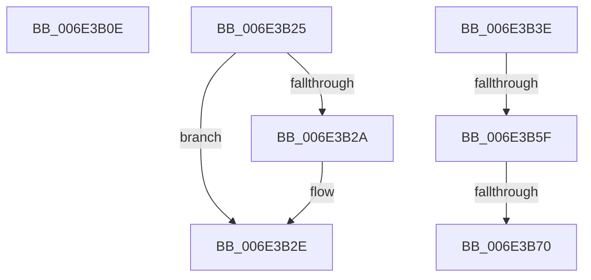

# sub_006E3B0E

- RVA: `0x006E3B0E`–`0x006E3B7B` (길이 `109` bytes)
- VA: `0x00000001406E3B0E`
- 실행 섹션: `.text`
- PDB 이름 있음: `아니요`; PDB Function 태그: `아니요`
- unwind 정보 RVA: `0x0007A1F4`
- 디코드: `25`개 명령, `109/109` bytes 표시
- 미해석 바이트: `0` (있으면 어셈블리에 `.byte`로 보존)

> 이 문서는 커널 이미지의 기계어와 PDB 기호를 분석해 생성했습니다. 4번과 5번은 함수 원형과 자료형을 바이너리 사용 방식에서 추정한 C 해석이며 원본 소스 복구 결과는 아닙니다.

## 1. Dependencies

- 직접 호출 지점: **3**; 고유 호출 대상: **3**
- 직접 호출자로 확인된 함수: **0**
- RIP 상대 이미지 참조: **2**

### Outgoing calls
- `0x006E3B19` → [MiReturnFaultCharges](../36/MiReturnFaultCharges_function_0036D928.md) (function, `0x0036D928`)
- `0x006E3B45` → [KeAbPostRelease](../2E/KeAbPostRelease_function_002E1600.md) (function, `0x002E1600`)
- `0x006E3B70` → [KiCheckForKernelApcDelivery](../2E/KiCheckForKernelApcDelivery_function_002E2C80.md) (function, `0x002E2C80`)

### Direct callers
- 이 함수 시작 RVA로 연결되는 직접 call은 확인되지 않았습니다. 간접 호출은 완전히 역산할 수 없습니다.

### Static image references
- `0x006E3B2E` → RVA `0x00E2D720` (`.data`; read)
- `0x006E3B3E` → RVA `0x00E2D718` (`.data`; read)

## 2. Other-region calls and transfers

- 다른 실행 섹션으로 향하는 call: **0**
- call이 아닌 외부 분기/꼬리 이동: **5**
  - `0x006E3B20` → [MiPrivateFixup + 0x465](../36/MiPrivateFixup_function_003693E8.md) (`tail-transfer`)
  - `0x006E3B39` → [MiPrivateFixup + 0x2AE](../36/MiPrivateFixup_function_003693E8.md) (`tail-transfer`)
  - `0x006E3B59` → [MiPrivateFixup + 0x36A](../36/MiPrivateFixup_function_003693E8.md) (`tail-transfer`)
  - `0x006E3B6A` → [MiPrivateFixup + 0x36A](../36/MiPrivateFixup_function_003693E8.md) (`tail-transfer`)
  - `0x006E3B76` → [MiPrivateFixup + 0x36A](../36/MiPrivateFixup_function_003693E8.md) (`tail-transfer`)

## 3. Assembly (complete function range)

```asm
006E3B0E  45 8B C4                        mov r8d, r12d
006E3B11  BA 01 00 00 00                  mov edx, 1
006E3B16  49 8B CD                        mov rcx, r13
006E3B19  E8 0A 9E C8 FF                  call 0x14036d928
006E3B1E  8B C7                           mov eax, edi
006E3B20  E9 28 5D C8 FF                  jmp 0x14036984d
006E3B25  48 85 DB                        test rbx, rbx
006E3B28  74 04                           je 0x1406e3b2e
006E3B2A  C6 43 0A 01                     mov byte ptr [rbx + 0xa], 1
006E3B2E  4C 8B 3D EB 9B 74 00            mov r15, qword ptr [rip + 0x749beb]
006E3B35  48 8B 5D BF                     mov rbx, qword ptr [rbp - 0x41]
006E3B39  E9 58 5B C8 FF                  jmp 0x140369696
006E3B3E  48 8D 0D D3 9B 74 00            lea rcx, [rip + 0x749bd3]
006E3B45  E8 B6 DA BF FF                  call 0x1402e1600
006E3B4A  41 BC 01 00 00 00               mov r12d, 1
006E3B50  90                              nop
006E3B51  66 45 01 A6 E6 01 00 00         add word ptr [r14 + 0x1e6], r12w
006E3B59  0F 85 F3 5B C8 FF               jne 0x140369752
006E3B5F  49 8D 86 98 00 00 00            lea rax, [r14 + 0x98]
006E3B66  90                              nop
006E3B67  48 39 00                        cmp qword ptr [rax], rax
006E3B6A  0F 84 E2 5B C8 FF               je 0x140369752
006E3B70  E8 0B F1 BF FF                  call 0x1402e2c80
006E3B75  90                              nop
006E3B76  E9 D7 5B C8 FF                  jmp 0x140369752
```

## 4. C-style interpretation (structured pseudocode)

```c
__int64 __fastcall sub_006E3B0E(void)
{
    __int64 result;

    result = MiReturnFaultCharges(v_r13, 1, (unsigned int)((unsigned int)(v_r12)), a4);
}
```

## 5. (Beta) C Style

```c
void sub_006E3B0E(void)
{
    int64_t result;

    result = MiReturnFaultCharges(local_r13, 1, (uint32_t)((uint32_t)(local_r12)), a4);
}
```

## 6. Execution-region graph

[열기: 2D/3D 그래프와 함수 탐색 컨트롤 패널](../../../control-panel.html?section=text&rva=0x006E3B0E&view=graph)

- 2D 그래프는 위에서 아래로 흐르고, 3D 그래프는 빈 공간을 드래그해 회전합니다. Shift+드래그는 이동, 휠은 확대·축소, 함수 노드 선택은 대상 보고서 이동입니다.

### Static fallback


