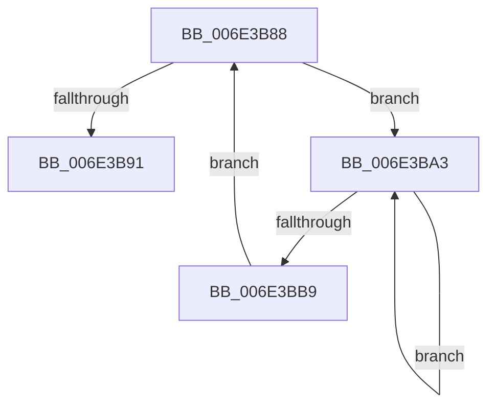

# sub_006E3B88

- RVA: `0x006E3B88`–`0x006E3BBB` (길이 `51` bytes)
- VA: `0x00000001406E3B88`
- 실행 섹션: `.text`
- PDB 이름 있음: `아니요`; PDB Function 태그: `아니요`
- unwind 정보 RVA: `0x0007A268`
- 디코드: `12`개 명령, `51/51` bytes 표시
- 미해석 바이트: `0` (있으면 어셈블리에 `.byte`로 보존)

> 이 문서는 커널 이미지의 기계어와 PDB 기호를 분석해 생성했습니다. 4번과 5번은 함수 원형과 자료형을 바이너리 사용 방식에서 추정한 C 해석이며 원본 소스 복구 결과는 아닙니다.

## 1. Dependencies

- 직접 호출 지점: **2**; 고유 호출 대상: **2**
- 직접 호출자로 확인된 함수: **0**
- RIP 상대 이미지 참조: **0**

### Outgoing calls
- `0x006E3B94` → [MiRemoveLockedPageChargeAndDecRef](../24/MiRemoveLockedPageChargeAndDecRef_function_002459D0.md) (function, `0x002459D0`)
- `0x006E3BAB` → [KeYieldProcessorEx](../3F/KeYieldProcessorEx_function_003FBD00.md) (function, `0x003FBD00`)

### Direct callers
- 이 함수 시작 RVA로 연결되는 직접 call은 확인되지 않았습니다. 간접 호출은 완전히 역산할 수 없습니다.

### Static image references
- 디코드된 RIP-relative 메모리 참조가 없습니다.

## 2. Other-region calls and transfers

- 다른 실행 섹션으로 향하는 call: **0**
- call이 아닌 외부 분기/꼬리 이동: **1**
  - `0x006E3B9E` → [MiWaitForCollidedFaultComplete + 0xA8](../36/MiWaitForCollidedFaultComplete_function_00369EDC.md) (`tail-transfer`)

## 3. Assembly (complete function range)

```asm
006E3B88  F0 48 0F BA 6B 18 3F            lock bts qword ptr [rbx + 0x18], 0x3f
006E3B8F  72 12                           jb 0x1406e3ba3
006E3B91  48 8B CB                        mov rcx, rbx
006E3B94  E8 37 1E B6 FF                  call 0x1402459d0
006E3B99  F0 4C 21 63 18                  lock and qword ptr [rbx + 0x18], r12
006E3B9E  E9 E1 63 C8 FF                  jmp 0x140369f84
006E3BA3  48 8D 8C 24 B0 00 00 00         lea rcx, [rsp + 0xb0]
006E3BAB  E8 50 81 D1 FF                  call 0x1403fbd00
006E3BB0  48 8B 43 18                     mov rax, qword ptr [rbx + 0x18]
006E3BB4  48 85 C0                        test rax, rax
006E3BB7  78 EA                           js 0x1406e3ba3
006E3BB9  EB CD                           jmp 0x1406e3b88
```

## 4. C-style interpretation (structured pseudocode)

```c
__int64 __fastcall sub_006E3B88(__int64 a1, __int64 a2, __int64 a3, __int64 a4, __int64 a5, __int64 a6, __int64 a7, __int64 a8, __int64 a9, __int64 a10, __int64 a11, __int64 a12, __int64 a13, __int64 a14, __int64 a15, __int64 a16, __int64 a17, __int64 a18, __int64 a19, __int64 a20, __int64 a21, __int64 a22)
{
    __int64 result;

    if (condition_is_below) goto loc_006E3BA3;
    result = MiRemoveLockedPageChargeAndDecRef(v_rbx, a2, a3, a4);
loc_006E3BA3:
    result = KeYieldProcessorEx(a22, a2, a3, a4);
    if (sign_flag) goto loc_006E3BA3;
    goto loc_006E3B88;
}
```

## 5. (Beta) C Style

```c
int64_t sub_006E3B88(int64_t Arg1, int64_t Arg2, int64_t Arg3, int64_t Arg4, uint64_t Arg5, uint64_t Arg6, uint64_t Arg7, uint64_t Arg8, uint64_t Arg9, uint64_t Arg10, uint64_t Arg11, uint64_t Arg12, uint64_t Arg13, uint64_t Arg14, uint64_t Arg15, uint64_t Arg16, uint64_t Arg17, uint64_t Arg18, uint64_t Arg19, uint64_t Arg20, uint64_t Arg21, int64_t Arg22)
{
    int64_t result;

    if (condition_is_below) goto loc_006E3BA3;
    result = MiRemoveLockedPageChargeAndDecRef(local_rbx, Arg2, Arg3, Arg4);
loc_006E3BA3:
    result = KeYieldProcessorEx(Arg22, Arg2, Arg3, Arg4);
    if (sign_flag) goto loc_006E3BA3;
    goto loc_006E3B88;
}
```

## 6. Execution-region graph

[열기: 2D/3D 그래프와 함수 탐색 컨트롤 패널](../../../control-panel.html?section=text&rva=0x006E3B88&view=graph)

- 2D 그래프는 위에서 아래로 흐르고, 3D 그래프는 빈 공간을 드래그해 회전합니다. Shift+드래그는 이동, 휠은 확대·축소, 함수 노드 선택은 대상 보고서 이동입니다.

### Static fallback


