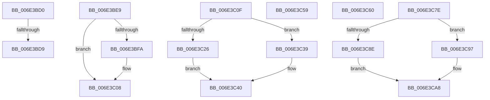

# sub_006E3BD0

- RVA: `0x006E3BD0`–`0x006E3CBA` (길이 `234` bytes)
- VA: `0x00000001406E3BD0`
- 실행 섹션: `.text`
- PDB 이름 있음: `아니요`; PDB Function 태그: `아니요`
- unwind 정보 RVA: `0x0007A65C`
- 디코드: `62`개 명령, `234/234` bytes 표시
- 미해석 바이트: `0` (있으면 어셈블리에 `.byte`로 보존)

> 이 문서는 커널 이미지의 기계어와 PDB 기호를 분석해 생성했습니다. 4번과 5번은 함수 원형과 자료형을 바이너리 사용 방식에서 추정한 C 해석이며 원본 소스 복구 결과는 아닙니다.

## 1. Dependencies

- 직접 호출 지점: **4**; 고유 호출 대상: **3**
- 직접 호출자로 확인된 함수: **0**
- RIP 상대 이미지 참조: **0**

### Outgoing calls
- `0x006E3BDE` → [MiUnlockProtoPoolPage](../24/MiUnlockProtoPoolPage_function_00246090.md) (function, `0x00246090`)
- `0x006E3BEC` → [MiFreeInPageSupportBlock](../2B/MiFreeInPageSupportBlock_function_002B5900.md) (function, `0x002B5900`)
- `0x006E3C44` → [MiUpdatePageFileHighInPte](../36/MiUpdatePageFileHighInPte_function_0036D840.md) (function, `0x0036D840`)
- `0x006E3CAC` → [MiUpdatePageFileHighInPte](../36/MiUpdatePageFileHighInPte_function_0036D840.md) (function, `0x0036D840`)

### Direct callers
- 이 함수 시작 RVA로 연결되는 직접 call은 확인되지 않았습니다. 간접 호출은 완전히 역산할 수 없습니다.

### Static image references
- 디코드된 RIP-relative 메모리 참조가 없습니다.

## 2. Other-region calls and transfers

- 다른 실행 섹션으로 향하는 call: **0**
- call이 아닌 외부 분기/꼬리 이동: **7**
  - `0x006E3BD3` → [MiResolvePageFileFault + 0xF51](../36/MiResolvePageFileFault_function_0036D968.md) (`tail-transfer`)
  - `0x006E3BE4` → [MiResolvePageFileFault + 0xF51](../36/MiResolvePageFileFault_function_0036D968.md) (`tail-transfer`)
  - `0x006E3C0A` → [MiResolvePageFileFault + 0x1042](../36/MiResolvePageFileFault_function_0036D968.md) (`tail-transfer`)
  - `0x006E3C54` → [MiResolvePageFileFault + 0x417](../36/MiResolvePageFileFault_function_0036D968.md) (`tail-transfer`)
  - `0x006E3C5B` → [MiResolvePageFileFault + 0x445](../36/MiResolvePageFileFault_function_0036D968.md) (`tail-transfer`)
  - `0x006E3C79` → [MiResolvePageFileFault + 0xC71](../36/MiResolvePageFileFault_function_0036D968.md) (`tail-transfer`)
  - `0x006E3CB5` → [MiResolvePageFileFault + 0x14F0](../36/MiResolvePageFileFault_function_0036D968.md) (`tail-transfer`)

## 3. Assembly (complete function range)

```asm
006E3BD0  48 85 FF                        test rdi, rdi
006E3BD3  0F 84 E0 AC C8 FF               je 0x14036e8b9
006E3BD9  B2 11                           mov dl, 0x11
006E3BDB  48 8B CF                        mov rcx, rdi
006E3BDE  E8 AD 24 B6 FF                  call 0x140246090
006E3BE3  90                              nop
006E3BE4  E9 D0 AC C8 FF                  jmp 0x14036e8b9
006E3BE9  49 8B CC                        mov rcx, r12
006E3BEC  E8 0F 1D BD FF                  call 0x1402b5900
006E3BF1  48 8B 45 A0                     mov rax, qword ptr [rbp - 0x60]
006E3BF5  48 85 C0                        test rax, rax
006E3BF8  74 0E                           je 0x1406e3c08
006E3BFA  81 FB 9A 00 00 C0               cmp ebx, 0xc000009a
006E3C00  0F 94 C1                        sete cl
006E3C03  FE C1                           inc cl
006E3C05  88 48 01                        mov byte ptr [rax + 1], cl
006E3C08  8B C3                           mov eax, ebx
006E3C0A  E9 9B AD C8 FF                  jmp 0x14036e9aa
006E3C0F  48 8B 8D 08 01 00 00            mov rcx, qword ptr [rbp + 0x108]
006E3C16  49 2B D9                        sub rbx, r9
006E3C19  48 C1 EA 20                     shr rdx, 0x20
006E3C1D  48 8D 04 DF                     lea rax, [rdi + rbx*8]
006E3C21  48 3B C1                        cmp rax, rcx
006E3C24  76 13                           jbe 0x1406e3c39
006E3C26  48 8B C1                        mov rax, rcx
006E3C29  48 89 4D 90                     mov qword ptr [rbp - 0x70], rcx
006E3C2D  48 2B C7                        sub rax, rdi
006E3C30  48 C1 F8 03                     sar rax, 3
006E3C34  48 03 D0                        add rdx, rax
006E3C37  EB 07                           jmp 0x1406e3c40
006E3C39  48 03 D3                        add rdx, rbx
006E3C3C  48 89 45 90                     mov qword ptr [rbp - 0x70], rax
006E3C40  48 8B 4D 88                     mov rcx, qword ptr [rbp - 0x78]
006E3C44  E8 F7 9B C8 FF                  call 0x14036d840
006E3C49  48 89 45 88                     mov qword ptr [rbp - 0x78], rax
006E3C4D  45 8B D1                        mov r10d, r9d
006E3C50  44 89 4D 80                     mov dword ptr [rbp - 0x80], r9d
006E3C54  E9 26 A1 C8 FF                  jmp 0x14036dd7f
006E3C59  33 FF                           xor edi, edi
006E3C5B  E9 4D A1 C8 FF                  jmp 0x14036ddad
006E3C60  48 8B 8D 00 01 00 00            mov rcx, qword ptr [rbp + 0x100]
006E3C67  48 8B 45 00                     mov rax, qword ptr [rbp]
006E3C6B  48 89 91 80 00 00 00            mov qword ptr [rcx + 0x80], rdx
006E3C72  48 89 81 90 00 00 00            mov qword ptr [rcx + 0x90], rax
006E3C79  E9 5B A9 C8 FF                  jmp 0x14036e5d9
006E3C7E  48 2B CF                        sub rcx, rdi
006E3C81  48 C1 EA 20                     shr rdx, 0x20
006E3C85  49 8D 04 C9                     lea rax, [r9 + rcx*8]
006E3C89  49 3B C2                        cmp rax, r10
006E3C8C  77 09                           ja 0x1406e3c97
006E3C8E  48 03 D1                        add rdx, rcx
006E3C91  48 89 45 90                     mov qword ptr [rbp - 0x70], rax
006E3C95  EB 11                           jmp 0x1406e3ca8
006E3C97  49 8B C2                        mov rax, r10
006E3C9A  4C 89 55 90                     mov qword ptr [rbp - 0x70], r10
006E3C9E  49 2B C1                        sub rax, r9
006E3CA1  48 C1 F8 03                     sar rax, 3
006E3CA5  48 03 D0                        add rdx, rax
006E3CA8  48 8B 4D 88                     mov rcx, qword ptr [rbp - 0x78]
006E3CAC  E8 8F 9B C8 FF                  call 0x14036d840
006E3CB1  48 89 45 88                     mov qword ptr [rbp - 0x78], rax
006E3CB5  E9 9E B1 C8 FF                  jmp 0x14036ee58
```

## 4. C-style interpretation (structured pseudocode)

```c
__int64 __fastcall sub_006E3BD0(__int64 a1, __int64 a2, __int64 a3, __int64 a4)
{
    __int64 result;

    result = MiUnlockProtoPoolPage(v_rdi, 17, a3, a4);
}
```

## 5. (Beta) C Style

```c
int64_t sub_006E3BD0(int64_t Arg1, int64_t Arg2, int64_t Arg3, int64_t Arg4)
{
    int64_t result;

    result = MiUnlockProtoPoolPage(local_rdi, 17, Arg3, Arg4);
}
```

## 6. Execution-region graph

[열기: 2D/3D 그래프와 함수 탐색 컨트롤 패널](../../../control-panel.html?section=text&rva=0x006E3BD0&view=graph)

- 2D 그래프는 위에서 아래로 흐르고, 3D 그래프는 빈 공간을 드래그해 회전합니다. Shift+드래그는 이동, 휠은 확대·축소, 함수 노드 선택은 대상 보고서 이동입니다.

### Static fallback


