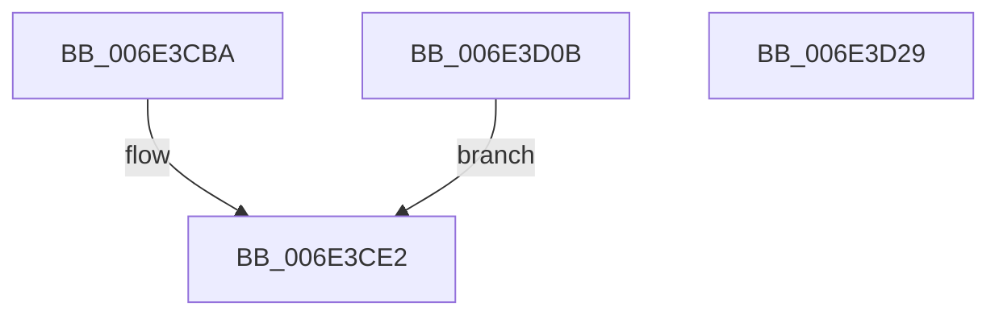

# sub_006E3CBA

- RVA: `0x006E3CBA`–`0x006E3D4A` (길이 `144` bytes)
- VA: `0x00000001406E3CBA`
- 실행 섹션: `.text`
- PDB 이름 있음: `아니요`; PDB Function 태그: `아니요`
- unwind 정보 RVA: `0x0007A6C8`
- 디코드: `36`개 명령, `144/144` bytes 표시
- 미해석 바이트: `0` (있으면 어셈블리에 `.byte`로 보존)

> 이 문서는 커널 이미지의 기계어와 PDB 기호를 분석해 생성했습니다. 4번과 5번은 함수 원형과 자료형을 바이너리 사용 방식에서 추정한 C 해석이며 원본 소스 복구 결과는 아닙니다.

## 1. Dependencies

- 직접 호출 지점: **9**; 고유 호출 대상: **7**
- 직접 호출자로 확인된 함수: **0**
- RIP 상대 이미지 참조: **0**

### Outgoing calls
- `0x006E3CBD` → [MiFlushTbList](../31/MiFlushTbList_function_00311FC0.md) (function, `0x00311FC0`)
- `0x006E3CC2` → [MiReleaseProcessorFlushList](../31/MiReleaseProcessorFlushList_function_00313C70.md) (function, `0x00313C70`)
- `0x006E3CCF` → [MiUnlockPageTable](../21/MiUnlockPageTable_function_00216EC0.md) (function, `0x00216EC0`)
- `0x006E3CDA` → [MiUnlockWorkingSetShared](../27/MiUnlockWorkingSetShared_function_0027D690.md) (function, `0x0027D690`)
- `0x006E3CF5` → [MiMakeDriverPagesPrivate](../38/MiMakeDriverPagesPrivate_function_00384C60.md) (function, `0x00384C60`)
- `0x006E3D00` → [MiLockWorkingSetShared](../27/MiLockWorkingSetShared_function_0027CBF0.md) (function, `0x0027CBF0`)
- `0x006E3D11` → [MiUnlockPageTable](../21/MiUnlockPageTable_function_00216EC0.md) (function, `0x00216EC0`)
- `0x006E3D1C` → [MiUnlockWorkingSetShared](../27/MiUnlockWorkingSetShared_function_0027D690.md) (function, `0x0027D690`)
- `0x006E3D36` → [MiInsertTbFlushEntry](../29/MiInsertTbFlushEntry_function_00293670.md) (function, `0x00293670`)

### Direct callers
- 이 함수 시작 RVA로 연결되는 직접 call은 확인되지 않았습니다. 간접 호출은 완전히 역산할 수 없습니다.

### Static image references
- 디코드된 RIP-relative 메모리 참조가 없습니다.

## 2. Other-region calls and transfers

- 다른 실행 섹션으로 향하는 call: **0**
- call이 아닌 외부 분기/꼬리 이동: **2**
  - `0x006E3D06` → [MiLockCode + 0x6AE](../36/MiLockCode_function_0036F91C.md) (`tail-transfer`)
  - `0x006E3D45` → [MiLockCode + 0x239](../36/MiLockCode_function_0036F91C.md) (`tail-transfer`)

## 3. Assembly (complete function range)

```asm
006E3CBA  48 8B CD                        mov rcx, rbp
006E3CBD  E8 FE E2 C2 FF                  call 0x140311fc0
006E3CC2  E8 A9 FF C2 FF                  call 0x140313c70
006E3CC7  33 ED                           xor ebp, ebp
006E3CC9  49 8B D5                        mov rdx, r13
006E3CCC  49 8B CE                        mov rcx, r14
006E3CCF  E8 EC 31 B3 FF                  call 0x140216ec0
006E3CD4  40 8A D7                        mov dl, dil
006E3CD7  49 8B CE                        mov rcx, r14
006E3CDA  E8 B1 99 B9 FF                  call 0x14027d690
006E3CDF  45 33 C9                        xor r9d, r9d
006E3CE2  4C 8B 84 24 D0 00 00 00         mov r8, qword ptr [rsp + 0xd0]
006E3CEA  49 8B D7                        mov rdx, r15
006E3CED  48 8B 8C 24 C0 00 00 00         mov rcx, qword ptr [rsp + 0xc0]
006E3CF5  E8 66 0F CA FF                  call 0x140384c60
006E3CFA  45 33 ED                        xor r13d, r13d
006E3CFD  49 8B CE                        mov rcx, r14
006E3D00  E8 EB 8E B9 FF                  call 0x14027cbf0
006E3D05  90                              nop
006E3D06  E9 BF C2 C8 FF                  jmp 0x14036ffca
006E3D0B  49 8B D5                        mov rdx, r13
006E3D0E  49 8B CE                        mov rcx, r14
006E3D11  E8 AA 31 B3 FF                  call 0x140216ec0
006E3D16  40 8A D7                        mov dl, dil
006E3D19  49 8B CE                        mov rcx, r14
006E3D1C  E8 6F 99 B9 FF                  call 0x14027d690
006E3D21  41 B9 01 00 00 00               mov r9d, 1
006E3D27  EB B9                           jmp 0x1406e3ce2
006E3D29  45 33 C9                        xor r9d, r9d
006E3D2C  49 8B D4                        mov rdx, r12
006E3D2F  48 8B CD                        mov rcx, rbp
006E3D32  45 8D 41 01                     lea r8d, [r9 + 1]
006E3D36  E8 35 F9 BA FF                  call 0x140293670
006E3D3B  48 8B 5C 24 38                  mov rbx, qword ptr [rsp + 0x38]
006E3D40  48 89 5C 24 38                  mov qword ptr [rsp + 0x38], rbx
006E3D45  E9 0B BE C8 FF                  jmp 0x14036fb55
```

## 4. C-style interpretation (structured pseudocode)

```c
__int64 __fastcall sub_006E3CBA(__int64 a1, __int64 a2, __int64 a3, int a4, __int64 a5, __int64 a6, __int64 a7, __int64 a8, __int64 a9, __int64 a10, __int64 a11, __int64 a12, __int64 a13, __int64 a14, __int64 a15, __int64 a16, __int64 a17, __int64 a18, __int64 a19, __int64 a20, __int64 a21, __int64 a22, __int64 a23, __int64 a24, __int64 a25, __int64 a26)
{
    __int64 result;
    __int64 v_r13;
    __int64 v_rbp;
    unsigned __int64 v_stack_p38;

    result = MiFlushTbList(v_rbp, a2, a3, a4);
    result = MiReleaseProcessorFlushList(v_rbp, a2, a3, a4);
    v_rbp = 0;
    result = MiUnlockPageTable(v_r14, v_r13, a3, a4);
    result = MiUnlockWorkingSetShared(v_r14, (unsigned __int8)(v_rdi), a3, a4);
    a4 = 0;
loc_006E3CE2:
    result = MiMakeDriverPagesPrivate(a24, v_r15, a26, a4);
    v_r13 = 0;
    result = MiLockWorkingSetShared(v_r14, v_r15, a26, a4);
}
```

## 5. (Beta) C Style

```c
int64_t sub_006E3CBA(int64_t Arg1, int64_t Arg2, int64_t Arg3, int32_t Arg4, uint64_t Arg5, uint64_t Arg6, uint64_t Arg7, uint64_t Arg8, uint64_t Arg9, uint64_t Arg10, uint64_t Arg11, uint64_t Arg12, uint64_t Arg13, uint64_t Arg14, uint64_t Arg15, uint64_t Arg16, uint64_t Arg17, uint64_t Arg18, uint64_t Arg19, uint64_t Arg20, uint64_t Arg21, uint64_t Arg22, uint64_t Arg23, int64_t Arg24, uint64_t Arg25, int64_t Arg26)
{
    int64_t result;
    int64_t local_r13;
    int64_t local_rbp;
    uint64_t v_stack_p38;

    result = MiFlushTbList(local_rbp, Arg2, Arg3, Arg4);
    result = MiReleaseProcessorFlushList(local_rbp, Arg2, Arg3, Arg4);
    local_rbp = 0;
    result = MiUnlockPageTable(local_r14, local_r13, Arg3, Arg4);
    result = MiUnlockWorkingSetShared(local_r14, (uint8_t)(local_rdi), Arg3, Arg4);
    Arg4 = 0;
loc_006E3CE2:
    result = MiMakeDriverPagesPrivate(Arg24, local_r15, Arg26, Arg4);
    local_r13 = 0;
    result = MiLockWorkingSetShared(local_r14, local_r15, Arg26, Arg4);
}
```

## 6. Execution-region graph

[열기: 2D/3D 그래프와 함수 탐색 컨트롤 패널](../../../control-panel.html?section=text&rva=0x006E3CBA&view=graph)

- 2D 그래프는 위에서 아래로 흐르고, 3D 그래프는 빈 공간을 드래그해 회전합니다. Shift+드래그는 이동, 휠은 확대·축소, 함수 노드 선택은 대상 보고서 이동입니다.

### Static fallback


