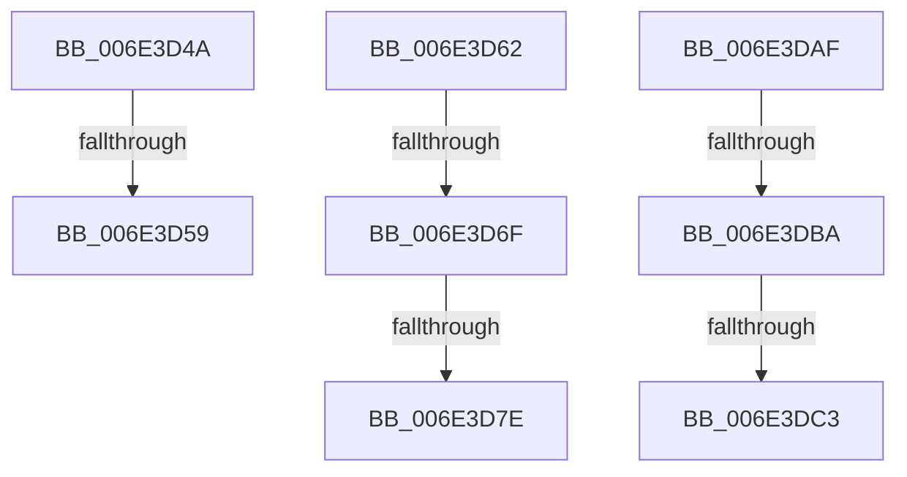

# sub_006E3D4A

- RVA: `0x006E3D4A`–`0x006E3DE3` (길이 `153` bytes)
- VA: `0x00000001406E3D4A`
- 실행 섹션: `.text`
- PDB 이름 있음: `아니요`; PDB Function 태그: `아니요`
- unwind 정보 RVA: `0x0007A828`
- 디코드: `33`개 명령, `153/153` bytes 표시
- 미해석 바이트: `0` (있으면 어셈블리에 `.byte`로 보존)

> 이 문서는 커널 이미지의 기계어와 PDB 기호를 분석해 생성했습니다. 4번과 5번은 함수 원형과 자료형을 바이너리 사용 방식에서 추정한 C 해석이며 원본 소스 복구 결과는 아닙니다.

## 1. Dependencies

- 직접 호출 지점: **2**; 고유 호출 대상: **2**
- 직접 호출자로 확인된 함수: **0**
- RIP 상대 이미지 참조: **1**

### Outgoing calls
- `0x006E3DA4` → [MiChargeCommit](../28/MiChargeCommit_function_00286EB0.md) (function, `0x00286EB0`)
- `0x006E3DDD` → [KeBugCheckEx](../4F/KeBugCheckEx_function_004FD660.md) (function, `0x004FD660`)

### Direct callers
- 이 함수 시작 RVA로 연결되는 직접 call은 확인되지 않았습니다. 간접 호출은 완전히 역산할 수 없습니다.

### Static image references
- `0x006E3D87` → RVA `0x00E30088` (`.data`; read)

## 2. Other-region calls and transfers

- 다른 실행 섹션으로 향하는 call: **0**
- call이 아닌 외부 분기/꼬리 이동: **7**
  - `0x006E3D53` → [MiPurgeSubsection + 0x106](../37/MiPurgeSubsection_function_003712F0.md) (`tail-transfer`)
  - `0x006E3D5D` → [MiPurgeSubsection + 0x4F6](../37/MiPurgeSubsection_function_003712F0.md) (`tail-transfer`)
  - `0x006E3D69` → [MiPurgeSubsection + 0x110](../37/MiPurgeSubsection_function_003712F0.md) (`tail-transfer`)
  - `0x006E3D78` → [MiPurgeSubsection + 0x110](../37/MiPurgeSubsection_function_003712F0.md) (`tail-transfer`)
  - `0x006E3DAA` → [MiPurgeSubsection + 0x110](../37/MiPurgeSubsection_function_003712F0.md) (`tail-transfer`)
  - `0x006E3DB4` → [MiPurgeSubsection + 0x383](../37/MiPurgeSubsection_function_003712F0.md) (`tail-transfer`)
  - `0x006E3DBD` → [MiPurgeSubsection + 0x383](../37/MiPurgeSubsection_function_003712F0.md) (`tail-transfer`)

## 3. Assembly (complete function range)

```asm
006E3D4A  8B 84 24 F0 00 00 00            mov eax, dword ptr [rsp + 0xf0]
006E3D51  85 C0                           test eax, eax
006E3D53  0F 84 9D D6 C8 FF               je 0x1403713f6
006E3D59  C6 47 09 01                     mov byte ptr [rdi + 9], 1
006E3D5D  E9 84 DA C8 FF                  jmp 0x1403717e6
006E3D62  41 8B 46 20                     mov eax, dword ptr [r14 + 0x20]
006E3D66  66 85 C0                        test ax, ax
006E3D69  0F 84 91 D6 C8 FF               je 0x140371400
006E3D6F  41 8B 46 10                     mov eax, dword ptr [r14 + 0x10]
006E3D73  48 0F BA E0 0A                  bt rax, 0xa
006E3D78  0F 82 82 D6 C8 FF               jb 0x140371400
006E3D7E  49 8B 46 28                     mov rax, qword ptr [r14 + 0x28]
006E3D82  BA 01 00 00 00                  mov edx, 1
006E3D87  48 8B 0D FA C2 74 00            mov rcx, qword ptr [rip + 0x74c2fa]
006E3D8E  48 C1 E8 2B                     shr rax, 0x2b
006E3D92  25 FF 03 00 00                  and eax, 0x3ff
006E3D97  44 8D 42 03                     lea r8d, [rdx + 3]
006E3D9B  48 8B 0C C1                     mov rcx, qword ptr [rcx + rax*8]
006E3D9F  48 89 4C 24 30                  mov qword ptr [rsp + 0x30], rcx
006E3DA4  E8 07 31 BA FF                  call 0x140286eb0
006E3DA9  90                              nop
006E3DAA  E9 51 D6 C8 FF                  jmp 0x140371400
006E3DAF  48 0F BA E3 0B                  bt rbx, 0xb
006E3DB4  0F 82 B9 D8 C8 FF               jb 0x140371673
006E3DBA  48 85 DB                        test rbx, rbx
006E3DBD  0F 84 B0 D8 C8 FF               je 0x140371673
006E3DC3  4C 8B 84 24 E0 00 00 00         mov r8, qword ptr [rsp + 0xe0]
006E3DCB  4D 8B CF                        mov r9, r15
006E3DCE  BA 04 00 00 00                  mov edx, 4
006E3DD3  48 89 5C 24 20                  mov qword ptr [rsp + 0x20], rbx
006E3DD8  B9 DE 00 00 00                  mov ecx, 0xde
006E3DDD  E8 7E 98 E1 FF                  call 0x1404fd660
006E3DE2  CC                              int3
```

## 4. C-style interpretation (structured pseudocode)

```c
__int64 __fastcall sub_006E3D4A(__int64 a1, __int64 a2, __int64 a3, __int64 a4, __int64 a5, __int64 a6, __int64 a7, __int64 a8, __int64 a9, __int64 a10, __int64 a11, __int64 a12, __int64 a13, __int64 a14, __int64 a15, __int64 a16, __int64 a17, __int64 a18, __int64 a19, __int64 a20, __int64 a21, __int64 a22, __int64 a23, __int64 a24, __int64 a25, __int64 a26, __int64 a27, __int64 a28, __int64 a29, unsigned int a30)
{
    unsigned __int64 v_stack_p20;
    unsigned __int64 v_stack_p30;
    unsigned __int64 v_stack_pE0;

    *(unsigned __int8 *)(v_rdi + 9) = 1;
}
```

## 5. (Beta) C Style

```c
int64_t sub_006E3D4A(int64_t Arg1, int64_t Arg2, int64_t Arg3, int64_t Arg4, uint64_t Arg5, uint64_t Arg6, uint64_t Arg7, uint64_t Arg8, uint64_t Arg9, uint64_t Arg10, uint64_t Arg11, uint64_t Arg12, uint64_t Arg13, uint64_t Arg14, uint64_t Arg15, uint64_t Arg16, uint64_t Arg17, uint64_t Arg18, uint64_t Arg19, uint64_t Arg20, uint64_t Arg21, uint64_t Arg22, uint64_t Arg23, uint64_t Arg24, uint64_t Arg25, uint64_t Arg26, uint64_t Arg27, uint64_t Arg28, uint64_t Arg29, uint32_t Arg30)
{
    uint64_t v_stack_p20;
    uint64_t v_stack_p30;
    uint64_t v_stack_pE0;

    *(uint8_t *)(local_rdi + 0x9) = 1;
}
```

## 6. Execution-region graph

[열기: 2D/3D 그래프와 함수 탐색 컨트롤 패널](../../../control-panel.html?section=text&rva=0x006E3D4A&view=graph)

- 2D 그래프는 위에서 아래로 흐르고, 3D 그래프는 빈 공간을 드래그해 회전합니다. Shift+드래그는 이동, 휠은 확대·축소, 함수 노드 선택은 대상 보고서 이동입니다.

### Static fallback


