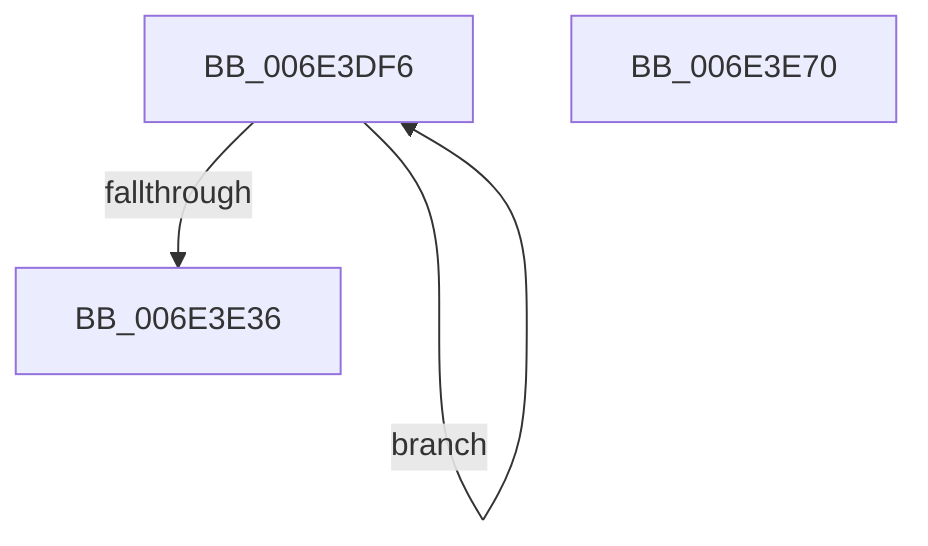

# sub_006E3DF6

- RVA: `0x006E3DF6`–`0x006E3E8A` (길이 `148` bytes)
- VA: `0x00000001406E3DF6`
- 실행 섹션: `.text`
- PDB 이름 있음: `아니요`; PDB Function 태그: `아니요`
- unwind 정보 RVA: `0x0007AA50`
- 디코드: `41`개 명령, `148/148` bytes 표시
- 미해석 바이트: `0` (있으면 어셈블리에 `.byte`로 보존)

> 이 문서는 커널 이미지의 기계어와 PDB 기호를 분석해 생성했습니다. 4번과 5번은 함수 원형과 자료형을 바이너리 사용 방식에서 추정한 C 해석이며 원본 소스 복구 결과는 아닙니다.

## 1. Dependencies

- 직접 호출 지점: **5**; 고유 호출 대상: **5**
- 직접 호출자로 확인된 함수: **0**
- RIP 상대 이미지 참조: **1**

### Outgoing calls
- `0x006E3E0B` → [MiLockPageInline](../31/MiLockPageInline_function_0031A340.md) (function, `0x0031A340`)
- `0x006E3E1D` → [MiWriteCompletePfn](../37/MiWriteCompletePfn_function_003737C4.md) (function, `0x003737C4`)
- `0x006E3E28` → [MiUnlockPage](../31/MiUnlockPage_function_0031A3E0.md) (function, `0x0031A3E0`)
- `0x006E3E55` → [MiReleaseWriteInProgressCharges](../40/MiReleaseWriteInProgressCharges_function_00407B4C.md) (function, `0x00407B4C`)
- `0x006E3E79` → [MiWriteComplete](../40/MiWriteComplete_function_004069B0.md) (function, `0x004069B0`)

### Direct callers
- 이 함수 시작 RVA로 연결되는 직접 call은 확인되지 않았습니다. 간접 호출은 완전히 역산할 수 없습니다.

### Static image references
- `0x006E3E7E` → RVA `0x00FC6D20` (`ALMOSTRO`; read)

## 2. Other-region calls and transfers

- 다른 실행 섹션으로 향하는 call: **0**
- call이 아닌 외부 분기/꼬리 이동: **2**
  - `0x006E3E6B` → [MiGatherPagefilePages + 0x1D5](../37/MiGatherPagefilePages_function_00372B08.md) (`tail-transfer`)
  - `0x006E3E85` → [MiGatherPagefilePages + 0x861](../37/MiGatherPagefilePages_function_00372B08.md) (`tail-transfer`)

## 3. Assembly (complete function range)

```asm
006E3DF6  49 8B 04 24                     mov rax, qword ptr [r12]
006E3DFA  4C 8D 34 40                     lea r14, [rax + rax*2]
006E3DFE  49 C1 E6 04                     shl r14, 4
006E3E02  49 8B C7                        mov rax, r15
006E3E05  4C 03 F0                        add r14, rax
006E3E08  49 8B CE                        mov rcx, r14
006E3E0B  E8 30 65 C3 FF                  call 0x14031a340
006E3E10  45 33 C0                        xor r8d, r8d
006E3E13  49 8B CE                        mov rcx, r14
006E3E16  40 8A F0                        mov sil, al
006E3E19  41 8D 50 21                     lea edx, [r8 + 0x21]
006E3E1D  E8 A2 F9 C8 FF                  call 0x1403737c4
006E3E22  40 8A D6                        mov dl, sil
006E3E25  49 8B CE                        mov rcx, r14
006E3E28  E8 B3 65 C3 FF                  call 0x14031a3e0
006E3E2D  49 83 C4 08                     add r12, 8
006E3E31  4D 3B E5                        cmp r12, r13
006E3E34  72 C0                           jb 0x1406e3df6
006E3E36  8B 4D A3                        mov ecx, dword ptr [rbp - 0x5d]
006E3E39  45 33 C0                        xor r8d, r8d
006E3E3C  8B 45 7F                        mov eax, dword ptr [rbp + 0x7f]
006E3E3F  8B 75 8F                        mov esi, dword ptr [rbp - 0x71]
006E3E42  2B C1                           sub eax, ecx
006E3E44  2B 4D 7F                        sub ecx, dword ptr [rbp + 0x7f]
006E3E47  03 F0                           add esi, eax
006E3E49  4C 8B 6D BF                     mov r13, qword ptr [rbp - 0x41]
006E3E4D  8B D1                           mov edx, ecx
006E3E4F  49 8B CD                        mov rcx, r13
006E3E52  89 75 93                        mov dword ptr [rbp - 0x6d], esi
006E3E55  E8 F2 3C D2 FF                  call 0x140407b4c
006E3E5A  8B 4D 7F                        mov ecx, dword ptr [rbp + 0x7f]
006E3E5D  41 BE 01 00 00 00               mov r14d, 1
006E3E63  4C 8B 7D AF                     mov r15, qword ptr [rbp - 0x51]
006E3E67  4C 8B 65 67                     mov r12, qword ptr [rbp + 0x67]
006E3E6B  E9 6D EE C8 FF                  jmp 0x140372cdd
006E3E70  45 33 C0                        xor r8d, r8d
006E3E73  48 8B D6                        mov rdx, rsi
006E3E76  49 8B CC                        mov rcx, r12
006E3E79  E8 32 2B D2 FF                  call 0x1404069b0
006E3E7E  44 39 3D 9B 2E 8E 00            cmp dword ptr [rip + 0x8e2e9b], r15d
006E3E85  E9 DF F4 C8 FF                  jmp 0x140373369
```

## 4. C-style interpretation (structured pseudocode)

```c
__int64 __fastcall sub_006E3DF6(__int64 a1, __int64 a2, int a3)
{
    __int64 result;
    __int64 v_r12;
    __int64 v_r14;
    __int64 v_rsi;

    v_r14 = (*(unsigned __int64 *)(v_r12) + *(unsigned __int64 *)(v_r12) * 2) << (4);
    v_r14 = (v_r14) + (v_r15);
    result = MiLockPageInline(v_r14, a2, a3, a4);
    a3 = 0;
    result = MiWriteCompletePfn(v_r14, a3 + 33, a3, a4);
    result = MiUnlockPage(v_r14, (unsigned __int8)((unsigned __int8)(result)), a3, a4);
    v_r12 = (v_r12) + (8);
    if (v_r12 < v_r13) goto loc_006E3DF6;
    a3 = 0;
    result = (unsigned int)(((unsigned int)(*(unsigned int *)(v_rbp + 127))) - ((unsigned int)((unsigned int)(*(unsigned int *)(v_rbp - 93)))));
    a1 = (unsigned int)(((unsigned int)(*(unsigned int *)(v_rbp - 93))) - (*(unsigned int *)(v_rbp + 127)));
    v_rsi = (unsigned int)(((unsigned int)(*(unsigned int *)(v_rbp - 113))) + ((unsigned int)(result)));
    *(unsigned int *)(v_rbp - 109) = (unsigned int)(v_rsi);
    result = MiReleaseWriteInProgressCharges(*(unsigned __int64 *)(v_rbp - 65), (unsigned int)((unsigned int)(a1)), a3, a4);
}
```

## 5. (Beta) C Style

```c
int64_t sub_006E3DF6(int64_t Arg1, int64_t Arg2, int32_t Arg3)
{
    int64_t result;
    int64_t local_r12;
    int64_t local_r14;
    int64_t local_rsi;

    local_r14 = (*(uint64_t *)(local_r12) + *(uint64_t *)(local_r12) * 2) << (4);
    local_r14 = (local_r14) + (local_r15);
    result = MiLockPageInline(local_r14, Arg2, Arg3, a4);
    Arg3 = 0;
    result = MiWriteCompletePfn(local_r14, Arg3 + 33, Arg3, a4);
    result = MiUnlockPage(local_r14, (uint8_t)((uint8_t)(result)), Arg3, a4);
    local_r12 = (local_r12) + (8);
    if (local_r12 < local_r13) goto loc_006E3DF6;
    Arg3 = 0;
    result = (uint32_t)(((uint32_t)(*(uint32_t *)(local_rbp + 0x7F))) - ((uint32_t)((uint32_t)(*(uint32_t *)(local_rbp - 0x5D)))));
    Arg1 = (uint32_t)(((uint32_t)(*(uint32_t *)(local_rbp - 0x5D))) - (*(uint32_t *)(local_rbp + 0x7F)));
    local_rsi = (uint32_t)(((uint32_t)(*(uint32_t *)(local_rbp - 0x71))) + ((uint32_t)(result)));
    *(uint32_t *)(local_rbp - 0x6D) = (uint32_t)(local_rsi);
    result = MiReleaseWriteInProgressCharges(*(uint64_t *)(local_rbp - 0x41), (uint32_t)((uint32_t)(Arg1)), Arg3, a4);
}
```

## 6. Execution-region graph

[열기: 2D/3D 그래프와 함수 탐색 컨트롤 패널](../../../control-panel.html?section=text&rva=0x006E3DF6&view=graph)

- 2D 그래프는 위에서 아래로 흐르고, 3D 그래프는 빈 공간을 드래그해 회전합니다. Shift+드래그는 이동, 휠은 확대·축소, 함수 노드 선택은 대상 보고서 이동입니다.

### Static fallback


