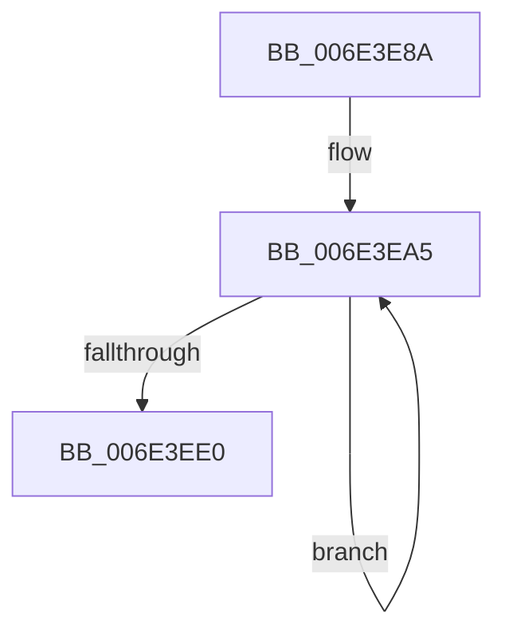

# sub_006E3E8A

- RVA: `0x006E3E8A`–`0x006E3EE9` (길이 `95` bytes)
- VA: `0x00000001406E3E8A`
- 실행 섹션: `.text`
- PDB 이름 있음: `아니요`; PDB Function 태그: `아니요`
- unwind 정보 RVA: `0x0007AAD4`
- 디코드: `26`개 명령, `95/95` bytes 표시
- 미해석 바이트: `0` (있으면 어셈블리에 `.byte`로 보존)

> 이 문서는 커널 이미지의 기계어와 PDB 기호를 분석해 생성했습니다. 4번과 5번은 함수 원형과 자료형을 바이너리 사용 방식에서 추정한 C 해석이며 원본 소스 복구 결과는 아닙니다.

## 1. Dependencies

- 직접 호출 지점: **3**; 고유 호출 대상: **3**
- 직접 호출자로 확인된 함수: **0**
- RIP 상대 이미지 참조: **0**

### Outgoing calls
- `0x006E3E9F` → [KeBugCheckEx](../4F/KeBugCheckEx_function_004FD660.md) (function, `0x004FD660`)
- `0x006E3EAA` → [MiSetPfnContainingFrame](../36/MiSetPfnContainingFrame_function_00363FC0.md) (function, `0x00363FC0`)
- `0x006E3EB4` → [MiInsertPageInFreeOrZeroedList](../33/MiInsertPageInFreeOrZeroedList_function_00334D20.md) (function, `0x00334D20`)

### Direct callers
- 이 함수 시작 RVA로 연결되는 직접 call은 확인되지 않았습니다. 간접 호출은 완전히 역산할 수 없습니다.

### Static image references
- 디코드된 RIP-relative 메모리 참조가 없습니다.

## 2. Other-region calls and transfers

- 다른 실행 섹션으로 향하는 call: **0**
- call이 아닌 외부 분기/꼬리 이동: **1**
  - `0x006E3EE4` → [MiDeleteSectionCluster + 0x3D6](../37/MiDeleteSectionCluster_function_00373DF0.md) (`tail-transfer`)

## 3. Assembly (complete function range)

```asm
006E3E8A  4D 8B CD                        mov r9, r13
006E3E8D  48 89 44 24 20                  mov qword ptr [rsp + 0x20], rax
006E3E92  4D 8B C7                        mov r8, r15
006E3E95  BA 03 00 00 00                  mov edx, 3
006E3E9A  B9 DE 00 00 00                  mov ecx, 0xde
006E3E9F  E8 BC 97 E1 FF                  call 0x1404fd660
006E3EA4  CC                              int3
006E3EA5  33 D2                           xor edx, edx
006E3EA7  49 8B C8                        mov rcx, r8
006E3EAA  E8 11 01 C8 FF                  call 0x140363fc0
006E3EAF  8B D6                           mov edx, esi
006E3EB1  49 8B CE                        mov rcx, r14
006E3EB4  E8 67 0E C5 FF                  call 0x140334d20
006E3EB9  49 83 FC 01                     cmp r12, 1
006E3EBD  49 0F 45 DF                     cmovne rbx, r15
006E3EC1  F0 4C 21 2F                     lock and qword ptr [rdi], r13
006E3EC5  4C 8D 43 30                     lea r8, [rbx + 0x30]
006E3EC9  49 FF C6                        inc r14
006E3ECC  4C 89 45 E0                     mov qword ptr [rbp - 0x20], r8
006E3ED0  49 8B D8                        mov rbx, r8
006E3ED3  48 8D 7F 30                     lea rdi, [rdi + 0x30]
006E3ED7  4D 8B F8                        mov r15, r8
006E3EDA  49 83 EC 01                     sub r12, 1
006E3EDE  75 C5                           jne 0x1406e3ea5
006E3EE0  4C 8B 6D E8                     mov r13, qword ptr [rbp - 0x18]
006E3EE4  E9 DD 02 C9 FF                  jmp 0x1403741c6
```

## 4. C-style interpretation (structured pseudocode)

```c
__int64 __fastcall sub_006E3E8A(void)
{
    __int64 result;
    __int64 v_r12;
    __int64 v_r14;
    __int64 v_rbx;
    unsigned __int64 v_stack_p20;

    v_stack_p20 = result;
    result = KeBugCheckEx(222, 3, v_r15, v_r13);
loc_006E3EA5:
    a2 = 0;
    result = MiSetPfnContainingFrame(v_r15, a2, v_r15, v_r13);
    result = MiInsertPageInFreeOrZeroedList(v_r14, (unsigned int)((unsigned int)(v_rsi)), v_r15, v_r13);
    if (v_r12 != 1) { v_rbx = v_r15; }
    v_r14 = (v_r14) + 1;
    *(unsigned __int64 *)(v_rbp - 32) = v_rbx + 48;
    v_r12 = (v_r12) - (1);
    if (condition_is_not_equal) goto loc_006E3EA5;
}
```

## 5. (Beta) C Style

```c
void sub_006E3E8A(void)
{
    int64_t result;
    int64_t local_r12;
    int64_t local_r14;
    int64_t local_rbx;
    uint64_t v_stack_p20;

    v_stack_p20 = result;
    result = KeBugCheckEx(222, 3, local_r15, local_r13);
loc_006E3EA5:
    a2 = 0;
    result = MiSetPfnContainingFrame(local_r15, a2, local_r15, local_r13);
    result = MiInsertPageInFreeOrZeroedList(local_r14, (uint32_t)((uint32_t)(local_rsi)), local_r15, local_r13);
    if (local_r12 != 1) { local_rbx = local_r15; }
    local_r14 = (local_r14) + 1;
    *(uint64_t *)(local_rbp - 0x20) = local_rbx + 48;
    local_r12 = (local_r12) - (1);
    if (condition_is_not_equal) goto loc_006E3EA5;
}
```

## 6. Execution-region graph

[열기: 2D/3D 그래프와 함수 탐색 컨트롤 패널](../../../control-panel.html?section=text&rva=0x006E3E8A&view=graph)

- 2D 그래프는 위에서 아래로 흐르고, 3D 그래프는 빈 공간을 드래그해 회전합니다. Shift+드래그는 이동, 휠은 확대·축소, 함수 노드 선택은 대상 보고서 이동입니다.

### Static fallback


