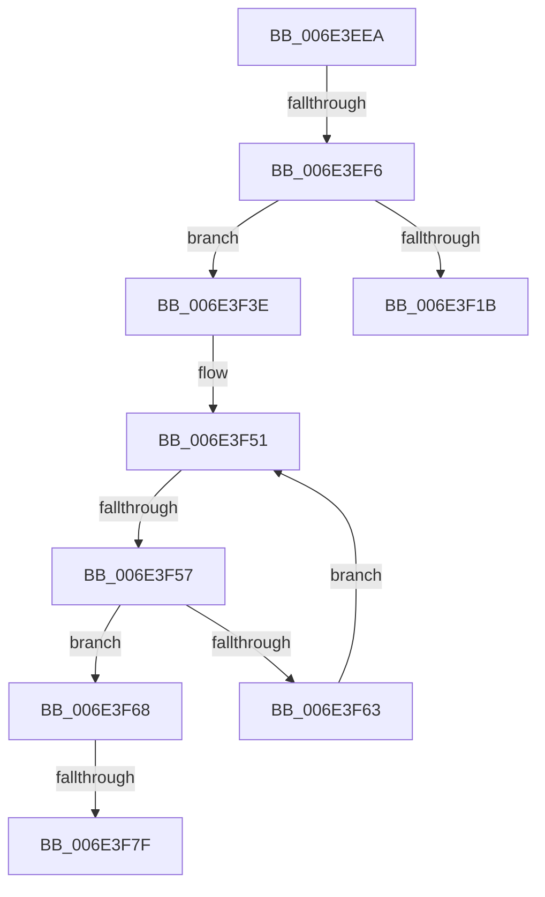

# sub_006E3EEA

- RVA: `0x006E3EEA`–`0x006E3F84` (길이 `154` bytes)
- VA: `0x00000001406E3EEA`
- 실행 섹션: `.text`
- PDB 이름 있음: `아니요`; PDB Function 태그: `아니요`
- unwind 정보 RVA: `0x0007AC20`
- 디코드: `45`개 명령, `154/154` bytes 표시
- 미해석 바이트: `0` (있으면 어셈블리에 `.byte`로 보존)

> 이 문서는 커널 이미지의 기계어와 PDB 기호를 분석해 생성했습니다. 4번과 5번은 함수 원형과 자료형을 바이너리 사용 방식에서 추정한 C 해석이며 원본 소스 복구 결과는 아닙니다.

## 1. Dependencies

- 직접 호출 지점: **0**; 고유 호출 대상: **0**
- 직접 호출자로 확인된 함수: **0**
- RIP 상대 이미지 참조: **0**

### Outgoing calls
- 직접 디코드된 call 명령이 없습니다.

### Direct callers
- 이 함수 시작 RVA로 연결되는 직접 call은 확인되지 않았습니다. 간접 호출은 완전히 역산할 수 없습니다.

### Static image references
- 디코드된 RIP-relative 메모리 참조가 없습니다.

## 2. Other-region calls and transfers

- 다른 실행 섹션으로 향하는 call: **0**
- call이 아닌 외부 분기/꼬리 이동: **5**
  - `0x006E3EF0` → [MiUpdateLargePageBitMap + 0x42E](../37/MiUpdateLargePageBitMap_function_0037619C.md) (`tail-transfer`)
  - `0x006E3F39` → [MiUpdateLargePageBitMap + 0x270](../37/MiUpdateLargePageBitMap_function_0037619C.md) (`tail-transfer`)
  - `0x006E3F51` → [MiUpdateLargePageBitMap + 0x42E](../37/MiUpdateLargePageBitMap_function_0037619C.md) (`tail-transfer`)
  - `0x006E3F79` → [MiUpdateLargePageBitMap + 0x278](../37/MiUpdateLargePageBitMap_function_0037619C.md) (`tail-transfer`)
  - `0x006E3F7F` → [MiUpdateLargePageBitMap + 0x42E](../37/MiUpdateLargePageBitMap_function_0037619C.md) (`tail-transfer`)

## 3. Assembly (complete function range)

```asm
006E3EEA  49 2B C1                        sub rax, r9
006E3EED  49 3B C0                        cmp rax, r8
006E3EF0  0F 82 D4 26 C9 FF               jb 0x1403765ca
006E3EF6  48 8B 56 08                     mov rdx, qword ptr [rsi + 8]
006E3EFA  48 FF CD                        dec rbp
006E3EFD  49 8B C1                        mov rax, r9
006E3F00  48 C1 E8 06                     shr rax, 6
006E3F04  4C 8D 14 C2                     lea r10, [rdx + rax*8]
006E3F08  48 8B C5                        mov rax, rbp
006E3F0B  48 C1 E8 06                     shr rax, 6
006E3F0F  48 8D 3C C2                     lea rdi, [rdx + rax*8]
006E3F13  49 8B 12                        mov rdx, qword ptr [r10]
006E3F16  4C 3B D7                        cmp r10, rdi
006E3F19  75 23                           jne 0x1406e3f3e
006E3F1B  48 83 C8 FF                     or rax, 0xffffffffffffffff
006E3F1F  B9 40 00 00 00                  mov ecx, 0x40
006E3F24  41 2A C8                        sub cl, r8b
006E3F27  48 D3 E8                        shr rax, cl
006E3F2A  49 8B C9                        mov rcx, r9
006E3F2D  48 D3 E0                        shl rax, cl
006E3F30  48 23 D0                        and rdx, rax
006E3F33  48 3B D0                        cmp rdx, rax
006E3F36  0F 94 C0                        sete al
006E3F39  E9 CE 24 C9 FF                  jmp 0x14037640c
006E3F3E  49 8B C9                        mov rcx, r9
006E3F41  49 83 C9 FF                     or r9, 0xffffffffffffffff
006E3F45  49 8B C1                        mov rax, r9
006E3F48  48 D3 E0                        shl rax, cl
006E3F4B  48 23 D0                        and rdx, rax
006E3F4E  48 3B D0                        cmp rdx, rax
006E3F51  0F 85 73 26 C9 FF               jne 0x1403765ca
006E3F57  49 83 C2 08                     add r10, 8
006E3F5B  49 8B 12                        mov rdx, qword ptr [r10]
006E3F5E  4C 3B D7                        cmp r10, rdi
006E3F61  74 05                           je 0x1406e3f68
006E3F63  49 3B D1                        cmp rdx, r9
006E3F66  EB E9                           jmp 0x1406e3f51
006E3F68  40 8A CD                        mov cl, bpl
006E3F6B  49 8B C1                        mov rax, r9
006E3F6E  F6 D1                           not cl
006E3F70  48 D3 E8                        shr rax, cl
006E3F73  48 23 D0                        and rdx, rax
006E3F76  48 3B D0                        cmp rdx, rax
006E3F79  0F 84 95 24 C9 FF               je 0x140376414
006E3F7F  E9 46 26 C9 FF                  jmp 0x1403765ca
```

## 4. C-style interpretation (structured pseudocode)

```c
__int64 __fastcall sub_006E3EEA(__int64 a1, __int64 a2, __int64 a3, __int64 a4)
{
    __int64 result;
    __int64 v_r10;
    __int64 v_rbp;

    result = (result) - (a4);
    v_rbp = (v_rbp) - 1;
    result = (a4) >> (6);
    result = (v_rbp) >> (6);
    if ((*(unsigned __int64 *)(v_rsi + 8) + result * 8) != (*(unsigned __int64 *)(v_rsi + 8) + result * 8)) goto loc_006E3F3E;
    result = (result) | (-1);
    a1 = (unsigned __int8)((64) - ((unsigned __int8)(a3)));
    result = (result) >> ((unsigned __int8)(a1));
    result = (result) << ((unsigned __int8)(a4));
    a2 = (*(unsigned __int64 *)(*(unsigned __int64 *)(v_rsi + 8) + result * 8)) & (result);
    result = (a2 == result) ? 1 : 0;
loc_006E3F3E:
    a4 = (a4) | (-1);
    result = (a4) << ((unsigned __int8)(a4));
    a2 = (a2) & (result);
loc_006E3F51:
    v_r10 = (*(unsigned __int64 *)(v_rsi + 8) + result * 8) + (8);
    if (v_r10 == (*(unsigned __int64 *)(v_rsi + 8) + result * 8)) goto loc_006E3F68;
    goto loc_006E3F51;
loc_006E3F68:
    a1 = (unsigned __int8)(~((unsigned __int8)(v_rbp)));
    result = (a4) >> ((unsigned __int8)(a1));
    a2 = (*(unsigned __int64 *)(v_r10)) & (result);
}
```

## 5. (Beta) C Style

```c
int64_t sub_006E3EEA(int64_t Arg1, int64_t Arg2, int64_t Arg3, int64_t Arg4)
{
    int64_t result;
    int64_t local_r10;
    int64_t local_rbp;

    result = (result) - (Arg4);
    local_rbp = (local_rbp) - 1;
    result = (Arg4) >> (6);
    result = (local_rbp) >> (6);
    if ((*(uint64_t *)(local_rsi + 0x8) + result * 8) != (*(uint64_t *)(local_rsi + 0x8) + result * 8)) goto loc_006E3F3E;
    result = (result) | (-1);
    Arg1 = (uint8_t)((64) - ((uint8_t)(Arg3)));
    result = (result) >> ((uint8_t)(Arg1));
    result = (result) << ((uint8_t)(Arg4));
    Arg2 = (*(uint64_t *)(*(uint64_t *)(local_rsi + 0x8) + result * 8)) & (result);
    result = (Arg2 == result) ? 1 : 0;
loc_006E3F3E:
    Arg4 = (Arg4) | (-1);
    result = (Arg4) << ((uint8_t)(Arg4));
    Arg2 = (Arg2) & (result);
loc_006E3F51:
    local_r10 = (*(uint64_t *)(local_rsi + 0x8) + result * 8) + (8);
    if (local_r10 == (*(uint64_t *)(local_rsi + 0x8) + result * 8)) goto loc_006E3F68;
    goto loc_006E3F51;
loc_006E3F68:
    Arg1 = (uint8_t)(~((uint8_t)(local_rbp)));
    result = (Arg4) >> ((uint8_t)(Arg1));
    Arg2 = (*(uint64_t *)(local_r10)) & (result);
}
```

## 6. Execution-region graph

[열기: 2D/3D 그래프와 함수 탐색 컨트롤 패널](../../../control-panel.html?section=text&rva=0x006E3EEA&view=graph)

- 2D 그래프는 위에서 아래로 흐르고, 3D 그래프는 빈 공간을 드래그해 회전합니다. Shift+드래그는 이동, 휠은 확대·축소, 함수 노드 선택은 대상 보고서 이동입니다.

### Static fallback


