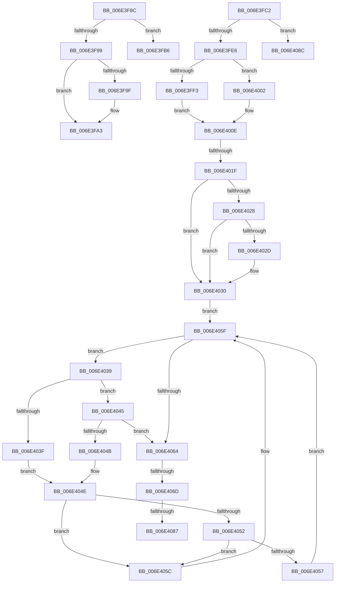

# sub_006E3F8C

- RVA: `0x006E3F8C`–`0x006E4094` (길이 `264` bytes)
- VA: `0x00000001406E3F8C`
- 실행 섹션: `.text`
- PDB 이름 있음: `아니요`; PDB Function 태그: `아니요`
- unwind 정보 RVA: `0x0007AD40`
- 디코드: `71`개 명령, `264/264` bytes 표시
- 미해석 바이트: `0` (있으면 어셈블리에 `.byte`로 보존)

> 이 문서는 커널 이미지의 기계어와 PDB 기호를 분석해 생성했습니다. 4번과 5번은 함수 원형과 자료형을 바이너리 사용 방식에서 추정한 C 해석이며 원본 소스 복구 결과는 아닙니다.

## 1. Dependencies

- 직접 호출 지점: **5**; 고유 호출 대상: **5**
- 직접 호출자로 확인된 함수: **0**
- RIP 상대 이미지 참조: **0**

### Outgoing calls
- `0x006E3FC9` → [MiReleaseSpinLockShared](../34/MiReleaseSpinLockShared_function_00348BF0.md) (function, `0x00348BF0`)
- `0x006E3FD4` → [MiRepurposeStandbySlabPage](../38/MiRepurposeStandbySlabPage_function_00385780.md) (function, `0x00385780`)
- `0x006E3FFB` → [ExAcquireSpinLockSharedAtDpcLevel](../24/ExAcquireSpinLockSharedAtDpcLevel_function_00248E30.md) (function, `0x00248E30`)
- `0x006E4002` → [ExAcquireSpinLockShared](../24/ExAcquireSpinLockShared_function_0024DCE0.md) (function, `0x0024DCE0`)
- `0x006E4075` → [MiGetPageFromSlabEntry](../37/MiGetPageFromSlabEntry_function_00377768.md) (function, `0x00377768`)

### Direct callers
- 이 함수 시작 RVA로 연결되는 직접 call은 확인되지 않았습니다. 간접 호출은 완전히 역산할 수 없습니다.

### Static image references
- 디코드된 RIP-relative 메모리 참조가 없습니다.

## 2. Other-region calls and transfers

- 다른 실행 섹션으로 향하는 call: **0**
- call이 아닌 외부 분기/꼬리 이동: **7**
  - `0x006E3FB1` → [MiGetPageFromSlabAllocator + 0xAF](../37/MiGetPageFromSlabAllocator_function_00377294.md) (`tail-transfer`)
  - `0x006E3FBD` → [MiGetPageFromSlabAllocator + 0x8E](../37/MiGetPageFromSlabAllocator_function_00377294.md) (`tail-transfer`)
  - `0x006E4019` → [MiGetPageFromSlabAllocator + 0x299](../37/MiGetPageFromSlabAllocator_function_00377294.md) (`tail-transfer`)
  - `0x006E4067` → [MiGetPageFromSlabAllocator + 0x299](../37/MiGetPageFromSlabAllocator_function_00377294.md) (`tail-transfer`)
  - `0x006E4081` → [MiGetPageFromSlabAllocator + 0x11A](../37/MiGetPageFromSlabAllocator_function_00377294.md) (`tail-transfer`)
  - `0x006E4087` → [MiGetPageFromSlabAllocator + 0x299](../37/MiGetPageFromSlabAllocator_function_00377294.md) (`tail-transfer`)
  - `0x006E408F` → [MiGetPageFromSlabAllocator + 0x14B](../37/MiGetPageFromSlabAllocator_function_00377294.md) (`tail-transfer`)

## 3. Assembly (complete function range)

```asm
006E3F8C  8B 83 8C 00 00 00               mov eax, dword ptr [rbx + 0x8c]
006E3F92  3D 00 02 00 00                  cmp eax, 0x200
006E3F97  7C 1D                           jl 0x1406e3fb6
006E3F99  48 83 F9 01                     cmp rcx, 1
006E3F9D  74 04                           je 0x1406e3fa3
006E3F9F  4C 8B 61 28                     mov r12, qword ptr [rcx + 0x28]
006E3FA3  48 83 64 24 78 00               and qword ptr [rsp + 0x78], 0
006E3FA9  33 C0                           xor eax, eax
006E3FAB  87 83 8C 00 00 00               xchg dword ptr [rbx + 0x8c], eax
006E3FB1  E9 8D 33 C9 FF                  jmp 0x140377343
006E3FB6  F0 FF 83 8C 00 00 00            lock inc dword ptr [rbx + 0x8c]
006E3FBD  E9 60 33 C9 FF                  jmp 0x140377322
006E3FC2  8A 54 24 60                     mov dl, byte ptr [rsp + 0x60]
006E3FC6  48 8B CE                        mov rcx, rsi
006E3FC9  E8 22 4C C6 FF                  call 0x140348bf0
006E3FCE  40 8A D5                        mov dl, bpl
006E3FD1  48 8B CB                        mov rcx, rbx
006E3FD4  E8 A7 17 CA FF                  call 0x140385780
006E3FD9  48 8B F8                        mov rdi, rax
006E3FDC  48 83 F8 FF                     cmp rax, -1
006E3FE0  0F 85 A6 00 00 00               jne 0x1406e408c
006E3FE6  C6 44 24 70 FF                  mov byte ptr [rsp + 0x70], 0xff
006E3FEB  48 8B CE                        mov rcx, rsi
006E3FEE  45 85 F6                        test r14d, r14d
006E3FF1  74 0F                           je 0x1406e4002
006E3FF3  41 B6 11                        mov r14b, 0x11
006E3FF6  44 88 74 24 60                  mov byte ptr [rsp + 0x60], r14b
006E3FFB  E8 30 4E B6 FF                  call 0x140248e30
006E4000  EB 0C                           jmp 0x1406e400e
006E4002  E8 D9 9C B6 FF                  call 0x14024dce0
006E4007  88 44 24 60                     mov byte ptr [rsp + 0x60], al
006E400B  41 B6 11                        mov r14b, 0x11
006E400E  F0 FF 83 A4 00 00 00            lock inc dword ptr [rbx + 0xa4]
006E4015  49 83 FC FF                     cmp r12, -1
006E4019  0F 84 0E 35 C9 FF               je 0x14037752d
006E401F  F6 43 08 01                     test byte ptr [rbx + 8], 1
006E4023  48 8B 0B                        mov rcx, qword ptr [rbx]
006E4026  74 08                           je 0x1406e4030
006E4028  48 85 C9                        test rcx, rcx
006E402B  74 03                           je 0x1406e4030
006E402D  48 33 CB                        xor rcx, rbx
006E4030  0F B6 53 08                     movzx edx, byte ptr [rbx + 8]
006E4034  83 E2 01                        and edx, 1
006E4037  EB 26                           jmp 0x1406e405f
006E4039  4C 3B 61 30                     cmp r12, qword ptr [rcx + 0x30]
006E403D  76 06                           jbe 0x1406e4045
006E403F  48 8B 41 08                     mov rax, qword ptr [rcx + 8]
006E4043  EB 09                           jmp 0x1406e404e
006E4045  4C 3B 61 28                     cmp r12, qword ptr [rcx + 0x28]
006E4049  73 19                           jae 0x1406e4064
006E404B  48 8B 01                        mov rax, qword ptr [rcx]
006E404E  85 D2                           test edx, edx
006E4050  74 0A                           je 0x1406e405c
006E4052  48 85 C0                        test rax, rax
006E4055  74 05                           je 0x1406e405c
006E4057  48 33 C8                        xor rcx, rax
006E405A  EB 03                           jmp 0x1406e405f
006E405C  48 8B C8                        mov rcx, rax
006E405F  48 85 C9                        test rcx, rcx
006E4062  75 D5                           jne 0x1406e4039
006E4064  48 85 C9                        test rcx, rcx
006E4067  0F 84 C0 34 C9 FF               je 0x14037752d
006E406D  48 8B D3                        mov rdx, rbx
006E4070  48 89 4C 24 78                  mov qword ptr [rsp + 0x78], rcx
006E4075  E8 EE 36 C9 FF                  call 0x140377768
006E407A  48 8B F8                        mov rdi, rax
006E407D  48 83 F8 FF                     cmp rax, -1
006E4081  0F 85 27 33 C9 FF               jne 0x1403773ae
006E4087  E9 A1 34 C9 FF                  jmp 0x14037752d
006E408C  41 B6 11                        mov r14b, 0x11
006E408F  E9 4B 33 C9 FF                  jmp 0x1403773df
```

## 4. C-style interpretation (structured pseudocode)

```c
__int64 __fastcall sub_006E3F8C(__int64 a1, __int64 a2, __int64 a3, __int64 a4, __int64 a5, __int64 a6, __int64 a7, __int64 a8, __int64 a9, __int64 a10, __int64 a11, __int64 a12, __int64 a13, __int64 a14, __int64 a15)
{
    __int64 result;
    __int64 v_r12;
    unsigned __int8 v_stack_p60;
    unsigned __int8 v_stack_p70;
    unsigned __int64 v_stack_p78;

    if (((unsigned int)((unsigned int)(*(unsigned int *)(v_rbx + 140)))) < 512) goto loc_006E3FB6;
    if (a1 != 1) {
        v_r12 = *(unsigned __int64 *)(a1 + 40);
    }
    result = 0;
loc_006E3FB6:
}
```

## 5. (Beta) C Style

```c
int64_t sub_006E3F8C(int64_t Arg1, int64_t Arg2, int64_t Arg3, int64_t Arg4, uint64_t Arg5, uint64_t Arg6, uint64_t Arg7, uint64_t Arg8, uint64_t Arg9, uint64_t Arg10, uint64_t Arg11, uint64_t Arg12, uint64_t Arg13, uint64_t Arg14, int64_t Arg15)
{
    int64_t result;
    int64_t local_r12;
    uint8_t v_stack_p60;
    uint8_t v_stack_p70;
    uint64_t v_stack_p78;

    if (((uint32_t)((uint32_t)(*(uint32_t *)(local_rbx + 0x8C)))) < 512) goto loc_006E3FB6;
    if (Arg1 != 1) {
        local_r12 = *(uint64_t *)(Arg1 + 0x28);
    }
    result = 0;
loc_006E3FB6:
}
```

## 6. Execution-region graph

[열기: 2D/3D 그래프와 함수 탐색 컨트롤 패널](../../../control-panel.html?section=text&rva=0x006E3F8C&view=graph)

- 2D 그래프는 위에서 아래로 흐르고, 3D 그래프는 빈 공간을 드래그해 회전합니다. Shift+드래그는 이동, 휠은 확대·축소, 함수 노드 선택은 대상 보고서 이동입니다.

### Static fallback


