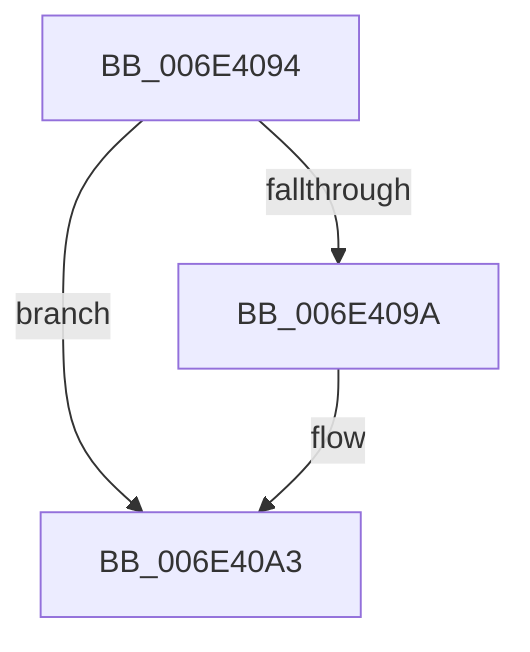

# sub_006E4094

- RVA: `0x006E4094`–`0x006E40AF` (길이 `27` bytes)
- VA: `0x00000001406E4094`
- 실행 섹션: `.text`
- PDB 이름 있음: `아니요`; PDB Function 태그: `아니요`
- unwind 정보 RVA: `0x0007ADAC`
- 디코드: `8`개 명령, `27/27` bytes 표시
- 미해석 바이트: `0` (있으면 어셈블리에 `.byte`로 보존)

> 이 문서는 커널 이미지의 기계어와 PDB 기호를 분석해 생성했습니다. 4번과 5번은 함수 원형과 자료형을 바이너리 사용 방식에서 추정한 C 해석이며 원본 소스 복구 결과는 아닙니다.

## 1. Dependencies

- 직접 호출 지점: **1**; 고유 호출 대상: **1**
- 직접 호출자로 확인된 함수: **0**
- RIP 상대 이미지 참조: **0**

### Outgoing calls
- `0x006E409D` → [MiBadRefCount](../24/MiBadRefCount_function_00246E08.md) (function, `0x00246E08`)

### Direct callers
- 이 함수 시작 RVA로 연결되는 직접 call은 확인되지 않았습니다. 간접 호출은 완전히 역산할 수 없습니다.

### Static image references
- 디코드된 RIP-relative 메모리 참조가 없습니다.

## 2. Other-region calls and transfers

- 다른 실행 섹션으로 향하는 call: **0**
- call이 아닌 외부 분기/꼬리 이동: **1**
  - `0x006E40AA` → [MiReadyLargePageToFree + 0xAA](../37/MiReadyLargePageToFree_function_00377A68.md) (`tail-transfer`)

## 3. Assembly (complete function range)

```asm
006E4094  41 F6 C5 04                     test r13b, 4
006E4098  74 09                           je 0x1406e40a3
006E409A  48 8B CB                        mov rcx, rbx
006E409D  E8 66 2D B6 FF                  call 0x140246e08
006E40A2  CC                              int3
006E40A3  48 83 C3 30                     add rbx, 0x30
006E40A7  49 FF C6                        inc r14
006E40AA  E9 63 3A C9 FF                  jmp 0x140377b12
```

## 4. C-style interpretation (structured pseudocode)

```c
__int64 __fastcall sub_006E4094(void)
{
    __int64 result;
    __int64 v_r14;
    __int64 v_rbx;

    if ((((unsigned __int8)(v_r13)) & (4)) != 0) {
        a1 = v_rbx;
        result = MiBadRefCount(a1, a2, a3, a4);
    }
    v_rbx = (v_rbx) + (48);
    v_r14 = (v_r14) + 1;
}
```

## 5. (Beta) C Style

```c
void sub_006E4094(void)
{
    int64_t result;
    int64_t local_r14;
    int64_t local_rbx;

    if ((((uint8_t)(local_r13)) & (4)) != 0) {
        a1 = local_rbx;
        result = MiBadRefCount(a1, a2, a3, a4);
    }
    local_rbx = (local_rbx) + (48);
    local_r14 = (local_r14) + 1;
}
```

## 6. Execution-region graph

[열기: 2D/3D 그래프와 함수 탐색 컨트롤 패널](../../../control-panel.html?section=text&rva=0x006E4094&view=graph)

- 2D 그래프는 위에서 아래로 흐르고, 3D 그래프는 빈 공간을 드래그해 회전합니다. Shift+드래그는 이동, 휠은 확대·축소, 함수 노드 선택은 대상 보고서 이동입니다.

### Static fallback


