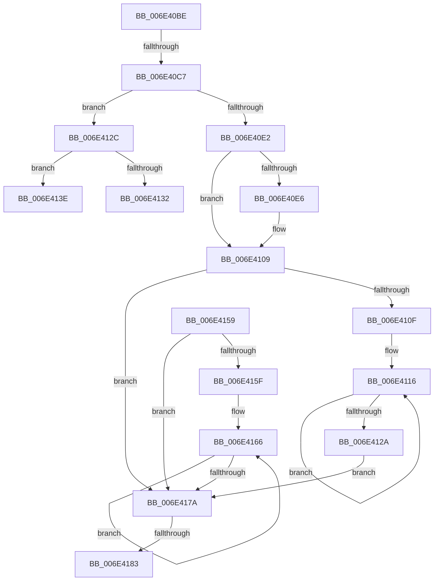

# sub_006E40BE

- RVA: `0x006E40BE`–`0x006E4191` (길이 `211` bytes)
- VA: `0x00000001406E40BE`
- 실행 섹션: `.text`
- PDB 이름 있음: `아니요`; PDB Function 태그: `아니요`
- unwind 정보 RVA: `0x0007AE04`
- 디코드: `62`개 명령, `211/211` bytes 표시
- 미해석 바이트: `0` (있으면 어셈블리에 `.byte`로 보존)

> 이 문서는 커널 이미지의 기계어와 PDB 기호를 분석해 생성했습니다. 4번과 5번은 함수 원형과 자료형을 바이너리 사용 방식에서 추정한 C 해석이며 원본 소스 복구 결과는 아닙니다.

## 1. Dependencies

- 직접 호출 지점: **0**; 고유 호출 대상: **0**
- 직접 호출자로 확인된 함수: **0**
- RIP 상대 이미지 참조: **0**

### Outgoing calls
- 직접 디코드된 call 명령이 없습니다.

### Direct callers
- 이 함수 시작 RVA로 연결되는 직접 call은 확인되지 않았습니다. 간접 호출은 완전히 역산할 수 없습니다.

### Static image references
- 디코드된 RIP-relative 메모리 참조가 없습니다.

## 2. Other-region calls and transfers

- 다른 실행 섹션으로 향하는 call: **0**
- call이 아닌 외부 분기/꼬리 이동: **5**
  - `0x006E40C1` → [RtlInterlockedSetClearRun + 0x163](../37/RtlInterlockedSetClearRun_function_00377F10.md) (`tail-transfer`)
  - `0x006E4139` → [RtlInterlockedSetClearRun + 0x163](../37/RtlInterlockedSetClearRun_function_00377F10.md) (`tail-transfer`)
  - `0x006E4154` → [RtlInterlockedSetClearRun + 0x163](../37/RtlInterlockedSetClearRun_function_00377F10.md) (`tail-transfer`)
  - `0x006E417D` → [RtlInterlockedSetClearRun + 0x163](../37/RtlInterlockedSetClearRun_function_00377F10.md) (`tail-transfer`)
  - `0x006E418C` → [RtlInterlockedSetClearRun + 0x163](../37/RtlInterlockedSetClearRun_function_00377F10.md) (`tail-transfer`)

## 3. Assembly (complete function range)

```asm
006E40BE  45 3B CB                        cmp r9d, r11d
006E40C1  0F 84 AC 3F C9 FF               je 0x140378073
006E40C7  49 8B 46 08                     mov rax, qword ptr [r14 + 8]
006E40CB  45 2B CB                        sub r9d, r11d
006E40CE  48 C1 ED 05                     shr rbp, 5
006E40D2  4C 8D 14 A8                     lea r10, [rax + rbp*4]
006E40D6  41 8B C1                        mov eax, r9d
006E40D9  48 03 C7                        add rax, rdi
006E40DC  48 83 F8 20                     cmp rax, 0x20
006E40E0  76 4A                           jbe 0x1406e412c
006E40E2  85 F6                           test esi, esi
006E40E4  74 23                           je 0x1406e4109
006E40E6  BA 20 00 00 00                  mov edx, 0x20
006E40EB  41 8B C0                        mov eax, r8d
006E40EE  2B D6                           sub edx, esi
006E40F0  8B CA                           mov ecx, edx
006E40F2  D3 E0                           shl eax, cl
006E40F4  48 8B CF                        mov rcx, rdi
006E40F7  41 2B C0                        sub eax, r8d
006E40FA  D3 E0                           shl eax, cl
006E40FC  F7 D0                           not eax
006E40FE  F0 41 21 02                     lock and dword ptr [r10], eax
006E4102  44 2B CA                        sub r9d, edx
006E4105  49 83 C2 04                     add r10, 4
006E4109  41 83 F9 20                     cmp r9d, 0x20
006E410D  72 6B                           jb 0x1406e417a
006E410F  41 8B C1                        mov eax, r9d
006E4112  48 C1 E8 05                     shr rax, 5
006E4116  41 C7 02 00 00 00 00            mov dword ptr [r10], 0
006E411D  41 83 C1 E0                     add r9d, -0x20
006E4121  49 83 C2 04                     add r10, 4
006E4125  49 2B C0                        sub rax, r8
006E4128  75 EC                           jne 0x1406e4116
006E412A  EB 4E                           jmp 0x1406e417a
006E412C  41 83 F9 20                     cmp r9d, 0x20
006E4130  75 0C                           jne 0x1406e413e
006E4132  41 C7 02 00 00 00 00            mov dword ptr [r10], 0
006E4139  E9 35 3F C9 FF                  jmp 0x140378073
006E413E  41 8B C9                        mov ecx, r9d
006E4141  41 8B C0                        mov eax, r8d
006E4144  D3 E0                           shl eax, cl
006E4146  48 8B CF                        mov rcx, rdi
006E4149  41 2B C0                        sub eax, r8d
006E414C  D3 E0                           shl eax, cl
006E414E  F7 D0                           not eax
006E4150  F0 41 21 02                     lock and dword ptr [r10], eax
006E4154  E9 1A 3F C9 FF                  jmp 0x140378073
006E4159  41 83 F9 20                     cmp r9d, 0x20
006E415D  72 1B                           jb 0x1406e417a
006E415F  41 8B C1                        mov eax, r9d
006E4162  48 C1 E8 05                     shr rax, 5
006E4166  41 C7 02 00 00 00 00            mov dword ptr [r10], 0
006E416D  41 83 C1 E0                     add r9d, -0x20
006E4171  49 83 C2 04                     add r10, 4
006E4175  49 2B C0                        sub rax, r8
006E4178  75 EC                           jne 0x1406e4166
006E417A  45 85 C9                        test r9d, r9d
006E417D  0F 84 F0 3E C9 FF               je 0x140378073
006E4183  41 8B C9                        mov ecx, r9d
006E4186  D3 E3                           shl ebx, cl
006E4188  F0 41 21 1A                     lock and dword ptr [r10], ebx
006E418C  E9 E2 3E C9 FF                  jmp 0x140378073
```

## 4. C-style interpretation (structured pseudocode)

```c
__int64 __fastcall sub_006E40BE(__int64 a1, __int64 a2, __int64 a3, int a4)
{
    __int64 result;
    __int64 v_r10;
    __int64 v_rbp;
    __int64 v_rbx;

    a4 = (unsigned int)((a4) - ((unsigned int)(v_r11)));
    v_rbp = (v_rbp) >> (5);
    result = ((unsigned int)(a4)) + (v_rdi);
    if (result <= 32) goto loc_006E412C;
    v_r10 = *(unsigned __int64 *)(v_r14 + 8) + v_rbp * 4;
    if ((unsigned int)(v_rsi) != 0) {
        a2 = 32;
        result = (unsigned int)(a3);
        a2 = (unsigned int)((a2) - ((unsigned int)(v_rsi)));
        a1 = (unsigned int)(a2);
        result = (unsigned int)((result) << ((unsigned __int8)(a1)));
        a1 = v_rdi;
        result = (unsigned int)((result) - ((unsigned int)(a3)));
        result = (unsigned int)((result) << ((unsigned __int8)(a1)));
        result = (unsigned int)(~(result));
        a4 = (unsigned int)((a4) - ((unsigned int)(a2)));
        v_r10 = (*(unsigned __int64 *)(v_r14 + 8) + v_rbp * 4) + (4);
    }
    if (a4 < 32) goto loc_006E417A;
    result = ((unsigned int)(a4)) >> (5);
loc_006E4116:
    *(unsigned int *)(v_r10) = 0;
    a4 = (unsigned int)((a4) + (-32));
    v_r10 = (v_r10) + (4);
    result = (result) - (a3);
    if (condition_is_not_equal) goto loc_006E4116;
    goto loc_006E417A;
loc_006E412C:
    if (a4 != 32) goto loc_006E413E;
    *(unsigned int *)(v_r10) = 0;
loc_006E413E:
    result = (unsigned int)(((unsigned int)((unsigned int)(a3))) << ((unsigned __int8)((unsigned int)(a4))));
    result = (unsigned int)((result) - ((unsigned int)(a3)));
    result = (unsigned int)((result) << ((unsigned __int8)(v_rdi)));
    result = (unsigned int)(~(result));
loc_006E417A:
    v_rbx = (unsigned int)((v_rbx) << ((unsigned __int8)((unsigned int)(a4))));
}
```

## 5. (Beta) C Style

```c
int64_t sub_006E40BE(int64_t Arg1, int64_t Arg2, int64_t Arg3, int32_t Arg4)
{
    int64_t result;
    int64_t local_r10;
    int64_t local_rbp;
    int64_t local_rbx;

    Arg4 = (uint32_t)((Arg4) - ((uint32_t)(local_r11)));
    local_rbp = (local_rbp) >> (5);
    result = ((uint32_t)(Arg4)) + (local_rdi);
    if (result <= 32) goto loc_006E412C;
    local_r10 = *(uint64_t *)(local_r14 + 0x8) + local_rbp * 4;
    if ((uint32_t)(local_rsi) != 0) {
        Arg2 = 32;
        result = (uint32_t)(Arg3);
        Arg2 = (uint32_t)((Arg2) - ((uint32_t)(local_rsi)));
        Arg1 = (uint32_t)(Arg2);
        result = (uint32_t)((result) << ((uint8_t)(Arg1)));
        Arg1 = local_rdi;
        result = (uint32_t)((result) - ((uint32_t)(Arg3)));
        result = (uint32_t)((result) << ((uint8_t)(Arg1)));
        result = (uint32_t)(~(result));
        Arg4 = (uint32_t)((Arg4) - ((uint32_t)(Arg2)));
        local_r10 = (*(uint64_t *)(local_r14 + 0x8) + local_rbp * 4) + (4);
    }
    if (Arg4 < 32) goto loc_006E417A;
    result = ((uint32_t)(Arg4)) >> (5);
loc_006E4116:
    *(uint32_t *)(local_r10) = 0;
    Arg4 = (uint32_t)((Arg4) + (-32));
    local_r10 = (local_r10) + (4);
    result = (result) - (Arg3);
    if (condition_is_not_equal) goto loc_006E4116;
    goto loc_006E417A;
loc_006E412C:
    if (Arg4 != 32) goto loc_006E413E;
    *(uint32_t *)(local_r10) = 0;
loc_006E413E:
    result = (uint32_t)(((uint32_t)((uint32_t)(Arg3))) << ((uint8_t)((uint32_t)(Arg4))));
    result = (uint32_t)((result) - ((uint32_t)(Arg3)));
    result = (uint32_t)((result) << ((uint8_t)(local_rdi)));
    result = (uint32_t)(~(result));
loc_006E417A:
    local_rbx = (uint32_t)((local_rbx) << ((uint8_t)((uint32_t)(Arg4))));
}
```

## 6. Execution-region graph

[열기: 2D/3D 그래프와 함수 탐색 컨트롤 패널](../../../control-panel.html?section=text&rva=0x006E40BE&view=graph)

- 2D 그래프는 위에서 아래로 흐르고, 3D 그래프는 빈 공간을 드래그해 회전합니다. Shift+드래그는 이동, 휠은 확대·축소, 함수 노드 선택은 대상 보고서 이동입니다.

### Static fallback


