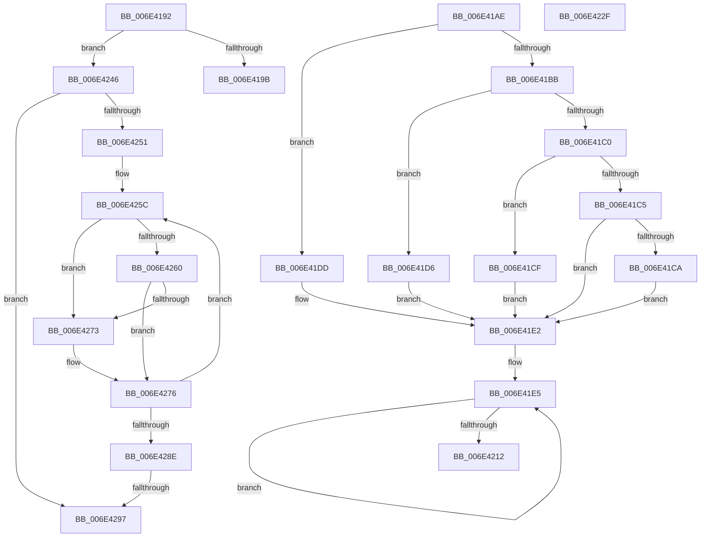

# sub_006E4192

- RVA: `0x006E4192`–`0x006E42A9` (길이 `279` bytes)
- VA: `0x00000001406E4192`
- 실행 섹션: `.text`
- PDB 이름 있음: `아니요`; PDB Function 태그: `아니요`
- unwind 정보 RVA: `0x0007AE5C`
- 디코드: `88`개 명령, `279/279` bytes 표시
- 미해석 바이트: `0` (있으면 어셈블리에 `.byte`로 보존)

> 이 문서는 커널 이미지의 기계어와 PDB 기호를 분석해 생성했습니다. 4번과 5번은 함수 원형과 자료형을 바이너리 사용 방식에서 추정한 C 해석이며 원본 소스 복구 결과는 아닙니다.

## 1. Dependencies

- 직접 호출 지점: **1**; 고유 호출 대상: **1**
- 직접 호출자로 확인된 함수: **0**
- RIP 상대 이미지 참조: **1**

### Outgoing calls
- `0x006E423B` → [wil_details_FeatureReporting_IncrementOpportunityInCache](../4D/wil_details_FeatureReporting_IncrementOpportunityInCache_function_004D2E40.md) (function, `0x004D2E40`)

### Direct callers
- 이 함수 시작 RVA로 연결되는 직접 call은 확인되지 않았습니다. 간접 호출은 완전히 역산할 수 없습니다.

### Static image references
- `0x006E419B` → RVA `0x00000000` (`image boundary/outside`; read)

## 2. Other-region calls and transfers

- 다른 실행 섹션으로 향하는 call: **0**
- call이 아닌 외부 분기/꼬리 이동: **4**
  - `0x006E422A` → [wil_details_FeatureReporting_ReportUsageToServiceDirect + 0x5B](../37/wil_details_FeatureReporting_ReportUsageToServiceDirect_function_003783A0.md) (`tail-transfer`)
  - `0x006E4241` → [wil_details_FeatureReporting_ReportUsageToServiceDirect + 0x5B](../37/wil_details_FeatureReporting_ReportUsageToServiceDirect_function_003783A0.md) (`tail-transfer`)
  - `0x006E4291` → [wil_details_FeatureReporting_ReportUsageToServiceDirect + 0x5B](../37/wil_details_FeatureReporting_ReportUsageToServiceDirect_function_003783A0.md) (`tail-transfer`)
  - `0x006E42A4` → [wil_details_FeatureReporting_ReportUsageToServiceDirect + 0x5B](../37/wil_details_FeatureReporting_ReportUsageToServiceDirect_function_003783A0.md) (`tail-transfer`)

## 3. Assembly (complete function range)

```asm
006E4192  83 FE 07                        cmp esi, 7
006E4195  0F 87 AB 00 00 00               ja 0x1406e4246
006E419B  48 8D 15 5E BE 91 FF            lea rdx, [rip - 0x6e41a2]
006E41A2  8B 8C B2 00 30 04 00            mov ecx, dword ptr [rdx + rsi*4 + 0x43000]
006E41A9  48 03 CA                        add rcx, rdx
006E41AC  FF E1                           jmp rcx
006E41AE  CC                              int3
006E41AF  CC                              int3
006E41B0  CC                              int3
006E41B1  CC                              int3
006E41B2  8B D6                           mov edx, esi
006E41B4  8B CF                           mov ecx, edi
006E41B6  83 EA 02                        sub edx, 2
006E41B9  74 22                           je 0x1406e41dd
006E41BB  83 EA 01                        sub edx, 1
006E41BE  74 16                           je 0x1406e41d6
006E41C0  83 EA 03                        sub edx, 3
006E41C3  74 0A                           je 0x1406e41cf
006E41C5  83 FA 01                        cmp edx, 1
006E41C8  75 18                           jne 0x1406e41e2
006E41CA  8D 4A 0F                        lea ecx, [rdx + 0xf]
006E41CD  EB 13                           jmp 0x1406e41e2
006E41CF  B9 04 00 00 00                  mov ecx, 4
006E41D4  EB 0C                           jmp 0x1406e41e2
006E41D6  B9 08 00 00 00                  mov ecx, 8
006E41DB  EB 05                           jmp 0x1406e41e2
006E41DD  B9 02 00 00 00                  mov ecx, 2
006E41E2  41 8B 12                        mov edx, dword ptr [r10]
006E41E5  44 8B C7                        mov r8d, edi
006E41E8  8B C1                           mov eax, ecx
006E41EA  0B C2                           or eax, edx
006E41EC  44 8B DA                        mov r11d, edx
006E41EF  3B C2                           cmp eax, edx
006E41F1  44 8B C8                        mov r9d, eax
006E41F4  41 0F 94 C0                     sete r8b
006E41F8  41 83 C9 01                     or r9d, 1
006E41FC  45 85 C0                        test r8d, r8d
006E41FF  44 89 45 D0                     mov dword ptr [rbp - 0x30], r8d
006E4203  44 0F 45 C8                     cmovne r9d, eax
006E4207  8B C2                           mov eax, edx
006E4209  F0 45 0F B1 0A                  lock cmpxchg dword ptr [r10], r9d
006E420E  8B D0                           mov edx, eax
006E4210  75 D3                           jne 0x1406e41e5
006E4212  41 F6 C3 01                     test r11b, 1
006E4216  0F 94 C1                        sete cl
006E4219  41 F6 C1 01                     test r9b, 1
006E421D  0F 95 C0                        setne al
006E4220  84 C8                           test al, cl
006E4222  8B C7                           mov eax, edi
006E4224  0F 95 C0                        setne al
006E4227  89 45 C0                        mov dword ptr [rbp - 0x40], eax
006E422A  E9 CC 41 C9 FF                  jmp 0x1403783fb
006E422F  4C 8D 4D C0                     lea r9, [rbp - 0x40]
006E4233  45 8B C6                        mov r8d, r14d
006E4236  8B D6                           mov edx, esi
006E4238  49 8B CA                        mov rcx, r10
006E423B  E8 00 EC DE FF                  call 0x1404d2e40
006E4240  90                              nop
006E4241  E9 B5 41 C9 FF                  jmp 0x1403783fb
006E4246  8D 96 C0 FE FF FF               lea edx, [rsi - 0x140]
006E424C  83 FA 40                        cmp edx, 0x40
006E424F  7D 46                           jge 0x1406e4297
006E4251  41 8B 42 04                     mov eax, dword ptr [r10 + 4]
006E4255  44 8B C2                        mov r8d, edx
006E4258  41 C1 E0 05                     shl r8d, 5
006E425C  A8 10                           test al, 0x10
006E425E  74 13                           je 0x1406e4273
006E4260  8B C8                           mov ecx, eax
006E4262  C7 45 D0 01 00 00 00            mov dword ptr [rbp - 0x30], 1
006E4269  C1 E9 05                        shr ecx, 5
006E426C  83 E1 3F                        and ecx, 0x3f
006E426F  3B CA                           cmp ecx, edx
006E4271  74 03                           je 0x1406e4276
006E4273  89 7D D0                        mov dword ptr [rbp - 0x30], edi
006E4276  41 8B C8                        mov ecx, r8d
006E4279  33 C8                           xor ecx, eax
006E427B  81 E1 E0 07 00 00               and ecx, 0x7e0
006E4281  33 C8                           xor ecx, eax
006E4283  83 C9 10                        or ecx, 0x10
006E4286  F0 41 0F B1 4A 04               lock cmpxchg dword ptr [r10 + 4], ecx
006E428C  75 CE                           jne 0x1406e425c
006E428E  39 7D D0                        cmp dword ptr [rbp - 0x30], edi
006E4291  0F 85 64 41 C9 FF               jne 0x1403783fb
006E4297  8B 45 BC                        mov eax, dword ptr [rbp - 0x44]
006E429A  89 45 CC                        mov dword ptr [rbp - 0x34], eax
006E429D  89 75 C8                        mov dword ptr [rbp - 0x38], esi
006E42A0  44 89 75 C4                     mov dword ptr [rbp - 0x3c], r14d
006E42A4  E9 52 41 C9 FF                  jmp 0x1403783fb
```

## 4. C-style interpretation (structured pseudocode)

```c
__int64 __fastcall sub_006E4192(void)
{
    if (((unsigned int)(v_rsi)) > 7) goto loc_006E4246;
    a1 = ((unsigned int)(*(unsigned int *)(v_rip - 7225762 + v_rsi * 4 + 274432))) + (v_rip - 7225762);
loc_006E4246:
    if (((unsigned int)(v_rsi - 320)) >= 64) goto loc_006E4297;
    a3 = (unsigned int)(((unsigned int)((unsigned int)(v_rsi - 320))) << (5));
loc_006E425C:
    if ((((unsigned __int8)((unsigned int)(*(unsigned int *)(v_r10 + 4)))) & (16)) == 0) goto loc_006E4273;
    *(unsigned int *)(v_rbp - 48) = 1;
    a1 = (unsigned int)(((unsigned int)((unsigned int)((unsigned int)(*(unsigned int *)(v_r10 + 4))))) >> (5));
    a1 = (unsigned int)((a1) & (63));
    if (((unsigned int)(a1)) != ((unsigned int)(v_rsi - 320))) {
        *(unsigned int *)(v_rbp - 48) = (unsigned int)(v_rdi);
    }
    a1 = (unsigned int)(((unsigned int)((unsigned int)(a3))) ^ ((unsigned int)((unsigned int)(*(unsigned int *)(v_r10 + 4)))));
    a1 = (unsigned int)((a1) & (0x7E0ULL));
    a1 = (unsigned int)((a1) ^ ((unsigned int)((unsigned int)(*(unsigned int *)(v_r10 + 4)))));
    a1 = (unsigned int)((a1) | (16));
    if (condition_is_not_equal) goto loc_006E425C;
loc_006E4297:
    *(unsigned int *)(v_rbp - 52) = (unsigned int)((unsigned int)(*(unsigned int *)(v_rbp - 68)));
    *(unsigned int *)(v_rbp - 56) = (unsigned int)(v_rsi);
    *(unsigned int *)(v_rbp - 60) = (unsigned int)(v_r14);
}
```

## 5. (Beta) C Style

```c
void sub_006E4192(void)
{
    if (((uint32_t)(local_rsi)) > 7) goto loc_006E4246;
    a1 = ((uint32_t)(*(uint32_t *)(v_rip - 0x6E41A2 + local_rsi * 4 + 0x43000))) + (v_rip - 7225762);
loc_006E4246:
    if (((uint32_t)(local_rsi - 320)) >= 64) goto loc_006E4297;
    a3 = (uint32_t)(((uint32_t)((uint32_t)(local_rsi - 320))) << (5));
loc_006E425C:
    if ((((uint8_t)((uint32_t)(*(uint32_t *)(local_r10 + 0x4)))) & (16)) == 0) goto loc_006E4273;
    *(uint32_t *)(local_rbp - 0x30) = 1;
    a1 = (uint32_t)(((uint32_t)((uint32_t)((uint32_t)(*(uint32_t *)(local_r10 + 0x4))))) >> (5));
    a1 = (uint32_t)((a1) & (63));
    if (((uint32_t)(a1)) != ((uint32_t)(local_rsi - 320))) {
        *(uint32_t *)(local_rbp - 0x30) = (uint32_t)(local_rdi);
    }
    a1 = (uint32_t)(((uint32_t)((uint32_t)(a3))) ^ ((uint32_t)((uint32_t)(*(uint32_t *)(local_r10 + 0x4)))));
    a1 = (uint32_t)((a1) & (0x7E0ULL));
    a1 = (uint32_t)((a1) ^ ((uint32_t)((uint32_t)(*(uint32_t *)(local_r10 + 0x4)))));
    a1 = (uint32_t)((a1) | (16));
    if (condition_is_not_equal) goto loc_006E425C;
loc_006E4297:
    *(uint32_t *)(local_rbp - 0x34) = (uint32_t)((uint32_t)(*(uint32_t *)(local_rbp - 0x44)));
    *(uint32_t *)(local_rbp - 0x38) = (uint32_t)(local_rsi);
    *(uint32_t *)(local_rbp - 0x3C) = (uint32_t)(local_r14);
}
```

## 6. Execution-region graph

[열기: 2D/3D 그래프와 함수 탐색 컨트롤 패널](../../../control-panel.html?section=text&rva=0x006E4192&view=graph)

- 2D 그래프는 위에서 아래로 흐르고, 3D 그래프는 빈 공간을 드래그해 회전합니다. Shift+드래그는 이동, 휠은 확대·축소, 함수 노드 선택은 대상 보고서 이동입니다.

### Static fallback


