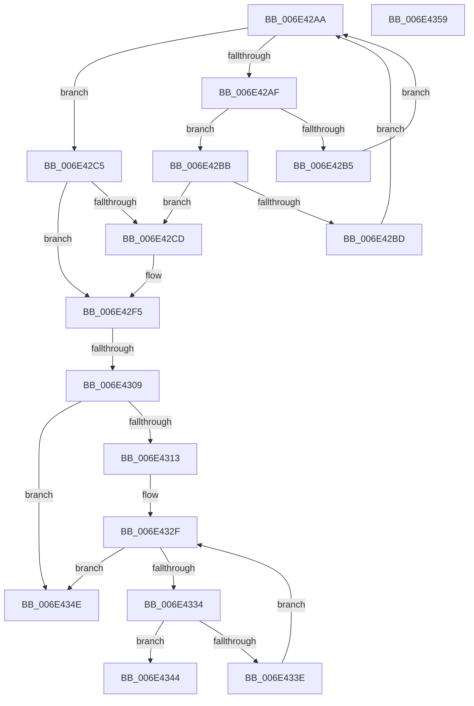

# sub_006E42AA

- RVA: `0x006E42AA`–`0x006E436C` (길이 `194` bytes)
- VA: `0x00000001406E42AA`
- 실행 섹션: `.text`
- PDB 이름 있음: `아니요`; PDB Function 태그: `아니요`
- unwind 정보 RVA: `0x0007AEF4`
- 디코드: `51`개 명령, `194/194` bytes 표시
- 미해석 바이트: `0` (있으면 어셈블리에 `.byte`로 보존)

> 이 문서는 커널 이미지의 기계어와 PDB 기호를 분석해 생성했습니다. 4번과 5번은 함수 원형과 자료형을 바이너리 사용 방식에서 추정한 C 해석이며 원본 소스 복구 결과는 아닙니다.

## 1. Dependencies

- 직접 호출 지점: **1**; 고유 호출 대상: **1**
- 직접 호출자로 확인된 함수: **0**
- RIP 상대 이미지 참조: **2**

### Outgoing calls
- `0x006E42FC` → [ExReleaseSpinLockSharedFromDpcLevel](../24/ExReleaseSpinLockSharedFromDpcLevel_function_0024A590.md) (function, `0x0024A590`)

### Direct callers
- 이 함수 시작 RVA로 연결되는 직접 call은 확인되지 않았습니다. 간접 호출은 완전히 역산할 수 없습니다.

### Static image references
- `0x006E42F5` → RVA `0x00E2FFD0` (`.data`; read)
- `0x006E4309` → RVA `0x00E2FFD8` (`.data`; read)

## 2. Other-region calls and transfers

- 다른 실행 섹션으로 향하는 call: **0**
- call이 아닌 외부 분기/꼬리 이동: **4**
  - `0x006E4303` → [MiInsertSlabEntry + 0x14C](../37/MiInsertSlabEntry_function_00378AF4.md) (`tail-transfer`)
  - `0x006E4349` → [MiInsertSlabEntry + 0x14C](../37/MiInsertSlabEntry_function_00378AF4.md) (`tail-transfer`)
  - `0x006E4354` → [MiInsertSlabEntry + 0x75](../37/MiInsertSlabEntry_function_00378AF4.md) (`tail-transfer`)
  - `0x006E4367` → [MiInsertSlabEntry + 0xF2](../37/MiInsertSlabEntry_function_00378AF4.md) (`tail-transfer`)

## 3. Assembly (complete function range)

```asm
006E42AA  48 85 C9                        test rcx, rcx
006E42AD  74 16                           je 0x1406e42c5
006E42AF  48 3B 79 18                     cmp rdi, qword ptr [rcx + 0x18]
006E42B3  76 06                           jbe 0x1406e42bb
006E42B5  48 8B 49 08                     mov rcx, qword ptr [rcx + 8]
006E42B9  EB EF                           jmp 0x1406e42aa
006E42BB  73 10                           jae 0x1406e42cd
006E42BD  48 8B D1                        mov rdx, rcx
006E42C0  48 8B 09                        mov rcx, qword ptr [rcx]
006E42C3  EB E5                           jmp 0x1406e42aa
006E42C5  48 8B CA                        mov rcx, rdx
006E42C8  48 85 D2                        test rdx, rdx
006E42CB  74 28                           je 0x1406e42f5
006E42CD  48 8B 46 30                     mov rax, qword ptr [rsi + 0x30]
006E42D1  48 8D 14 40                     lea rdx, [rax + rax*2]
006E42D5  48 B8 00 00 00 00 00 DE FF FF   movabs rax, 0xffffde0000000000
006E42DF  48 C1 E2 04                     shl rdx, 4
006E42E3  48 8B C0                        mov rax, rax
006E42E6  48 03 D0                        add rdx, rax
006E42E9  B8 01 00 00 00                  mov eax, 1
006E42EE  48 39 51 18                     cmp qword ptr [rcx + 0x18], rdx
006E42F2  0F 46 E8                        cmovbe ebp, eax
006E42F5  48 8D 0D D4 BC 74 00            lea rcx, [rip + 0x74bcd4]
006E42FC  E8 8F 62 B6 FF                  call 0x14024a590
006E4301  85 ED                           test ebp, ebp
006E4303  0F 85 37 49 C9 FF               jne 0x140378c40
006E4309  48 83 3D C7 BC 74 00 00         cmp qword ptr [rip + 0x74bcc7], 0
006E4311  74 3B                           je 0x1406e434e
006E4313  48 8B 46 30                     mov rax, qword ptr [rsi + 0x30]
006E4317  48 8D 0C 40                     lea rcx, [rax + rax*2]
006E431B  48 B8 00 00 00 00 00 DE FF FF   movabs rax, 0xffffde0000000000
006E4325  48 C1 E1 04                     shl rcx, 4
006E4329  48 8B C0                        mov rax, rax
006E432C  48 03 C8                        add rcx, rax
006E432F  48 3B F9                        cmp rdi, rcx
006E4332  77 1A                           ja 0x1406e434e
006E4334  8B 47 20                        mov eax, dword ptr [rdi + 0x20]
006E4337  C1 E8 18                        shr eax, 0x18
006E433A  A8 40                           test al, 0x40
006E433C  75 06                           jne 0x1406e4344
006E433E  48 83 C7 30                     add rdi, 0x30
006E4342  EB EB                           jmp 0x1406e432f
006E4344  BD 01 00 00 00                  mov ebp, 1
006E4349  E9 F2 48 C9 FF                  jmp 0x140378c40
006E434E  41 B9 01 00 00 00               mov r9d, 1
006E4354  E9 10 48 C9 FF                  jmp 0x140378b69
006E4359  48 89 02                        mov qword ptr [rdx], rax
006E435C  4C 89 42 08                     mov qword ptr [rdx + 8], r8
006E4360  49 89 10                        mov qword ptr [r8], rdx
006E4363  48 89 50 08                     mov qword ptr [rax + 8], rdx
006E4367  E9 7A 48 C9 FF                  jmp 0x140378be6
```

## 4. C-style interpretation (structured pseudocode)

```c
__int64 __fastcall sub_006E42AA(__int64 a1, __int64 a2, __int64 a3)
{
    __int64 result;
    __int64 v_rbp;
    __int64 v_rdi;

    if (a1 == 0) goto loc_006E42C5;
    if (v_rdi <= (*(unsigned __int64 *)(a1 + 24))) goto loc_006E42BB;
    goto loc_006E42AA;
loc_006E42BB:
    if (v_rdi >= (*(unsigned __int64 *)(a1 + 24))) goto loc_006E42CD;
    goto loc_006E42AA;
loc_006E42C5:
    if (*(unsigned __int64 *)(a1 + 8) != 0) {
        result = *(unsigned __int64 *)(v_rsi + 48);
        a2 = result + result * 2;
        a2 = (a2) << (4);
        result = result;
        a2 = (a2) + (result);
        result = 1;
        if ((*(unsigned __int64 *)(*(unsigned __int64 *)(a1 + 8) + 24)) <= a2) { v_rbp = (unsigned int)(result); }
    }
    result = ExReleaseSpinLockSharedFromDpcLevel(v_rip + 7650516, a2, a3, a4);
    if ((*(unsigned __int64 *)(v_rip + 7650503)) == 0) goto loc_006E434E;
    a1 = (*(unsigned __int64 *)(v_rsi + 48) + *(unsigned __int64 *)(v_rsi + 48) * 2) << (4);
    a1 = (a1) + (*(unsigned __int64 *)(v_rsi + 48));
loc_006E432F:
    if (v_rdi > a1) goto loc_006E434E;
    result = (unsigned int)(((unsigned int)(*(unsigned int *)(v_rdi + 32))) >> (24));
    if ((((unsigned __int8)(result)) & (64)) != 0) goto loc_006E4344;
    v_rdi = (v_rdi) + (48);
    goto loc_006E432F;
loc_006E4344:
loc_006E434E:
}
```

## 5. (Beta) C Style

```c
int64_t sub_006E42AA(int64_t Arg1, int64_t Arg2, int64_t Arg3)
{
    int64_t result;
    int64_t local_rbp;
    int64_t local_rdi;

    if (Arg1 == 0) goto loc_006E42C5;
    if (local_rdi <= (*(uint64_t *)(Arg1 + 0x18))) goto loc_006E42BB;
    goto loc_006E42AA;
loc_006E42BB:
    if (local_rdi >= (*(uint64_t *)(Arg1 + 0x18))) goto loc_006E42CD;
    goto loc_006E42AA;
loc_006E42C5:
    if (*(uint64_t *)(Arg1 + 0x8) != 0) {
        result = *(uint64_t *)(local_rsi + 0x30);
        Arg2 = result + result * 2;
        Arg2 = (Arg2) << (4);
        result = result;
        Arg2 = (Arg2) + (result);
        result = 1;
        if ((*(uint64_t *)(*(uint64_t *)(Arg1 + 0x8) + 0x18)) <= Arg2) { local_rbp = (uint32_t)(result); }
    }
    result = ExReleaseSpinLockSharedFromDpcLevel(v_rip + 7650516, Arg2, Arg3, a4);
    if ((*(uint64_t *)(v_rip + 0x74BCC7)) == 0) goto loc_006E434E;
    Arg1 = (*(uint64_t *)(local_rsi + 0x30) + *(uint64_t *)(local_rsi + 0x30) * 2) << (4);
    Arg1 = (Arg1) + (*(uint64_t *)(local_rsi + 0x30));
loc_006E432F:
    if (local_rdi > Arg1) goto loc_006E434E;
    result = (uint32_t)(((uint32_t)(*(uint32_t *)(local_rdi + 0x20))) >> (24));
    if ((((uint8_t)(result)) & (64)) != 0) goto loc_006E4344;
    local_rdi = (local_rdi) + (48);
    goto loc_006E432F;
loc_006E4344:
loc_006E434E:
}
```

## 6. Execution-region graph

[열기: 2D/3D 그래프와 함수 탐색 컨트롤 패널](../../../control-panel.html?section=text&rva=0x006E42AA&view=graph)

- 2D 그래프는 위에서 아래로 흐르고, 3D 그래프는 빈 공간을 드래그해 회전합니다. Shift+드래그는 이동, 휠은 확대·축소, 함수 노드 선택은 대상 보고서 이동입니다.

### Static fallback


