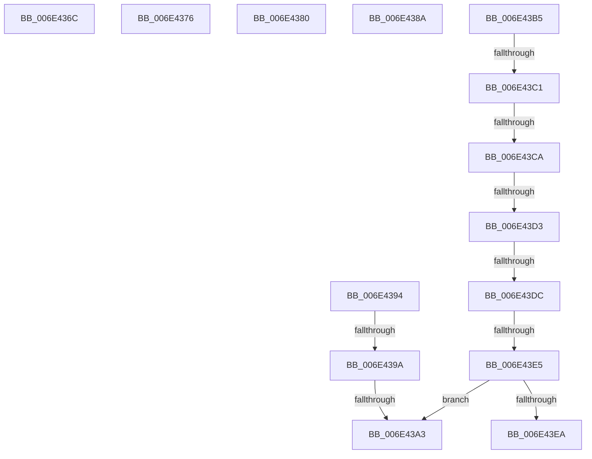

# sub_006E436C

- RVA: `0x006E436C`–`0x006E43F4` (길이 `136` bytes)
- VA: `0x00000001406E436C`
- 실행 섹션: `.text`
- PDB 이름 있음: `아니요`; PDB Function 태그: `아니요`
- unwind 정보 RVA: `0x0007AF34`
- 디코드: `29`개 명령, `136/136` bytes 표시
- 미해석 바이트: `0` (있으면 어셈블리에 `.byte`로 보존)

> 이 문서는 커널 이미지의 기계어와 PDB 기호를 분석해 생성했습니다. 4번과 5번은 함수 원형과 자료형을 바이너리 사용 방식에서 추정한 C 해석이며 원본 소스 복구 결과는 아닙니다.

## 1. Dependencies

- 직접 호출 지점: **1**; 고유 호출 대상: **1**
- 직접 호출자로 확인된 함수: **0**
- RIP 상대 이미지 참조: **1**

### Outgoing calls
- `0x006E43AA` → [RtlRaiseException](../5E/RtlRaiseException_function_005E6B00.md) (function, `0x005E6B00`)

### Direct callers
- 이 함수 시작 RVA로 연결되는 직접 call은 확인되지 않았습니다. 간접 호출은 완전히 역산할 수 없습니다.

### Static image references
- `0x006E43A3` → RVA `0x00E0A8C0` (`.data`; read)

## 2. Other-region calls and transfers

- 다른 실행 섹션으로 향하는 call: **0**
- call이 아닌 외부 분기/꼬리 이동: **13**
  - `0x006E4371` → [HvlpGetRegister64 + 0x3C](../37/HvlpGetRegister64_function_00379050.md) (`tail-transfer`)
  - `0x006E437B` → [HvlpGetRegister64 + 0x3C](../37/HvlpGetRegister64_function_00379050.md) (`tail-transfer`)
  - `0x006E4385` → [HvlpGetRegister64 + 0x3C](../37/HvlpGetRegister64_function_00379050.md) (`tail-transfer`)
  - `0x006E438F` → [HvlpGetRegister64 + 0x3C](../37/HvlpGetRegister64_function_00379050.md) (`tail-transfer`)
  - `0x006E4394` → [HvlpGetRegister64 + 0xF9](../37/HvlpGetRegister64_function_00379050.md) (`tail-transfer`)
  - `0x006E439D` → [HvlpGetRegister64 + 0xF9](../37/HvlpGetRegister64_function_00379050.md) (`tail-transfer`)
  - `0x006E43B0` → [HvlpGetRegister64 + 0x48](../37/HvlpGetRegister64_function_00379050.md) (`tail-transfer`)
  - `0x006E43BB` → [HvlpGetRegister64 + 0xF9](../37/HvlpGetRegister64_function_00379050.md) (`tail-transfer`)
  - `0x006E43C4` → [HvlpGetRegister64 + 0xF9](../37/HvlpGetRegister64_function_00379050.md) (`tail-transfer`)
  - `0x006E43CD` → [HvlpGetRegister64 + 0xF9](../37/HvlpGetRegister64_function_00379050.md) (`tail-transfer`)
  - `0x006E43D6` → [HvlpGetRegister64 + 0xF9](../37/HvlpGetRegister64_function_00379050.md) (`tail-transfer`)
  - `0x006E43DF` → [HvlpGetRegister64 + 0xF9](../37/HvlpGetRegister64_function_00379050.md) (`tail-transfer`)
  - `0x006E43EF` → [HvlpGetRegister64 + 0x3C](../37/HvlpGetRegister64_function_00379050.md) (`tail-transfer`)

## 3. Assembly (complete function range)

```asm
006E436C  B9 05 01 00 40                  mov ecx, 0x40000105
006E4371  E9 16 4D C9 FF                  jmp 0x14037908c
006E4376  B9 21 00 00 40                  mov ecx, 0x40000021
006E437B  E9 0C 4D C9 FF                  jmp 0x14037908c
006E4380  B9 73 00 00 40                  mov ecx, 0x40000073
006E4385  E9 02 4D C9 FF                  jmp 0x14037908c
006E438A  B9 04 00 00 40                  mov ecx, 0x40000004
006E438F  E9 F8 4C C9 FF                  jmp 0x14037908c
006E4394  0F 84 AF 4D C9 FF               je 0x140379149
006E439A  83 F9 01                        cmp ecx, 1
006E439D  0F 84 A6 4D C9 FF               je 0x140379149
006E43A3  48 8D 0D 16 65 72 00            lea rcx, [rip + 0x726516]
006E43AA  E8 51 27 F0 FF                  call 0x1405e6b00
006E43AF  90                              nop
006E43B0  E9 E3 4C C9 FF                  jmp 0x140379098
006E43B5  81 E9 0B 00 0A 00               sub ecx, 0xa000b
006E43BB  0F 84 88 4D C9 FF               je 0x140379149
006E43C1  83 E9 01                        sub ecx, 1
006E43C4  0F 84 7F 4D C9 FF               je 0x140379149
006E43CA  83 E9 01                        sub ecx, 1
006E43CD  0F 84 76 4D C9 FF               je 0x140379149
006E43D3  83 E9 01                        sub ecx, 1
006E43D6  0F 84 6D 4D C9 FF               je 0x140379149
006E43DC  83 E9 01                        sub ecx, 1
006E43DF  0F 84 64 4D C9 FF               je 0x140379149
006E43E5  83 F9 04                        cmp ecx, 4
006E43E8  75 B9                           jne 0x1406e43a3
006E43EA  B9 83 00 00 40                  mov ecx, 0x40000083
006E43EF  E9 98 4C C9 FF                  jmp 0x14037908c
```

## 4. C-style interpretation (structured pseudocode)

```c
__int64 __fastcall sub_006E436C(void)
{
}
```

## 5. (Beta) C Style

```c
void sub_006E436C(void)
{
}
```

## 6. Execution-region graph

[열기: 2D/3D 그래프와 함수 탐색 컨트롤 패널](../../../control-panel.html?section=text&rva=0x006E436C&view=graph)

- 2D 그래프는 위에서 아래로 흐르고, 3D 그래프는 빈 공간을 드래그해 회전합니다. Shift+드래그는 이동, 휠은 확대·축소, 함수 노드 선택은 대상 보고서 이동입니다.

### Static fallback


