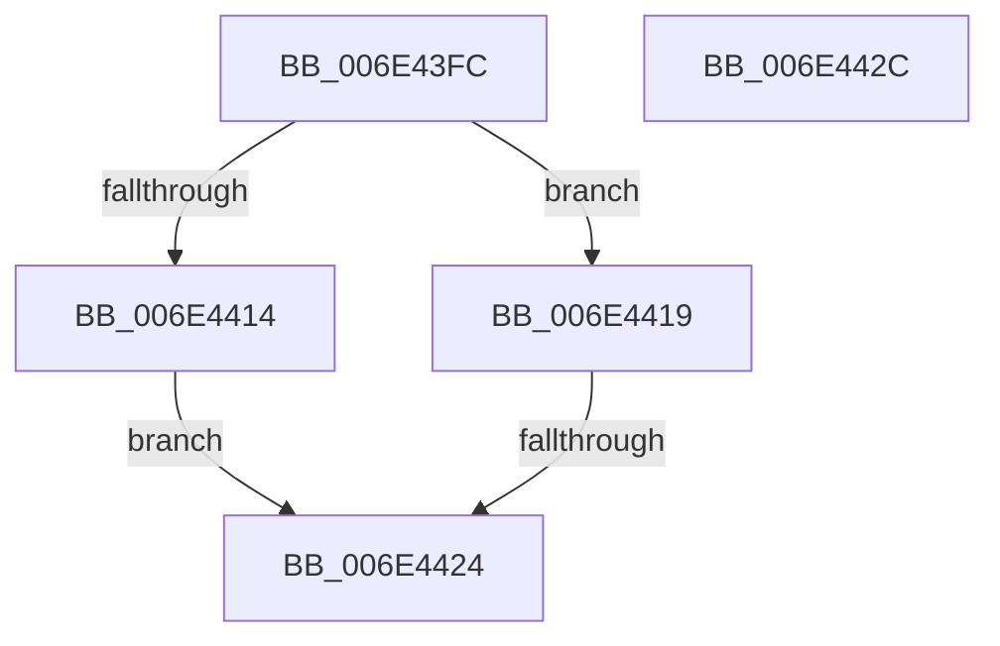

# sub_006E43FC

- RVA: `0x006E43FC`–`0x006E4446` (길이 `74` bytes)
- VA: `0x00000001406E43FC`
- 실행 섹션: `.text`
- PDB 이름 있음: `아니요`; PDB Function 태그: `아니요`
- unwind 정보 RVA: `0x0007AF98`
- 디코드: `19`개 명령, `74/74` bytes 표시
- 미해석 바이트: `0` (있으면 어셈블리에 `.byte`로 보존)

> 이 문서는 커널 이미지의 기계어와 PDB 기호를 분석해 생성했습니다. 4번과 5번은 함수 원형과 자료형을 바이너리 사용 방식에서 추정한 C 해석이며 원본 소스 복구 결과는 아닙니다.

## 1. Dependencies

- 직접 호출 지점: **1**; 고유 호출 대상: **1**
- 직접 호출자로 확인된 함수: **0**
- RIP 상대 이미지 참조: **0**

### Outgoing calls
- `0x006E4406` → [MiProcessLargeCoalesceCandidates](../37/MiProcessLargeCoalesceCandidates_function_00379DF4.md) (function, `0x00379DF4`)

### Direct callers
- 이 함수 시작 RVA로 연결되는 직접 call은 확인되지 않았습니다. 간접 호출은 완전히 역산할 수 없습니다.

### Static image references
- 디코드된 RIP-relative 메모리 참조가 없습니다.

## 2. Other-region calls and transfers

- 다른 실행 섹션으로 향하는 call: **0**
- call이 아닌 외부 분기/꼬리 이동: **3**
  - `0x006E441E` → [MiPerformOnDemandLargePageCoalesce + 0xAB](../37/MiPerformOnDemandLargePageCoalesce_function_00379678.md) (`tail-transfer`)
  - `0x006E4427` → [MiPerformOnDemandLargePageCoalesce + 0x138](../37/MiPerformOnDemandLargePageCoalesce_function_00379678.md) (`tail-transfer`)
  - `0x006E4441` → [MiPerformOnDemandLargePageCoalesce + 0xCB](../37/MiPerformOnDemandLargePageCoalesce_function_00379678.md) (`tail-transfer`)

## 3. Assembly (complete function range)

```asm
006E43FC  4C 8D 45 D0                     lea r8, [rbp - 0x30]
006E4400  41 8B D6                        mov edx, r14d
006E4403  48 8B CE                        mov rcx, rsi
006E4406  E8 E9 59 C9 FF                  call 0x140379df4
006E440B  8B F8                           mov edi, eax
006E440D  3D 2D 02 00 C0                  cmp eax, 0xc000022d
006E4412  75 05                           jne 0x1406e4419
006E4414  41 FF C6                        inc r14d
006E4417  EB 0B                           jmp 0x1406e4424
006E4419  3D 05 01 00 00                  cmp eax, 0x105
006E441E  0F 85 FF 52 C9 FF               jne 0x140379723
006E4424  41 FF CE                        dec r14d
006E4427  E9 84 53 C9 FF                  jmp 0x1403797b0
006E442C  48 8D 0C 49                     lea rcx, [rcx + rcx*2]
006E4430  48 C1 E1 04                     shl rcx, 4
006E4434  48 81 C1 84 40 00 00            add rcx, 0x4084
006E443B  48 03 CE                        add rcx, rsi
006E443E  F0 FF 01                        lock inc dword ptr [rcx]
006E4441  E9 FD 52 C9 FF                  jmp 0x140379743
```

## 4. C-style interpretation (structured pseudocode)

```c
__int64 __fastcall sub_006E43FC(void)
{
    __int64 result;
    __int64 v_r14;

    result = MiProcessLargeCoalesceCandidates(v_rsi, (unsigned int)((unsigned int)(v_r14)), v_rbp - 48, a4);
    if (((unsigned int)(result)) != 0xC000022DULL) goto loc_006E4419;
    v_r14 = (unsigned int)((v_r14) + 1);
    goto loc_006E4424;
loc_006E4419:
loc_006E4424:
    v_r14 = (unsigned int)((v_r14) - 1);
}
```

## 5. (Beta) C Style

```c
void sub_006E43FC(void)
{
    int64_t result;
    int64_t local_r14;

    result = MiProcessLargeCoalesceCandidates(local_rsi, (uint32_t)((uint32_t)(local_r14)), local_rbp - 48, a4);
    if (((uint32_t)(result)) != 0xC000022DULL) goto loc_006E4419;
    local_r14 = (uint32_t)((local_r14) + 1);
    goto loc_006E4424;
loc_006E4419:
loc_006E4424:
    local_r14 = (uint32_t)((local_r14) - 1);
}
```

## 6. Execution-region graph

[열기: 2D/3D 그래프와 함수 탐색 컨트롤 패널](../../../control-panel.html?section=text&rva=0x006E43FC&view=graph)

- 2D 그래프는 위에서 아래로 흐르고, 3D 그래프는 빈 공간을 드래그해 회전합니다. Shift+드래그는 이동, 휠은 확대·축소, 함수 노드 선택은 대상 보고서 이동입니다.

### Static fallback


