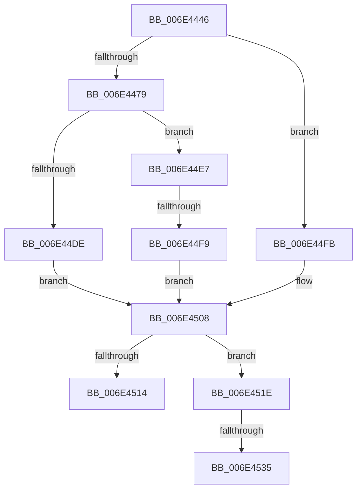

# sub_006E4446

- RVA: `0x006E4446`–`0x006E453A` (길이 `244` bytes)
- VA: `0x00000001406E4446`
- 실행 섹션: `.text`
- PDB 이름 있음: `아니요`; PDB Function 태그: `아니요`
- unwind 정보 RVA: `0x0007B01C`
- 디코드: `54`개 명령, `244/244` bytes 표시
- 미해석 바이트: `0` (있으면 어셈블리에 `.byte`로 보존)

> 이 문서는 커널 이미지의 기계어와 PDB 기호를 분석해 생성했습니다. 4번과 5번은 함수 원형과 자료형을 바이너리 사용 방식에서 추정한 C 해석이며 원본 소스 복구 결과는 아닙니다.

## 1. Dependencies

- 직접 호출 지점: **3**; 고유 호출 대상: **3**
- 직접 호출자로 확인된 함수: **0**
- RIP 상대 이미지 참조: **1**

### Outgoing calls
- `0x006E44CC` → [MiProcessLargeCoalesceBitmapCandidates](../37/MiProcessLargeCoalesceBitmapCandidates_function_0037A3F0.md) (function, `0x0037A3F0`)
- `0x006E450B` → [MiCheckLargePagesExist](../37/MiCheckLargePagesExist_function_0037ABC0.md) (function, `0x0037ABC0`)
- `0x006E4528` → [MiAccumulateTimeBoundTime](../4D/MiAccumulateTimeBoundTime_function_004D5FAC.md) (function, `0x004D5FAC`)

### Direct callers
- 이 함수 시작 RVA로 연결되는 직접 call은 확인되지 않았습니다. 간접 호출은 완전히 역산할 수 없습니다.

### Static image references
- `0x006E4481` → RVA `0x00000000` (`image boundary/outside`; read)

## 2. Other-region calls and transfers

- 다른 실행 섹션으로 향하는 call: **0**
- call이 아닌 외부 분기/꼬리 이동: **4**
  - `0x006E44F3` → [MiProcessLargeCoalesceCandidates + 0x12D](../37/MiProcessLargeCoalesceCandidates_function_00379DF4.md) (`tail-transfer`)
  - `0x006E4519` → [MiProcessLargeCoalesceCandidates + 0x12D](../37/MiProcessLargeCoalesceCandidates_function_00379DF4.md) (`tail-transfer`)
  - `0x006E452F` → [MiProcessLargeCoalesceCandidates + 0x127](../37/MiProcessLargeCoalesceCandidates_function_00379DF4.md) (`tail-transfer`)
  - `0x006E4535` → [MiProcessLargeCoalesceCandidates + 0x44C](../37/MiProcessLargeCoalesceCandidates_function_00379DF4.md) (`tail-transfer`)

## 3. Assembly (complete function range)

```asm
006E4446  48 8B 46 20                     mov rax, qword ptr [rsi + 0x20]
006E444A  48 8B 8C 24 88 00 00 00         mov rcx, qword ptr [rsp + 0x88]
006E4452  4A 89 4C F0 10                  mov qword ptr [rax + r14*8 + 0x10], rcx
006E4457  8B 46 0C                        mov eax, dword ptr [rsi + 0xc]
006E445A  48 8B 4E 20                     mov rcx, qword ptr [rsi + 0x20]
006E445E  42 89 04 B1                     mov dword ptr [rcx + r14*4], eax
006E4462  48 8B 44 24 68                  mov rax, qword ptr [rsp + 0x68]
006E4467  4E 8B 8C 28 78 40 00 00         mov r9, qword ptr [rax + r13 + 0x4078]
006E446F  49 83 F9 FD                     cmp r9, -3
006E4473  0F 87 82 00 00 00               ja 0x1406e44fb
006E4479  44 8B 84 24 28 01 00 00         mov r8d, dword ptr [rsp + 0x128]
006E4481  48 8D 05 78 BB 91 FF            lea rax, [rip - 0x6e4488]
006E4488  4A 8B 8C F0 28 11 01 00         mov rcx, qword ptr [rax + r14*8 + 0x11128]
006E4490  49 8B D1                        mov rdx, r9
006E4493  4D 0F AF CA                     imul r9, r10
006E4497  48 D3 E2                        shl rdx, cl
006E449A  49 8D 42 FF                     lea rax, [r10 - 1]
006E449E  48 8B 8C 24 90 00 00 00         mov rcx, qword ptr [rsp + 0x90]
006E44A6  48 89 74 24 38                  mov qword ptr [rsp + 0x38], rsi
006E44AB  88 4C 24 30                     mov byte ptr [rsp + 0x30], cl
006E44AF  49 8B CD                        mov rcx, r13
006E44B2  4D 0F AF CF                     imul r9, r15
006E44B6  49 0F AF C7                     imul rax, r15
006E44BA  4C 03 4C 24 50                  add r9, qword ptr [rsp + 0x50]
006E44BF  4C 89 7C 24 28                  mov qword ptr [rsp + 0x28], r15
006E44C4  49 03 C1                        add rax, r9
006E44C7  48 89 44 24 20                  mov qword ptr [rsp + 0x20], rax
006E44CC  E8 1F 5F C9 FF                  call 0x14037a3f0
006E44D1  41 BC 2D 02 00 C0               mov r12d, 0xc000022d
006E44D7  8B D8                           mov ebx, eax
006E44D9  41 3B C4                        cmp eax, r12d
006E44DC  75 09                           jne 0x1406e44e7
006E44DE  BB 05 01 00 00                  mov ebx, 0x105
006E44E3  8B EF                           mov ebp, edi
006E44E5  EB 21                           jmp 0x1406e4508
006E44E7  8B AC 24 20 01 00 00            mov ebp, dword ptr [rsp + 0x120]
006E44EE  3D 05 01 00 00                  cmp eax, 0x105
006E44F3  0F 85 28 5A C9 FF               jne 0x140379f21
006E44F9  EB 0D                           jmp 0x1406e4508
006E44FB  8B AC 24 20 01 00 00            mov ebp, dword ptr [rsp + 0x120]
006E4502  41 BC 2D 02 00 C0               mov r12d, 0xc000022d
006E4508  48 8B CE                        mov rcx, rsi
006E450B  E8 B0 66 C9 FF                  call 0x14037abc0
006E4510  3B C7                           cmp eax, edi
006E4512  77 0A                           ja 0x1406e451e
006E4514  BB FF 00 00 00                  mov ebx, 0xff
006E4519  E9 03 5A C9 FF                  jmp 0x140379f21
006E451E  48 8B 4E 20                     mov rcx, qword ptr [rsi + 0x20]
006E4522  33 D2                           xor edx, edx
006E4524  48 83 C1 28                     add rcx, 0x28
006E4528  E8 7F 1A DF FF                  call 0x1404d5fac
006E452D  85 C0                           test eax, eax
006E452F  0F 84 E6 59 C9 FF               je 0x140379f1b
006E4535  E9 06 5D C9 FF                  jmp 0x14037a240
```

## 4. C-style interpretation (structured pseudocode)

```c
__int64 __fastcall sub_006E4446(__int64 a1, __int64 a2, __int64 a3, __int64 a4, __int64 a5, __int64 a6, __int64 a7, __int64 a8, __int64 a9, __int64 a10, __int64 a11, __int64 a12, __int64 a13, __int64 a14, __int64 a15, __int64 a16, __int64 a17, __int64 a18, __int64 a19, __int64 a20, __int64 a21, __int64 a22, __int64 a23, __int64 a24, __int64 a25, __int64 a26, __int64 a27, __int64 a28, __int64 a29, __int64 a30, __int64 a31, __int64 a32, __int64 a33, __int64 a34, __int64 a35, unsigned int a36, unsigned int a37)
{
    __int64 result;
    unsigned __int64 v_stack_p20;
    unsigned __int64 v_stack_p28;
    unsigned __int8 v_stack_p30;
    unsigned __int64 v_stack_p38;

    *(unsigned __int64 *)(*(unsigned __int64 *)(v_rsi + 32) + v_r14 * 8 + 16) = a17;
    *(unsigned int *)(*(unsigned __int64 *)(v_rsi + 32) + v_r14 * 4) = (unsigned int)((unsigned int)(*(unsigned int *)(v_rsi + 12)));
    if ((*(unsigned __int64 *)(a13 + v_r13 * 1 + 16504)) > -3) goto loc_006E44FB;
    a4 = (*(unsigned __int64 *)(a13 + v_r13 * 1 + 16504)) * (v_r10);
    a2 = (*(unsigned __int64 *)(a13 + v_r13 * 1 + 16504)) << ((unsigned __int8)(*(unsigned __int64 *)(v_rip - 7226504 + v_r14 * 8 + 69928)));
    v_stack_p38 = v_rsi;
    v_stack_p30 = (unsigned __int8)(a18);
    a4 = (a4) * (v_r15);
    result = (v_r10 - 1) * (v_r15);
    a4 = (a4) + (a10);
    v_stack_p28 = v_r15;
    result = (result) + (a4);
    v_stack_p20 = result;
    result = MiProcessLargeCoalesceBitmapCandidates(v_r13, a2, (unsigned int)(a37), a4);
    if (((unsigned int)(result)) != ((unsigned int)((unsigned int)(0xC000022DULL)))) goto loc_006E44E7;
    goto loc_006E4508;
loc_006E44E7:
    goto loc_006E4508;
loc_006E44FB:
loc_006E4508:
    result = MiCheckLargePagesExist(v_rsi, a2, (unsigned int)(a37), a4);
    if (((unsigned int)(result)) > ((unsigned int)(v_rdi))) goto loc_006E451E;
loc_006E451E:
    a2 = 0;
    a1 = (*(unsigned __int64 *)(v_rsi + 32)) + (40);
    result = MiAccumulateTimeBoundTime(a1, a2, (unsigned int)(a37), a4);
}
```

## 5. (Beta) C Style

```c
int64_t sub_006E4446(int64_t Arg1, int64_t Arg2, int64_t Arg3, int64_t Arg4, uint64_t Arg5, uint64_t Arg6, uint64_t Arg7, uint64_t Arg8, uint64_t Arg9, int64_t Arg10, uint64_t Arg11, uint64_t Arg12, void *Arg13, uint64_t Arg14, uint64_t Arg15, uint64_t Arg16, int64_t Arg17, int64_t Arg18, uint64_t Arg19, uint64_t Arg20, uint64_t Arg21, uint64_t Arg22, uint64_t Arg23, uint64_t Arg24, uint64_t Arg25, uint64_t Arg26, uint64_t Arg27, uint64_t Arg28, uint64_t Arg29, uint64_t Arg30, uint64_t Arg31, uint64_t Arg32, uint64_t Arg33, uint64_t Arg34, uint64_t Arg35, uint32_t Arg36, uint32_t Arg37)
{
    uint8_t *arg13 = (uint8_t *)Arg13;

    int64_t result;
    uint64_t v_stack_p20;
    uint64_t v_stack_p28;
    uint8_t v_stack_p30;
    uint64_t v_stack_p38;

    *(uint64_t *)(*(uint64_t *)(local_rsi + 0x20) + local_r14 * 8 + 0x10) = Arg17;
    *(uint32_t *)(*(uint64_t *)(local_rsi + 0x20) + local_r14 * 4) = (uint32_t)((uint32_t)(*(uint32_t *)(local_rsi + 0xC)));
    if ((*(uint64_t *)(arg13 + local_r13 * 1 + 0x4078)) > -3) goto loc_006E44FB;
    Arg4 = (*(uint64_t *)(arg13 + local_r13 * 1 + 0x4078)) * (local_r10);
    Arg2 = (*(uint64_t *)(arg13 + local_r13 * 1 + 0x4078)) << ((uint8_t)(*(uint64_t *)(v_rip - 0x6E4488 + local_r14 * 8 + 0x11128)));
    v_stack_p38 = local_rsi;
    v_stack_p30 = (uint8_t)(Arg18);
    Arg4 = (Arg4) * (local_r15);
    result = (local_r10 - 1) * (local_r15);
    Arg4 = (Arg4) + (Arg10);
    v_stack_p28 = local_r15;
    result = (result) + (Arg4);
    v_stack_p20 = result;
    result = MiProcessLargeCoalesceBitmapCandidates(local_r13, Arg2, (uint32_t)(Arg37), Arg4);
    if (((uint32_t)(result)) != ((uint32_t)((uint32_t)(0xC000022DULL)))) goto loc_006E44E7;
    goto loc_006E4508;
loc_006E44E7:
    goto loc_006E4508;
loc_006E44FB:
loc_006E4508:
    result = MiCheckLargePagesExist(local_rsi, Arg2, (uint32_t)(Arg37), Arg4);
    if (((uint32_t)(result)) > ((uint32_t)(local_rdi))) goto loc_006E451E;
loc_006E451E:
    Arg2 = 0;
    Arg1 = (*(uint64_t *)(local_rsi + 0x20)) + (40);
    result = MiAccumulateTimeBoundTime(Arg1, Arg2, (uint32_t)(Arg37), Arg4);
}
```

### 관측된 메모리 오프셋

구조체 형식이 확인되지 않은 접근은 인자 기준의 오프셋으로만 기록했습니다.

| 기준 인자 | 오프셋 표현 | 폭 (bit) | 접근 |
|---|---:|---:|---|
| `Arg13` | `+ 0x4078 + r13*1` | `64` | `R` |

## 6. Execution-region graph

[열기: 2D/3D 그래프와 함수 탐색 컨트롤 패널](../../../control-panel.html?section=text&rva=0x006E4446&view=graph)

- 2D 그래프는 위에서 아래로 흐르고, 3D 그래프는 빈 공간을 드래그해 회전합니다. Shift+드래그는 이동, 휠은 확대·축소, 함수 노드 선택은 대상 보고서 이동입니다.

### Static fallback


