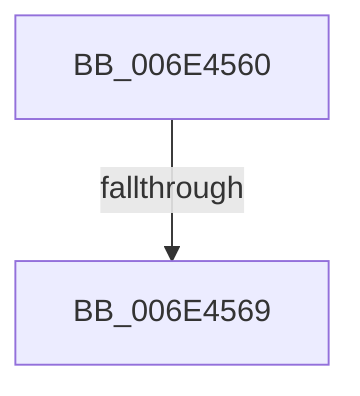

# sub_006E4560

- RVA: `0x006E4560`–`0x006E4581` (길이 `33` bytes)
- VA: `0x00000001406E4560`
- 실행 섹션: `.text`
- PDB 이름 있음: `아니요`; PDB Function 태그: `아니요`
- unwind 정보 RVA: `0x0007B864`
- 디코드: `8`개 명령, `33/33` bytes 표시
- 미해석 바이트: `0` (있으면 어셈블리에 `.byte`로 보존)

> 이 문서는 커널 이미지의 기계어와 PDB 기호를 분석해 생성했습니다. 4번과 5번은 함수 원형과 자료형을 바이너리 사용 방식에서 추정한 C 해석이며 원본 소스 복구 결과는 아닙니다.

## 1. Dependencies

- 직접 호출 지점: **1**; 고유 호출 대상: **1**
- 직접 호출자로 확인된 함수: **0**
- RIP 상대 이미지 참조: **1**

### Outgoing calls
- `0x006E4576` → [KiStackAttachProcess](../21/KiStackAttachProcess_function_00216820.md) (function, `0x00216820`)

### Direct callers
- 이 함수 시작 RVA로 연결되는 직접 call은 확인되지 않았습니다. 간접 호출은 완전히 역산할 수 없습니다.

### Static image references
- `0x006E4569` → RVA `0x00FC6AB0` (`ALMOSTRO`; read)

## 2. Other-region calls and transfers

- 다른 실행 섹션으로 향하는 call: **0**
- call이 아닌 외부 분기/꼬리 이동: **2**
  - `0x006E4563` → [MiIssueHardFault + 0x23D](../38/MiIssueHardFault_function_00380074.md) (`tail-transfer`)
  - `0x006E457C` → [MiIssueHardFault + 0x23D](../38/MiIssueHardFault_function_00380074.md) (`tail-transfer`)

## 3. Assembly (complete function range)

```asm
006E4560  4C 39 08                        cmp qword ptr [rax], r9
006E4563  0F 85 48 BD C9 FF               jne 0x1403802b1
006E4569  48 8B 0D 40 25 8E 00            mov rcx, qword ptr [rip + 0x8e2540]
006E4570  4D 8D 46 68                     lea r8, [r14 + 0x68]
006E4574  33 D2                           xor edx, edx
006E4576  E8 A5 22 B3 FF                  call 0x140216820
006E457B  90                              nop
006E457C  E9 30 BD C9 FF                  jmp 0x1403802b1
```

## 4. C-style interpretation (structured pseudocode)

```c
__int64 __fastcall sub_006E4560(__int64 a1, int a2, __int64 a3, __int64 a4)
{
    __int64 result;

    a2 = 0;
    result = KiStackAttachProcess(*(unsigned __int64 *)(v_rip + 9315648), a2, v_r14 + 104, a4);
}
```

## 5. (Beta) C Style

```c
int64_t sub_006E4560(int64_t Arg1, int32_t Arg2, int64_t Arg3, int64_t Arg4)
{
    int64_t result;

    Arg2 = 0;
    result = KiStackAttachProcess(*(uint64_t *)(v_rip + 0x8E2540), Arg2, local_r14 + 104, Arg4);
}
```

## 6. Execution-region graph

[열기: 2D/3D 그래프와 함수 탐색 컨트롤 패널](../../../control-panel.html?section=text&rva=0x006E4560&view=graph)

- 2D 그래프는 위에서 아래로 흐르고, 3D 그래프는 빈 공간을 드래그해 회전합니다. Shift+드래그는 이동, 휠은 확대·축소, 함수 노드 선택은 대상 보고서 이동입니다.

### Static fallback


