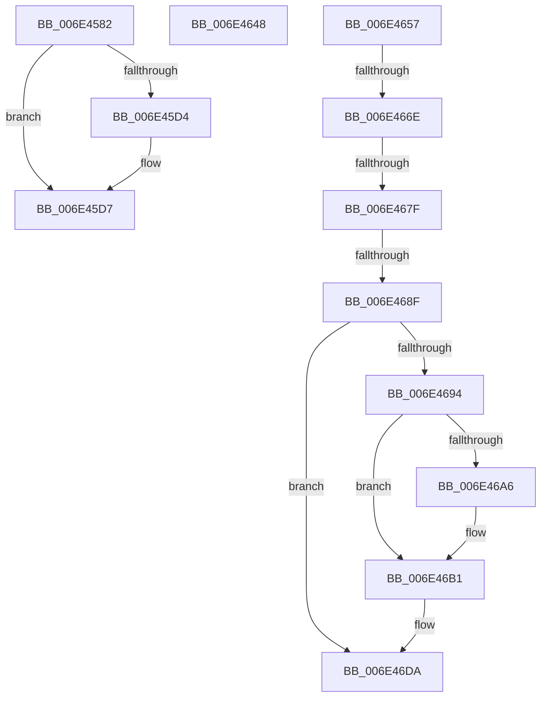

# sub_006E4582

- RVA: `0x006E4582`–`0x006E46E9` (길이 `359` bytes)
- VA: `0x00000001406E4582`
- 실행 섹션: `.text`
- PDB 이름 있음: `아니요`; PDB Function 태그: `아니요`
- unwind 정보 RVA: `0x0007B924`
- 디코드: `84`개 명령, `359/359` bytes 표시
- 미해석 바이트: `0` (있으면 어셈블리에 `.byte`로 보존)

> 이 문서는 커널 이미지의 기계어와 PDB 기호를 분석해 생성했습니다. 4번과 5번은 함수 원형과 자료형을 바이너리 사용 방식에서 추정한 C 해석이며 원본 소스 복구 결과는 아닙니다.

## 1. Dependencies

- 직접 호출 지점: **8**; 고유 호출 대상: **8**
- 직접 호출자로 확인된 함수: **0**
- RIP 상대 이미지 참조: **4**

### Outgoing calls
- `0x006E45DA` → [MiPageToNode](../33/MiPageToNode_function_00338CD0.md) (function, `0x00338CD0`)
- `0x006E463A` → [MiFindContiguousPagesEx](../28/MiFindContiguousPagesEx_function_0028BDE0.md) (function, `0x0028BDE0`)
- `0x006E4671` → [MiGetSystemRegionType](../28/MiGetSystemRegionType_function_0028EC80.md) (function, `0x0028EC80`)
- `0x006E4682` → [MiExceptionForMappedVa](../67/MiExceptionForMappedVa_function_0067E164.md) (function, `0x0067E164`)
- `0x006E469D` → [MmIsAddressValidEx](../27/MmIsAddressValidEx_function_0027FDD0.md) (function, `0x0027FDD0`)
- `0x006E46A9` → [MI_READ_PTE_LOCK_FREE](../28/MI_READ_PTE_LOCK_FREE_function_002828A0.md) (function, `0x002828A0`)
- `0x006E46B6` → [MiFlushAllFilesystemPages](../4E/MiFlushAllFilesystemPages_function_004E141C.md) (function, `0x004E141C`)
- `0x006E46D4` → [KeBugCheckEx](../4F/KeBugCheckEx_function_004FD660.md) (function, `0x004FD660`)

### Direct callers
- 이 함수 시작 RVA로 연결되는 직접 call은 확인되지 않았습니다. 간접 호출은 완전히 역산할 수 없습니다.

### Static image references
- `0x006E458F` → RVA `0x00E30088` (`.data`; read)
- `0x006E45CB` → RVA `0x00FC6ED0` (`ALMOSTRO`; read)
- `0x006E4625` → RVA `0x00E2DCE0` (`.data`; read)
- `0x006E4648` → RVA `0x00E37398` (`.data`; write)

## 2. Other-region calls and transfers

- 다른 실행 섹션으로 향하는 call: **0**
- call이 아닌 외부 분기/꼬리 이동: **6**
  - `0x006E4643` → [MiWaitForInPageComplete + 0xA5](../38/MiWaitForInPageComplete_function_00380AB8.md) (`tail-transfer`)
  - `0x006E4652` → [MiWaitForInPageComplete + 0x4E8](../38/MiWaitForInPageComplete_function_00380AB8.md) (`tail-transfer`)
  - `0x006E4668` → [MiWaitForInPageComplete + 0x235](../38/MiWaitForInPageComplete_function_00380AB8.md) (`tail-transfer`)
  - `0x006E4679` → [MiWaitForInPageComplete + 0x235](../38/MiWaitForInPageComplete_function_00380AB8.md) (`tail-transfer`)
  - `0x006E4689` → [MiWaitForInPageComplete + 0x235](../38/MiWaitForInPageComplete_function_00380AB8.md) (`tail-transfer`)
  - `0x006E46E4` → [MiWaitForInPageComplete + 0x235](../38/MiWaitForInPageComplete_function_00380AB8.md) (`tail-transfer`)

## 3. Assembly (complete function range)

```asm
006E4582  49 8B C2                        mov rax, r10
006E4585  4D 8B F9                        mov r15, r9
006E4588  4C 2B F8                        sub r15, rax
006E458B  49 8B 41 28                     mov rax, qword ptr [r9 + 0x28]
006E458F  48 8B 0D F2 BA 74 00            mov rcx, qword ptr [rip + 0x74baf2]
006E4596  41 8B 58 50                     mov ebx, dword ptr [r8 + 0x50]
006E459A  48 C1 E8 2B                     shr rax, 0x2b
006E459E  C1 E3 09                        shl ebx, 9
006E45A1  25 FF 03 00 00                  and eax, 0x3ff
006E45A6  F7 D3                           not ebx
006E45A8  49 C1 FF 04                     sar r15, 4
006E45AC  81 E3 00 00 02 00               and ebx, 0x20000
006E45B2  4D 0F AF FB                     imul r15, r11
006E45B6  48 8B 04 C1                     mov rax, qword ptr [rcx + rax*8]
006E45BA  0F BA EB 1E                     bts ebx, 0x1e
006E45BE  48 89 45 F7                     mov qword ptr [rbp - 9], rax
006E45C2  65 48 8B 04 25 88 01 00 00      mov rax, qword ptr gs:[0x188]
006E45CB  48 3B 05 FE 28 8E 00            cmp rax, qword ptr [rip + 0x8e28fe]
006E45D2  75 03                           jne 0x1406e45d7
006E45D4  83 CB 08                        or ebx, 8
006E45D7  49 8B CF                        mov rcx, r15
006E45DA  E8 F1 46 C5 FF                  call 0x140338cd0
006E45DF  48 8B 4D FF                     mov rcx, qword ptr [rbp - 1]
006E45E3  49 8D 57 01                     lea rdx, [r15 + 1]
006E45E7  45 33 C9                        xor r9d, r9d
006E45EA  8B 49 20                        mov ecx, dword ptr [rcx + 0x20]
006E45ED  C1 E9 10                        shr ecx, 0x10
006E45F0  44 0F B6 C1                     movzx r8d, cl
006E45F4  48 8D 4D EF                     lea rcx, [rbp - 0x11]
006E45F8  48 89 4C 24 68                  mov qword ptr [rsp + 0x68], rcx
006E45FD  48 8B 4D F7                     mov rcx, qword ptr [rbp - 9]
006E4601  48 89 74 24 60                  mov qword ptr [rsp + 0x60], rsi
006E4606  48 89 74 24 58                  mov qword ptr [rsp + 0x58], rsi
006E460B  89 74 24 50                     mov dword ptr [rsp + 0x50], esi
006E460F  89 5C 24 48                     mov dword ptr [rsp + 0x48], ebx
006E4613  C6 44 24 40 FF                  mov byte ptr [rsp + 0x40], 0xff
006E4618  89 44 24 38                     mov dword ptr [rsp + 0x38], eax
006E461C  41 C1 E8 06                     shr r8d, 6
006E4620  44 89 44 24 30                  mov dword ptr [rsp + 0x30], r8d
006E4625  4C 8B 05 B4 96 74 00            mov r8, qword ptr [rip + 0x7496b4]
006E462C  48 C7 44 24 28 01 00 00 00      mov qword ptr [rsp + 0x28], 1
006E4635  48 89 74 24 20                  mov qword ptr [rsp + 0x20], rsi
006E463A  E8 A1 77 BA FF                  call 0x14028bde0
006E463F  4C 8B 45 67                     mov r8, qword ptr [rbp + 0x67]
006E4643  E9 15 C5 C9 FF                  jmp 0x140380b5d
006E4648  C7 05 46 2D 75 00 20 00 00 00   mov dword ptr [rip + 0x752d46], 0x20
006E4652  E9 49 C9 C9 FF                  jmp 0x140380fa0
006E4657  4C 8B 6D E7                     mov r13, qword ptr [rbp - 0x19]
006E465B  48 B8 FF FF FE FF FF 7F 00 00   movabs rax, 0x7ffffffeffff
006E4665  4C 3B E8                        cmp r13, rax
006E4668  0F 86 7F C6 C9 FF               jbe 0x140380ced
006E466E  49 8B CD                        mov rcx, r13
006E4671  E8 0A A6 BA FF                  call 0x14028ec80
006E4676  83 F8 07                        cmp eax, 7
006E4679  0F 84 6E C6 C9 FF               je 0x140380ced
006E467F  49 8B CD                        mov rcx, r13
006E4682  E8 DD 9A F9 FF                  call 0x14067e164
006E4687  85 C0                           test eax, eax
006E4689  0F 85 5E C6 C9 FF               jne 0x140380ced
006E468F  39 75 DF                        cmp dword ptr [rbp - 0x21], esi
006E4692  75 46                           jne 0x1406e46da
006E4694  4C 8B 75 07                     mov r14, qword ptr [rbp + 7]
006E4698  33 D2                           xor edx, edx
006E469A  49 8B CE                        mov rcx, r14
006E469D  E8 2E B7 B9 FF                  call 0x14027fdd0
006E46A2  84 C0                           test al, al
006E46A4  74 0B                           je 0x1406e46b1
006E46A6  49 8B CE                        mov rcx, r14
006E46A9  E8 F2 E1 B9 FF                  call 0x1402828a0
006E46AE  48 8B F8                        mov rdi, rax
006E46B1  B9 01 00 00 00                  mov ecx, 1
006E46B6  E8 61 CD DF FF                  call 0x1404e141c
006E46BB  85 DB                           test ebx, ebx
006E46BD  4C 89 6C 24 20                  mov qword ptr [rsp + 0x20], r13
006E46C2  4C 8B CF                        mov r9, rdi
006E46C5  49 8B D6                        mov rdx, r14
006E46C8  44 0F 48 FB                     cmovs r15d, ebx
006E46CC  B9 7A 00 00 00                  mov ecx, 0x7a
006E46D1  4D 63 C7                        movsxd r8, r15d
006E46D4  E8 87 8F E1 FF                  call 0x1404fd660
006E46D9  CC                              int3
006E46DA  81 FB 3F 00 00 C0               cmp ebx, 0xc000003f
006E46E0  45 0F 45 FC                     cmovne r15d, r12d
006E46E4  E9 04 C6 C9 FF                  jmp 0x140380ced
```

## 4. C-style interpretation (structured pseudocode)

```c
__int64 __fastcall sub_006E4582(__int64 a1, __int64 a2, __int64 a3, __int64 a4)
{
    __int64 result;
    __int64 v_r15;
    __int64 v_rbx;
    unsigned __int64 v_stack_p20;
    unsigned __int64 v_stack_p28;
    unsigned int v_stack_p30;
    unsigned int v_stack_p38;
    unsigned __int8 v_stack_p40;
    unsigned int v_stack_p48;
    unsigned int v_stack_p50;
    unsigned __int64 v_stack_p58;
    unsigned __int64 v_stack_p60;
    unsigned __int64 v_stack_p68;

    v_r15 = (a4) - (v_r10);
    result = (*(unsigned __int64 *)(a4 + 40)) >> (43);
    v_rbx = (unsigned int)(((unsigned int)(*(unsigned int *)(a3 + 80))) << (9));
    result = (unsigned int)((result) & (0x3FFULL));
    v_rbx = (unsigned int)(~(v_rbx));
    v_r15 = (v_r15) >> (4);
    v_rbx = (unsigned int)((v_rbx) & (0x20000ULL));
    v_r15 = (v_r15) * (v_r11);
    *(unsigned __int64 *)(v_rbp - 9) = *(unsigned __int64 *)(*(unsigned __int64 *)(v_rip + 7650034) + result * 8);
    if ((*(unsigned __int64 *)(gs_base + (0 + 392))) == (*(unsigned __int64 *)(v_rip + 9316606))) {
        v_rbx = (unsigned int)((v_rbx) | (8));
    }
    result = MiPageToNode(v_r15, a2, a3, a4);
    a4 = 0;
    a1 = (unsigned int)(((unsigned int)(*(unsigned int *)(*(unsigned __int64 *)(v_rbp - 1) + 32))) >> (16));
    v_stack_p68 = v_rbp - 17;
    v_stack_p60 = v_rsi;
    v_stack_p58 = v_rsi;
    v_stack_p50 = (unsigned int)(v_rsi);
    v_stack_p48 = (unsigned int)(v_rbx);
    v_stack_p40 = 255;
    v_stack_p38 = (unsigned int)(result);
    a3 = (unsigned int)(((unsigned __int8)(a1)) >> (6));
    v_stack_p30 = (unsigned int)(a3);
    v_stack_p28 = 1;
    v_stack_p20 = v_rsi;
    result = MiFindContiguousPagesEx(*(unsigned __int64 *)(v_rbp - 9), v_r15 + 1, *(unsigned __int64 *)(v_rip + 7640756), a4);
}
```

## 5. (Beta) C Style

```c
int64_t sub_006E4582(int64_t Arg1, int64_t Arg2, void *Arg3, void *Arg4)
{
    uint8_t *arg3 = (uint8_t *)Arg3;
    uint8_t *arg4 = (uint8_t *)Arg4;

    int64_t result;
    int64_t local_r15;
    int64_t local_rbx;
    uint64_t v_stack_p20;
    uint64_t v_stack_p28;
    uint32_t v_stack_p30;
    uint32_t v_stack_p38;
    uint8_t v_stack_p40;
    uint32_t v_stack_p48;
    uint32_t v_stack_p50;
    uint64_t v_stack_p58;
    uint64_t v_stack_p60;
    uint64_t v_stack_p68;

    local_r15 = (Arg4) - (local_r10);
    result = (*(uint64_t *)(arg4 + 0x28)) >> (43);
    local_rbx = (uint32_t)(((uint32_t)(*(uint32_t *)(arg3 + 0x50))) << (9));
    result = (uint32_t)((result) & (0x3FFULL));
    local_rbx = (uint32_t)(~(local_rbx));
    local_r15 = (local_r15) >> (4);
    local_rbx = (uint32_t)((local_rbx) & (0x20000ULL));
    local_r15 = (local_r15) * (local_r11);
    *(uint64_t *)(local_rbp - 0x9) = *(uint64_t *)(*(uint64_t *)(v_rip + 0x74BAF2) + result * 8);
    if ((*(uint64_t *)(gs_base + (0 + 0x188))) == (*(uint64_t *)(v_rip + 0x8E28FE))) {
        local_rbx = (uint32_t)((local_rbx) | (8));
    }
    result = MiPageToNode(local_r15, Arg2, Arg3, Arg4);
    Arg4 = 0;
    Arg1 = (uint32_t)(((uint32_t)(*(uint32_t *)(*(uint64_t *)(local_rbp - 0x1) + 0x20))) >> (16));
    v_stack_p68 = local_rbp - 17;
    v_stack_p60 = local_rsi;
    v_stack_p58 = local_rsi;
    v_stack_p50 = (uint32_t)(local_rsi);
    v_stack_p48 = (uint32_t)(local_rbx);
    v_stack_p40 = 255;
    v_stack_p38 = (uint32_t)(result);
    Arg3 = (uint32_t)(((uint8_t)(Arg1)) >> (6));
    v_stack_p30 = (uint32_t)(Arg3);
    v_stack_p28 = 1;
    v_stack_p20 = local_rsi;
    result = MiFindContiguousPagesEx(*(uint64_t *)(local_rbp - 0x9), local_r15 + 1, *(uint64_t *)(v_rip + 0x7496B4), Arg4);
}
```

### 관측된 메모리 오프셋

구조체 형식이 확인되지 않은 접근은 인자 기준의 오프셋으로만 기록했습니다.

| 기준 인자 | 오프셋 표현 | 폭 (bit) | 접근 |
|---|---:|---:|---|
| `Arg3` | `+ 0x50` | `32` | `R` |
| `Arg4` | `+ 0x28` | `64` | `R` |

## 6. Execution-region graph

[열기: 2D/3D 그래프와 함수 탐색 컨트롤 패널](../../../control-panel.html?section=text&rva=0x006E4582&view=graph)

- 2D 그래프는 위에서 아래로 흐르고, 3D 그래프는 빈 공간을 드래그해 회전합니다. Shift+드래그는 이동, 휠은 확대·축소, 함수 노드 선택은 대상 보고서 이동입니다.

### Static fallback


