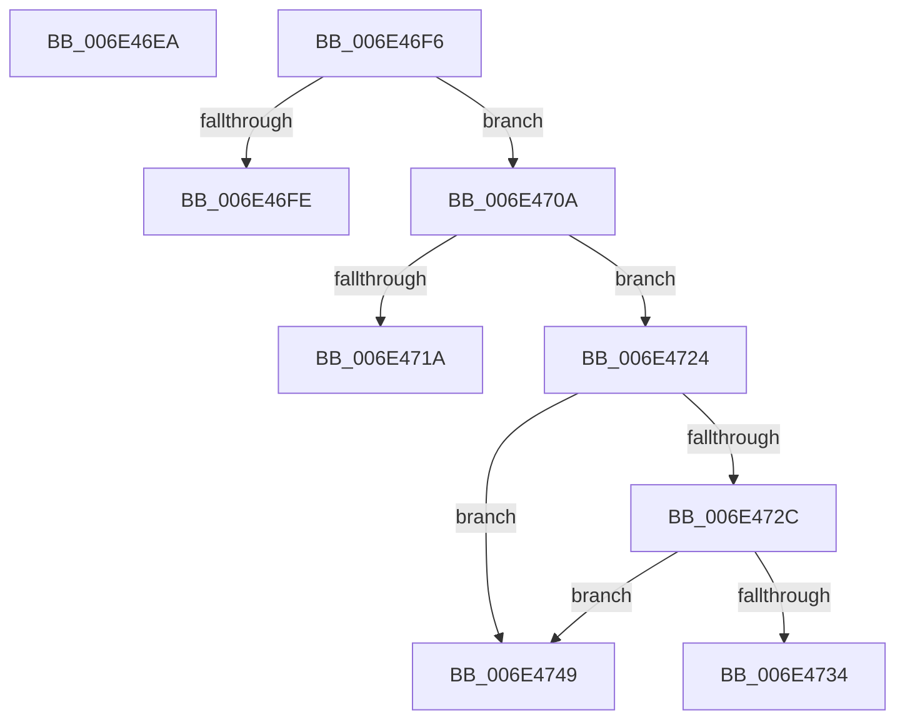

# sub_006E46EA

- RVA: `0x006E46EA`–`0x006E4765` (길이 `123` bytes)
- VA: `0x00000001406E46EA`
- 실행 섹션: `.text`
- PDB 이름 있음: `아니요`; PDB Function 태그: `아니요`
- unwind 정보 RVA: `0x0007B964`
- 디코드: `29`개 명령, `123/123` bytes 표시
- 미해석 바이트: `0` (있으면 어셈블리에 `.byte`로 보존)

> 이 문서는 커널 이미지의 기계어와 PDB 기호를 분석해 생성했습니다. 4번과 5번은 함수 원형과 자료형을 바이너리 사용 방식에서 추정한 C 해석이며 원본 소스 복구 결과는 아닙니다.

## 1. Dependencies

- 직접 호출 지점: **3**; 고유 호출 대상: **3**
- 직접 호출자로 확인된 함수: **0**
- RIP 상대 이미지 참조: **1**

### Outgoing calls
- `0x006E4711` → [MiIsRetryIoStatus](../40/MiIsRetryIoStatus_function_00408640.md) (function, `0x00408640`)
- `0x006E473E` → [MiStoreLogReadFailure](../69/MiStoreLogReadFailure_function_00692ED0.md) (function, `0x00692ED0`)
- `0x006E475F` → [KeBugCheckEx](../4F/KeBugCheckEx_function_004FD660.md) (function, `0x004FD660`)

### Direct callers
- 이 함수 시작 RVA로 연결되는 직접 call은 확인되지 않았습니다. 간접 호출은 완전히 역산할 수 없습니다.

### Static image references
- `0x006E4734` → RVA `0x00E37420` (`.data`; read/write)

## 2. Other-region calls and transfers

- 다른 실행 섹션으로 향하는 call: **0**
- call이 아닌 외부 분기/꼬리 이동: **4**
  - `0x006E46F1` → [MiStoreFaultComplete + 0x37](../38/MiStoreFaultComplete_function_00381240.md) (`tail-transfer`)
  - `0x006E4705` → [MiStoreFaultComplete + 0x37](../38/MiStoreFaultComplete_function_00381240.md) (`tail-transfer`)
  - `0x006E471F` → [MiStoreFaultComplete + 0x37](../38/MiStoreFaultComplete_function_00381240.md) (`tail-transfer`)
  - `0x006E4744` → [MiStoreFaultComplete + 0x37](../38/MiStoreFaultComplete_function_00381240.md) (`tail-transfer`)

## 3. Assembly (complete function range)

```asm
006E46EA  C7 47 50 17 00 00 C0            mov dword ptr [rdi + 0x50], 0xc0000017
006E46F1  E9 81 CB C9 FF                  jmp 0x140381277
006E46F6  81 FE 21 00 00 C0               cmp esi, 0xc0000021
006E46FC  75 0C                           jne 0x1406e470a
006E46FE  C7 41 50 17 00 00 C0            mov dword ptr [rcx + 0x50], 0xc0000017
006E4705  E9 6D CB C9 FF                  jmp 0x140381277
006E470A  BA 00 10 00 00                  mov edx, 0x1000
006E470F  8B CE                           mov ecx, esi
006E4711  E8 2A 3F D2 FF                  call 0x140408640
006E4716  85 C0                           test eax, eax
006E4718  74 0A                           je 0x1406e4724
006E471A  BB 03 00 00 00                  mov ebx, 3
006E471F  E9 53 CB C9 FF                  jmp 0x140381277
006E4724  81 FE 11 00 00 C0               cmp esi, 0xc0000011
006E472A  74 1D                           je 0x1406e4749
006E472C  81 FE 16 00 00 80               cmp esi, 0x80000016
006E4732  74 15                           je 0x1406e4749
006E4734  F0 01 1D E5 2C 75 00            lock add dword ptr [rip + 0x752ce5], ebx
006E473B  48 8B CF                        mov rcx, rdi
006E473E  E8 8D E7 FA FF                  call 0x140692ed0
006E4743  90                              nop
006E4744  E9 2E CB C9 FF                  jmp 0x140381277
006E4749  48 83 64 24 20 00               and qword ptr [rsp + 0x20], 0
006E474F  4C 8B CE                        mov r9, rsi
006E4752  4C 8B C7                        mov r8, rdi
006E4755  BA 02 60 00 00                  mov edx, 0x6002
006E475A  B9 1A 00 00 00                  mov ecx, 0x1a
006E475F  E8 FC 8E E1 FF                  call 0x1404fd660
006E4764  CC                              int3
```

## 4. C-style interpretation (structured pseudocode)

```c
__int64 __fastcall sub_006E46EA(__int64 a1)
{
    unsigned __int64 v_stack_p20;

    *(unsigned int *)(v_rdi + 80) = 0xC0000017ULL;
}
```

## 5. (Beta) C Style

```c
int64_t sub_006E46EA(int64_t Arg1)
{
    uint64_t v_stack_p20;

    *(uint32_t *)(local_rdi + 0x50) = 0xC0000017ULL;
}
```

## 6. Execution-region graph

[열기: 2D/3D 그래프와 함수 탐색 컨트롤 패널](../../../control-panel.html?section=text&rva=0x006E46EA&view=graph)

- 2D 그래프는 위에서 아래로 흐르고, 3D 그래프는 빈 공간을 드래그해 회전합니다. Shift+드래그는 이동, 휠은 확대·축소, 함수 노드 선택은 대상 보고서 이동입니다.

### Static fallback


