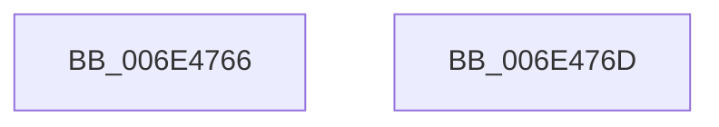

# sub_006E4766

- RVA: `0x006E4766`–`0x006E4785` (길이 `31` bytes)
- VA: `0x00000001406E4766`
- 실행 섹션: `.text`
- PDB 이름 있음: `아니요`; PDB Function 태그: `아니요`
- unwind 정보 RVA: `0x0007BA40`
- 디코드: `9`개 명령, `31/31` bytes 표시
- 미해석 바이트: `0` (있으면 어셈블리에 `.byte`로 보존)

> 이 문서는 커널 이미지의 기계어와 PDB 기호를 분석해 생성했습니다. 4번과 5번은 함수 원형과 자료형을 바이너리 사용 방식에서 추정한 C 해석이며 원본 소스 복구 결과는 아닙니다.

## 1. Dependencies

- 직접 호출 지점: **1**; 고유 호출 대상: **1**
- 직접 호출자로 확인된 함수: **0**
- RIP 상대 이미지 참조: **0**

### Outgoing calls
- `0x006E477F` → [MiPageHashBugCheck](../69/MiPageHashBugCheck_function_00697AC8.md) (function, `0x00697AC8`)

### Direct callers
- 이 함수 시작 RVA로 연결되는 직접 call은 확인되지 않았습니다. 간접 호출은 완전히 역산할 수 없습니다.

### Static image references
- 디코드된 RIP-relative 메모리 참조가 없습니다.

## 2. Other-region calls and transfers

- 다른 실행 섹션으로 향하는 call: **0**
- call이 아닌 외부 분기/꼬리 이동: **1**
  - `0x006E4768` → [MiArePagefileContentsCorrupted + 0xFA](../38/MiArePagefileContentsCorrupted_function_003818C8.md) (`tail-transfer`)

## 3. Assembly (complete function range)

```asm
006E4766  8B C7                           mov eax, edi
006E4768  E9 55 D2 C9 FF                  jmp 0x1403819c2
006E476D  4C 8B CE                        mov r9, rsi
006E4770  44 89 6C 24 20                  mov dword ptr [rsp + 0x20], r13d
006E4775  4C 8D 44 24 30                  lea r8, [rsp + 0x30]
006E477A  41 8B D6                        mov edx, r14d
006E477D  8B CB                           mov ecx, ebx
006E477F  E8 44 33 FB FF                  call 0x140697ac8
006E4784  CC                              int3
```

## 4. C-style interpretation (structured pseudocode)

```c
__int64 __fastcall sub_006E4766(void)
{
    unsigned int v_stack_p20;
    unsigned __int64 v_stack_p30;
}
```

## 5. (Beta) C Style

```c
void sub_006E4766(void)
{
    uint32_t v_stack_p20;
    uint64_t v_stack_p30;
}
```

## 6. Execution-region graph

[열기: 2D/3D 그래프와 함수 탐색 컨트롤 패널](../../../control-panel.html?section=text&rva=0x006E4766&view=graph)

- 2D 그래프는 위에서 아래로 흐르고, 3D 그래프는 빈 공간을 드래그해 회전합니다. Shift+드래그는 이동, 휠은 확대·축소, 함수 노드 선택은 대상 보고서 이동입니다.

### Static fallback


