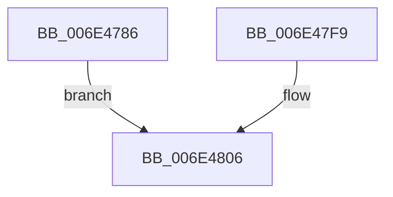

# sub_006E4786

- RVA: `0x006E4786`–`0x006E4817` (길이 `145` bytes)
- VA: `0x00000001406E4786`
- 실행 섹션: `.text`
- PDB 이름 있음: `아니요`; PDB Function 태그: `아니요`
- unwind 정보 RVA: `0x0007BB1C`
- 디코드: `27`개 명령, `145/145` bytes 표시
- 미해석 바이트: `0` (있으면 어셈블리에 `.byte`로 보존)

> 이 문서는 커널 이미지의 기계어와 PDB 기호를 분석해 생성했습니다. 4번과 5번은 함수 원형과 자료형을 바이너리 사용 방식에서 추정한 C 해석이며 원본 소스 복구 결과는 아닙니다.

## 1. Dependencies

- 직접 호출 지점: **2**; 고유 호출 대상: **2**
- 직접 호출자로 확인된 함수: **0**
- RIP 상대 이미지 참조: **0**

### Outgoing calls
- `0x006E47BE` → [MiUnlockWorkingSetExclusive](../27/MiUnlockWorkingSetExclusive_function_0027EC70.md) (function, `0x0027EC70`)
- `0x006E480B` → [MiLockWorkingSetExclusive](../32/MiLockWorkingSetExclusive_function_003238A0.md) (function, `0x003238A0`)

### Direct callers
- 이 함수 시작 RVA로 연결되는 직접 call은 확인되지 않았습니다. 간접 호출은 완전히 역산할 수 없습니다.

### Static image references
- 디코드된 RIP-relative 메모리 참조가 없습니다.

## 2. Other-region calls and transfers

- 다른 실행 섹션으로 향하는 call: **0**
- call이 아닌 외부 분기/꼬리 이동: **1**
  - `0x006E4812` → [MiDuplicateCloneLeaf + 0x278](../38/MiDuplicateCloneLeaf_function_003825F0.md) (`tail-transfer`)

## 3. Assembly (complete function range)

```asm
006E4786  65 48 8B 04 25 88 01 00 00      mov rax, qword ptr gs:[0x188]
006E478F  48 8B 98 B8 00 00 00            mov rbx, qword ptr [rax + 0xb8]
006E4796  48 81 C3 00 04 00 00            add rbx, 0x400
006E479D  48 89 9C 24 80 00 00 00         mov qword ptr [rsp + 0x80], rbx
006E47A5  48 B8 FF FF FF FF FF FF FF 7F   movabs rax, 0x7fffffffffffffff
006E47AF  F0 48 21 46 18                  lock and qword ptr [rsi + 0x18], rax
006E47B4  8A 94 24 A0 00 00 00            mov dl, byte ptr [rsp + 0xa0]
006E47BB  48 8B CB                        mov rcx, rbx
006E47BE  E8 AD A4 B9 FF                  call 0x14027ec70
006E47C3  65 48 8B 04 25 88 01 00 00      mov rax, qword ptr gs:[0x188]
006E47CC  48 8D 88 AE 05 00 00            lea rcx, [rax + 0x5ae]
006E47D3  48 89 4C 24 30                  mov qword ptr [rsp + 0x30], rcx
006E47D8  FE 01                           inc byte ptr [rcx]
006E47DA  49 C1 E4 19                     shl r12, 0x19
006E47DE  48 B8 00 00 00 00 80 F6 FF FF   movabs rax, 0xfffff68000000000
006E47E8  48 C1 E0 19                     shl rax, 0x19
006E47EC  4C 2B E0                        sub r12, rax
006E47EF  49 C1 FC 10                     sar r12, 0x10
006E47F3  49 8B 04 24                     mov rax, qword ptr [r12]
006E47F7  EB 0D                           jmp 0x1406e4806
006E47F9  48 8B 9C 24 80 00 00 00         mov rbx, qword ptr [rsp + 0x80]
006E4801  48 8B 4C 24 30                  mov rcx, qword ptr [rsp + 0x30]
006E4806  FE 09                           dec byte ptr [rcx]
006E4808  48 8B CB                        mov rcx, rbx
006E480B  E8 90 F0 C3 FF                  call 0x1403238a0
006E4810  33 C0                           xor eax, eax
006E4812  E9 51 E0 C9 FF                  jmp 0x140382868
```

## 4. C-style interpretation (structured pseudocode)

```c
__int64 __fastcall sub_006E4786(__int64 a1, __int64 a2, __int64 a3, __int64 a4, __int64 a5, __int64 a6, __int64 a7, __int64 a8, __int64 a9, __int64 a10, __int64 a11, __int64 a12, __int64 a13, __int64 a14, __int64 a15, __int64 a16, __int64 a17, __int64 a18, __int64 a19, unsigned __int8 a20)
{
    __int64 result;
    __int64 v_r12;
    __int64 v_rbx;
    unsigned __int64 v_stack_p30;
    unsigned __int64 v_stack_p80;

    v_rbx = (*(unsigned __int64 *)(*(unsigned __int64 *)(gs_base + (0 + 392)) + 184)) + (0x400ULL);
    v_stack_p80 = v_rbx;
    result = MiUnlockWorkingSetExclusive(v_rbx, a20, a3, a4);
    v_stack_p30 = *(unsigned __int64 *)(gs_base + (0 + 392)) + 1454;
    v_r12 = (v_r12) << (25);
    result = (*(unsigned __int64 *)(gs_base + (0 + 392))) << (25);
    v_r12 = (v_r12) - (result);
    v_r12 = (v_r12) >> (16);
    goto loc_006E4806;
loc_006E4806:
    result = MiLockWorkingSetExclusive(v_rbx, a20, a3, a4);
    result = 0;
}
```

## 5. (Beta) C Style

```c
int64_t sub_006E4786(int64_t Arg1, int64_t Arg2, int64_t Arg3, int64_t Arg4, uint64_t Arg5, uint64_t Arg6, uint64_t Arg7, uint64_t Arg8, uint64_t Arg9, uint64_t Arg10, uint64_t Arg11, uint64_t Arg12, uint64_t Arg13, uint64_t Arg14, uint64_t Arg15, uint64_t Arg16, uint64_t Arg17, uint64_t Arg18, uint64_t Arg19, uint8_t Arg20)
{
    int64_t result;
    int64_t local_r12;
    int64_t local_rbx;
    uint64_t v_stack_p30;
    uint64_t v_stack_p80;

    local_rbx = (*(uint64_t *)(*(uint64_t *)(gs_base + (0 + 0x188)) + 0xB8)) + (0x400ULL);
    v_stack_p80 = local_rbx;
    result = MiUnlockWorkingSetExclusive(local_rbx, Arg20, Arg3, Arg4);
    v_stack_p30 = *(uint64_t *)(gs_base + (0 + 0x188)) + 1454;
    local_r12 = (local_r12) << (25);
    result = (*(uint64_t *)(gs_base + (0 + 0x188))) << (25);
    local_r12 = (local_r12) - (result);
    local_r12 = (local_r12) >> (16);
    goto loc_006E4806;
loc_006E4806:
    result = MiLockWorkingSetExclusive(local_rbx, Arg20, Arg3, Arg4);
    result = 0;
}
```

## 6. Execution-region graph

[열기: 2D/3D 그래프와 함수 탐색 컨트롤 패널](../../../control-panel.html?section=text&rva=0x006E4786&view=graph)

- 2D 그래프는 위에서 아래로 흐르고, 3D 그래프는 빈 공간을 드래그해 회전합니다. Shift+드래그는 이동, 휠은 확대·축소, 함수 노드 선택은 대상 보고서 이동입니다.

### Static fallback


