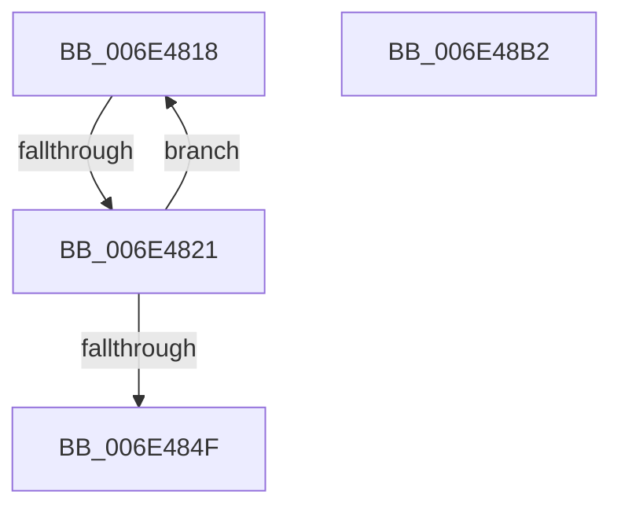

# sub_006E4818

- RVA: `0x006E4818`–`0x006E48C1` (길이 `169` bytes)
- VA: `0x00000001406E4818`
- 실행 섹션: `.text`
- PDB 이름 있음: `아니요`; PDB Function 태그: `아니요`
- unwind 정보 RVA: `0x0007BB78`
- 디코드: `36`개 명령, `169/169` bytes 표시
- 미해석 바이트: `0` (있으면 어셈블리에 `.byte`로 보존)

> 이 문서는 커널 이미지의 기계어와 PDB 기호를 분석해 생성했습니다. 4번과 5번은 함수 원형과 자료형을 바이너리 사용 방식에서 추정한 C 해석이며 원본 소스 복구 결과는 아닙니다.

## 1. Dependencies

- 직접 호출 지점: **4**; 고유 호출 대상: **4**
- 직접 호출자로 확인된 함수: **0**
- RIP 상대 이미지 참조: **0**

### Outgoing calls
- `0x006E486F` → [MiMapPageInHyperSpaceWorker](../33/MiMapPageInHyperSpaceWorker_function_00332B10.md) (function, `0x00332B10`)
- `0x006E4886` → [memset](../6C/memset_function_006C6C40.md) (function, `0x006C6C40`)
- `0x006E489B` → [MiUnmapPageInHyperSpaceWorker](../43/MiUnmapPageInHyperSpaceWorker_function_00432800.md) (function, `0x00432800`)
- `0x006E48B2` → [MiFlushEntireTbDueToAttributeChange](../30/MiFlushEntireTbDueToAttributeChange_function_00308AE0.md) (function, `0x00308AE0`)

### Direct callers
- 이 함수 시작 RVA로 연결되는 직접 call은 확인되지 않았습니다. 간접 호출은 완전히 역산할 수 없습니다.

### Static image references
- 디코드된 RIP-relative 메모리 참조가 없습니다.

## 2. Other-region calls and transfers

- 다른 실행 섹션으로 향하는 call: **0**
- call이 아닌 외부 분기/꼬리 이동: **3**
  - `0x006E481B` → [MiValidateInPage + 0xA6](../38/MiValidateInPage_function_00382E0C.md) (`tail-transfer`)
  - `0x006E48AD` → [MiValidateInPage + 0xA6](../38/MiValidateInPage_function_00382E0C.md) (`tail-transfer`)
  - `0x006E48BC` → [MiValidateInPage + 0x17A](../38/MiValidateInPage_function_00382E0C.md) (`tail-transfer`)

## 3. Assembly (complete function range)

```asm
006E4818  4D 3B E8                        cmp r13, r8
006E481B  0F 83 91 E6 C9 FF               jae 0x140382eb2
006E4821  0F AE E8                        lfence
006E4824  49 8B 45 00                     mov rax, qword ptr [r13]
006E4828  48 8D 04 40                     lea rax, [rax + rax*2]
006E482C  48 03 C0                        add rax, rax
006E482F  48 B9 08 00 00 00 00 DE FF FF   movabs rcx, 0xffffde0000000008
006E4839  48 8B 04 C1                     mov rax, qword ptr [rcx + rax*8]
006E483D  48 B9 00 00 00 00 00 00 00 80   movabs rcx, 0x8000000000000000
006E4847  48 0B C1                        or rax, rcx
006E484A  48 3B C2                        cmp rax, rdx
006E484D  75 C9                           jne 0x1406e4818
006E484F  41 8B 7E 38                     mov edi, dword ptr [r14 + 0x38]
006E4853  48 8D 94 24 C0 00 00 00         lea rdx, [rsp + 0xc0]
006E485B  49 8B 4D 00                     mov rcx, qword ptr [r13]
006E485F  41 B8 00 00 00 80               mov r8d, 0x80000000
006E4865  49 23 F9                        and rdi, r9
006E4868  88 9C 24 C0 00 00 00            mov byte ptr [rsp + 0xc0], bl
006E486F  E8 9C E2 C4 FF                  call 0x140332b10
006E4874  41 B8 00 10 00 00               mov r8d, 0x1000
006E487A  33 D2                           xor edx, edx
006E487C  4C 2B C7                        sub r8, rdi
006E487F  48 8B D8                        mov rbx, rax
006E4882  48 8D 0C 07                     lea rcx, [rdi + rax]
006E4886  E8 B5 23 FE FF                  call 0x1406c6c40
006E488B  8A 94 24 C0 00 00 00            mov dl, byte ptr [rsp + 0xc0]
006E4892  41 B8 00 00 00 80               mov r8d, 0x80000000
006E4898  48 8B CB                        mov rcx, rbx
006E489B  E8 60 DF D4 FF                  call 0x140432800
006E48A0  4C 8B 54 24 58                  mov r10, qword ptr [rsp + 0x58]
006E48A5  33 DB                           xor ebx, ebx
006E48A7  41 B9 FF 0F 00 00               mov r9d, 0xfff
006E48AD  E9 00 E6 C9 FF                  jmp 0x140382eb2
006E48B2  E8 29 42 C2 FF                  call 0x140308ae0
006E48B7  4C 8B 54 24 58                  mov r10, qword ptr [rsp + 0x58]
006E48BC  E9 C5 E6 C9 FF                  jmp 0x140382f86
```

## 4. C-style interpretation (structured pseudocode)

```c
__int64 __fastcall sub_006E4818(__int64 a1, __int64 a2, __int64 a3, __int64 a4, __int64 a5, __int64 a6, __int64 a7, __int64 a8, __int64 a9, __int64 a10, __int64 a11, __int64 a12, __int64 a13, __int64 a14, __int64 a15, __int64 a16, __int64 a17, __int64 a18, __int64 a19, __int64 a20, __int64 a21, __int64 a22, __int64 a23, unsigned __int8 a24)
{
    __int64 result;
    __int64 v_rbx;
    __int64 v_rdi;
    unsigned __int64 v_stack_p58;
    unsigned __int8 v_stack_pC0;

    result = (*(unsigned __int64 *)(v_r13) + *(unsigned __int64 *)(v_r13) * 2) + (*(unsigned __int64 *)(v_r13) + *(unsigned __int64 *)(v_r13) * 2);
    result = (*(unsigned __int64 *)(a1 + result * 8)) | (a1);
    if (result != a2) goto loc_006E4818;
    v_rdi = ((unsigned int)(*(unsigned int *)(v_r14 + 56))) & (a4);
    v_stack_pC0 = (unsigned __int8)(v_rbx);
    result = MiMapPageInHyperSpaceWorker(*(unsigned __int64 *)(v_r13), a24, (unsigned int)(0x80000000ULL), a4);
    a2 = 0;
    a3 = ((unsigned int)(0x1000ULL)) - (v_rdi);
    result = memset(v_rdi + result * 1, a2, a3, a4);
    result = MiUnmapPageInHyperSpaceWorker(result, a24, (unsigned int)(0x80000000ULL), a4);
    v_rbx = 0;
}
```

## 5. (Beta) C Style

```c
int64_t sub_006E4818(int64_t Arg1, int64_t Arg2, int64_t Arg3, int64_t Arg4, uint64_t Arg5, uint64_t Arg6, uint64_t Arg7, uint64_t Arg8, uint64_t Arg9, uint64_t Arg10, int64_t Arg11, uint64_t Arg12, uint64_t Arg13, uint64_t Arg14, uint64_t Arg15, uint64_t Arg16, uint64_t Arg17, uint64_t Arg18, uint64_t Arg19, uint64_t Arg20, uint64_t Arg21, uint64_t Arg22, uint64_t Arg23, uint8_t Arg24)
{
    int64_t result;
    int64_t local_rbx;
    int64_t local_rdi;
    uint64_t v_stack_p58;
    uint8_t v_stack_pC0;

    result = (*(uint64_t *)(local_r13) + *(uint64_t *)(local_r13) * 2) + (*(uint64_t *)(local_r13) + *(uint64_t *)(local_r13) * 2);
    result = (*(uint64_t *)(Arg1 + result * 8)) | (Arg1);
    if (result != Arg2) goto loc_006E4818;
    local_rdi = ((uint32_t)(*(uint32_t *)(local_r14 + 0x38))) & (Arg4);
    v_stack_pC0 = (uint8_t)(local_rbx);
    result = MiMapPageInHyperSpaceWorker(*(uint64_t *)(local_r13), Arg24, (uint32_t)(0x80000000ULL), Arg4);
    Arg2 = 0;
    Arg3 = ((uint32_t)(0x1000ULL)) - (local_rdi);
    result = memset(local_rdi + result * 1, Arg2, Arg3, Arg4);
    result = MiUnmapPageInHyperSpaceWorker(result, Arg24, (uint32_t)(0x80000000ULL), Arg4);
    local_rbx = 0;
}
```

## 6. Execution-region graph

[열기: 2D/3D 그래프와 함수 탐색 컨트롤 패널](../../../control-panel.html?section=text&rva=0x006E4818&view=graph)

- 2D 그래프는 위에서 아래로 흐르고, 3D 그래프는 빈 공간을 드래그해 회전합니다. Shift+드래그는 이동, 휠은 확대·축소, 함수 노드 선택은 대상 보고서 이동입니다.

### Static fallback


