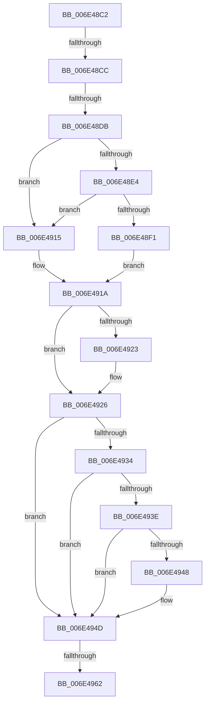

# sub_006E48C2

- RVA: `0x006E48C2`–`0x006E497D` (길이 `187` bytes)
- VA: `0x00000001406E48C2`
- 실행 섹션: `.text`
- PDB 이름 있음: `아니요`; PDB Function 태그: `아니요`
- unwind 정보 RVA: `0x0007BBA4`
- 디코드: `45`개 명령, `187/187` bytes 표시
- 미해석 바이트: `0` (있으면 어셈블리에 `.byte`로 보존)

> 이 문서는 커널 이미지의 기계어와 PDB 기호를 분석해 생성했습니다. 4번과 5번은 함수 원형과 자료형을 바이너리 사용 방식에서 추정한 C 해석이며 원본 소스 복구 결과는 아닙니다.

## 1. Dependencies

- 직접 호출 지점: **2**; 고유 호출 대상: **2**
- 직접 호출자로 확인된 함수: **0**
- RIP 상대 이미지 참조: **1**

### Outgoing calls
- `0x006E4955` → [KeSetPagePrivilege](../40/KeSetPagePrivilege_function_00407970.md) (function, `0x00407970`)
- `0x006E4977` → [KeBugCheckEx](../4F/KeBugCheckEx_function_004FD660.md) (function, `0x004FD660`)

### Direct callers
- 이 함수 시작 RVA로 연결되는 직접 call은 확인되지 않았습니다. 간접 호출은 완전히 역산할 수 없습니다.

### Static image references
- `0x006E48CC` → RVA `0x00FC6A88` (`ALMOSTRO`; read)

## 2. Other-region calls and transfers

- 다른 실행 섹션으로 향하는 call: **0**
- call이 아닌 외부 분기/꼬리 이동: **3**
  - `0x006E48C6` → [MiMarkPfnVerified + 0x59](../38/MiMarkPfnVerified_function_003833C4.md) (`tail-transfer`)
  - `0x006E48D5` → [MiMarkPfnVerified + 0x59](../38/MiMarkPfnVerified_function_003833C4.md) (`tail-transfer`)
  - `0x006E495C` → [MiMarkPfnVerified + 0x59](../38/MiMarkPfnVerified_function_003833C4.md) (`tail-transfer`)

## 3. Assembly (complete function range)

```asm
006E48C2  40 F6 C7 02                     test dil, 2
006E48C6  0F 84 51 EB C9 FF               je 0x14038341d
006E48CC  48 0F BA 25 B3 21 8E 00 0F      bt qword ptr [rip + 0x8e21b3], 0xf
006E48D5  0F 83 42 EB C9 FF               jae 0x14038341d
006E48DB  48 8B 43 28                     mov rax, qword ptr [rbx + 0x28]
006E48DF  48 85 C0                        test rax, rax
006E48E2  78 31                           js 0x1406e4915
006E48E4  48 F7 05 99 21 8E 00 00 40 00 00  test qword ptr [rip + 0x8e2199], 0x4000
006E48EF  74 24                           je 0x1406e4915
006E48F1  48 8B 53 08                     mov rdx, qword ptr [rbx + 8]
006E48F5  48 C1 E2 19                     shl rdx, 0x19
006E48F9  48 B8 00 00 00 00 80 F6 FF FF   movabs rax, 0xfffff68000000000
006E4903  48 C1 E0 19                     shl rax, 0x19
006E4907  48 2B D0                        sub rdx, rax
006E490A  48 C1 FA 10                     sar rdx, 0x10
006E490E  48 89 54 24 30                  mov qword ptr [rsp + 0x30], rdx
006E4913  EB 05                           jmp 0x1406e491a
006E4915  48 8B 54 24 30                  mov rdx, qword ptr [rsp + 0x30]
006E491A  44 8B CF                        mov r9d, edi
006E491D  41 83 E1 01                     and r9d, 1
006E4921  74 03                           je 0x1406e4926
006E4923  83 E7 FE                        and edi, 0xfffffffe
006E4926  46 8D 0C 8D 02 00 00 00         lea r9d, [r9*4 + 2]
006E492E  40 F6 C7 20                     test dil, 0x20
006E4932  74 19                           je 0x1406e494d
006E4934  41 83 C9 40                     or r9d, 0x40
006E4938  F6 43 22 10                     test byte ptr [rbx + 0x22], 0x10
006E493C  75 0F                           jne 0x1406e494d
006E493E  8B 43 10                        mov eax, dword ptr [rbx + 0x10]
006E4941  C0 E8 02                        shr al, 2
006E4944  A8 01                           test al, 1
006E4946  75 05                           jne 0x1406e494d
006E4948  41 0F BA E9 0A                  bts r9d, 0xa
006E494D  4C 8D 44 24 30                  lea r8, [rsp + 0x30]
006E4952  48 8B CD                        mov rcx, rbp
006E4955  E8 16 30 D2 FF                  call 0x140407970
006E495A  85 C0                           test eax, eax
006E495C  0F 89 BB EA C9 FF               jns 0x14038341d
006E4962  48 83 64 24 20 00               and qword ptr [rsp + 0x20], 0
006E4968  45 33 C9                        xor r9d, r9d
006E496B  4C 8B C5                        mov r8, rbp
006E496E  BA 0C 15 05 00                  mov edx, 0x5150c
006E4973  41 8D 49 1A                     lea ecx, [r9 + 0x1a]
006E4977  E8 E4 8C E1 FF                  call 0x1404fd660
006E497C  CC                              int3
```

## 4. C-style interpretation (structured pseudocode)

```c
__int64 __fastcall sub_006E48C2(__int64 a1, __int64 a2, __int64 a3, __int64 a4, __int64 a5, __int64 a6)
{
    __int64 result;
    __int64 v_rdi;
    unsigned __int64 v_stack_p20;
    unsigned __int64 v_stack_p30;

    if (sign_flag) goto loc_006E4915;
    if (((*(unsigned __int64 *)(v_rip + 9314713)) & (0x4000ULL)) == 0) goto loc_006E4915;
    a2 = (*(unsigned __int64 *)(v_rbx + 8)) << (25);
    result = (*(unsigned __int64 *)(v_rbx + 40)) << (25);
    a2 = (a2) - (result);
    a2 = (a2) >> (16);
    v_stack_p30 = a2;
    goto loc_006E491A;
loc_006E4915:
loc_006E491A:
    a4 = (unsigned int)(((unsigned int)((unsigned int)(v_rdi))) & (1));
    if (!(condition_is_equal)) {
        v_rdi = (unsigned int)((v_rdi) & (0xFFFFFFFEULL));
    }
    if ((((unsigned __int8)(v_rdi)) & (32)) == 0) goto loc_006E494D;
    a4 = (unsigned int)((a4 * 4 + 2) | (64));
    if (((*(unsigned __int8 *)(v_rbx + 34)) & (16)) != 0) goto loc_006E494D;
    result = (unsigned __int8)(((unsigned int)(*(unsigned int *)(v_rbx + 16))) >> (2));
    if ((((unsigned __int8)(result)) & (1)) == 0) {
    }
    result = KeSetPagePrivilege(v_rbp, a6, a6, a4);
    a4 = 0;
    result = KeBugCheckEx(a4 + 26, (unsigned int)(0x5150CULL), v_rbp, a4);
    return result;
}
```

## 5. (Beta) C Style

```c
int64_t sub_006E48C2(int64_t Arg1, int64_t Arg2, int64_t Arg3, int64_t Arg4, uint64_t Arg5, int64_t Arg6)
{
    int64_t result;
    int64_t local_rdi;
    uint64_t v_stack_p20;
    uint64_t v_stack_p30;

    if (sign_flag) goto loc_006E4915;
    if (((*(uint64_t *)(v_rip + 0x8E2199)) & (0x4000ULL)) == 0) goto loc_006E4915;
    Arg2 = (*(uint64_t *)(local_rbx + 0x8)) << (25);
    result = (*(uint64_t *)(local_rbx + 0x28)) << (25);
    Arg2 = (Arg2) - (result);
    Arg2 = (Arg2) >> (16);
    v_stack_p30 = Arg2;
    goto loc_006E491A;
loc_006E4915:
loc_006E491A:
    Arg4 = (uint32_t)(((uint32_t)((uint32_t)(local_rdi))) & (1));
    if (!(condition_is_equal)) {
        local_rdi = (uint32_t)((local_rdi) & (0xFFFFFFFEULL));
    }
    if ((((uint8_t)(local_rdi)) & (32)) == 0) goto loc_006E494D;
    Arg4 = (uint32_t)((Arg4 * 4 + 2) | (64));
    if (((*(uint8_t *)(local_rbx + 0x22)) & (16)) != 0) goto loc_006E494D;
    result = (uint8_t)(((uint32_t)(*(uint32_t *)(local_rbx + 0x10))) >> (2));
    if ((((uint8_t)(result)) & (1)) == 0) {
    }
    result = KeSetPagePrivilege(local_rbp, Arg6, Arg6, Arg4);
    Arg4 = 0;
    result = KeBugCheckEx(Arg4 + 26, (uint32_t)(0x5150CULL), local_rbp, Arg4);
    return result;
}
```

## 6. Execution-region graph

[열기: 2D/3D 그래프와 함수 탐색 컨트롤 패널](../../../control-panel.html?section=text&rva=0x006E48C2&view=graph)

- 2D 그래프는 위에서 아래로 흐르고, 3D 그래프는 빈 공간을 드래그해 회전합니다. Shift+드래그는 이동, 휠은 확대·축소, 함수 노드 선택은 대상 보고서 이동입니다.

### Static fallback


