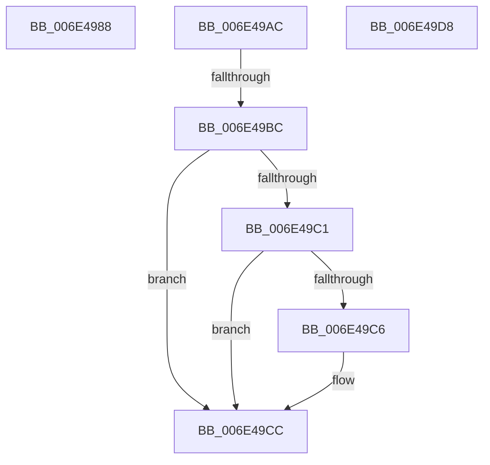

# sub_006E4988

- RVA: `0x006E4988`–`0x006E49E7` (길이 `95` bytes)
- VA: `0x00000001406E4988`
- 실행 섹션: `.text`
- PDB 이름 있음: `아니요`; PDB Function 태그: `아니요`
- unwind 정보 RVA: `0x0007BC1C`
- 디코드: `27`개 명령, `95/95` bytes 표시
- 미해석 바이트: `0` (있으면 어셈블리에 `.byte`로 보존)

> 이 문서는 커널 이미지의 기계어와 PDB 기호를 분석해 생성했습니다. 4번과 5번은 함수 원형과 자료형을 바이너리 사용 방식에서 추정한 C 해석이며 원본 소스 복구 결과는 아닙니다.

## 1. Dependencies

- 직접 호출 지점: **0**; 고유 호출 대상: **0**
- 직접 호출자로 확인된 함수: **0**
- RIP 상대 이미지 참조: **0**

### Outgoing calls
- 직접 디코드된 call 명령이 없습니다.

### Direct callers
- 이 함수 시작 RVA로 연결되는 직접 call은 확인되지 않았습니다. 간접 호출은 완전히 역산할 수 없습니다.

### Static image references
- 디코드된 RIP-relative 메모리 참조가 없습니다.

## 2. Other-region calls and transfers

- 다른 실행 섹션으로 향하는 call: **0**
- call이 아닌 외부 분기/꼬리 이동: **4**
  - `0x006E49A7` → [MiReservePageFileSpace + 0x1CC](../38/MiReservePageFileSpace_function_00383ED8.md) (`tail-transfer`)
  - `0x006E49B6` → [MiReservePageFileSpace + 0x3CC](../38/MiReservePageFileSpace_function_00383ED8.md) (`tail-transfer`)
  - `0x006E49D3` → [MiReservePageFileSpace + 0x2BB](../38/MiReservePageFileSpace_function_00383ED8.md) (`tail-transfer`)
  - `0x006E49E2` → [MiReservePageFileSpace + 0x307](../38/MiReservePageFileSpace_function_00383ED8.md) (`tail-transfer`)

## 3. Assembly (complete function range)

```asm
006E4988  41 2B C6                        sub eax, r14d
006E498B  45 33 F6                        xor r14d, r14d
006E498E  2B C8                           sub ecx, eax
006E4990  8B C1                           mov eax, ecx
006E4992  4E 8D 34 F5 00 00 00 00         lea r14, [r14*8]
006E499A  48 C1 E0 03                     shl rax, 3
006E499E  4D 8B FD                        mov r15, r13
006E49A1  4C 2B F8                        sub r15, rax
006E49A4  4D 03 F5                        add r14, r13
006E49A7  E9 F8 F6 C9 FF                  jmp 0x1403840a4
006E49AC  45 8B CE                        mov r9d, r14d
006E49AF  48 C1 E8 20                     shr rax, 0x20
006E49B3  4C 3B C8                        cmp r9, rax
006E49B6  0F 83 E8 F8 C9 FF               jae 0x1403842a4
006E49BC  4D 85 C0                        test r8, r8
006E49BF  74 0B                           je 0x1406e49cc
006E49C1  F6 C2 10                        test dl, 0x10
006E49C4  75 06                           jne 0x1406e49cc
006E49C6  49 F7 D0                        not r8
006E49C9  49 23 D0                        and rdx, r8
006E49CC  48 C1 EA 20                     shr rdx, 0x20
006E49D0  49 2B D1                        sub rdx, r9
006E49D3  E9 BB F7 C9 FF                  jmp 0x140384193
006E49D8  45 2B F7                        sub r14d, r15d
006E49DB  45 33 FF                        xor r15d, r15d
006E49DE  44 29 75 58                     sub dword ptr [rbp + 0x58], r14d
006E49E2  E9 F8 F7 C9 FF                  jmp 0x1403841df
```

## 4. C-style interpretation (structured pseudocode)

```c
__int64 __fastcall sub_006E4988(int a1, __int64 a2, __int64 a3)
{
    __int64 result;
    __int64 v_r14;
    __int64 v_r15;

    result = (unsigned int)((result) - ((unsigned int)(v_r14)));
    v_r14 = 0;
    a1 = (unsigned int)((a1) - ((unsigned int)(result)));
    result = ((unsigned int)(a1)) << (3);
    v_r15 = (v_r13) - (result);
    v_r14 = (v_r14 * 8) + (v_r13);
}
```

## 5. (Beta) C Style

```c
int64_t sub_006E4988(int32_t Arg1, int64_t Arg2, int64_t Arg3)
{
    int64_t result;
    int64_t local_r14;
    int64_t local_r15;

    result = (uint32_t)((result) - ((uint32_t)(local_r14)));
    local_r14 = 0;
    Arg1 = (uint32_t)((Arg1) - ((uint32_t)(result)));
    result = ((uint32_t)(Arg1)) << (3);
    local_r15 = (local_r13) - (result);
    local_r14 = (local_r14 * 8) + (local_r13);
}
```

## 6. Execution-region graph

[열기: 2D/3D 그래프와 함수 탐색 컨트롤 패널](../../../control-panel.html?section=text&rva=0x006E4988&view=graph)

- 2D 그래프는 위에서 아래로 흐르고, 3D 그래프는 빈 공간을 드래그해 회전합니다. Shift+드래그는 이동, 휠은 확대·축소, 함수 노드 선택은 대상 보고서 이동입니다.

### Static fallback


