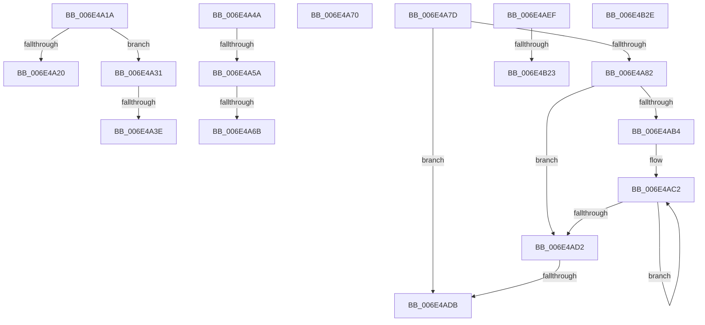

# sub_006E4A1A

- RVA: `0x006E4A1A`–`0x006E4B4B` (길이 `305` bytes)
- VA: `0x00000001406E4A1A`
- 실행 섹션: `.text`
- PDB 이름 있음: `아니요`; PDB Function 태그: `아니요`
- unwind 정보 RVA: `0x0007BCA0`
- 디코드: `81`개 명령, `305/305` bytes 표시
- 미해석 바이트: `0` (있으면 어셈블리에 `.byte`로 보존)

> 이 문서는 커널 이미지의 기계어와 PDB 기호를 분석해 생성했습니다. 4번과 5번은 함수 원형과 자료형을 바이너리 사용 방식에서 추정한 C 해석이며 원본 소스 복구 결과는 아닙니다.

## 1. Dependencies

- 직접 호출 지점: **4**; 고유 호출 대상: **4**
- 직접 호출자로 확인된 함수: **0**
- RIP 상대 이미지 참조: **0**

### Outgoing calls
- `0x006E4A5D` → [MiGetPfnChannel](../33/MiGetPfnChannel_function_0033BA90.md) (function, `0x0033BA90`)
- `0x006E4AF6` → [MiUpdateTransitionPteFrame](../38/MiUpdateTransitionPteFrame_function_00385EDC.md) (function, `0x00385EDC`)
- `0x006E4B10` → [MiIsDecayPfn](../2B/MiIsDecayPfn_function_002B9240.md) (function, `0x002B9240`)
- `0x006E4B23` → [MiSetPfnContainingFrame](../36/MiSetPfnContainingFrame_function_00363FC0.md) (function, `0x00363FC0`)

### Direct callers
- 이 함수 시작 RVA로 연결되는 직접 call은 확인되지 않았습니다. 간접 호출은 완전히 역산할 수 없습니다.

### Static image references
- 디코드된 RIP-relative 메모리 참조가 없습니다.

## 2. Other-region calls and transfers

- 다른 실행 섹션으로 향하는 call: **0**
- call이 아닌 외부 분기/꼬리 이동: **12**
  - `0x006E4A2C` → [MiSwapNumaStandbyPage + 0x9B](../38/MiSwapNumaStandbyPage_function_00385144.md) (`tail-transfer`)
  - `0x006E4A38` → [MiSwapNumaStandbyPage + 0x9E](../38/MiSwapNumaStandbyPage_function_00385144.md) (`tail-transfer`)
  - `0x006E4A45` → [MiSwapNumaStandbyPage + 0x9E](../38/MiSwapNumaStandbyPage_function_00385144.md) (`tail-transfer`)
  - `0x006E4A54` → [MiSwapNumaStandbyPage + 0xB5](../38/MiSwapNumaStandbyPage_function_00385144.md) (`tail-transfer`)
  - `0x006E4A65` → [MiSwapNumaStandbyPage + 0x467](../38/MiSwapNumaStandbyPage_function_00385144.md) (`tail-transfer`)
  - `0x006E4A6B` → [MiSwapNumaStandbyPage + 0xB5](../38/MiSwapNumaStandbyPage_function_00385144.md) (`tail-transfer`)
  - `0x006E4A78` → [MiSwapNumaStandbyPage + 0x43E](../38/MiSwapNumaStandbyPage_function_00385144.md) (`tail-transfer`)
  - `0x006E4AD5` → [MiSwapNumaStandbyPage + 0x13F](../38/MiSwapNumaStandbyPage_function_00385144.md) (`tail-transfer`)
  - `0x006E4AEA` → [MiSwapNumaStandbyPage + 0x13F](../38/MiSwapNumaStandbyPage_function_00385144.md) (`tail-transfer`)
  - `0x006E4B1D` → [MiSwapNumaStandbyPage + 0x1BF](../38/MiSwapNumaStandbyPage_function_00385144.md) (`tail-transfer`)
  - `0x006E4B29` → [MiSwapNumaStandbyPage + 0x1C7](../38/MiSwapNumaStandbyPage_function_00385144.md) (`tail-transfer`)
  - `0x006E4B46` → [MiSwapNumaStandbyPage + 0x297](../38/MiSwapNumaStandbyPage_function_00385144.md) (`tail-transfer`)

## 3. Assembly (complete function range)

```asm
006E4A1A  0F BA E7 0D                     bt edi, 0xd
006E4A1E  73 11                           jae 0x1406e4a31
006E4A20  B1 01                           mov cl, 1
006E4A22  44 88 6D 48                     mov byte ptr [rbp + 0x48], r13b
006E4A26  88 4D C0                        mov byte ptr [rbp - 0x40], cl
006E4A29  45 33 E4                        xor r12d, r12d
006E4A2C  E9 AE 07 CA FF                  jmp 0x1403851df
006E4A31  40 84 FF                        test dil, dil
006E4A34  40 8A 7D 40                     mov dil, byte ptr [rbp + 0x40]
006E4A38  0F 89 A4 07 CA FF               jns 0x1403851e2
006E4A3E  4C 8D A0 83 3B 00 00            lea r12, [rax + 0x3b83]
006E4A45  E9 98 07 CA FF                  jmp 0x1403851e2
006E4A4A  45 8A 2C 24                     mov r13b, byte ptr [r12]
006E4A4E  44 88 6D 48                     mov byte ptr [rbp + 0x48], r13b
006E4A52  3B F3                           cmp esi, ebx
006E4A54  0F 85 9F 07 CA FF               jne 0x1403851f9
006E4A5A  49 8B CF                        mov rcx, r15
006E4A5D  E8 2E 70 C5 FF                  call 0x14033ba90
006E4A62  44 3A E8                        cmp r13b, al
006E4A65  0F 84 40 0B CA FF               je 0x1403855ab
006E4A6B  E9 89 07 CA FF                  jmp 0x1403851f9
006E4A70  0F B6 45 40                     movzx eax, byte ptr [rbp + 0x40]
006E4A74  44 0F 22 C0                     mov cr8, rax
006E4A78  E9 05 0B CA FF                  jmp 0x140385582
006E4A7D  4D 85 C9                        test r9, r9
006E4A80  74 59                           je 0x1406e4adb
006E4A82  41 8B C5                        mov eax, r13d
006E4A85  BA 20 00 00 00                  mov edx, 0x20
006E4A8A  83 E0 1F                        and eax, 0x1f
006E4A8D  2B D0                           sub edx, eax
006E4A8F  41 8B C4                        mov eax, r12d
006E4A92  8B CA                           mov ecx, edx
006E4A94  D3 E0                           shl eax, cl
006E4A96  49 8B C9                        mov rcx, r9
006E4A99  41 2B C4                        sub eax, r12d
006E4A9C  D3 E0                           shl eax, cl
006E4A9E  F0 41 09 00                     lock or dword ptr [r8], eax
006E4AA2  8B C2                           mov eax, edx
006E4AA4  49 83 C0 04                     add r8, 4
006E4AA8  49 8B D4                        mov rdx, r12
006E4AAB  48 2B D0                        sub rdx, rax
006E4AAE  48 83 FA 20                     cmp rdx, 0x20
006E4AB2  72 1E                           jb 0x1406e4ad2
006E4AB4  48 8B CA                        mov rcx, rdx
006E4AB7  48 C1 E9 05                     shr rcx, 5
006E4ABB  48 6B C1 E0                     imul rax, rcx, -0x20
006E4ABF  48 03 D0                        add rdx, rax
006E4AC2  41 C7 00 FF FF FF FF            mov dword ptr [r8], 0xffffffff
006E4AC9  49 83 C0 04                     add r8, 4
006E4ACD  49 2B CC                        sub rcx, r12
006E4AD0  75 F0                           jne 0x1406e4ac2
006E4AD2  48 85 D2                        test rdx, rdx
006E4AD5  0F 84 A8 07 CA FF               je 0x140385283
006E4ADB  48 8B CA                        mov rcx, rdx
006E4ADE  41 8B C4                        mov eax, r12d
006E4AE1  D3 E0                           shl eax, cl
006E4AE3  41 2B C4                        sub eax, r12d
006E4AE6  F0 41 09 00                     lock or dword ptr [r8], eax
006E4AEA  E9 94 07 CA FF                  jmp 0x140385283
006E4AEF  49 8B 49 10                     mov rcx, qword ptr [r9 + 0x10]
006E4AF3  49 8B D6                        mov rdx, r14
006E4AF6  E8 E1 13 CA FF                  call 0x140385edc
006E4AFB  49 89 41 10                     mov qword ptr [r9 + 0x10], rax
006E4AFF  4F 8D 0C 52                     lea r9, [r10 + r10*2]
006E4B03  49 C1 E1 04                     shl r9, 4
006E4B07  49 8B C3                        mov rax, r11
006E4B0A  49 8B CA                        mov rcx, r10
006E4B0D  4C 03 C8                        add r9, rax
006E4B10  E8 2B 47 BD FF                  call 0x1402b9240
006E4B15  49 8B D6                        mov rdx, r14
006E4B18  49 8B C9                        mov rcx, r9
006E4B1B  85 C0                           test eax, eax
006E4B1D  0F 84 E0 07 CA FF               je 0x140385303
006E4B23  E8 98 F4 C7 FF                  call 0x140363fc0
006E4B28  90                              nop
006E4B29  E9 DD 07 CA FF                  jmp 0x14038530b
006E4B2E  48 89 83 00 FD FF FF            mov qword ptr [rbx - 0x300], rax
006E4B35  48 B8 00 00 00 00 00 00 00 80   movabs rax, 0x8000000000000000
006E4B3F  48 8B 77 08                     mov rsi, qword ptr [rdi + 8]
006E4B43  48 0B F0                        or rsi, rax
006E4B46  E9 90 08 CA FF                  jmp 0x1403853db
```

## 4. C-style interpretation (structured pseudocode)

```c
__int64 __fastcall sub_006E4A1A(__int64 a1, __int64 a2, __int64 a3, __int64 a4)
{
    __int64 v_r12;

    if (condition_is_above_or_equal) goto loc_006E4A31;
    *(unsigned __int8 *)(v_rbp + 72) = (unsigned __int8)(v_r13);
    *(unsigned __int8 *)(v_rbp - 64) = 1;
    v_r12 = 0;
loc_006E4A31:
}
```

## 5. (Beta) C Style

```c
int64_t sub_006E4A1A(int64_t Arg1, int64_t Arg2, int64_t Arg3, int64_t Arg4)
{
    int64_t local_r12;

    if (condition_is_above_or_equal) goto loc_006E4A31;
    *(uint8_t *)(local_rbp + 0x48) = (uint8_t)(local_r13);
    *(uint8_t *)(local_rbp - 0x40) = 1;
    local_r12 = 0;
loc_006E4A31:
}
```

## 6. Execution-region graph

[열기: 2D/3D 그래프와 함수 탐색 컨트롤 패널](../../../control-panel.html?section=text&rva=0x006E4A1A&view=graph)

- 2D 그래프는 위에서 아래로 흐르고, 3D 그래프는 빈 공간을 드래그해 회전합니다. Shift+드래그는 이동, 휠은 확대·축소, 함수 노드 선택은 대상 보고서 이동입니다.

### Static fallback


