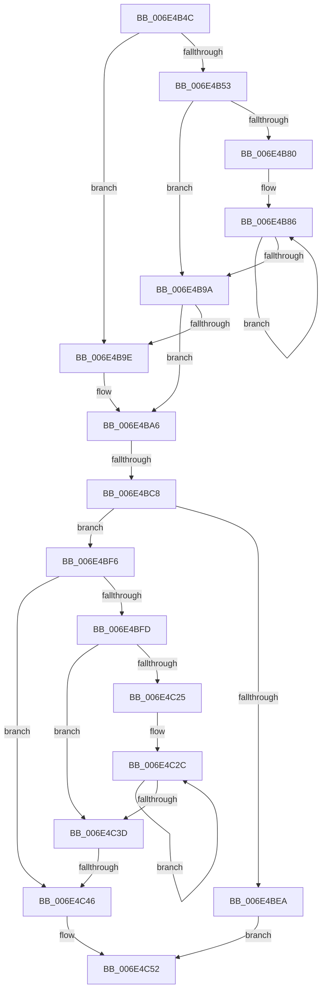

# sub_006E4B4C

- RVA: `0x006E4B4C`–`0x006E4C5B` (길이 `271` bytes)
- VA: `0x00000001406E4B4C`
- 실행 섹션: `.text`
- PDB 이름 있음: `아니요`; PDB Function 태그: `아니요`
- unwind 정보 RVA: `0x0007BCCC`
- 디코드: `85`개 명령, `271/271` bytes 표시
- 미해석 바이트: `0` (있으면 어셈블리에 `.byte`로 보존)

> 이 문서는 커널 이미지의 기계어와 PDB 기호를 분석해 생성했습니다. 4번과 5번은 함수 원형과 자료형을 바이너리 사용 방식에서 추정한 C 해석이며 원본 소스 복구 결과는 아닙니다.

## 1. Dependencies

- 직접 호출 지점: **1**; 고유 호출 대상: **1**
- 직접 호출자로 확인된 함수: **0**
- RIP 상대 이미지 참조: **0**

### Outgoing calls
- `0x006E4BB7` → [MiLockLowestPrioritySecondaryStandbyPage](../38/MiLockLowestPrioritySecondaryStandbyPage_function_00385A2C.md) (function, `0x00385A2C`)

### Direct callers
- 이 함수 시작 RVA로 연결되는 직접 call은 확인되지 않았습니다. 간접 호출은 완전히 역산할 수 없습니다.

### Static image references
- 디코드된 RIP-relative 메모리 참조가 없습니다.

## 2. Other-region calls and transfers

- 다른 실행 섹션으로 향하는 call: **0**
- call이 아닌 외부 분기/꼬리 이동: **3**
  - `0x006E4BC2` → [MiRepurposeStandbySlabPage + 0x9D](../38/MiRepurposeStandbySlabPage_function_00385780.md) (`tail-transfer`)
  - `0x006E4C40` → [MiRepurposeStandbySlabPage + 0x18C](../38/MiRepurposeStandbySlabPage_function_00385780.md) (`tail-transfer`)
  - `0x006E4C56` → [MiRepurposeStandbySlabPage + 0x18C](../38/MiRepurposeStandbySlabPage_function_00385780.md) (`tail-transfer`)

## 3. Assembly (complete function range)

```asm
006E4B4C  8B C6                           mov eax, esi
006E4B4E  83 E0 1F                        and eax, 0x1f
006E4B51  74 4B                           je 0x1406e4b9e
006E4B53  BA 20 00 00 00                  mov edx, 0x20
006E4B58  2B D0                           sub edx, eax
006E4B5A  B8 01 00 00 00                  mov eax, 1
006E4B5F  8B CA                           mov ecx, edx
006E4B61  D3 E0                           shl eax, cl
006E4B63  49 8B CF                        mov rcx, r15
006E4B66  FF C8                           dec eax
006E4B68  D3 E0                           shl eax, cl
006E4B6A  F7 D0                           not eax
006E4B6C  F0 41 21 00                     lock and dword ptr [r8], eax
006E4B70  B9 01 00 00 00                  mov ecx, 1
006E4B75  49 83 C0 04                     add r8, 4
006E4B79  2B CA                           sub ecx, edx
006E4B7B  83 F9 20                        cmp ecx, 0x20
006E4B7E  72 1A                           jb 0x1406e4b9a
006E4B80  8B C1                           mov eax, ecx
006E4B82  48 C1 E8 05                     shr rax, 5
006E4B86  41 C7 00 00 00 00 00            mov dword ptr [r8], 0
006E4B8D  83 C1 E0                        add ecx, -0x20
006E4B90  49 83 C0 04                     add r8, 4
006E4B94  48 83 E8 01                     sub rax, 1
006E4B98  75 EC                           jne 0x1406e4b86
006E4B9A  85 C9                           test ecx, ecx
006E4B9C  74 08                           je 0x1406e4ba6
006E4B9E  8B C7                           mov eax, edi
006E4BA0  D3 E0                           shl eax, cl
006E4BA2  F0 41 21 00                     lock and dword ptr [r8], eax
006E4BA6  48 8B 54 24 70                  mov rdx, qword ptr [rsp + 0x70]
006E4BAB  4C 8D 44 24 60                  lea r8, [rsp + 0x60]
006E4BB0  49 8B 4D 18                     mov rcx, qword ptr [r13 + 0x18]
006E4BB4  45 33 C9                        xor r9d, r9d
006E4BB7  E8 70 0E CA FF                  call 0x140385a2c
006E4BBC  4C 8B F0                        mov r14, rax
006E4BBF  48 3B C7                        cmp rax, rdi
006E4BC2  0F 84 55 0C CA FF               je 0x14038581d
006E4BC8  48 8B 43 08                     mov rax, qword ptr [rbx + 8]
006E4BCC  41 B9 01 00 00 00               mov r9d, 1
006E4BD2  8B D6                           mov edx, esi
006E4BD4  83 E2 1F                        and edx, 0x1f
006E4BD7  8B CE                           mov ecx, esi
006E4BD9  48 C1 E9 05                     shr rcx, 5
006E4BDD  48 FF C2                        inc rdx
006E4BE0  4C 8D 04 88                     lea r8, [rax + rcx*4]
006E4BE4  48 83 FA 20                     cmp rdx, 0x20
006E4BE8  77 0C                           ja 0x1406e4bf6
006E4BEA  8B CE                           mov ecx, esi
006E4BEC  41 8B C1                        mov eax, r9d
006E4BEF  80 E1 1F                        and cl, 0x1f
006E4BF2  D3 E0                           shl eax, cl
006E4BF4  EB 5C                           jmp 0x1406e4c52
006E4BF6  8B C6                           mov eax, esi
006E4BF8  83 E0 1F                        and eax, 0x1f
006E4BFB  74 49                           je 0x1406e4c46
006E4BFD  BA 20 00 00 00                  mov edx, 0x20
006E4C02  2B D0                           sub edx, eax
006E4C04  41 8B C1                        mov eax, r9d
006E4C07  8B CA                           mov ecx, edx
006E4C09  D3 E0                           shl eax, cl
006E4C0B  8B CE                           mov ecx, esi
006E4C0D  80 E1 1F                        and cl, 0x1f
006E4C10  FF C8                           dec eax
006E4C12  D3 E0                           shl eax, cl
006E4C14  F0 41 09 00                     lock or dword ptr [r8], eax
006E4C18  44 2B CA                        sub r9d, edx
006E4C1B  49 83 C0 04                     add r8, 4
006E4C1F  41 83 F9 20                     cmp r9d, 0x20
006E4C23  72 18                           jb 0x1406e4c3d
006E4C25  41 8B C1                        mov eax, r9d
006E4C28  48 C1 E8 05                     shr rax, 5
006E4C2C  41 89 38                        mov dword ptr [r8], edi
006E4C2F  41 83 C1 E0                     add r9d, -0x20
006E4C33  49 83 C0 04                     add r8, 4
006E4C37  48 83 E8 01                     sub rax, 1
006E4C3B  75 EF                           jne 0x1406e4c2c
006E4C3D  45 85 C9                        test r9d, r9d
006E4C40  0F 84 C6 0C CA FF               je 0x14038590c
006E4C46  41 8B C9                        mov ecx, r9d
006E4C49  B8 01 00 00 00                  mov eax, 1
006E4C4E  D3 E0                           shl eax, cl
006E4C50  FF C8                           dec eax
006E4C52  F0 41 09 00                     lock or dword ptr [r8], eax
006E4C56  E9 B1 0C CA FF                  jmp 0x14038590c
```

## 4. C-style interpretation (structured pseudocode)

```c
__int64 __fastcall sub_006E4B4C(__int64 a1, __int64 a2, __int64 a3, int a4, __int64 a5, __int64 a6, __int64 a7, __int64 a8, __int64 a9, __int64 a10, __int64 a11, __int64 a12, __int64 a13, __int64 a14)
{
    __int64 result;

    result = (unsigned int)(((unsigned int)((unsigned int)(v_rsi))) & (31));
    if (condition_is_equal) goto loc_006E4B9E;
    a2 = (unsigned int)((32) - ((unsigned int)(result)));
    result = (unsigned int)((1) << ((unsigned __int8)((unsigned int)((unsigned int)(a2)))));
    result = (unsigned int)((result) - 1);
    result = (unsigned int)((result) << ((unsigned __int8)(v_r15)));
    result = (unsigned int)(~(result));
    a3 = (a3) + (4);
    a1 = (unsigned int)((1) - ((unsigned int)(a2)));
    if (((unsigned int)(a1)) < 32) goto loc_006E4B9A;
    result = ((unsigned int)((unsigned int)(a1))) >> (5);
loc_006E4B86:
    *(unsigned int *)(a3) = 0;
    a1 = (unsigned int)((a1) + (-32));
    a3 = (a3) + (4);
    result = (result) - (1);
    if (condition_is_not_equal) goto loc_006E4B86;
loc_006E4B9A:
    if ((unsigned int)(a1) != 0) {
        result = (unsigned int)(v_rdi);
        result = (unsigned int)((result) << ((unsigned __int8)(a1)));
    }
    a4 = 0;
    result = MiLockLowestPrioritySecondaryStandbyPage(*(unsigned __int64 *)(v_r13 + 24), a14, a12, a4);
    a2 = (unsigned int)(((unsigned int)((unsigned int)(v_rsi))) & (31));
    a1 = ((unsigned int)((unsigned int)(v_rsi))) >> (5);
    a2 = (a2) + 1;
    if (a2 > 32) goto loc_006E4BF6;
    a1 = (unsigned __int8)(((unsigned int)((unsigned int)(v_rsi))) & (31));
    result = (unsigned int)((1) << ((unsigned __int8)(a1)));
    goto loc_006E4C52;
loc_006E4BF6:
    result = (unsigned int)(((unsigned int)((unsigned int)(v_rsi))) & (31));
    if (condition_is_equal) goto loc_006E4C46;
    a2 = (unsigned int)((32) - ((unsigned int)(result)));
    result = (unsigned int)((1) << ((unsigned __int8)((unsigned int)((unsigned int)(a2)))));
    a1 = (unsigned __int8)(((unsigned int)((unsigned int)(v_rsi))) & (31));
    result = (unsigned int)((result) - 1);
    result = (unsigned int)((result) << ((unsigned __int8)(a1)));
    a4 = (unsigned int)((1) - ((unsigned int)(a2)));
    a3 = (*(unsigned __int64 *)(v_rbx + 8) + a1 * 4) + (4);
    if (a4 < 32) goto loc_006E4C3D;
    result = ((unsigned int)(a4)) >> (5);
loc_006E4C2C:
    *(unsigned int *)(a3) = (unsigned int)(v_rdi);
    a4 = (unsigned int)((a4) + (-32));
    a3 = (a3) + (4);
    result = (result) - (1);
    if (condition_is_not_equal) goto loc_006E4C2C;
loc_006E4C3D:
loc_006E4C46:
    result = (unsigned int)((1) << ((unsigned __int8)((unsigned int)(a4))));
    result = (unsigned int)((result) - 1);
loc_006E4C52:
}
```

## 5. (Beta) C Style

```c
int64_t sub_006E4B4C(int64_t Arg1, int64_t Arg2, void *Arg3, int32_t Arg4, uint64_t Arg5, uint64_t Arg6, uint64_t Arg7, uint64_t Arg8, uint64_t Arg9, uint64_t Arg10, uint64_t Arg11, int64_t Arg12, uint64_t Arg13, int64_t Arg14)
{
    uint8_t *arg3 = (uint8_t *)Arg3;

    int64_t result;

    result = (uint32_t)(((uint32_t)((uint32_t)(local_rsi))) & (31));
    if (condition_is_equal) goto loc_006E4B9E;
    Arg2 = (uint32_t)((32) - ((uint32_t)(result)));
    result = (uint32_t)((1) << ((uint8_t)((uint32_t)((uint32_t)(Arg2)))));
    result = (uint32_t)((result) - 1);
    result = (uint32_t)((result) << ((uint8_t)(local_r15)));
    result = (uint32_t)(~(result));
    Arg3 = (Arg3) + (4);
    Arg1 = (uint32_t)((1) - ((uint32_t)(Arg2)));
    if (((uint32_t)(Arg1)) < 32) goto loc_006E4B9A;
    result = ((uint32_t)((uint32_t)(Arg1))) >> (5);
loc_006E4B86:
    *(uint32_t *)(arg3) = 0;
    Arg1 = (uint32_t)((Arg1) + (-32));
    Arg3 = (Arg3) + (4);
    result = (result) - (1);
    if (condition_is_not_equal) goto loc_006E4B86;
loc_006E4B9A:
    if ((uint32_t)(Arg1) != 0) {
        result = (uint32_t)(local_rdi);
        result = (uint32_t)((result) << ((uint8_t)(Arg1)));
    }
    Arg4 = 0;
    result = MiLockLowestPrioritySecondaryStandbyPage(*(uint64_t *)(local_r13 + 0x18), Arg14, Arg12, Arg4);
    Arg2 = (uint32_t)(((uint32_t)((uint32_t)(local_rsi))) & (31));
    Arg1 = ((uint32_t)((uint32_t)(local_rsi))) >> (5);
    Arg2 = (Arg2) + 1;
    if (Arg2 > 32) goto loc_006E4BF6;
    Arg1 = (uint8_t)(((uint32_t)((uint32_t)(local_rsi))) & (31));
    result = (uint32_t)((1) << ((uint8_t)(Arg1)));
    goto loc_006E4C52;
loc_006E4BF6:
    result = (uint32_t)(((uint32_t)((uint32_t)(local_rsi))) & (31));
    if (condition_is_equal) goto loc_006E4C46;
    Arg2 = (uint32_t)((32) - ((uint32_t)(result)));
    result = (uint32_t)((1) << ((uint8_t)((uint32_t)((uint32_t)(Arg2)))));
    Arg1 = (uint8_t)(((uint32_t)((uint32_t)(local_rsi))) & (31));
    result = (uint32_t)((result) - 1);
    result = (uint32_t)((result) << ((uint8_t)(Arg1)));
    Arg4 = (uint32_t)((1) - ((uint32_t)(Arg2)));
    Arg3 = (*(uint64_t *)(local_rbx + 0x8) + Arg1 * 4) + (4);
    if (Arg4 < 32) goto loc_006E4C3D;
    result = ((uint32_t)(Arg4)) >> (5);
loc_006E4C2C:
    *(uint32_t *)(arg3) = (uint32_t)(local_rdi);
    Arg4 = (uint32_t)((Arg4) + (-32));
    Arg3 = (Arg3) + (4);
    result = (result) - (1);
    if (condition_is_not_equal) goto loc_006E4C2C;
loc_006E4C3D:
loc_006E4C46:
    result = (uint32_t)((1) << ((uint8_t)((uint32_t)(Arg4))));
    result = (uint32_t)((result) - 1);
loc_006E4C52:
}
```

### 관측된 메모리 오프셋

구조체 형식이 확인되지 않은 접근은 인자 기준의 오프셋으로만 기록했습니다.

| 기준 인자 | 오프셋 표현 | 폭 (bit) | 접근 |
|---|---:|---:|---|
| `Arg3` | `+ 0x0` | `32` | `R/W` |
| `Arg3` | `+ 0x0` | `32` | `W` |

## 6. Execution-region graph

[열기: 2D/3D 그래프와 함수 탐색 컨트롤 패널](../../../control-panel.html?section=text&rva=0x006E4B4C&view=graph)

- 2D 그래프는 위에서 아래로 흐르고, 3D 그래프는 빈 공간을 드래그해 회전합니다. Shift+드래그는 이동, 휠은 확대·축소, 함수 노드 선택은 대상 보고서 이동입니다.

### Static fallback


