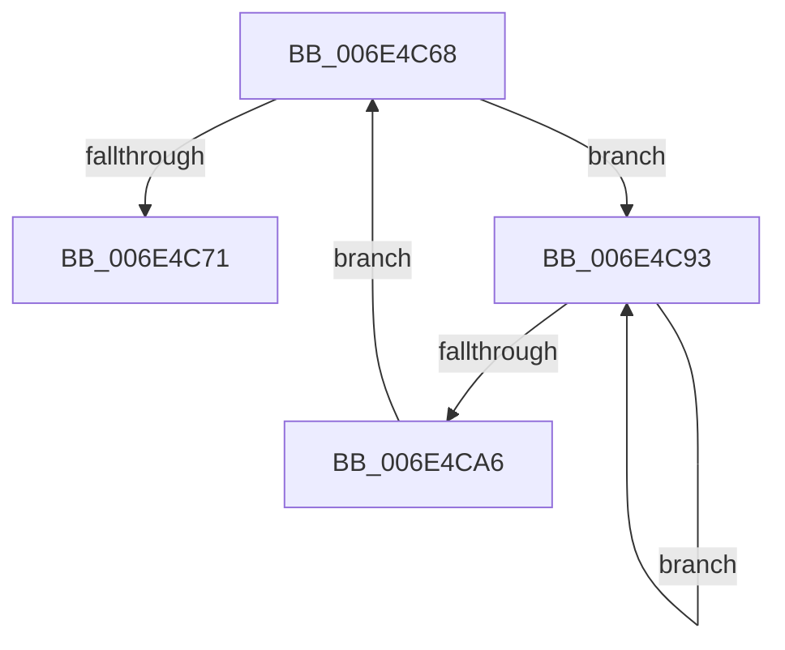

# sub_006E4C68

- RVA: `0x006E4C68`–`0x006E4CA8` (길이 `64` bytes)
- VA: `0x00000001406E4C68`
- 실행 섹션: `.text`
- PDB 이름 있음: `아니요`; PDB Function 태그: `아니요`
- unwind 정보 RVA: `0x0007BD1C`
- 디코드: `15`개 명령, `64/64` bytes 표시
- 미해석 바이트: `0` (있으면 어셈블리에 `.byte`로 보존)

> 이 문서는 커널 이미지의 기계어와 PDB 기호를 분석해 생성했습니다. 4번과 5번은 함수 원형과 자료형을 바이너리 사용 방식에서 추정한 C 해석이며 원본 소스 복구 결과는 아닙니다.

## 1. Dependencies

- 직접 호출 지점: **2**; 고유 호출 대상: **2**
- 직접 호출자로 확인된 함수: **0**
- RIP 상대 이미지 참조: **0**

### Outgoing calls
- `0x006E4C7A` → [MiRemoveSystemImagePage](../48/MiRemoveSystemImagePage_function_0048B398.md) (function, `0x0048B398`)
- `0x006E4C98` → [KeYieldProcessorEx](../3F/KeYieldProcessorEx_function_003FBD00.md) (function, `0x003FBD00`)

### Direct callers
- 이 함수 시작 RVA로 연결되는 직접 call은 확인되지 않았습니다. 간접 호출은 완전히 역산할 수 없습니다.

### Static image references
- 디코드된 RIP-relative 메모리 참조가 없습니다.

## 2. Other-region calls and transfers

- 다른 실행 섹션으로 향하는 call: **0**
- call이 아닌 외부 분기/꼬리 이동: **1**
  - `0x006E4C8E` → [MiMakeDriverPageStayResident + 0x58](../38/MiMakeDriverPageStayResident_function_00385D18.md) (`tail-transfer`)

## 3. Assembly (complete function range)

```asm
006E4C68  F0 48 0F BA 6B 18 3F            lock bts qword ptr [rbx + 0x18], 0x3f
006E4C6F  72 22                           jb 0x1406e4c93
006E4C71  4C 8B C3                        mov r8, rbx
006E4C74  48 8B D7                        mov rdx, rdi
006E4C77  48 8B CE                        mov rcx, rsi
006E4C7A  E8 19 67 DA FF                  call 0x14048b398
006E4C7F  48 B8 FF FF FF FF FF FF FF 7F   movabs rax, 0x7fffffffffffffff
006E4C89  F0 48 21 43 18                  lock and qword ptr [rbx + 0x18], rax
006E4C8E  E9 DD 10 CA FF                  jmp 0x140385d70
006E4C93  48 8D 4C 24 30                  lea rcx, [rsp + 0x30]
006E4C98  E8 63 70 D1 FF                  call 0x1403fbd00
006E4C9D  48 8B 43 18                     mov rax, qword ptr [rbx + 0x18]
006E4CA1  48 85 C0                        test rax, rax
006E4CA4  78 ED                           js 0x1406e4c93
006E4CA6  EB C0                           jmp 0x1406e4c68
```

## 4. C-style interpretation (structured pseudocode)

```c
__int64 __fastcall sub_006E4C68(__int64 a1, __int64 a2, __int64 a3, __int64 a4, __int64 a5, __int64 a6)
{
    __int64 result;

    if (condition_is_below) goto loc_006E4C93;
    result = MiRemoveSystemImagePage(v_rsi, v_rdi, v_rbx, a4);
loc_006E4C93:
    result = KeYieldProcessorEx(a6, v_rdi, v_rbx, a4);
    if (sign_flag) goto loc_006E4C93;
    goto loc_006E4C68;
}
```

## 5. (Beta) C Style

```c
int64_t sub_006E4C68(int64_t Arg1, int64_t Arg2, int64_t Arg3, int64_t Arg4, uint64_t Arg5, int64_t Arg6)
{
    int64_t result;

    if (condition_is_below) goto loc_006E4C93;
    result = MiRemoveSystemImagePage(local_rsi, local_rdi, local_rbx, Arg4);
loc_006E4C93:
    result = KeYieldProcessorEx(Arg6, local_rdi, local_rbx, Arg4);
    if (sign_flag) goto loc_006E4C93;
    goto loc_006E4C68;
}
```

## 6. Execution-region graph

[열기: 2D/3D 그래프와 함수 탐색 컨트롤 패널](../../../control-panel.html?section=text&rva=0x006E4C68&view=graph)

- 2D 그래프는 위에서 아래로 흐르고, 3D 그래프는 빈 공간을 드래그해 회전합니다. Shift+드래그는 이동, 휠은 확대·축소, 함수 노드 선택은 대상 보고서 이동입니다.

### Static fallback


