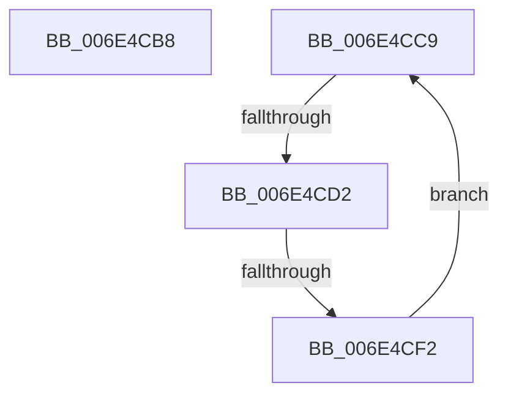

# sub_006E4CB8

- RVA: `0x006E4CB8`–`0x006E4CFD` (길이 `69` bytes)
- VA: `0x00000001406E4CB8`
- 실행 섹션: `.text`
- PDB 이름 있음: `아니요`; PDB Function 태그: `아니요`
- unwind 정보 RVA: `0x0007FC38`
- 디코드: `16`개 명령, `69/69` bytes 표시
- 미해석 바이트: `0` (있으면 어셈블리에 `.byte`로 보존)

> 이 문서는 커널 이미지의 기계어와 PDB 기호를 분석해 생성했습니다. 4번과 5번은 함수 원형과 자료형을 바이너리 사용 방식에서 추정한 C 해석이며 원본 소스 복구 결과는 아닙니다.

## 1. Dependencies

- 직접 호출 지점: **1**; 고유 호출 대상: **1**
- 직접 호출자로 확인된 함수: **0**
- RIP 상대 이미지 참조: **1**

### Outgoing calls
- `0x006E4CE3` → [MiZeroPageWrite](../29/MiZeroPageWrite_function_0029F280.md) (function, `0x0029F280`)

### Direct callers
- 이 함수 시작 RVA로 연결되는 직접 call은 확인되지 않았습니다. 간접 호출은 완전히 역산할 수 없습니다.

### Static image references
- `0x006E4CB8` → RVA `0x00F8F52C` (`.data`; read/write)

## 2. Other-region calls and transfers

- 다른 실행 섹션으로 향하는 call: **0**
- call이 아닌 외부 분기/꼬리 이동: **3**
  - `0x006E4CC4` → [CcZeroDataOnDisk + 0x33](../38/CcZeroDataOnDisk_function_00386B80.md) (`tail-transfer`)
  - `0x006E4CCC` → [CcZeroDataOnDisk + 0x35](../38/CcZeroDataOnDisk_function_00386B80.md) (`tail-transfer`)
  - `0x006E4CEC` → [CcZeroDataOnDisk + 0x5D](../38/CcZeroDataOnDisk_function_00386B80.md) (`tail-transfer`)

## 3. Assembly (complete function range)

```asm
006E4CB8  F0 FF 0D 6D A8 8A 00            lock dec dword ptr [rip + 0x8aa86d]
006E4CBF  BF 00 00 01 00                  mov edi, 0x10000
006E4CC4  E9 EA 1E CA FF                  jmp 0x140386bb3
006E4CC9  83 FE 04                        cmp esi, 4
006E4CCC  0F 83 E3 1E CA FF               jae 0x140386bb5
006E4CD2  44 8B CF                        mov r9d, edi
006E4CD5  48 8D 54 24 48                  lea rdx, [rsp + 0x48]
006E4CDA  41 B8 00 00 00 40               mov r8d, 0x40000000
006E4CE0  49 8B CE                        mov rcx, r14
006E4CE3  E8 98 A5 BB FF                  call 0x14029f280
006E4CE8  8B C8                           mov ecx, eax
006E4CEA  85 C0                           test eax, eax
006E4CEC  0F 88 EB 1E CA FF               js 0x140386bdd
006E4CF2  48 81 EB 00 00 00 40            sub rbx, 0x40000000
006E4CF9  FF C6                           inc esi
006E4CFB  EB CC                           jmp 0x1406e4cc9
```

## 4. C-style interpretation (structured pseudocode)

```c
__int64 __fastcall sub_006E4CB8(void)
{
    unsigned __int64 v_stack_p48;
}
```

## 5. (Beta) C Style

```c
void sub_006E4CB8(void)
{
    uint64_t v_stack_p48;
}
```

## 6. Execution-region graph

[열기: 2D/3D 그래프와 함수 탐색 컨트롤 패널](../../../control-panel.html?section=text&rva=0x006E4CB8&view=graph)

- 2D 그래프는 위에서 아래로 흐르고, 3D 그래프는 빈 공간을 드래그해 회전합니다. Shift+드래그는 이동, 휠은 확대·축소, 함수 노드 선택은 대상 보고서 이동입니다.

### Static fallback


