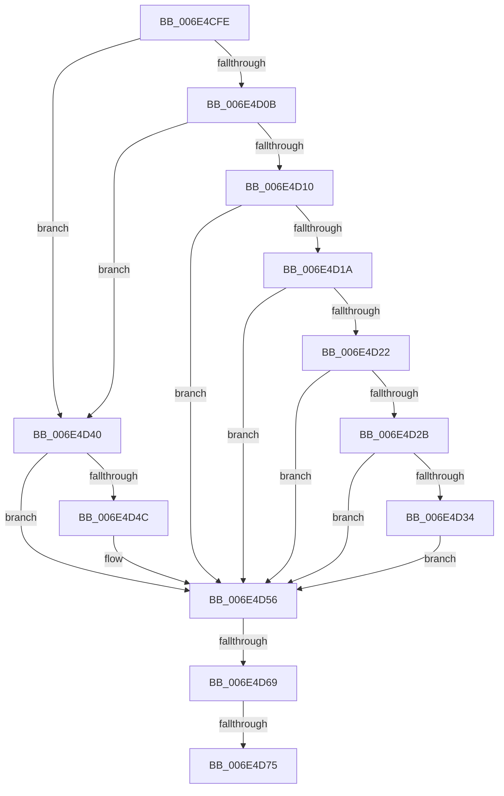

# sub_006E4CFE

- RVA: `0x006E4CFE`–`0x006E4D85` (길이 `135` bytes)
- VA: `0x00000001406E4CFE`
- 실행 섹션: `.text`
- PDB 이름 있음: `아니요`; PDB Function 태그: `아니요`
- unwind 정보 RVA: `0x0007FCA4`
- 디코드: `38`개 명령, `135/135` bytes 표시
- 미해석 바이트: `0` (있으면 어셈블리에 `.byte`로 보존)

> 이 문서는 커널 이미지의 기계어와 PDB 기호를 분석해 생성했습니다. 4번과 5번은 함수 원형과 자료형을 바이너리 사용 방식에서 추정한 C 해석이며 원본 소스 복구 결과는 아닙니다.

## 1. Dependencies

- 직접 호출 지점: **5**; 고유 호출 대상: **4**
- 직접 호출자로 확인된 함수: **0**
- RIP 상대 이미지 참조: **0**

### Outgoing calls
- `0x006E4D39` → [CcAdjustWriteBehindThreadPool](../57/CcAdjustWriteBehindThreadPool_function_0057B684.md) (function, `0x0057B684`)
- `0x006E4D43` → [CcIsWriteBehindThreadpoolAtLowPriority](../35/CcIsWriteBehindThreadpoolAtLowPriority_function_003570DC.md) (function, `0x003570DC`)
- `0x006E4D4E` → [CcAdjustWriteBehindThreadPool](../57/CcAdjustWriteBehindThreadPool_function_0057B684.md) (function, `0x0057B684`)
- `0x006E4D5B` → [KeReleaseInStackQueuedSpinLock](../34/KeReleaseInStackQueuedSpinLock_function_00342CE0.md) (function, `0x00342CE0`)
- `0x006E4D7A` → [CcBoostLowPriorityWorkerThread](../57/CcBoostLowPriorityWorkerThread_function_0057B704.md) (function, `0x0057B704`)

### Direct callers
- 이 함수 시작 RVA로 연결되는 직접 call은 확인되지 않았습니다. 간접 호출은 완전히 역산할 수 없습니다.

### Static image references
- 디코드된 RIP-relative 메모리 참조가 없습니다.

## 2. Other-region calls and transfers

- 다른 실행 섹션으로 향하는 call: **0**
- call이 아닌 외부 분기/꼬리 이동: **3**
  - `0x006E4D63` → [CcAdjustWriteBehindThreadPoolIfNeeded + 0x33](../38/CcAdjustWriteBehindThreadPoolIfNeeded_function_00386D94.md) (`tail-transfer`)
  - `0x006E4D6F` → [CcAdjustWriteBehindThreadPoolIfNeeded + 0x33](../38/CcAdjustWriteBehindThreadPoolIfNeeded_function_00386D94.md) (`tail-transfer`)
  - `0x006E4D80` → [CcAdjustWriteBehindThreadPoolIfNeeded + 0x33](../38/CcAdjustWriteBehindThreadPoolIfNeeded_function_00386D94.md) (`tail-transfer`)

## 3. Assembly (complete function range)

```asm
006E4CFE  48 81 BB 20 04 00 00 00 20 00 00  cmp qword ptr [rbx + 0x420], 0x2000
006E4D09  77 35                           ja 0x1406e4d40
006E4D0B  40 84 ED                        test bpl, bpl
006E4D0E  75 30                           jne 0x1406e4d40
006E4D10  8B 87 BC 00 00 00               mov eax, dword ptr [rdi + 0xbc]
006E4D16  85 C0                           test eax, eax
006E4D18  75 3C                           jne 0x1406e4d56
006E4D1A  39 87 B0 00 00 00               cmp dword ptr [rdi + 0xb0], eax
006E4D20  75 34                           jne 0x1406e4d56
006E4D22  48 8D 47 68                     lea rax, [rdi + 0x68]
006E4D26  48 39 00                        cmp qword ptr [rax], rax
006E4D29  75 2B                           jne 0x1406e4d56
006E4D2B  48 8D 47 78                     lea rax, [rdi + 0x78]
006E4D2F  48 39 00                        cmp qword ptr [rax], rax
006E4D32  75 22                           jne 0x1406e4d56
006E4D34  B2 01                           mov dl, 1
006E4D36  48 8B CB                        mov rcx, rbx
006E4D39  E8 46 69 E9 FF                  call 0x14057b684
006E4D3E  EB 16                           jmp 0x1406e4d56
006E4D40  48 8B CB                        mov rcx, rbx
006E4D43  E8 94 23 C7 FF                  call 0x1403570dc
006E4D48  84 C0                           test al, al
006E4D4A  74 0A                           je 0x1406e4d56
006E4D4C  33 D2                           xor edx, edx
006E4D4E  E8 31 69 E9 FF                  call 0x14057b684
006E4D53  40 B6 01                        mov sil, 1
006E4D56  48 8D 4C 24 20                  lea rcx, [rsp + 0x20]
006E4D5B  E8 80 DF C5 FF                  call 0x140342ce0
006E4D60  40 84 F6                        test sil, sil
006E4D63  0F 84 5E 20 CA FF               je 0x140386dc7
006E4D69  44 0F 20 C0                     mov rax, cr8
006E4D6D  3C 02                           cmp al, 2
006E4D6F  0F 83 52 20 CA FF               jae 0x140386dc7
006E4D75  33 D2                           xor edx, edx
006E4D77  48 8B CB                        mov rcx, rbx
006E4D7A  E8 85 69 E9 FF                  call 0x14057b704
006E4D7F  90                              nop
006E4D80  E9 42 20 CA FF                  jmp 0x140386dc7
```

## 4. C-style interpretation (structured pseudocode)

```c
__int64 __fastcall sub_006E4CFE(void)
{
    __int64 result;
    __int64 v_rsi;
    unsigned __int64 v_stack_p20;

    if ((*(unsigned __int64 *)(v_rbx + 1056)) > 0x2000ULL) goto loc_006E4D40;
    if ((unsigned __int8)(v_rbp) != 0) goto loc_006E4D40;
    if ((unsigned int)((unsigned int)(*(unsigned int *)(v_rdi + 188))) != 0) goto loc_006E4D56;
    if ((*(unsigned int *)(v_rdi + 176)) != ((unsigned int)((unsigned int)(*(unsigned int *)(v_rdi + 188))))) goto loc_006E4D56;
    if ((*(unsigned __int64 *)(v_rdi + 104)) != (v_rdi + 104)) goto loc_006E4D56;
    if ((*(unsigned __int64 *)(v_rdi + 120)) != (v_rdi + 120)) goto loc_006E4D56;
    result = CcAdjustWriteBehindThreadPool(v_rbx, 1, a3, a4);
    goto loc_006E4D56;
loc_006E4D40:
    result = CcIsWriteBehindThreadpoolAtLowPriority(v_rbx, 1, a3, a4);
    if ((unsigned __int8)(result) != 0) {
        a2 = 0;
        result = CcAdjustWriteBehindThreadPool(v_rbx, a2, a3, a4);
        v_rsi = 1;
    }
    result = KeReleaseInStackQueuedSpinLock(v_stack_p20, a2, a3, a4);
    a2 = 0;
    result = CcBoostLowPriorityWorkerThread(v_rbx, a2, a3, a4);
}
```

## 5. (Beta) C Style

```c
void sub_006E4CFE(void)
{
    int64_t result;
    int64_t local_rsi;
    uint64_t v_stack_p20;

    if ((*(uint64_t *)(local_rbx + 0x420)) > 0x2000ULL) goto loc_006E4D40;
    if ((uint8_t)(local_rbp) != 0) goto loc_006E4D40;
    if ((uint32_t)((uint32_t)(*(uint32_t *)(local_rdi + 0xBC))) != 0) goto loc_006E4D56;
    if ((*(uint32_t *)(local_rdi + 0xB0)) != ((uint32_t)((uint32_t)(*(uint32_t *)(local_rdi + 0xBC))))) goto loc_006E4D56;
    if ((*(uint64_t *)(local_rdi + 0x68)) != (local_rdi + 104)) goto loc_006E4D56;
    if ((*(uint64_t *)(local_rdi + 0x78)) != (local_rdi + 120)) goto loc_006E4D56;
    result = CcAdjustWriteBehindThreadPool(local_rbx, 1, a3, a4);
    goto loc_006E4D56;
loc_006E4D40:
    result = CcIsWriteBehindThreadpoolAtLowPriority(local_rbx, 1, a3, a4);
    if ((uint8_t)(result) != 0) {
        a2 = 0;
        result = CcAdjustWriteBehindThreadPool(local_rbx, a2, a3, a4);
        local_rsi = 1;
    }
    result = KeReleaseInStackQueuedSpinLock(v_stack_p20, a2, a3, a4);
    a2 = 0;
    result = CcBoostLowPriorityWorkerThread(local_rbx, a2, a3, a4);
}
```

## 6. Execution-region graph

[열기: 2D/3D 그래프와 함수 탐색 컨트롤 패널](../../../control-panel.html?section=text&rva=0x006E4CFE&view=graph)

- 2D 그래프는 위에서 아래로 흐르고, 3D 그래프는 빈 공간을 드래그해 회전합니다. Shift+드래그는 이동, 휠은 확대·축소, 함수 노드 선택은 대상 보고서 이동입니다.

### Static fallback


