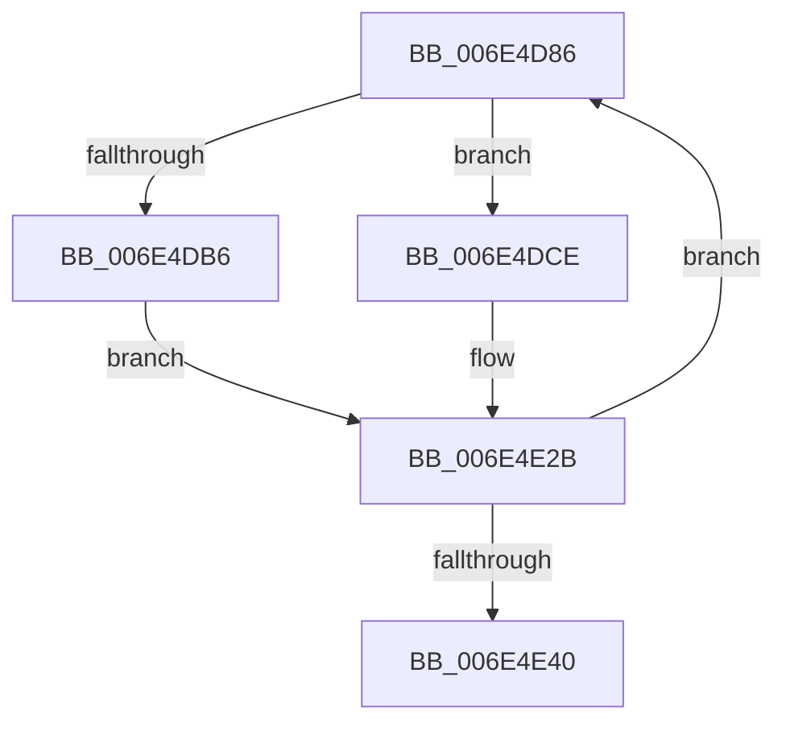

# sub_006E4D86

- RVA: `0x006E4D86`–`0x006E4E45` (길이 `191` bytes)
- VA: `0x00000001406E4D86`
- 실행 섹션: `.text`
- PDB 이름 있음: `아니요`; PDB Function 태그: `아니요`
- unwind 정보 RVA: `0x0007FD0C`
- 디코드: `44`개 명령, `191/191` bytes 표시
- 미해석 바이트: `0` (있으면 어셈블리에 `.byte`로 보존)

> 이 문서는 커널 이미지의 기계어와 PDB 기호를 분석해 생성했습니다. 4번과 5번은 함수 원형과 자료형을 바이너리 사용 방식에서 추정한 C 해석이며 원본 소스 복구 결과는 아닙니다.

## 1. Dependencies

- 직접 호출 지점: **9**; 고유 호출 대상: **8**
- 직접 호출자로 확인된 함수: **0**
- RIP 상대 이미지 참조: **4**

### Outgoing calls
- `0x006E4D94` → [KxReleaseSpinLock](../20/KxReleaseSpinLock_function_00206670.md) (function, `0x00206670`)
- `0x006E4D9C` → [KeAcquireQueuedSpinLock](../27/KeAcquireQueuedSpinLock_function_00273D80.md) (function, `0x00273D80`)
- `0x006E4DB6` → [KeReleaseQueuedSpinLock](../27/KeReleaseQueuedSpinLock_function_00272540.md) (function, `0x00272540`)
- `0x006E4DCE` → [KeReleaseQueuedSpinLock](../27/KeReleaseQueuedSpinLock_function_00272540.md) (function, `0x00272540`)
- `0x006E4DDD` → [KeReleaseSpinLock](../39/KeReleaseSpinLock_function_00392BA0.md) (function, `0x00392BA0`)
- `0x006E4E08` → [FsRtlCompleteLockIrpReal](../49/FsRtlCompleteLockIrpReal_function_004973AC.md) (function, `0x004973AC`)
- `0x006E4E17` → [ExFreeToNPagedLookasideList](../38/ExFreeToNPagedLookasideList_function_0038D9D0.md) (function, `0x0038D9D0`)
- `0x006E4E23` → [KeAcquireSpinLockRaiseToDpc](../20/KeAcquireSpinLockRaiseToDpc_function_00208470.md) (function, `0x00208470`)
- `0x006E4E2E` → [KeAcquireSpinLockAtDpcLevel](../20/KeAcquireSpinLockAtDpcLevel_function_00208430.md) (function, `0x00208430`)

### Direct callers
- 이 함수 시작 RVA로 연결되는 직접 call은 확인되지 않았습니다. 간접 호출은 완전히 역산할 수 없습니다.

### Static image references
- `0x006E4DBB` → RVA `0x00F8F0E0` (`.data`; read)
- `0x006E4DC5` → RVA `0x00F8F0E0` (`.data`; write)
- `0x006E4DD6` → RVA `0x00F8F0D8` (`.data`; read)
- `0x006E4E10` → RVA `0x00E12000` (`.data`; read)

## 2. Other-region calls and transfers

- 다른 실행 섹션으로 향하는 call: **0**
- call이 아닌 외부 분기/꼬리 이동: **1**
  - `0x006E4E40` → [FsRtlUninitializeFileLock + 0x7A](../38/FsRtlUninitializeFileLock_function_00386F50.md) (`tail-transfer`)

## 3. Assembly (complete function range)

```asm
006E4D86  48 8B 07                        mov rax, qword ptr [rdi]
006E4D89  48 8B CD                        mov rcx, rbp
006E4D8C  48 89 43 30                     mov qword ptr [rbx + 0x30], rax
006E4D90  48 8B 77 18                     mov rsi, qword ptr [rdi + 0x18]
006E4D94  E8 D7 18 B2 FF                  call 0x140206670
006E4D99  49 8B CE                        mov rcx, r14
006E4D9C  E8 DF EF B8 FF                  call 0x140273d80
006E4DA1  88 46 45                        mov byte ptr [rsi + 0x45], al
006E4DA4  49 8B CE                        mov rcx, r14
006E4DA7  33 C0                           xor eax, eax
006E4DA9  48 87 46 68                     xchg qword ptr [rsi + 0x68], rax
006E4DAD  80 7E 44 00                     cmp byte ptr [rsi + 0x44], 0
006E4DB1  8A 56 45                        mov dl, byte ptr [rsi + 0x45]
006E4DB4  74 18                           je 0x1406e4dce
006E4DB6  E8 85 D7 B8 FF                  call 0x140272540
006E4DBB  48 8B 05 1E A3 8A 00            mov rax, qword ptr [rip + 0x8aa31e]
006E4DC2  48 89 07                        mov qword ptr [rdi], rax
006E4DC5  48 89 3D 14 A3 8A 00            mov qword ptr [rip + 0x8aa314], rdi
006E4DCC  EB 5D                           jmp 0x1406e4e2b
006E4DCE  E8 6D D7 B8 FF                  call 0x140272540
006E4DD3  41 8A D4                        mov dl, r12b
006E4DD6  48 8D 0D FB A2 8A 00            lea rcx, [rip + 0x8aa2fb]
006E4DDD  E8 BE DD CA FF                  call 0x140392ba0
006E4DE2  48 83 66 38 00                  and qword ptr [rsi + 0x38], 0
006E4DE7  48 8D 44 24 60                  lea rax, [rsp + 0x60]
006E4DEC  48 83 64 24 28 00               and qword ptr [rsp + 0x28], 0
006E4DF2  41 B9 7E 00 00 C0               mov r9d, 0xc000007e
006E4DF8  48 8B 57 10                     mov rdx, qword ptr [rdi + 0x10]
006E4DFC  4C 8B C6                        mov r8, rsi
006E4DFF  48 8B 4B 08                     mov rcx, qword ptr [rbx + 8]
006E4E03  48 89 44 24 20                  mov qword ptr [rsp + 0x20], rax
006E4E08  E8 9F 25 DB FF                  call 0x1404973ac
006E4E0D  48 8B D7                        mov rdx, rdi
006E4E10  48 8D 0D E9 D1 72 00            lea rcx, [rip + 0x72d1e9]
006E4E17  E8 B4 8B CA FF                  call 0x14038d9d0
006E4E1C  48 8D 0D B5 A2 8A 00            lea rcx, [rip + 0x8aa2b5]
006E4E23  E8 48 36 B2 FF                  call 0x140208470
006E4E28  44 8A E0                        mov r12b, al
006E4E2B  48 8B CD                        mov rcx, rbp
006E4E2E  E8 FD 35 B2 FF                  call 0x140208430
006E4E33  48 8B 7B 30                     mov rdi, qword ptr [rbx + 0x30]
006E4E37  48 85 FF                        test rdi, rdi
006E4E3A  0F 85 46 FF FF FF               jne 0x1406e4d86
006E4E40  E9 85 21 CA FF                  jmp 0x140386fca
```

## 4. C-style interpretation (structured pseudocode)

```c
__int64 __fastcall sub_006E4D86(__int64 a1, __int64 a2, __int64 a3, __int64 a4, __int64 a5, __int64 a6, __int64 a7, __int64 a8, __int64 a9, __int64 a10, __int64 a11, __int64 a12)
{
    __int64 result;
    unsigned __int64 v_stack_p20;

    *(unsigned __int64 *)(v_rbx + 48) = *(unsigned __int64 *)(v_rdi);
    result = KxReleaseSpinLock(v_rbp, a2, a3, a4);
    result = KeAcquireQueuedSpinLock(v_r14, a2, a3, a4);
    *(unsigned __int8 *)(*(unsigned __int64 *)(v_rdi + 24) + 69) = (unsigned __int8)(result);
    result = 0;
    if ((*(unsigned __int8 *)(*(unsigned __int64 *)(v_rdi + 24) + 68)) == 0) goto loc_006E4DCE;
    result = KeReleaseQueuedSpinLock(v_r14, *(unsigned __int8 *)(*(unsigned __int64 *)(v_rdi + 24) + 69), a3, a4);
    *(unsigned __int64 *)(v_rdi) = *(unsigned __int64 *)(v_rip + 9085726);
    *(unsigned __int64 *)(v_rip + 9085716) = v_rdi;
    goto loc_006E4E2B;
loc_006E4DCE:
    result = KeReleaseQueuedSpinLock(v_r14, *(unsigned __int8 *)(*(unsigned __int64 *)(v_rdi + 24) + 69), a3, a4);
    result = KeReleaseSpinLock(v_rip + 9085691, (unsigned __int8)(v_r12), a3, a4);
    v_stack_p20 = a12;
    result = FsRtlCompleteLockIrpReal(*(unsigned __int64 *)(v_rbx + 8), *(unsigned __int64 *)(v_rdi + 16), *(unsigned __int64 *)(v_rdi + 24), (unsigned int)(0xC000007EULL));
    result = ExFreeToNPagedLookasideList(v_rip + 7524841, v_rdi, *(unsigned __int64 *)(v_rdi + 24), (unsigned int)(0xC000007EULL));
    result = KeAcquireSpinLockRaiseToDpc(v_rip + 9085621, v_rdi, *(unsigned __int64 *)(v_rdi + 24), (unsigned int)(0xC000007EULL));
loc_006E4E2B:
    result = KeAcquireSpinLockAtDpcLevel(v_rbp, v_rdi, *(unsigned __int64 *)(v_rdi + 24), (unsigned int)(0xC000007EULL));
    if (*(unsigned __int64 *)(v_rbx + 48) != 0) goto loc_006E4D86;
}
```

## 5. (Beta) C Style

```c
int64_t sub_006E4D86(int64_t Arg1, int64_t Arg2, int64_t Arg3, int64_t Arg4, int64_t Arg5, uint64_t Arg6, uint64_t Arg7, uint64_t Arg8, uint64_t Arg9, uint64_t Arg10, uint64_t Arg11, int64_t Arg12)
{
    int64_t result;
    uint64_t v_stack_p20;

    *(uint64_t *)(local_rbx + 0x30) = *(uint64_t *)(local_rdi);
    result = KxReleaseSpinLock(local_rbp, Arg2, Arg3, Arg4);
    result = KeAcquireQueuedSpinLock(local_r14, Arg2, Arg3, Arg4);
    *(uint8_t *)(*(uint64_t *)(local_rdi + 0x18) + 0x45) = (uint8_t)(result);
    result = 0;
    if ((*(uint8_t *)(*(uint64_t *)(local_rdi + 0x18) + 0x44)) == 0) goto loc_006E4DCE;
    result = KeReleaseQueuedSpinLock(local_r14, *(uint8_t *)(*(uint64_t *)(local_rdi + 0x18) + 0x45), Arg3, Arg4);
    *(uint64_t *)(local_rdi) = *(uint64_t *)(v_rip + 0x8AA31E);
    *(uint64_t *)(v_rip + 0x8AA314) = local_rdi;
    goto loc_006E4E2B;
loc_006E4DCE:
    result = KeReleaseQueuedSpinLock(local_r14, *(uint8_t *)(*(uint64_t *)(local_rdi + 0x18) + 0x45), Arg3, Arg4);
    result = KeReleaseSpinLock(v_rip + 9085691, (uint8_t)(local_r12), Arg3, Arg4);
    v_stack_p20 = Arg12;
    result = FsRtlCompleteLockIrpReal(*(uint64_t *)(local_rbx + 0x8), *(uint64_t *)(local_rdi + 0x10), *(uint64_t *)(local_rdi + 0x18), (uint32_t)(0xC000007EULL));
    result = ExFreeToNPagedLookasideList(v_rip + 7524841, local_rdi, *(uint64_t *)(local_rdi + 0x18), (uint32_t)(0xC000007EULL));
    result = KeAcquireSpinLockRaiseToDpc(v_rip + 9085621, local_rdi, *(uint64_t *)(local_rdi + 0x18), (uint32_t)(0xC000007EULL));
loc_006E4E2B:
    result = KeAcquireSpinLockAtDpcLevel(local_rbp, local_rdi, *(uint64_t *)(local_rdi + 0x18), (uint32_t)(0xC000007EULL));
    if (*(uint64_t *)(local_rbx + 0x30) != 0) goto loc_006E4D86;
}
```

## 6. Execution-region graph

[열기: 2D/3D 그래프와 함수 탐색 컨트롤 패널](../../../control-panel.html?section=text&rva=0x006E4D86&view=graph)

- 2D 그래프는 위에서 아래로 흐르고, 3D 그래프는 빈 공간을 드래그해 회전합니다. Shift+드래그는 이동, 휠은 확대·축소, 함수 노드 선택은 대상 보고서 이동입니다.

### Static fallback


