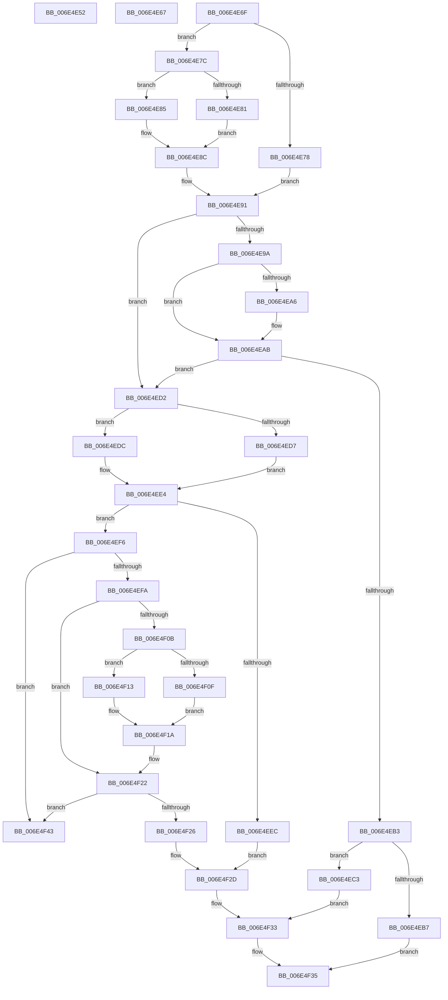

# sub_006E4E52

- RVA: `0x006E4E52`–`0x006E4F4D` (길이 `251` bytes)
- VA: `0x00000001406E4E52`
- 실행 섹션: `.text`
- PDB 이름 있음: `아니요`; PDB Function 태그: `아니요`
- unwind 정보 RVA: `0x0007FDC0`
- 디코드: `82`개 명령, `251/251` bytes 표시
- 미해석 바이트: `0` (있으면 어셈블리에 `.byte`로 보존)

> 이 문서는 커널 이미지의 기계어와 PDB 기호를 분석해 생성했습니다. 4번과 5번은 함수 원형과 자료형을 바이너리 사용 방식에서 추정한 C 해석이며 원본 소스 복구 결과는 아닙니다.

## 1. Dependencies

- 직접 호출 지점: **1**; 고유 호출 대상: **1**
- 직접 호출자로 확인된 함수: **0**
- RIP 상대 이미지 참조: **0**

### Outgoing calls
- `0x006E4F38` → [FsRtlRemoveLargeEntry](../38/FsRtlRemoveLargeEntry_function_00387EA0.md) (function, `0x00387EA0`)

### Direct callers
- 이 함수 시작 RVA로 연결되는 직접 call은 확인되지 않았습니다. 간접 호출은 완전히 역산할 수 없습니다.

### Static image references
- 디코드된 RIP-relative 메모리 참조가 없습니다.

## 2. Other-region calls and transfers

- 다른 실행 섹션으로 향하는 call: **0**
- call이 아닌 외부 분기/꼬리 이동: **4**
  - `0x006E4E62` → [sub_00387740 + 0x386](../38/Unknown_function_00387740.md) (`tail-transfer`)
  - `0x006E4E6A` → [sub_003875A6 + 0x178](../38/Unknown_function_003875A6.md) (`tail-transfer`)
  - `0x006E4F3E` → [sub_003875A6 + 0x178](../38/Unknown_function_003875A6.md) (`tail-transfer`)
  - `0x006E4F48` → [sub_003875A6 + 0x178](../38/Unknown_function_003875A6.md) (`tail-transfer`)

## 3. Assembly (complete function range)

```asm
006E4E52  8D 46 FE                        lea eax, [rsi - 2]
006E4E55  41 8B 04 C3                     mov eax, dword ptr [r11 + rax*8]
006E4E59  45 8B D0                        mov r10d, r8d
006E4E5C  44 2B D0                        sub r10d, eax
006E4E5F  44 03 12                        add r10d, dword ptr [rdx]
006E4E62  E9 5F 2C CA FF                  jmp 0x140387ac6
006E4E67  44 01 2A                        add dword ptr [rdx], r13d
006E4E6A  E9 AF 28 CA FF                  jmp 0x14038771e
006E4E6F  41 8B 52 04                     mov edx, dword ptr [r10 + 4]
006E4E73  41 3B D4                        cmp edx, r12d
006E4E76  75 04                           jne 0x1406e4e7c
006E4E78  8B D5                           mov edx, ebp
006E4E7A  EB 15                           jmp 0x1406e4e91
006E4E7C  45 85 C9                        test r9d, r9d
006E4E7F  75 04                           jne 0x1406e4e85
006E4E81  8B C5                           mov eax, ebp
006E4E83  EB 07                           jmp 0x1406e4e8c
006E4E85  8D 46 FE                        lea eax, [rsi - 2]
006E4E88  41 8B 04 C3                     mov eax, dword ptr [r11 + rax*8]
006E4E8C  2B D0                           sub edx, eax
006E4E8E  41 03 12                        add edx, dword ptr [r10]
006E4E91  48 8B 5C 24 70                  mov rbx, qword ptr [rsp + 0x70]
006E4E96  3B D3                           cmp edx, ebx
006E4E98  75 38                           jne 0x1406e4ed2
006E4E9A  8D 4E 01                        lea ecx, [rsi + 1]
006E4E9D  41 8B D4                        mov edx, r12d
006E4EA0  3B 74 24 60                     cmp esi, dword ptr [rsp + 0x60]
006E4EA4  73 05                           jae 0x1406e4eab
006E4EA6  41 8B 54 CB 04                  mov edx, dword ptr [r11 + rcx*8 + 4]
006E4EAB  42 8D 04 2B                     lea eax, [rbx + r13]
006E4EAF  3B D0                           cmp edx, eax
006E4EB1  75 1F                           jne 0x1406e4ed2
006E4EB3  85 F6                           test esi, esi
006E4EB5  75 0C                           jne 0x1406e4ec3
006E4EB7  41 89 5B 0C                     mov dword ptr [r11 + 0xc], ebx
006E4EBB  44 8D 46 01                     lea r8d, [rsi + 1]
006E4EBF  33 D2                           xor edx, edx
006E4EC1  EB 72                           jmp 0x1406e4f35
006E4EC3  41 8B 0C CB                     mov ecx, dword ptr [r11 + rcx*8]
006E4EC7  41 B8 02 00 00 00               mov r8d, 2
006E4ECD  41 89 0A                        mov dword ptr [r10], ecx
006E4ED0  EB 61                           jmp 0x1406e4f33
006E4ED2  41 3B F7                        cmp esi, r15d
006E4ED5  72 05                           jb 0x1406e4edc
006E4ED7  41 8B CC                        mov ecx, r12d
006E4EDA  EB 08                           jmp 0x1406e4ee4
006E4EDC  8D 46 01                        lea eax, [rsi + 1]
006E4EDF  41 8B 4C C3 04                  mov ecx, dword ptr [r11 + rax*8 + 4]
006E4EE4  42 8D 04 2B                     lea eax, [rbx + r13]
006E4EE8  3B C8                           cmp ecx, eax
006E4EEA  75 0A                           jne 0x1406e4ef6
006E4EEC  8D 46 01                        lea eax, [rsi + 1]
006E4EEF  41 89 5C C3 04                  mov dword ptr [r11 + rax*8 + 4], ebx
006E4EF4  EB 37                           jmp 0x1406e4f2d
006E4EF6  85 F6                           test esi, esi
006E4EF8  74 49                           je 0x1406e4f43
006E4EFA  8D 4E FF                        lea ecx, [rsi - 1]
006E4EFD  45 8B 4C CB 04                  mov r9d, dword ptr [r11 + rcx*8 + 4]
006E4F02  4D 8D 04 CB                     lea r8, [r11 + rcx*8]
006E4F06  45 3B CC                        cmp r9d, r12d
006E4F09  74 17                           je 0x1406e4f22
006E4F0B  85 C9                           test ecx, ecx
006E4F0D  75 04                           jne 0x1406e4f13
006E4F0F  8B C5                           mov eax, ebp
006E4F11  EB 07                           jmp 0x1406e4f1a
006E4F13  8D 46 FE                        lea eax, [rsi - 2]
006E4F16  41 8B 04 C3                     mov eax, dword ptr [r11 + rax*8]
006E4F1A  41 8B 28                        mov ebp, dword ptr [r8]
006E4F1D  2B E8                           sub ebp, eax
006E4F1F  41 03 E9                        add ebp, r9d
006E4F22  3B EB                           cmp ebp, ebx
006E4F24  75 1D                           jne 0x1406e4f43
006E4F26  41 8B 0C F3                     mov ecx, dword ptr [r11 + rsi*8]
006E4F2A  41 89 08                        mov dword ptr [r8], ecx
006E4F2D  41 B8 01 00 00 00               mov r8d, 1
006E4F33  8B D6                           mov edx, esi
006E4F35  48 8B CF                        mov rcx, rdi
006E4F38  E8 63 2F CA FF                  call 0x140387ea0
006E4F3D  90                              nop
006E4F3E  E9 DB 27 CA FF                  jmp 0x14038771e
006E4F43  41 89 5C F3 04                  mov dword ptr [r11 + rsi*8 + 4], ebx
006E4F48  E9 D1 27 CA FF                  jmp 0x14038771e
```

## 4. C-style interpretation (structured pseudocode)

```c
__int64 __fastcall sub_006E4E52(__int64 a1, __int64 a2, int a3, int a4)
{
    __int64 v_r10;
    unsigned int v_stack_p60;
    unsigned __int64 v_stack_p70;

    v_r10 = (unsigned int)(((unsigned int)(a3)) - ((unsigned int)((unsigned int)(*(unsigned int *)(v_r11 + v_rsi - 2 * 8)))));
    v_r10 = (unsigned int)((v_r10) + (*(unsigned int *)(a2)));
}
```

## 5. (Beta) C Style

```c
int64_t sub_006E4E52(int64_t Arg1, void *Arg2, int32_t Arg3, int32_t Arg4)
{
    uint8_t *arg2 = (uint8_t *)Arg2;

    int64_t local_r10;
    uint32_t v_stack_p60;
    uint64_t v_stack_p70;

    local_r10 = (uint32_t)(((uint32_t)(Arg3)) - ((uint32_t)((uint32_t)(*(uint32_t *)(local_r11 + local_rsi - 0x2 * 8)))));
    local_r10 = (uint32_t)((local_r10) + (*(uint32_t *)(arg2)));
}
```

### 관측된 메모리 오프셋

구조체 형식이 확인되지 않은 접근은 인자 기준의 오프셋으로만 기록했습니다.

| 기준 인자 | 오프셋 표현 | 폭 (bit) | 접근 |
|---|---:|---:|---|
| `Arg2` | `+ 0x0` | `32` | `R` |

## 6. Execution-region graph

[열기: 2D/3D 그래프와 함수 탐색 컨트롤 패널](../../../control-panel.html?section=text&rva=0x006E4E52&view=graph)

- 2D 그래프는 위에서 아래로 흐르고, 3D 그래프는 빈 공간을 드래그해 회전합니다. Shift+드래그는 이동, 휠은 확대·축소, 함수 노드 선택은 대상 보고서 이동입니다.

### Static fallback


