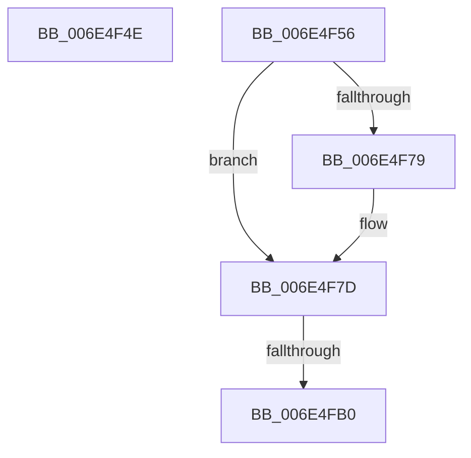

# sub_006E4F4E

- RVA: `0x006E4F4E`–`0x006E4FB9` (길이 `107` bytes)
- VA: `0x00000001406E4F4E`
- 실행 섹션: `.text`
- PDB 이름 있음: `아니요`; PDB Function 태그: `아니요`
- unwind 정보 RVA: `0x0007FE70`
- 디코드: `28`개 명령, `107/107` bytes 표시
- 미해석 바이트: `0` (있으면 어셈블리에 `.byte`로 보존)

> 이 문서는 커널 이미지의 기계어와 PDB 기호를 분석해 생성했습니다. 4번과 5번은 함수 원형과 자료형을 바이너리 사용 방식에서 추정한 C 해석이며 원본 소스 복구 결과는 아닙니다.

## 1. Dependencies

- 직접 호출 지점: **5**; 고유 호출 대상: **5**
- 직접 호출자로 확인된 함수: **0**
- RIP 상대 이미지 참조: **0**

### Outgoing calls
- `0x006E4F5D` → [KeAcquireInStackQueuedSpinLock](../27/KeAcquireInStackQueuedSpinLock_function_002757A0.md) (function, `0x002757A0`)
- `0x006E4F6E` → [CcScheduleLazyWriteScan](../3C/CcScheduleLazyWriteScan_function_003CBD20.md) (function, `0x003CBD20`)
- `0x006E4F81` → [KeReleaseInStackQueuedSpinLock](../34/KeReleaseInStackQueuedSpinLock_function_00342CE0.md) (function, `0x00342CE0`)
- `0x006E4F8C` → [CcPostDeferredWrites](../35/CcPostDeferredWrites_function_003590FC.md) (function, `0x003590FC`)
- `0x006E4FA3` → [KeWaitForSingleObject](../20/KeWaitForSingleObject_function_0020E6B0.md) (function, `0x0020E6B0`)

### Direct callers
- 이 함수 시작 RVA로 연결되는 직접 call은 확인되지 않았습니다. 간접 호출은 완전히 역산할 수 없습니다.

### Static image references
- 디코드된 RIP-relative 메모리 참조가 없습니다.

## 2. Other-region calls and transfers

- 다른 실행 섹션으로 향하는 call: **0**
- call이 아닌 외부 분기/꼬리 이동: **3**
  - `0x006E4F51` → [CcCanIWrite + 0x1DF](../38/CcCanIWrite_function_00388250.md) (`tail-transfer`)
  - `0x006E4FAA` → [CcCanIWrite + 0x417](../38/CcCanIWrite_function_00388250.md) (`tail-transfer`)
  - `0x006E4FB4` → [CcCanIWrite + 0x1DF](../38/CcCanIWrite_function_00388250.md) (`tail-transfer`)

## 3. Assembly (complete function range)

```asm
006E4F4E  41 8A DF                        mov bl, r15b
006E4F51  E9 D9 34 CA FF                  jmp 0x14038842f
006E4F56  48 8D 55 88                     lea rdx, [rbp - 0x78]
006E4F5A  49 8B CF                        mov rcx, r15
006E4F5D  E8 3E 08 B9 FF                  call 0x1402757a0
006E4F62  45 33 C9                        xor r9d, r9d
006E4F65  44 8A C3                        mov r8b, bl
006E4F68  48 8B D6                        mov rdx, rsi
006E4F6B  48 8B CF                        mov rcx, rdi
006E4F6E  E8 AD 6D CE FF                  call 0x1403cbd20
006E4F73  41 80 3E 00                     cmp byte ptr [r14], 0
006E4F77  74 04                           je 0x1406e4f7d
006E4F79  41 C6 06 00                     mov byte ptr [r14], 0
006E4F7D  48 8D 4D 88                     lea rcx, [rbp - 0x78]
006E4F81  E8 5A DD C5 FF                  call 0x140342ce0
006E4F86  48 8B D6                        mov rdx, rsi
006E4F89  48 8B CF                        mov rcx, rdi
006E4F8C  E8 6B 41 C7 FF                  call 0x1403590fc
006E4F91  45 33 C9                        xor r9d, r9d
006E4F94  4C 89 6C 24 20                  mov qword ptr [rsp + 0x20], r13
006E4F99  45 33 C0                        xor r8d, r8d
006E4F9C  48 8D 4C 24 60                  lea rcx, [rsp + 0x60]
006E4FA1  33 D2                           xor edx, edx
006E4FA3  E8 08 97 B2 FF                  call 0x14020e6b0
006E4FA8  85 C0                           test eax, eax
006E4FAA  0F 85 B7 36 CA FF               jne 0x140388667
006E4FB0  4C 8B 75 80                     mov r14, qword ptr [rbp - 0x80]
006E4FB4  E9 76 34 CA FF                  jmp 0x14038842f
```

## 4. C-style interpretation (structured pseudocode)

```c
__int64 __fastcall sub_006E4F4E(__int64 a1, __int64 a2, __int64 a3, int a4)
{
    unsigned __int64 v_stack_p20;
    unsigned __int64 v_stack_p60;
}
```

## 5. (Beta) C Style

```c
int64_t sub_006E4F4E(int64_t Arg1, int64_t Arg2, int64_t Arg3, int32_t Arg4)
{
    uint64_t v_stack_p20;
    uint64_t v_stack_p60;
}
```

## 6. Execution-region graph

[열기: 2D/3D 그래프와 함수 탐색 컨트롤 패널](../../../control-panel.html?section=text&rva=0x006E4F4E&view=graph)

- 2D 그래프는 위에서 아래로 흐르고, 3D 그래프는 빈 공간을 드래그해 회전합니다. Shift+드래그는 이동, 휠은 확대·축소, 함수 노드 선택은 대상 보고서 이동입니다.

### Static fallback


