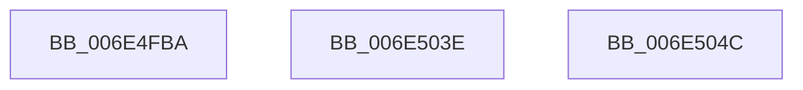

# sub_006E4FBA

- RVA: `0x006E4FBA`–`0x006E5061` (길이 `167` bytes)
- VA: `0x00000001406E4FBA`
- 실행 섹션: `.text`
- PDB 이름 있음: `아니요`; PDB Function 태그: `아니요`
- unwind 정보 RVA: `0x0007FEBC`
- 디코드: `32`개 명령, `167/167` bytes 표시
- 미해석 바이트: `0` (있으면 어셈블리에 `.byte`로 보존)

> 이 문서는 커널 이미지의 기계어와 PDB 기호를 분석해 생성했습니다. 4번과 5번은 함수 원형과 자료형을 바이너리 사용 방식에서 추정한 C 해석이며 원본 소스 복구 결과는 아닙니다.

## 1. Dependencies

- 직접 호출 지점: **2**; 고유 호출 대상: **2**
- 직접 호출자로 확인된 함수: **0**
- RIP 상대 이미지 참조: **1**

### Outgoing calls
- `0x006E5033` → [CcPerfLogLazyWriteScan](../4A/CcPerfLogLazyWriteScan_function_004ABD64.md) (function, `0x004ABD64`)
- `0x006E5053` → [CcPostWorkQueueAsyncLazywrite](../4B/CcPostWorkQueueAsyncLazywrite_function_004BA17C.md) (function, `0x004BA17C`)

### Direct callers
- 이 함수 시작 RVA로 연결되는 직접 call은 확인되지 않았습니다. 간접 호출은 완전히 역산할 수 없습니다.

### Static image references
- `0x006E4FBE` → RVA `0x00E65B8C` (`.data`; read)

## 2. Other-region calls and transfers

- 다른 실행 섹션으로 향하는 call: **0**
- call이 아닌 외부 분기/꼬리 이동: **3**
  - `0x006E5039` → [CcLazyWriteScanVolume + 0x1B4](../38/CcLazyWriteScanVolume_function_00388DC0.md) (`tail-transfer`)
  - `0x006E5047` → [CcLazyWriteScanVolume + 0x2B3](../38/CcLazyWriteScanVolume_function_00388DC0.md) (`tail-transfer`)
  - `0x006E505C` → [CcLazyWriteScanVolume + 0x3D4](../38/CcLazyWriteScanVolume_function_00388DC0.md) (`tail-transfer`)

## 3. Assembly (complete function range)

```asm
006E4FBA  49 8B 47 08                     mov rax, qword ptr [r15 + 8]
006E4FBE  8B 0D C8 0B 78 00               mov ecx, dword ptr [rip + 0x780bc8]
006E4FC4  4C 8B 8F E0 03 00 00            mov r9, qword ptr [rdi + 0x3e0]
006E4FCB  44 8B 87 90 03 00 00            mov r8d, dword ptr [rdi + 0x390]
006E4FD2  48 8B 10                        mov rdx, qword ptr [rax]
006E4FD5  8B 87 C0 02 00 00               mov eax, dword ptr [rdi + 0x2c0]
006E4FDB  48 89 44 24 58                  mov qword ptr [rsp + 0x58], rax
006E4FE0  48 8B 87 40 04 00 00            mov rax, qword ptr [rdi + 0x440]
006E4FE7  48 89 44 24 50                  mov qword ptr [rsp + 0x50], rax
006E4FEC  48 8B 87 38 04 00 00            mov rax, qword ptr [rdi + 0x438]
006E4FF3  48 89 44 24 48                  mov qword ptr [rsp + 0x48], rax
006E4FF8  48 8B 87 08 04 00 00            mov rax, qword ptr [rdi + 0x408]
006E4FFF  48 89 44 24 40                  mov qword ptr [rsp + 0x40], rax
006E5004  48 8B 87 00 04 00 00            mov rax, qword ptr [rdi + 0x400]
006E500B  48 89 44 24 38                  mov qword ptr [rsp + 0x38], rax
006E5010  48 8B 87 F8 03 00 00            mov rax, qword ptr [rdi + 0x3f8]
006E5017  48 89 4C 24 30                  mov qword ptr [rsp + 0x30], rcx
006E501C  49 8B CE                        mov rcx, r14
006E501F  48 89 44 24 28                  mov qword ptr [rsp + 0x28], rax
006E5024  48 8B 82 00 49 00 00            mov rax, qword ptr [rdx + 0x4900]
006E502B  41 8B D4                        mov edx, r12d
006E502E  48 89 44 24 20                  mov qword ptr [rsp + 0x20], rax
006E5033  E8 2C 6D DC FF                  call 0x1404abd64
006E5038  90                              nop
006E5039  E9 36 3F CA FF                  jmp 0x140388f74
006E503E  C1 EA 03                        shr edx, 3
006E5041  89 93 C8 00 00 00               mov dword ptr [rbx + 0xc8], edx
006E5047  E9 27 40 CA FF                  jmp 0x140389073
006E504C  48 81 C2 38 01 00 00            add rdx, 0x138
006E5053  E8 24 51 DD FF                  call 0x1404ba17c
006E5058  48 8B 4D CF                     mov rcx, qword ptr [rbp - 0x31]
006E505C  E9 33 41 CA FF                  jmp 0x140389194
```

## 4. C-style interpretation (structured pseudocode)

```c
__int64 __fastcall sub_006E4FBA(void)
{
    __int64 result;
    unsigned __int64 v_stack_p20;
    unsigned __int64 v_stack_p28;
    unsigned __int64 v_stack_p30;
    unsigned __int64 v_stack_p38;
    unsigned __int64 v_stack_p40;
    unsigned __int64 v_stack_p48;
    unsigned __int64 v_stack_p50;
    unsigned __int64 v_stack_p58;

    v_stack_p58 = (unsigned int)(*(unsigned int *)(v_rdi + 704));
    v_stack_p50 = *(unsigned __int64 *)(v_rdi + 1088);
    v_stack_p48 = *(unsigned __int64 *)(v_rdi + 1080);
    v_stack_p40 = *(unsigned __int64 *)(v_rdi + 1032);
    v_stack_p38 = *(unsigned __int64 *)(v_rdi + 1024);
    v_stack_p30 = (unsigned int)(*(unsigned int *)(v_rip + 7867336));
    v_stack_p28 = *(unsigned __int64 *)(v_rdi + 1016);
    v_stack_p20 = *(unsigned __int64 *)(*(unsigned __int64 *)(*(unsigned __int64 *)(v_r15 + 8)) + 18688);
    result = CcPerfLogLazyWriteScan(v_r14, (unsigned int)((unsigned int)(v_r12)), (unsigned int)(*(unsigned int *)(v_rdi + 912)), *(unsigned __int64 *)(v_rdi + 992));
}
```

## 5. (Beta) C Style

```c
void sub_006E4FBA(void)
{
    int64_t result;
    uint64_t v_stack_p20;
    uint64_t v_stack_p28;
    uint64_t v_stack_p30;
    uint64_t v_stack_p38;
    uint64_t v_stack_p40;
    uint64_t v_stack_p48;
    uint64_t v_stack_p50;
    uint64_t v_stack_p58;

    v_stack_p58 = (uint32_t)(*(uint32_t *)(local_rdi + 0x2C0));
    v_stack_p50 = *(uint64_t *)(local_rdi + 0x440);
    v_stack_p48 = *(uint64_t *)(local_rdi + 0x438);
    v_stack_p40 = *(uint64_t *)(local_rdi + 0x408);
    v_stack_p38 = *(uint64_t *)(local_rdi + 0x400);
    v_stack_p30 = (uint32_t)(*(uint32_t *)(v_rip + 0x780BC8));
    v_stack_p28 = *(uint64_t *)(local_rdi + 0x3F8);
    v_stack_p20 = *(uint64_t *)(*(uint64_t *)(*(uint64_t *)(local_r15 + 0x8)) + 0x4900);
    result = CcPerfLogLazyWriteScan(local_r14, (uint32_t)((uint32_t)(local_r12)), (uint32_t)(*(uint32_t *)(local_rdi + 0x390)), *(uint64_t *)(local_rdi + 0x3E0));
}
```

## 6. Execution-region graph

[열기: 2D/3D 그래프와 함수 탐색 컨트롤 패널](../../../control-panel.html?section=text&rva=0x006E4FBA&view=graph)

- 2D 그래프는 위에서 아래로 흐르고, 3D 그래프는 빈 공간을 드래그해 회전합니다. Shift+드래그는 이동, 휠은 확대·축소, 함수 노드 선택은 대상 보고서 이동입니다.

### Static fallback


