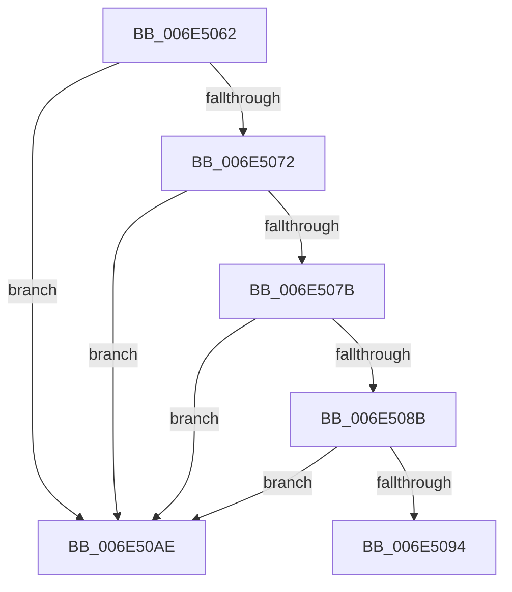

# sub_006E5062

- RVA: `0x006E5062`–`0x006E50B5` (길이 `83` bytes)
- VA: `0x00000001406E5062`
- 실행 섹션: `.text`
- PDB 이름 있음: `아니요`; PDB Function 태그: `아니요`
- unwind 정보 RVA: `0x0007FF00`
- 디코드: `25`개 명령, `83/83` bytes 표시
- 미해석 바이트: `0` (있으면 어셈블리에 `.byte`로 보존)

> 이 문서는 커널 이미지의 기계어와 PDB 기호를 분석해 생성했습니다. 4번과 5번은 함수 원형과 자료형을 바이너리 사용 방식에서 추정한 C 해석이며 원본 소스 복구 결과는 아닙니다.

## 1. Dependencies

- 직접 호출 지점: **1**; 고유 호출 대상: **1**
- 직접 호출자로 확인된 함수: **0**
- RIP 상대 이미지 참조: **0**

### Outgoing calls
- `0x006E50A3` → [CcPostPVCMForDeleteToPartition](../4C/CcPostPVCMForDeleteToPartition_function_004C2DBC.md) (function, `0x004C2DBC`)

### Direct callers
- 이 함수 시작 RVA로 연결되는 직접 call은 확인되지 않았습니다. 간접 호출은 완전히 역산할 수 없습니다.

### Static image references
- 디코드된 RIP-relative 메모리 참조가 없습니다.

## 2. Other-region calls and transfers

- 다른 실행 섹션으로 향하는 call: **0**
- call이 아닌 외부 분기/꼬리 이동: **1**
  - `0x006E50A9` → [CcForEachPrivateVolumeCacheMap + 0xA1](../38/CcForEachPrivateVolumeCacheMap_function_0038967C.md) (`tail-transfer`)

## 3. Assembly (complete function range)

```asm
006E5062  48 8D 8E 50 02 00 00            lea rcx, [rsi + 0x250]
006E5069  48 8B 11                        mov rdx, qword ptr [rcx]
006E506C  48 39 4A 08                     cmp qword ptr [rdx + 8], rcx
006E5070  75 3C                           jne 0x1406e50ae
006E5072  48 8B 41 08                     mov rax, qword ptr [rcx + 8]
006E5076  48 39 08                        cmp qword ptr [rax], rcx
006E5079  75 33                           jne 0x1406e50ae
006E507B  48 89 10                        mov qword ptr [rax], rdx
006E507E  48 89 42 08                     mov qword ptr [rdx + 8], rax
006E5082  48 8B 13                        mov rdx, qword ptr [rbx]
006E5085  48 39 5A 08                     cmp qword ptr [rdx + 8], rbx
006E5089  75 23                           jne 0x1406e50ae
006E508B  48 8B 43 08                     mov rax, qword ptr [rbx + 8]
006E508F  48 39 18                        cmp qword ptr [rax], rbx
006E5092  75 1A                           jne 0x1406e50ae
006E5094  48 89 10                        mov qword ptr [rax], rdx
006E5097  45 33 C0                        xor r8d, r8d
006E509A  48 89 42 08                     mov qword ptr [rdx + 8], rax
006E509E  48 8B CE                        mov rcx, rsi
006E50A1  B2 01                           mov dl, 1
006E50A3  E8 14 DD DD FF                  call 0x1404c2dbc
006E50A8  90                              nop
006E50A9  E9 6F 46 CA FF                  jmp 0x14038971d
006E50AE  B9 03 00 00 00                  mov ecx, 3
006E50B3  CD 29                           int 0x29
```

## 4. C-style interpretation (structured pseudocode)

```c
__int64 __fastcall sub_006E5062(__int64 a1, __int64 a2, int a3)
{
    __int64 result;

    if ((*(unsigned __int64 *)(*(unsigned __int64 *)(v_rsi + 592) + 8)) != (v_rsi + 592)) goto loc_006E50AE;
    if ((*(unsigned __int64 *)(*(unsigned __int64 *)(v_rsi + 592 + 8))) != (v_rsi + 592)) goto loc_006E50AE;
    *(unsigned __int64 *)(*(unsigned __int64 *)(v_rsi + 592 + 8)) = *(unsigned __int64 *)(v_rsi + 592);
    *(unsigned __int64 *)(*(unsigned __int64 *)(v_rsi + 592) + 8) = *(unsigned __int64 *)(v_rsi + 592 + 8);
    if ((*(unsigned __int64 *)(*(unsigned __int64 *)(v_rbx) + 8)) != v_rbx) goto loc_006E50AE;
    if ((*(unsigned __int64 *)(*(unsigned __int64 *)(v_rbx + 8))) != v_rbx) goto loc_006E50AE;
    *(unsigned __int64 *)(*(unsigned __int64 *)(v_rbx + 8)) = *(unsigned __int64 *)(v_rbx);
    a3 = 0;
    *(unsigned __int64 *)(*(unsigned __int64 *)(v_rbx) + 8) = *(unsigned __int64 *)(v_rbx + 8);
    result = CcPostPVCMForDeleteToPartition(v_rsi, 1, a3, a4);
loc_006E50AE:
    return result;
}
```

## 5. (Beta) C Style

```c
int64_t sub_006E5062(int64_t Arg1, int64_t Arg2, int32_t Arg3)
{
    int64_t result;

    if ((*(uint64_t *)(*(uint64_t *)(local_rsi + 0x250) + 0x8)) != (local_rsi + 592)) goto loc_006E50AE;
    if ((*(uint64_t *)(*(uint64_t *)(local_rsi + 0x250 + 0x8))) != (local_rsi + 592)) goto loc_006E50AE;
    *(uint64_t *)(*(uint64_t *)(local_rsi + 0x250 + 0x8)) = *(uint64_t *)(local_rsi + 0x250);
    *(uint64_t *)(*(uint64_t *)(local_rsi + 0x250) + 0x8) = *(uint64_t *)(local_rsi + 0x250 + 0x8);
    if ((*(uint64_t *)(*(uint64_t *)(local_rbx) + 0x8)) != local_rbx) goto loc_006E50AE;
    if ((*(uint64_t *)(*(uint64_t *)(local_rbx + 0x8))) != local_rbx) goto loc_006E50AE;
    *(uint64_t *)(*(uint64_t *)(local_rbx + 0x8)) = *(uint64_t *)(local_rbx);
    Arg3 = 0;
    *(uint64_t *)(*(uint64_t *)(local_rbx) + 0x8) = *(uint64_t *)(local_rbx + 0x8);
    result = CcPostPVCMForDeleteToPartition(local_rsi, 1, Arg3, a4);
loc_006E50AE:
    return result;
}
```

## 6. Execution-region graph

[열기: 2D/3D 그래프와 함수 탐색 컨트롤 패널](../../../control-panel.html?section=text&rva=0x006E5062&view=graph)

- 2D 그래프는 위에서 아래로 흐르고, 3D 그래프는 빈 공간을 드래그해 회전합니다. Shift+드래그는 이동, 휠은 확대·축소, 함수 노드 선택은 대상 보고서 이동입니다.

### Static fallback


